# Predictive Model Documentation - Inteli

## ShokAI — demand forecasting for breast-cancer care in the North Region

### Group 2

<!-- TEAM: replace this comment with the members' full names, in alphabetical order, separated by commas. -->

## Table of Contents

1. [Introduction](#c1)
2. [Objectives and Justification](#c2)
3. [Methodology](#c3)
4. [Development and Results](#c4)
5. [Conclusions and Recommendations](#c5)
6. [References](#c6)
7. [Attachments](#c7)

## <a name="c1"></a>1. Introduction

The partner is a Japanese pharmaceutical company operating internationally, providing pharmaceutical products and services in 32 countries and regions. Its activities cover the research, development, production, and distribution of pharmaceutical products and services, with the objective of improving patients' life expectancy and quality of life through treatments. Drawing on more than 120 years of scientific expertise and a workforce of more than 20,000 employees worldwide [1], the company operates across several therapeutic areas, including primary care, oncology and rare diseases, with a strong and growing focus on oncology innovation.

Its research and development network includes 13 facilities across three countries/regions, complemented by 13 manufacturing plants located in six countries, reflecting a broad international operational footprint [1].

In Brazil, the company employs more than 700 people, with an office in São Paulo, a manufacturing plant in Barueri and a distribution center in Varginha, Minas Gerais. The Barueri plant currently manufactures more than 20 different medicines and is undergoing an expansion expected to triple its production capacity by 2027 [2]. This growing production and distribution structure supports both the domestic market and exports to other Latin American countries.

Within the pharmaceutical market, the company has established a leading position in oncology through its antibody-drug conjugate (ADC) platform. Enhertu (trastuzumab deruxtecan), developed in partnership with AstraZeneca, is the company's leading HER2-directed therapy and has recently expanded into first-line treatment for HER2-positive breast cancer [3]. Building on this platform, the company has set out a five-year plan targeting more than ¥2.3 trillion in oncology revenue by 2030 and a position among the world's five leading oncology companies by 2035 [4].

One of the business challenges faced by the partner in Brazil is the limited visibility of potential patient demand across the private healthcare ecosystem. The company needs to estimate, based on historical data from the ANS (Agência Nacional de Saúde Suplementar), the potential number of patients who may require specific technologies and treatments within the country's main specialized healthcare services [5].

This estimation is currently possible when a health insurance operator and a specialized healthcare service are vertically integrated, meaning both belong to the same group, since the relationship between them is directly observable. For non-vertically-integrated operators, however, no direct allocation data exists indicating where patients receive specialized care, leaving part of the potential demand hidden and limiting the partner's visibility of patient flows within the market.

Several characteristics of the available data add further complexity: direct clinical information is not always available, so some patient characteristics can only be inferred indirectly through proxies, such as using trastuzumab prescriptions as a signal for HER2 status; claims data carries a structural delay of approximately three to six months; and relevant information remains fragmented between hospital and non-hospital datasets. The central challenge, therefore, is to estimate potential demand from non-vertically-integrated operators despite these limitations, using historical ANS data and demographic variables such as region, age group, and sex to address a visibility gap that the available data cannot close on its own [1].

## <a name="c2"></a>2. Objectives and Justification

### 2.1 Objectives

The partner's general objective for this project is to make the potential demand for specialized breast-cancer care visible across the whole Brazilian private health market, including the portion it currently cannot see. The company can already estimate that demand where an operator and a specialized provider are vertically integrated, because the relationship between them is directly observable; for non-vertically-integrated operators, no allocation data records where beneficiaries receive specialized care, so part of the addressable market stays hidden from its Market Access planning.

Four specific objectives follow from it, and they are the objectives this document reports against:

1. **Quantify demand where it is currently invisible.** Produce an estimate of billed specialized-care volume per operator, treatment line, state and month for the North Region, including non-vertically-integrated operators, from historical ANS data alone.
2. **Make the estimate auditable rather than merely available.** Every figure must be traceable to a documented transformation of a public source, reproducible end to end, and accompanied by an explicit statement of what it does and does not measure.
3. **Deliver it in a form the business team can use directly.** A structured prediction base and an interactive dashboard filterable by operator, service, region and patient profile, usable by commercial roles without exposing the underlying model.
4. **Leave a reusable asset.** A documented pipeline that can be re-run on a later ANS release, or extended to another region or therapeutic area, without being rebuilt.

Section 4.1.3(e) records the success criteria agreed for these objectives, and Section 5.1 reports the measured outcome against them.

### 2.2 Proposed Solution

The solution is a classical supervised regression model — no deep learning — that forecasts billed demand volume one month ahead for each `operator × treatment line × state` unit, together with the pipeline that constructs its input and the dashboard that delivers its output.

Because TISS Ambulatorial carries no diagnosis field and no beneficiary identifier, there is no observed label to supervise against. The project therefore constructs one: `volume_demanda_proxy`, the sum of billed item quantities at the `ID_PLANO × treatment_line_primary × UF_PRESTADOR × MES` grain (Section 4.3.6), reached through a TUSS/SBOC crosswalk that establishes breast-cancer relevance from procedure and drug codes (Section 4.2.2.3). That target is a **utilization-volume proxy, not a patient count**, and the distinction is carried through every claim this document makes about it. The treatment-line component of its grain is validated in Section 4.3.11.

An unsupervised stage precedes the supervised one and defines *which* operators enter the model: two K-Means passes [26] over operator-level and operator-municipality activity matrices separate operators with sustained breast-cancer-related billing from those whose presence in the base is marginal (Sections 4.3.1–4.3.4). The supervised stage then predicts *how much* volume the retained population generates, from historical-demand and structural features screened so that every one of them is available strictly before the month it predicts (Section 4.3.6). Three candidates — Linear Regression, Decision Tree and Random Forest — are trained independently and scored on one chronological holdout with one shared evaluation function (Sections 4.3.7–4.3.10).

The outputs are a prediction base (`.parquet`/`.csv`) carrying one row per eligible unit per holdout month, with a demand tier and the flags that qualify it, and a dashboard through which the Market Access team filters those estimates by operator, service, region and patient profile.

### 2.3 Justification

The problem is worth solving because the gap it addresses is structural rather than incidental. Non-vertically-integrated operators are not a marginal share of the market, and no amount of commercial effort recovers demand that is never quantified; the alternative to a model is not a worse estimate but no estimate at all for that segment.

The approach is justified on three grounds. First, **it fits the data that actually exists**. A supervised model needs a label, and this domain supplies none; constructing an explicit, documented volume proxy from billed quantities is the only path to regression here, and stating plainly that it is a proxy is what keeps the result usable rather than misleading. Second, **classical models are the right instrument at this scale**. The signal available is dominated by month-to-month autocorrelation in a panel of a few thousand units; a Random Forest or a regression exposes which features carry that signal and can be explained to a business audience, where a deep model would add opacity and no accuracy. Third, **the constraint that binds is trust, not sophistication**. The deliverable is intended to inform where a commercial team spends its access effort, so an auditable pipeline with an honest account of its own limits — a population-selection leak found and fixed (Section 4.3.6), five metrics scored on a chronological holdout, and a candid report that, at the operator grain, the forests beat last month's value only by small margins on a single held-out window (skill +0.039 for `forest_v1` and +0.086 for `forest_v2`, Sections 4.3.9.7 and 4.3.12.5), so last month's value stays the operational default until that holds on live months (Section 4.4.6) — is worth more to the partner than a higher score whose provenance cannot be inspected.

What distinguishes the solution is therefore its traceability: every number reproduces from public data through documented notebooks, every feature is screened for temporal availability, and every limitation that would change how the output should be read is stated where the output is presented rather than left for the reader to discover.

## <a name="c3"></a>3. Methodology

This project follows **CRISP-DM** (Cross-Industry Standard Process for Data Mining), the reference process model for data mining and data science projects, originally proposed by a consortium of industry practitioners and formalized as a step-by-step guide by Chapman et al. [6] and, in its academic formulation, by Wirth and Hipp [7]. CRISP-DM was chosen over an ad-hoc analytical workflow for three reasons. It is process-neutral with respect to the algorithm ultimately selected. It is the de-facto standard reported across data-mining and data-science practice regardless of industry or tool [8]. And it explicitly separates the business framing of a problem from the technical work of preparing data and fitting a model, a separation that suits a project run with an external business partner and a dataset with no proprietary label.

CRISP-DM organizes a project into six phases, as defined in the original guide [6,7]. The phases are not meant to be executed as a strict waterfall: the model represents them as forming an outer cycle back to Business Understanding once a project is deployed, and it explicitly allows iteration back and forth between any two adjacent phases as new information surfaces, most frequently between Data Preparation and Modeling, and between Modeling and Business Understanding. The six phases are listed below in the order in which they are typically first entered; how each of them was concretely instantiated for this project, and the results obtained at each stage, are documented in Section 4.

1. **Business Understanding** — determining the project's business objectives and constraints from the perspective of the business partner, translating that business problem into a data-mining problem definition, and producing a preliminary project plan against which later phases are validated.
2. **Data Understanding** — collecting the initial data, and using descriptive and exploratory techniques to become familiar with it, identify data-quality problems, form initial hypotheses, and detect early subsets of interest.
3. **Data Preparation** — covering every activity needed to construct the final dataset that will be fed to the modeling tools, including selection, cleaning, construction of derived attributes, integration of separate sources, and reformatting.
4. **Modeling** — selecting and applying one or more modeling techniques, calibrating their parameters to optimal values, and, where the technique requires it, revisiting the outputs of Data Preparation to meet the specific data-form requirements of that technique.
5. **Evaluation** — assessing the model(s) produced against the business success criteria set out in Business Understanding, rather than only against a technical performance metric, and deciding whether the project is ready to move to deployment or whether it must return to an earlier phase.
6. **Deployment** — organizing and presenting the knowledge gained in a form the business partner can use, ranging from a written report to the implementation of a repeatable, maintainable process integrated into the partner's operations.

## <a name="c4"></a>4. Development and Results

### 4.1. Problem Understanding

#### 4.1.1. Industry Context

**Competitors**

In Brazil, the company competes across distinct breast cancer subtypes and treatment lines with three companies whose portfolios overlap with its Market Access agenda. Roche is the main reference in HER2-positive breast cancer, the therapeutic area suggested by the partner as scope for this project, since it holds a consolidated franchise formed by Herceptin, Perjeta, Phesgo, and Kadcyla [9]. Novartis competes in the adjacent segment of hormone-receptor-positive and HER2-negative locally advanced or metastatic disease, where Kisqali is used as an initial endocrine therapy [10]. Gilead Sciences is the closest competitor in TROP2-directed antibody-drug conjugates, since Trodelvy has advanced to first-line treatment of unresectable, locally advanced, or metastatic triple-negative breast cancer [11]. These companies compete primarily through clinical evidence, approved indications, safety, reimbursement, and access, while demand intelligence supports Market Access and commercial prioritization across the same network of health plan beneficiaries and specialized services.

**Business Model**

The partner is a Japanese pharmaceutical company with more than a century of scientific activity that discovers, develops, manufactures, and commercializes prescription medicines, deriving its revenue from patent-protected innovation rather than from generics or volume competition. The business rests on two engines. The first is a mature primary care base, built in Brazil since the launch of Benicar in 2004 and reinforced by products in cardiology, psychiatry, gastroenterology, and pain, which generates recurring cash flow. The second is a high-value franchise in oncology and rare diseases, inaugurated locally with Enhertu in 2022 and complemented by Radicava in 2024 and Nustendi in 2025 [5]. The technological core of this second engine is the company's proprietary antibody-drug conjugate platform, which uses an antibody to deliver a cytotoxic agent directly to tumor cells and is monetized through co-development alliances with AstraZeneca and Merck & Co. that share costs, profits, and milestone payments [1]. An essential characteristic for this project is that the company does not sell to the patient. It sells to wholesalers and distributors, so revenue depends on prescription, on reimbursement decisions taken by health plan operators and on the composition of the referral network, which is exactly why the demand for a demand estimation model originates in Market Access. In Brazil the operation is both commercial and industrial, combining an office in São Paulo, a national sales force, a distribution center in Varginha, and a factory in Barueri that produces more than 20 million units per year and exports over 30% of that output to Latin America [5]. Global revenue of approximately R$ 68.6 billion in fiscal 2025 gives the scale of the effort that the local oncology expansion supports.

**Trends in the Sector**

Three converging movements make the prediction of service potential a current business concern in Brazil. The first is epidemiological pressure. INCA estimates 781 thousand new cases of cancer per year for the triennium of 2026 to 2028, with female breast cancer among the most incident tumors and with marked regional differences related to unequal access to health services [12]. It is relevant for the methodological choice of this project that these official estimates are themselves produced by statistical prediction models rather than by direct counting, which shows that modeling demand from historical data is already accepted practice for planning in Brazilian oncology. The second movement is the reorganization of supplementary health, which has surpassed 52 million beneficiaries and grows mainly through corporate collective contracts and through group medicine and specialized insurers, while cooperatives and self-management operators lose participation [13]. This growth coincides with consolidation and vertical integration of large operators, which improves their internal cost control but reduces external visibility over patient flows in the non-integrated part of the market, and that opacity is the gap this project addresses. The third movement is the consolidation of predictive analytics as a decision-support instrument, advancing on fronts that converge on the same problem. Operators have adopted models to anticipate utilization and control medical costs, while pharmaceutical companies contract specialized data providers, such as IQVIA, to estimate where eligible patients are concentrated, so predictive intelligence has become an input purchased in the market rather than an internal experiment. What sustains both fronts is the growing availability of real-world data, and in the Brazilian case the public repositories maintained by the regulator allow this kind of model to be built without proprietary sources. Two characteristics shape how these models are built. Because the relevant information is administrative and tabular, classical supervised algorithms such as regression and tree ensembles remain the standard choice rather than deep learning, which is consistent with the technical scope defined here. And because the consolidation of the General Data Protection Law and the ongoing discussion of a national legal framework for artificial intelligence are raising the requirements applied to health data, explainability and traceability tend to become criteria of acceptance of the model and not optional refinements.

**Porter's Five Forces**

**Rivalry Among Existing Competitors**

Rivalry is high but concentrated in oncology, where competition turns on clinical evidence, approved indications, market access, and speed of approval. In the breast cancer segments covered here, Roche defends its HER2 franchise, Novartis competes in hormone-receptor-positive and HER2-negative disease with Kisqali, and Gilead contests the TROP2-directed ADC category with Trodelvy, now approved in Brazil for first-line unresectable, locally advanced, or metastatic triple-negative disease [9-11]. Frontiers shift constantly, so an earlier-line approval removes patients from rivals' pools, and in Brazil, competing for a finite set of specialized services and reimbursing operators makes visibility into eligible patients a decision-support asset. Primary care, by contrast, faces generic and price competition, as with the Benicar line, closer to a commodity market.

**Threat of New Entrants**

Barriers are high short-term but only moderate medium-term. Innovative pharma requires a proprietary molecule, capital for a decade of high-failure-risk development, regulatory approval, GMP-compliant manufacturing, and a specialized commercial structure; The company's alliances with AstraZeneca and Merck & Co. show even large firms share these costs [1]. Entry needn't be full-scale, since Asian biotech firms increasingly license ADCs to multinationals, reaching Brazil without local infrastructure, while patent expiry turns today's barrier into tomorrow's opening as biosimilars enter at a lower cost. The exclusivity window is finite, so anticipating demand is most valuable while a product remains protected.

**Bargaining Power of Suppliers**

Supplier power is moderate and asymmetric. Biological and ADC manufacturing depends on few qualified suppliers and contract manufacturers, and switching requires regulatory revalidation, limiting negotiating room. The company's Barueri plant, currently expanding and producing over 20 million units yearly [5], reduces this exposure for part of the portfolio, though complex oncology products still rely on global supply chains. A second, more direct category is data and market intelligence, where the company cites IQVIA, and this market is concentrated among few global players selling subscription data. This is where the project carries weight, since a predictive model built on public regulatory data supplements external intelligence and supports internal decision-making.

**Bargaining Power of Buyers**

This is the strongest force in Brazil and the one the project addresses most directly. The buyer is not the patient but the health plan operator that authorizes and pays for treatment, alongside the hospital and distributor. Operator power is rising structurally, since the sector now exceeds 52 million beneficiaries, with growth concentrating among large group-medicine and specialized insurers while cooperatives and self-management operators lose share [13], so fewer buyers control more of the covered population. Rising costs push operators toward stricter auditing, renegotiation, and vertical integration. A solid regional demand estimate supports more focused engagement than national averages, exactly what the model aims to deliver.

**Threat of Substitute Products**

The threat is moderate, from three directions. Therapeutic substitution is most immediate, since a patient eligible for an ADC may instead receive a CDK4/6 inhibitor, chemotherapy, hormone therapy, immunotherapy, or surgery with radiotherapy, depending on staging, biomarkers, and protocol. Prevention and early diagnosis form a second channel, since INCA's estimates support prevention, early detection, and timely access [12], and broader screening shifts demand toward earlier stages rather than eliminating treatment need. The third is loss of exclusivity, effectively substitution by an equivalent product and the most predictable erosion of value. It is decided by clinical protocol and coverage rules rather than the end consumer, making it less price-sensitive and more sensitive to evidence and institutional recommendation.

#### 4.1.2. SWOT Analysis

SWOT Analysis is a business framework used to evaluate the internal and external factors affecting a company's performance. Each letter represents one concept: S for Strengths, W for Weaknesses, O for Opportunities, and T for Threats.

Below is the diagram illustrating the SWOT Analysis developed for the partner's operations in Brazil.

<div align="center">
Figure 1: SWOT Analysis.

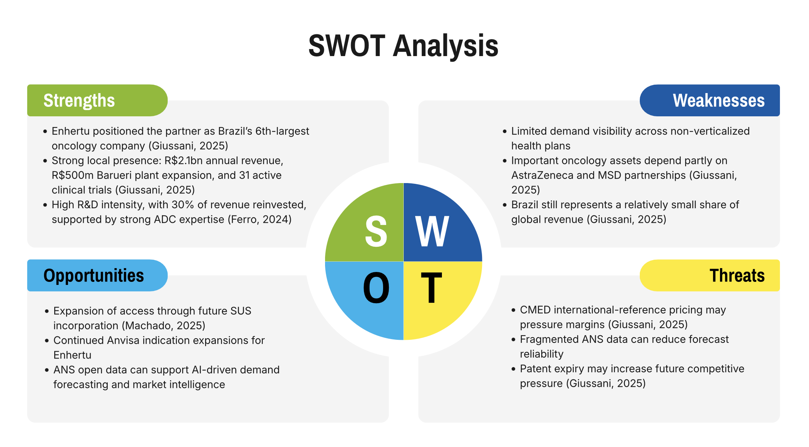

Source: Authors (2026).
</div>

**Concepts:**

**ADC** — Antibody-Drug Conjugate: targeted cancer therapy combining a monoclonal antibody with a cytotoxic drug.

**SUS** — Sistema Único de Saúde: Brazil's publicly funded national healthcare system.

**ANS** — Agência Nacional de Saúde Suplementar: Brazilian regulator responsible for the private health insurance sector.

**CMED** — Câmara de Regulação do Mercado de Medicamentos: Brazilian authority responsible for regulating pharmaceutical prices.

**Anvisa** — Agência Nacional de Vigilância Sanitária: Brazilian health regulatory agency responsible for approving and monitoring medicines.


#### 4.1.3. General Solution Planning

<br>

**a) Available Data**

The project draws on two main data sources. The primary source is the public ANS (Agência Nacional de Saúde Suplementar) database, which covers the Brazilian private health insurance market and provides: consolidated beneficiary counts per health plan and region, TISS outpatient and hospital medical claims records, including billed procedures and drugs broken down by state (UF), health plan data (DADOS_DE_PLANOS), non-hospital and hospital operator and provider registries, and the Unified Private Health Terminology (TUSS), used to decode medical bill entries into readable information. This dataset is publicly accessible and forms the foundation for all modeling work, covering demographic variables such as sex and age group as well as geographic variables at the state level, with a temporal reference anchored at August 2025 for the referral network.

The secondary source consists of confidential business data shared directly by the partner: market share distributions and provider referral network data for health insurance plans and medical providers in the North Region. These files are partner-confidential: they are excluded from version control, and their download link is kept in a local, gitignored `.env` file rather than in any committed notebook or document (Section 4.3.5.4). These files were segmented by region due to file size constraints, and percentages do not sum to 100% because they were originally calculated relative to the full country. Pre-processing to re-proportion the network to the North Region alone is therefore required before any modeling using this source.

Model notebooks and derived outputs from the public ANS pipeline are kept in the project repository and are reproducible in Google Colab, while dashboard authentication and database records are handled through Supabase. No partner-confidential file or link is committed to the repository.

**b) Proposed Solution**

The proposed solution is a classical supervised Machine Learning model, built using algorithms such as Random Forest or Regression, without deep learning, trained on historical ANS data combined with demographic and geographic variables (region, age group, sex) to estimate potential patient demand generated by non-vertically-integrated health insurance operators for specialized healthcare services. Because direct allocation data linking these operators to specialized services does not exist, the model learns from historical patterns in the vertically-integrated segment and uses that learned structure to infer hidden demand in the non-integrated portion of the market. Where clinical test results are not recorded in the data, the model uses prescription records as substitutes to identify which patients are likely eligible for each treatment. 

The model's outputs are delivered through two end products: a structured prediction base (Excel/CSV) listing estimated potential patient volumes per specialized service and region, and an interactive dashboard that allows the partner's market access and pricing teams to filter and explore demand estimates by operator, specialized service, geographic region (state and city), and patient profile (sex and age group). Because the solution's end users come from business and commercial backgrounds rather than data science, the dashboard  will be built around usability, presenting predictions in plain business terms without exposing the underlying model's complexity. 

**c) How the Solution Will Be Used**

The primary users are the partner's market intelligence and pricing team, specifically the Value Strategy Manager, Field Manager, Product Manager and Data Analyst roles. The Data Analyst will use the model to extend demand calculations, currently only possible for vertically-integrated operators, to the full market, covering the non-integrated segment that is currently invisible. The interactive dashboard will allow the broader team to respond to ad-hoc market analysis requests from the commercial team without manual data reprocessing for each request. Filters for region, operator, service, and patient profile allow users to drill into specific segments and produce segmented demand estimates that can be presented to leadership or used to guide commercial prioritization decisions. The documented Jupyter Notebook/Google Colab environment additionally allows the solution to be reproduced, audited, and maintained beyond the original project team.

**d) Benefits**

The solution delivers four principal benefits. First, it closes the visibility gap for non-vertically-integrated operators, which currently represent hidden demand that the partner has no systematic method to quantify. Second, it provides a data grounded basis for resource prioritization, enabling the team to identify high, medium, and low potential operators, regions, and services and to concentrate access effort accordingly, rather than spreading it evenly across a market it cannot see. Third, it reduces manual data reconciliation work by automating the extraction, merging, and standardization of ANS datasets, freeing the Data Analyst from time consuming processes. Fourth, the documented and reproducible model gives the organization a maintainable asset with defined performance metrics, supporting internal decisions on whether to scale or further invest in the capability after the project ends.

**e) Success Criteria**

The solution will be considered successful if it meets the following criteria: 

- The predictive model achieves satisfactory accuracy as measured by standard supervised learning metrics (such as R², MAE, and RMSE) evaluated on a held-out test set, demonstrating that the model generalizes beyond training data;

- the model produces a coherent and plausible demand estimate for non-vertically-integrated operators in the North Region, consistent in order of magnitude with the vertically-integrated benchmark that the partner can already calculate;

- The interactive dashboard correctly reflects model outputs and allows filtering across all required dimensions (operator, service, region, patient profile) without errors, all code is documented and reproducible in Google Colab, with explicit data treatment steps and model performance metrics recorded;

- The structured prediction base (Excel/CSV) is delivered in a format immediately usable by the business team for further analysis or reporting.

<br>

#### 4.1.4. Value Proposition Canvas

The documentation focuses on the Value Strategy Manager, Product Manager, and Data Analyst personas because they represent the main roles directly involved in the project's data analysis, strategic decision-making, and product definition. These personas cover the key stages of the solution, from transforming data into insights to identifying market opportunities and translating those insights into strategic and product decisions.

<div align="center">
Figure 2: Value Strategy Manager Proposition Canvas.

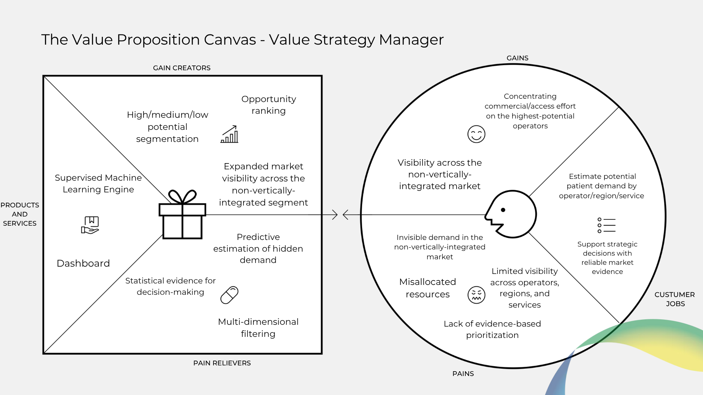

Source: Authors (2026).
</div>

##### Customer Jobs

The main customer job is to estimate potential patient demand by operator, region, and service. The partner's Value Strategy and Market Potential Managers already do this for vertically-integrated health insurance operators; the challenge is extending that same capability to the rest of the market.

Closely tied to this is a second responsibility: supporting strategic decisions with reliable market evidence. An estimate only matters to the team if it can be defended in front of leadership.

##### Customer Pains

The central pain is that demand in the non-vertically-integrated market is structurally invisible. Unlike the vertically-integrated segment, there's no direct allocation data linking demand to a decision for these operators.

That invisibility is compounded by limited visibility across operators, regions, and services, which makes cross-comparisons difficult, and by a lack of evidence-based prioritization. Together, these gaps leave resources misallocated — effort gets spread evenly across a market the team can't fully see, rather than concentrated where it shows the highest potential.

##### Gains

The main expected gain is full visibility across the non-vertically-integrated market, closing the coverage gap that currently limits the team's view.

From there follows a second gain: the ability to concentrate commercial and access effort on the highest-potential operators, turning a raw demand estimate into an actual basis for deciding where to act.

##### Products and Services

The Supervised Machine Learning Engine uses historical ANS data along with demographic and geographic variables to estimate hidden demand across non-vertically-integrated operators.

Alongside it, a Dashboard converts the model's output into a decision-ready view, with filtering across the dimensions the team needs.

##### Pain Relievers

Predictive Estimation of Hidden Demand relieves the invisibility of the non-vertically-integrated market directly, giving the team a demand estimate where none currently exists.

Statistical Evidence for Decision-Making addresses the lack of evidence-based prioritization, letting the team defend its calls with data instead of impressions. Multi-Dimensional Filtering, in turn, relieves the limited visibility across operators, regions, and services by letting users explore demand estimates through the dimensions most relevant to their decisions.

##### Gain Creators

Full-Market Demand Visibility closes the blind spot in the non-vertically-integrated segment, creating the coverage gain directly.

Opportunity Ranking and High/Medium/Low Potential Segmentation then turns that raw estimate into something immediately actionable — letting the Value Strategy or Market Potential Manager concentrate commercial and access effort on the operators most worth pursuing.

##### Overall Value Proposition

The canvas establishes a direct line between the customer's problem and the proposed solution:

> **Invisible demand → Predictive ML estimate + decision-ready dashboard → Full-market visibility → Evidence-based prioritization → Concentrated commercial effort**

**Note on scope:** the market share data provided covers only the North Region. "Full-market demand visibility" should be read as full-market *methodology*, validated at national scale only as data availability allows within the 10-week MVP.

<div align="center">
Figure 3: Product Manager Proposition Canvas.

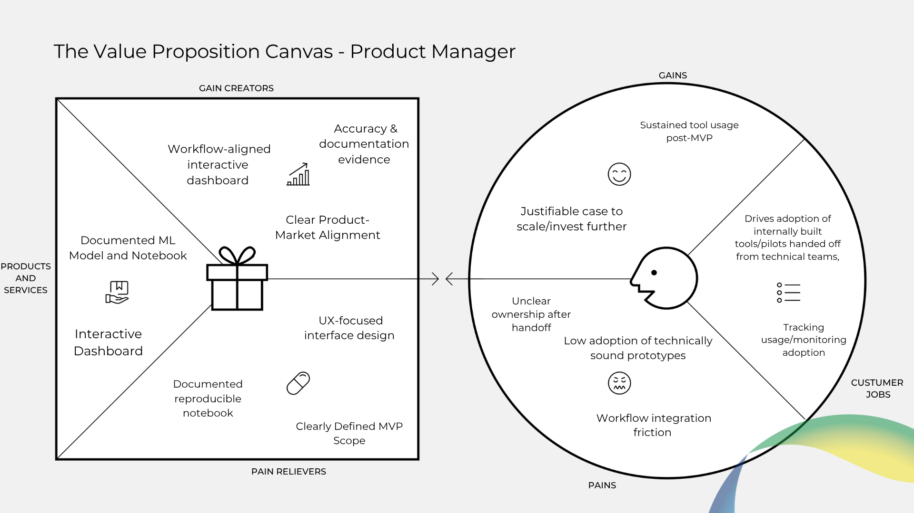

Source: Authors (2026).
</div>

##### Customer Jobs

The main customer job is to drive adoption of analytical tools delivered by technical teams, closely paired with tracking usage and monitoring adoption over time.

For this project, the Product Manager is responsible for ensuring that the predictive model and dashboard move beyond being technical deliverables and become a usable product that addresses a real business need.

##### Customer Pains

The central pain is low adoption of technically sound prototypes. Analytical solutions can be technically successful and still fail to become part of the organization's daily workflows if they aren't designed around users' needs.

This is compounded by unclear ownership after handoff: once a project team delivers a model and its documentation, responsibility for maintaining, iterating on, and evolving the solution can remain undefined. There is also workflow integration friction — even a well-built tool can struggle to gain adoption if it requires users to change their existing routines or work through a separate process.

##### Gains

The main expected gain is sustained tool usage beyond the MVP milestone. Continued adoption is the clearest signal that the solution has become relevant to the organization's ongoing decision-making.

Beyond that, the solution should give the Product Manager a justifiable basis for scaling or further investing in it. Documented model performance, usage evidence, and clear product outcomes provide the tangible grounds needed to evaluate whether the solution should continue or expand.

##### Products and Services

The Documented ML Model and Notebook offers a reproducible record of the model's development, data treatment, and performance metrics, allowing the solution to be understood and maintained beyond the original project team.

Complementing it, the Interactive Dashboard is a user-friendly interface that turns model outputs into an accessible, decision-ready experience for end users.

##### Pain Relievers

A Documented and Reproducible ML Model addresses unclear ownership after handoff by making the model's logic, data treatment, and performance understandable beyond its original developers.

UX-Focused Interface Design tackles workflow integration friction by presenting the model's results through a dashboard built around the needs of decision-makers. A Clearly Defined MVP Scope reduces the risk of scope expansion and helps ensure the project delivers a functional, usable solution within the 10-week cycle.

##### Gain Creators

The Workflow-Aligned Interactive Dashboard supports sustained tool usage by integrating predictive results into a practical interface that decision-makers can use within their existing workflows.

Accuracy and Documentation Evidence gives leadership a tangible basis for evaluating the solution's effectiveness and deciding whether it should be scaled or receive further investment. Clear Product-Market Alignment, meanwhile, keeps the technical solution connected to the original business problem and user needs throughout development.

##### Overall Value Proposition

The canvas establishes a direct line between the Product Manager's challenges and the proposed solution:

> **Adoption risk → Clearly scoped and documented product → Workflow-aligned experience → Sustained usage → Evidence-based decision to scale**

The core value proposition for the Product Manager is the transformation of a technical solution into a usable, maintainable, evidence-backed product capable of sustained adoption and future investment.

<div align="center">
Figure 4: Data Analyst Proposition Canvas.

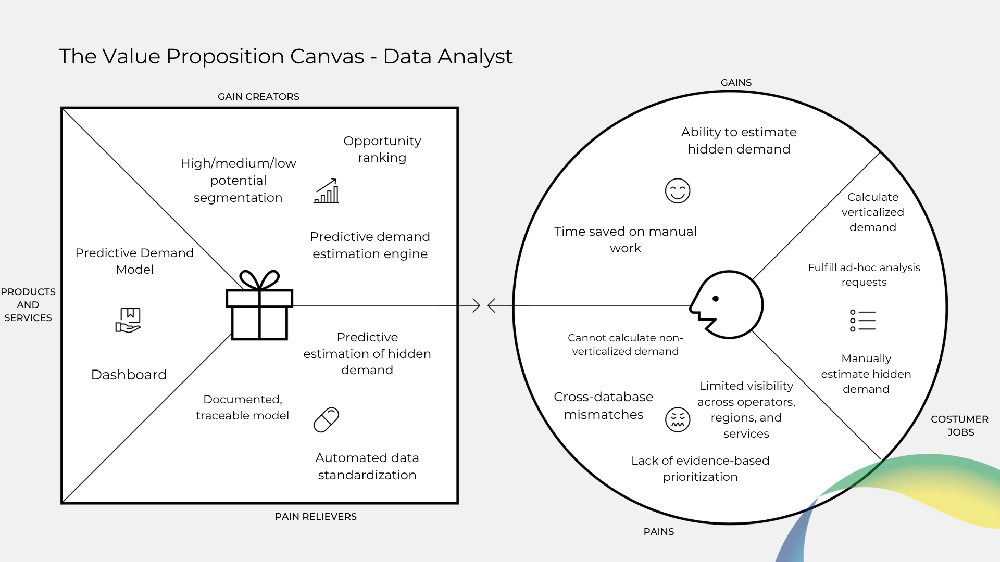

Source: Authors (2026).
</div>

##### Customer Jobs

The main customer job is to extract and merge ANS data to calculate demand for vertically-integrated operators and distribute it across the partner's departments.

The Data Analyst's job also includes fulfilling ad-hoc market analysis requests from the commercial team, and, when required, attempting to manually estimate demand for non-vertically-integrated operators despite lacking the tools to do so reliably.

##### Customer Pains

The first major pain is that demand for non-vertically-integrated operators is currently impossible to calculate. The Data Analyst acknowledges hidden demand exists, but has no estimation tool to translate that intuition into an answer he can give.

This is compounded by mismatches and inconsistencies across different databases, which make even the vertically-integrated-market calculations harder than they should be, and by processing bottlenecks whenever he tries to handle large data volumes manually.

Other pains are the limited visibility across operators, regions, and services, that leave the Data Analyst unable to say where hidden demand is concentrated, and the lack of evidence-based prioritization, since without an estimate to work from he has no defensible basis for flagging which operators or regions deserve attention first.

##### Gains

The main expected gain is the ability to estimate demand for non-vertically-integrated operators, closing the exact gap the Data Analyst names in his own words: "I know the demand exists, but currently I have no way of knowing where exactly it is."

Another important gain is time freed from manual data reconciliation, as automated processing takes over the extracting, merging, and standardizing work he currently does by hand.

##### Products and Services

The proposed value proposition is delivered through two main products and services:

- Predictive Demand Model: trained to estimate demand for non-vertically-integrated operators, extending the Data Analyst's existing vertically-integrated-market calculations to the rest of the market.

- Dashboard: turns the model's output into a usable, filterable view, letting the Data Analyst respond to ad-hoc market analysis requests without manually reprocessing data each time.

##### Pain Relievers

Predictive Estimation of Hidden Demand directly relieves the Data Analyst's inability to calculate demand for non-vertically-integrated operators, giving him an estimate where he previously had none.

Automated Data Standardization relieves both the database mismatches/inconsistencies and the processing bottlenecks, by standardizing and merging data automatically instead of by hand.

Documented, Traceable Model partially relieves the burden of monitoring reliability alone, by making the model's logic and metrics legible enough for the Data Analyst to check without depending on teammates' technical support.

##### Gain Creators

High/Medium/Low Potential Segmentation and Opportunity Ranking create the time-savings gain directly: instead of manually digging through inconsistent databases to gauge where demand might be concentrated, the Data Analyst gets a pre-organized view he can hand off or reference immediately when a request comes in.

Predictive Demand Estimation Engine creates the ability to answer non-vertically-integrated demand questions, turning the Data Analyst's acknowledged blind spot into something he can actually measure and report.

##### Overall Value Proposition

Overall, the canvas establishes a direct relationship between the customer's problem and the proposed solution:

> **Invisible non-vertically-integrated demand + limited visibility + lack of prioritization → Predictive demand model + decision-ready dashboard → Estimated hidden demand, segmented and ranked → Faster, reliable answers to ad-hoc requests, with less manual data work**

#### 4.1.5. Risk Matrix

The Risk Matrix details each risk and opportunity, based on the partner's kick-off meeting and the project's TAPI brief. For each item, the following are presented: description, impact level, probability level, and — for risks — a prevention, mitigation, and contingency plan (with defined timeframes); for opportunities, an anticipation, activation, and scale plan, following the same structure.

**RISKS**

##### **R01 — Absence of laboratory test results as a data source**

**The risk:** *Impossibility of accessing clinical laboratory results (e.g., HER2 status) to confirm a patient's eligibility for specific oncology treatments.*

**Risk description:** The project relies exclusively on TISS/ANS medical claims data, which record billed procedures and drugs but not clinical exam results. Without lab-confirmed eligibility, the team must infer whether a patient is a "potential patient" indirectly, using comparable drugs (e.g., Trastuzumab) and SBOC (Brazilian Society of Clinical Oncology) treatment guidelines as proxies.

**Impact level — Extremely High**: The entire definition of "potential patient" — the core unit of analysis for the whole project — depends on this proxy. Any distortion here propagates through every downstream metric, forecast, and business decision built on top of the model.

**Probability level — Very Likely**: This is not a hypothetical scenario but a structural characteristic of the chosen data source. The absence of lab results is confirmed to occur across essentially all TISS claims records, as validated during the kick-off meeting.

**Prevention Plan:**

* Map, together with the SBOC guidelines, which drugs and procedures can reliably serve as eligibility proxies for each treatment line, before starting any modeling.

* Validate this proxy list with the business team (the partner's point of contact) before it is used to define the model's target variable.

**Mitigation Plan:**

* Adjust proxy weights and criteria as distortions are identified during exploratory data analysis, cross-checking results with INCA reports whenever possible.

* Re-validate the proxy list within 5 business days whenever a new treatment line or drug category is added to the project scope.

**Contingency Plan:**

* Explicitly document the proxy's limitations in the final report, within 2 business days of finalizing the model.

* Communicate to managers that potential-patient estimates should be read as approximations, not exact counts.

##### **R02 — Inconsistency between hospital and non-hospital provider files**

**The risk:** *Divergence between the datasets covering hospital and non-hospital healthcare providers.*

**Risk description:** A technical inconsistency between the hospital and non-hospital provider files was acknowledged by the partner's point of contact during the kick-off meeting, but remained unresolved at project start. Left unaddressed, this inconsistency can distort the provider-level counts and rankings the model is meant to produce.

**Impact level — High**: The model's most useful output — the provider-level ranking used by field managers — is built directly from these two files. Any unresolved inconsistency degrades the reliability of the project's central deliverable.

**Probability level — Medium**: Resolution depends partly on the partner's own correction timeline, which the team cannot fully control. Early, formal follow-up materially reduces the odds the inconsistency remains unresolved through delivery.

**Prevention Plan:**

* Formally request and track the correction timeline with the partner, following up on a weekly basis.

* Implement independent cross-checking routines (record counts, duplicate keys, provider types) before any modeling begins.

**Mitigation Plan:**

* Manually normalize both files using business rules agreed with the partner's team, isolating inconsistent records in a dedicated exceptions dataset, within 5 business days of detecting the divergence.

**Contingency Plan:**

* Proceed with modeling using only the file considered most reliable, as defined jointly with the partner, within 3 business days of the decision.

* Clearly flag the limitation's impact on model performance metrics in the final report.

##### **R03 — Statistical noise from excessive granularity**

**The risk:** *Loss of predictive robustness caused by over-segmenting the data.*

**Risk description:** Segmenting data simultaneously by procedure, day, and municipality can reduce the number of beneficiaries per cell to a point where algorithms such as Random Forest can no longer learn real patterns, increasing the risk of overfitting to noise.

**Impact level — High**: A model trained on statistically unreliable cells produces forecasts that cannot be trusted by the business team, undermining the credibility of the project's central deliverable.

**Probability level — Likely**: Given the scope already discussed at kick-off — a specific disease within a market limited to about 25% of the population, further narrowed to the North Region for the MVP — fine-grained cells are likely to fall below a statistically sound sample size unless actively managed.

**Prevention Plan:**

* Validate, during feature engineering, the distribution of beneficiaries per cell and define a minimum observation threshold before accepting any level of granularity.

**Mitigation Plan:**

* Aggregate data to a higher hierarchical level (e.g., from municipality to insurance operator, or from a specific procedure to an SBOC category) whenever a cell falls below the defined threshold, within 3 business days of detecting the issue.

**Contingency Plan:**

* Fall back to the provider (hospital) level of granularity — already indicated by the partner as the most actionable — abandoning finer cuts that compromise statistical robustness, before the final modeling round.

##### **R04 — Difficulty categorizing TUSS codes via SBOC guidelines**

**The risk:** *Complexity in translating thousands of TUSS procedure codes into clinically coherent model variables.*

**Risk description:** Translating TUSS billing codes into categories aligned with SBOC clinical guidelines directly affects the quality of the variables used in the model; inconsistent or overly generic categorization introduces noise and reduces clinical relevance.

**Impact level — Moderate**: This affects variable quality and, indirectly, model accuracy, but does not compromise the project's core deliverables the way a broken proxy or corrupted dataset would.

**Probability level — Medium**: The categorization is achievable using the publicly available SBOC guidelines, but it is a labor-intensive task with a real risk of inconsistent judgment calls across team members.

**Prevention Plan:**

* Build a categorization dictionary, supported by the public SBOC guidelines, validated by at least two team members before it is used in modeling.

**Mitigation Plan:**

* Iteratively review categories that generate the most noise in results, adjusting the aggregation level based on accuracy tests, on a weekly basis during the modeling phase.

**Contingency Plan:**

* Use a more generic, widely accepted categorization (by type of oncology procedure) if there is insufficient time for full refinement, decided no later than 2 weeks before the final delivery deadline.

##### **R05 — Dashboard too complex for non-technical users**

**The risk:** *Low adoption of the dashboard caused by a mismatch between its complexity and the users' technical profile.*

**Risk description:** The dashboard's end users — value strategy managers and field managers — are not data scientists and, according to the kick-off, expect a tool in plain, non-technical language. A dashboard built with excessive technical complexity risks being underused or misinterpreted.

**Impact level — High**: Adoption by business users is the entire purpose of the dashboard deliverable. If it is not used, the project's commercial value drops sharply, regardless of how accurate the underlying model is.

**Probability level — Unlikely**: This requirement was explicitly and clearly communicated by the partner during kick-off, giving the team both the information and the time needed to design around it from the start, which materially lowers the likelihood of an inaccessible tool.

**Prevention Plan:**

* Validate screen prototypes with the business team before final implementation, prioritizing a small number of core indicators (e.g., patient potential by provider and region) over an excess of technical metrics.

**Mitigation Plan:**

* Simplify labels, add contextual explanations, and revise technical variable names into business terms, iterating based on user feedback within 5 business days of each review round.

**Contingency Plan:**

* Reduce the dashboard to a minimal version with only the most actionable indicators (provider ranking, potential map), finalized at least 1 week before delivery if there is no time to refine the full experience.

##### **R06 — Inadvertent disclosure of the partner's name or sensitive data**

**The risk:** *Unauthorized publication of the partner's name, or of real market data, in public channels.*

**Risk description:** When publishing code, notebooks, or the final report to personal portfolios, team members could unintentionally mention the partner by name or reproduce sensitive market data, breaching the confidentiality agreement established during kick-off.

**Impact level — Extremely High**: A confidentiality breach directly damages the trust relationship between Inteli and the partner and could carry legal and reputational consequences for both institutions.

**Probability level — Unlikely**: The confidentiality rule was clearly communicated and is easy to apply through a review checklist, but human error in informal, personal publications remains a realistic possibility.

**Prevention Plan:**

* Define, before any publication, a review checklist that replaces the partner's name with generic terms (e.g., "a pharmaceutical company") and removes any real market data, keeping only synthetic or anonymized examples.

**Mitigation Plan:**

* If an improper mention is identified after publication, remove or correct it immediately and log the incident for the faculty advisors, within 24 hours of detection.

**Contingency Plan:**

* Keep the most sensitive materials in private repositories, making only generalized versions of the code and methodology publicly available, reviewed and confirmed before the project's public release.

##### **R07 — Improper use of the official brand or logo on the dashboard**

**The risk:** *Use of an incorrect, distorted, or outdated version of the partner's logo.*

**Risk description:** Despite the creative freedom granted for colors and fonts, the dashboard or final report could use an incorrect or outdated version of the official logo, or apply it in a way that violates minimum brand proportions.

**Impact level — Low**: This is a cosmetic/institutional issue that does not affect the model's accuracy or the dashboard's functionality, though it can slightly affect the perceived professionalism of the deliverable.

**Probability level — Very Unlikely**: The official logo file is a single static asset that, once obtained and reviewed one time, is unlikely to be misused again.

**Prevention Plan:**

* Request the official high-resolution logo file at the start of the project and confirm any minimum proportion or clear-space guidelines.

**Mitigation Plan:**

* Visually review every dashboard screen before final delivery, specifically checking correct brand usage, within 3 business days of the delivery deadline.

**Contingency Plan:**

* If there is doubt about the correct logo version, use a text-only version of the partner's name until validation is obtained, applied immediately upon detection.

##### **R08 — Scope mismatch between national (INCA) and private-market (TISS/ANS) data limits generalization and validation**

**The risk:** *Structural mismatch between the population covered by national cancer statistics and the population covered by the project's private-market data source.*

**Risk description:** INCA (Brazil's National Cancer Institute) periodically publishes official incidence and prevalence data for breast cancer covering the entire Brazilian population — both the public (SUS) and private healthcare systems — while the project relies exclusively on TISS/ANS data from the private healthcare market, which covers only about 25% of the population. This scope difference, raised during the kick-off discussion on using INCA as a benchmark and on the project's systematic biases, limits the ability to generalize the model's estimates to the total population or to use INCA reports as a direct quantitative validation source without first segmenting or adjusting the numbers.

**Impact level — Extremely High**: This affects the project's ability to credibly claim external validation of its results, which is central to how the model's outputs will be trusted and used by decision-makers.

**Probability level — Likely**: This is a known, structural characteristic of the two data sources rather than an occasional error, so a scope mismatch will occur whenever a direct comparison is attempted, unless actively managed.

**Prevention Plan:**

* Map in advance which INCA indicators are actually comparable to TISS/ANS data (e.g., only incidence estimates, not full treatment series), documenting which population each source represents before any comparison is made.

**Mitigation Plan:**

* When a comparison is necessary, apply segmentation or proportionality factors estimated from the private-market share (\~25%), always accompanied by an explicit methodological note, within 5 business days of any benchmarking exercise.

**Contingency Plan:**

* Use INCA reports only as qualitative/contextual reference in the final report, without incorporating them as a quantitative validation metric, if the two data sources cannot be reconciled with statistical confidence — decided no later than 2 weeks before final delivery.

**OPPORTUNITIES**

##### **O01 — Uncovering hidden demand in non-vertically-integrated operators expands the addressable market**

**The opportunity:** *Identifying and quantifying patient potential in operators where the partner currently has no visibility into real demand.*

**Opportunity description:** This is the central objective defined in the TAPI: estimating patient potential in non-vertically-integrated operators, where the company today cannot see demand directly because it lacks the internal allocation data that vertically integrated operators have. If successful, the model turns a commercially "invisible" segment of the market into a quantified set of leads — hospitals and operators worth approaching — with a direct effect on the potential sales volume of oncology drugs such as Enhertu.

**Impact level — Extremely High**: This is not a peripheral benefit but the reason the project exists. Realizing it well changes what the company can see and act on commercially, with a direct line to revenue rather than just to internal efficiency or brand perception.

**Probability level — Very Likely**: This outcome does not depend on external validation or on reconciling scope with other data sources — it is the direct output of the core model the team is already building, so as long as a working model is delivered at all, some version of this opportunity is captured.

**Anticipation Plan (preparing the ground before the model/dashboard are finalized):**

* Treat hidden-demand detection as the project's central deliverable from week one, prioritizing it over complementary analyses (e.g., health tourism mapping), completed by the time feature engineering begins.

* Validate the target variable definition (what counts as a "potential patient") with the business team before large-scale modeling starts.

**Activation Plan (making sure the opportunity materializes):**

* Translate the model's output into a directly actionable format for field managers, such as a ranked list of providers by estimated potential, validated with the business team before final delivery.

**Scale Plan (maximizing impact in future cycles):**

* Even if the initial estimate is not perfect, deliver at least a reliable order of magnitude (ranking) that already guides real commercial decisions, treating further refinement of the estimate as a target for future cycles rather than a blocker for this one.

##### **O02 — SBOC guidelines as a robust forecasting filter**

**The opportunity:** *Using a clinically validated "gold standard" to filter relevant procedures and reduce noise in the dataset.*

**Opportunity description:** The SBOC guidelines function as an already validated clinical standard, allowing the team to filter relevant procedures and consistently reduce noise in the data, which can meaningfully increase model accuracy compared to a purely exploratory approach.

**Impact level — Extremely High**: This decision underlies the entire feature engineering approach, so its effect compounds across every downstream metric and forecast the model produces.

**Probability level — Likely**: The SBOC guidelines are already public and were explicitly recommended by the partner as the project's methodological backbone, making this a low-friction, high-confidence opportunity to capture.

**Anticipation Plan (preparing the ground before the model/dashboard are finalized):**

* Structure feature engineering around SBOC categories from the first weeks of the project, treating the guidelines as the organizing axis of the database, completed within the first 2 weeks of the modeling phase.

**Activation Plan (making sure the opportunity materializes):**

* Document this methodological decision clearly in the final report, evidencing the accuracy and clinical legitimacy gains it provides, before the mid-project checkpoint.

**Scale Plan (maximizing impact in future cycles):**

* Extend the same SBOC-based categorization approach to future therapeutic areas (e.g., lung cancer), reusing the same mapping logic to reduce the marginal cost of future model iterations.

##### **O03 — Mapping "health tourism" reveals expansion areas**

**The opportunity:** *Identifying patient travel patterns to uncover new, unprioritized commercial expansion regions.*

**Opportunity description:** Mapping patterns of patients traveling between cities and states to seek oncology treatment can reveal regions with expansion potential not yet prioritized by the partner, as illustrated during kick-off by the case of Sergipe versus Manaus.

**Impact level — Moderate**: This analysis is a valuable strategic input, but it is complementary to — not a replacement for — the core provider-level demand model, so its impact is real but bounded.

**Probability level — Unlikely**: The analysis is acknowledged by the partner as genuinely complex, and the team explicitly agreed it may not be fully achievable within the project's 10-week timeline.

**Anticipation Plan (preparing the ground before the model/dashboard are finalized):**

* Start with a simplified version of the analysis, cross-referencing the beneficiary's municipality of residence with the provider's municipality, without attempting to solve the full complexity of the phenomenon from the outset, scoped within the first 3 weeks.

**Activation Plan (making sure the opportunity materializes):**

* Treat this as a complementary/optional analysis, delivered only if the main schedule allows, evaluated at the mid-project checkpoint.

**Scale Plan (maximizing impact in future cycles):**

* If successful, extend the travel-pattern mapping to other regions in future project cycles, connecting it directly to the partner's commercial expansion planning.

##### **O04 — Reusable year-over-year analytical asset reduces the cost and time of strategic decisions**

**The opportunity:** *Institutionalizing an expert-opinion-based annual process into a documented, reusable model and dashboard.*

**Opportunity description:** The partner's commercial strategy is reviewed annually and today depends heavily on expert opinion. By delivering a documented model and dashboard, the project institutionalizes this process: with each new data cycle, the company can re-run the pipeline instead of manually redoing the entire analysis, generating a recurring efficiency gain and freeing the internal team's time for higher-value decisions.

**Impact level — Extremely High**: A reusable asset changes the company's annual decision-making cost structure on an ongoing basis, not just for a single cycle, which is a materially larger impact than a one-off analytical deliverable.

**Probability level — Very Likely**: This outcome follows almost directly from properly documenting the pipeline, which is fully within the team's control and does not depend on external factors.

**Anticipation Plan (preparing the ground before the model/dashboard are finalized):**

* Document the pipeline (data, features, model, dashboard) explicitly for future reuse by the partner's team, not just as a one-time delivery notebook, drafted alongside each pipeline component as it is built.

**Activation Plan (making sure the opportunity materializes):**

* Deliver a short maintenance guide alongside the source code, aligned with what was agreed on publication and restricted content, finalized before final delivery.

**Scale Plan (maximizing impact in future cycles):**

* Even if full automation is not achieved within the project timeline, leave a well-documented, reproducible notebook so the internal team can adapt it in subsequent cycles without external support.

##### **O05 — Replicable pipeline enables future expansion to other regions and therapeutic areas**

**The opportunity:** *Turning the MVP's current scope limitations into a documented path for future expansion.*

**Opportunity description:** Although the MVP is restricted to the North Region and to breast cancer (with lung cancer as a secondary option), a well-structured, modular pipeline can be reapplied to other regions and other therapeutic areas at a lower marginal cost, extending the return on the company's initial investment in the project beyond its original academic scope.

**Impact level — High**: This opportunity extends the value of the project well beyond the original MVP, effectively turning a one-time deliverable into a reusable expansion engine for the company.

**Probability level — Medium**: Realizing this fully depends on the team explicitly separating reusable pipeline components from scope-specific logic, which requires deliberate design effort rather than happening automatically.

**Anticipation Plan (preparing the ground before the model/dashboard are finalized):**

* Design the pipeline separating clearly reusable parts (data engineering, model architecture, dashboard logic) from scope-specific parts (SBOC mapping for breast cancer, North Region cut), documenting these dependencies explicitly, completed by the pipeline's first stable version.

**Activation Plan (making sure the opportunity materializes):**

* Record a replication roadmap for new regions or diseases in the final report, even if the replication itself is not executed within the project timeline, finalized before final delivery.

**Scale Plan (maximizing impact in future cycles):**

* Use the documented roadmap as the basis for a follow-up project phase, if the partner chooses to extend the initiative to additional regions or therapeutic areas in future cycles.

| RISKS | | | | | | | OPPORTUNITIES | | | | | | |
|---|---|---|---|---|---|---|---|---|---|---|---|---|---|
| IMPACT | PROBABILITY | | | | | | PROBABILITY | | | | | | IMPACT |
| | | Very unlikely | Unlikely | Medium | Likely | Very likely | Very likely | Likely | Medium | Unlikely | Very unlikely | | |
| | Extremely high | | Inadvertent disclosure of the partner's name or sensitive data (R06) | | Scope mismatch between national (INCA) and private-market (TISS/ANS) data limits generalization and validation (R08) | Absence of laboratory test results as a data source (R01) | Reusable year-over-year analytical asset reduces the cost and time of strategic decisions (O04); Uncovering hidden demand in non-vertically-integrated operators (O01) | SBOC guidelines as a robust forecasting filter (O02) | | | | Extremely high | |
| | High | | Dashboard too complex for non-technical users (R05) | Inconsistency between hospital and non-hospital provider files (R02) | Statistical noise from excessive granularity (R03) | | | | Replicable pipeline enables future expansion to other regions and therapeutic areas (O05) | | | High | |
| | Moderate | | | Difficulty categorizing TUSS codes via SBOC guidelines (R04) | | | | | | Mapping "health tourism" reveals expansion areas (O03) | | Moderate | |
| | Low | Improper use of the official brand or logo on the dashboard (R07) | | | | | | | | | | Low | |
| | Very low | | | | | | | | | | | Very low | |

Link to the Risk Matrix (Excel format): https://docs.google.com/spreadsheets/d/1Y1Pe2thKdJAZeIp7zD37jmbwY5ZvvzIphxh_nTAyYSc/edit?usp=sharing

Elaborated by the group.

#### 4.1.6. Personas

The personas built in this document are proto-personas, as we have no direct access to primary research with real users for now. In the case of this project, most of the information that grounds the personas came from two main sources, the TAPI document, provided by the partner at the beginning of the project, which formally defines the problem, the objectives, the MVP scope, and the expected stakeholders; and the questions and answers recorded during the kick-off meeting with the partner, which clarified points the TAPI did not detail, such as who actually accesses the dashboard, how often decisions are reviewed, and which technical assumptions are acceptable. Additionally, some information came from a preliminary conversation with the partner's manager, and a minor part was built by inference, supported by external research on how this type of role typically operates in similar pharmaceutical market contexts.

<div align="center">
Figure 5: Value Strategy Manager Persona.


Source: Authors (2026).
</div>

We chose Lucas because he represents the person who converts model output into commercial resource allocation. This persona matters from the start because his needs, a consolidated dashboard and a way to trust statistical estimates over subjective judgment, define what "success" looks like from a leadership perspective. Choosing him early means the model's explainability and calibration requirements get shaped by his standards from day one, rather than becoming an afterthought.

*Uncertainties: "Value Strategy Manager" may be a functional label rather than Lucas's literal job title. Our research points to a real title at the company around Account Management, Evidence Generation, Value and Access, but we can't confirm this maps exactly to Lucas's role. His location (Barueri, SP) is grounded in the company's actual Brazil headquarters, but we don't know if this specific function sits there. His major, tool set, annual review cadence, and quote are constructed to be plausible, not confirmed facts about an actual person or process.*

<div align="center">
Figure 6: Data Analyst Persona.


Source: Authors (2026).
</div>

We chose Pedro because he embodies the current-state problem the entire project exists to solve: manually merging inconsistent databases, hitting processing bottlenecks, and having no method to estimate demand for non-vertically-integrated operators. This persona matters at the start because his frustrations are the technical requirements the model has to satisfy.

*Uncertainties: We could not find a confirmed, publicly listed title at the company matching "Data Analyst" for this internal function. It may sit under a broader Business Intelligence or IT structure we don't have visibility into. His tools (SQL, Python, BI tools), major (Computer Science), and specific day-to-day tasks (handling ad-hoc commercial requests, merging ANS data manually) are reasonable inferences for this kind of role, not confirmed details about a real employee or team structure.*

<div align="center">
Figure 7: Field Manager Persona.


Source: Authors (2026).
</div>

We chose Jenifer because she is the person who turns a ranked opportunity into an actual hospital visit and negotiation. This persona matters early on because her pain points surface real operational constraints, namely data going stale between when it's pulled and when she's in the field, and a pacing mismatch with Lucas's review cycle. Choosing her ensures data freshness, output format, and update cadence get designed into the MVP rather than discovered after launch.

*Uncertainties: The confirmed real-world equivalent title we found was "District Manager," not "Field Manager." We don't know if these are the same role or distinct ones at the company. Her location (Manaus, AM) is inferred from the project's North Region focus, not confirmed as where field managers are actually based. Her major, CRM tool usage, the specific operator profiles she prioritizes (self-management, cooperatives, self-insurance), and the described mismatch with Lucas's timeline are constructed assumptions, not verified facts.*

<div align="center">
Figure 8: Product Manager Persona.


Source: Authors (2026).
</div>

We chose Ricardo because he represents the executive layer that consumes the dashboard's output at a higher level of abstraction than Lucas's day-to-day commercial use. This persona matters because his need for forward-looking, citable signals to justify portfolio prioritization sets a requirement the other personas don't: the tool must support aggregation and summarization at the therapeutic-line level, not just operator/region granularity.

*Uncertainties: "Product Manager" may be a functional label rather than a confirmed job title at the company; our research suggests this kind of portfolio-strategy role could sit under Marketing, Business Development, or a dedicated Portfolio Management function, but we can't confirm which. His location (Barueri, SP) follows the same assumption as Lucas's, tied to the company's Brazil headquarters, not confirmed for this specific function. His major, tool set, review cadence, and quote are constructed to be plausible for this type of role in similar pharmaceutical contexts, not confirmed facts about a real employee.*

<div align="center">
Figure 9: Patient Persona.


Source: Authors (2026).
</div>

We chose Camila because the core problem is fundamentally about people like her, statistically invisible to demand forecasting because their insurance operator isn't vertically integrated with their treatment provider. She isn't a user of the model, and we say so directly on her card, but including her keeps the team's technical choices anchored to a real human stake rather than becoming a purely abstract data engineering exercise.

*Uncertainties: Hospital Saúde da Mulher (HSM) is a real, confirmed hospital in Belém offering private oncology care, but we do not actually know whether HSM's provider network is linked to a vertically-integrated or non-vertically-integrated operator. That specific detail is assumed for narrative purposes, not verified. We also don't know Camila's age, treatment stage (new, ongoing, or already-treated), or specific insurance plan. All of these are placeholders standing in for a category of patient, not a real, data-backed individual.*

##### 4.1.6.1. Core Personas

To define the core personas for this project, we adopted the classification model proposed by Cooper et al. [14], which distinguishes primary personas, those for whom the interface should be optimized. In addition, we applied the prioritization criteria recommended by the Nielsen Norman Group [15], which evaluate each candidate persona along three dimensions: actual frequency of interaction with the system, distinctiveness of needs relative to other personas, and the existence of empirical evidence supporting the profile.

<div align="center">
Figure 10: Core Personas.


Source: Authors (2026).
</div>

Among the six profiles identified during exploratory conversations with the company and personal research, only two meet all three criteria simultaneously: the **Data Analyst** and the **Value Strategy Manager**. Both were directly named by the company as actual dashboard users and show distinct usage frequency, so they were defined as the project's primary personas.

##### 4.1.6.2. Other Personas

The **Product Manager** was classified as a secondary persona as his involvement with the tool is expected but sporadic, and oriented toward a more executive layer of decision-making, which does not justify dedicated interface optimization, though it should be considered when defining granularity and summarization levels for the visualizations.

The **Field Manager** was defined as a negative persona; although a direct beneficiary of decisions generated by the tool, she has no direct interaction with the dashboard, as research indicates this information reaches her already processed by a third party. Including her as an active persona would induce unnecessary design decisions.

The **oncology patient** was defined as a negative persona. The patient won't have interaction with the solution at any point in the flow, as the tool was explicitly confirmed by the company as an internal commercial instrument. Rather, the patient functions as the object of prediction, the demand the model estimates.

#### 4.1.7. User Journeys

A user journey map is a visualization of the process a person goes through in order to accomplish a goal, organized as a sequence of phases and read through what the person does, thinks and feels along the way [16]. The map presented here describes the future state of that process, meaning the routine as it is expected to happen after the solution is in place, and not the routine as it exists today. The current state was already documented in the previous sections, where the pains of each persona were described from the Value Proposition Canvas and from the risk analysis, so repeating it as a journey would add little. Mapping the future state instead allows the team to check whether the product being built actually removes the obstacles that were identified, and to turn that check into a requirement rather than an assumption.

The map follows the single point of view criterion recommended by the Nielsen Norman Group, which states that a journey should represent one actor pursuing one goal in one scenario, since mixing several actors in the same map produces an average experience that belongs to no one [16]. For that reason each mapped persona receives its own board, and the other actors appear inside the map only at the moment where their involvement is decisive.

##### Choice of the mapped persona

Pedro Vaz, the Data Analyst, was mapped first because he is the actor with the highest frequency of interaction with the solution and the one whose routine changes the most because of it. Section 4.1.6.1 classified him as a primary persona using the criteria of interaction frequency, distinctiveness of needs and available evidence [15], and Cooper et al. [14] define the primary persona as the one for whom the interface should be optimized, which makes him the natural starting point for the mapping.

There is also a practical reason. Pedro is the only actor who touches every stage of the process, from the arrival of the request to the export of the result, so his journey is the only one that exposes the full path of the solution. The other personas enter at specific points and see only a part of it. Mapping him first therefore produces the complete flow, and the maps of the remaining personas can be read as segments of the same process seen from a different position.

<div align="center">
Figure 11: User Journey.

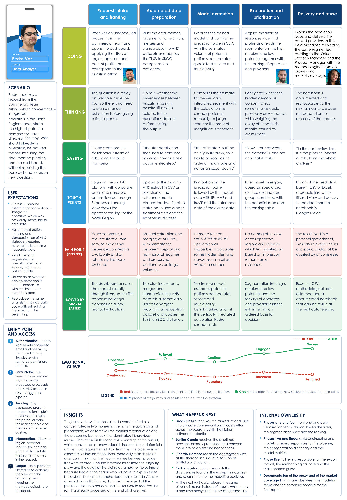

Source: Authors (2026).
</div>

##### How the board is organized

The five phases were defined by the team from the analytical routine described: request intake and framing, automated data preparation, model execution, exploration and prioritization, and delivery and reuse. The same five phases will be used in the remaining journeys, so the boards stay comparable and the reader can look at a single column and see how different actors experience the same moment.

The first three rows follow the NN/g model, which reads the journey through what the user is doing, thinking and saying at each moment [16]. Three further rows were added by the team. The touch points row was included because a journey describing only intentions does not show how the person actually reaches the data, so it records the concrete interaction with the platform at each phase. The pain point row restates the obstacle that existed before the solution, and the row below it states how the solution addresses that same obstacle at that same point of the process. Placing the two in the same column is what allows the map to answer how the current state becomes the future state phase by phase, instead of leaving that relationship implicit.

The scenario box fixes the situation being mapped, which is a request from the commercial team asking which non vertically integrated operators in the North Region concentrate the highest potential demand for HER2 directed therapy. Fixing one concrete request keeps the map from drifting into a generic description of the product. The user expectations box lists what Pedro brings to that situation, and the entry point and access box breaks the interaction into five steps of authentication, data intake, reading, interrogation and output, which answers how the user reaches the information rather than only what he obtains from it.

##### Where the other actors appear

Three of the remaining personas are placed at the single phase where their involvement is decisive, so the map stays legible and the single point of view criterion is preserved. Their photograph sits in the corresponding column, and the consequences of the interaction for all of them are gathered in the what happens next box.

**Lucas Ribeiro**, the Value Strategy Manager, appears at request intake, because the commercial questions that start Pedro's work originate from the strategic allocation decisions he is responsible for. He is also a primary persona and reads the same segmentation directly, which is why he receives a journey map of his own rather than being represented only here.

**Ricardo Campos**, the Product Manager, appears at exploration and prioritization. His use is expected but sporadic and oriented toward an executive layer of decision, as established in section 4.1.6.2, so he consults the aggregated view at the therapeutic line level rather than the operator by operator detail that Pedro works with. 

**Jenifer Garcia**, the Field Manager, appears at delivery and reuse, which is the phase where the output leaves the platform. She was classified as a negative persona in section 4.1.6.2 because the information reaches her already processed by a third party, and the map reflects that distinction rather than softening it. She has no touch point with the interface, does not sign in and does not apply filters, yet she is the destination of the ranking, so the doing cell of that phase names her as the direct recipient of the exported providers and the row below it records that the export reaches her with the methodological note attached. Placing her here makes visible the point where the estimate stops being an analytical result and becomes a hospital visit and a negotiation, which is the moment the model produces commercial effect. It also sets a requirement on the output format, since a ranking she receives without ever opening the platform has to be legible on its own, in plain business terms and with its limits stated in the same document.

Two phases carry no other actor, and in both cases the absence is informative. Automated data preparation shows that the standardization and reconciliation work is invisible to the rest of the team and exists only within the Data Analyst's routine, which is precisely the burden the solution is meant to reduce. Model execution shows that the estimate is produced without anyone else intervening, since the result only reaches the other personas after it has been read and segmented in the following phase.

##### What the map produced as requirements

The insights box translates the journey into obligations for the product. The value delivered to Pedro concentrates in two moments, the automation of preparation and the segmented reading of the output, and two requirements follow from them. The pipeline has to expose its validation steps, because he only trusts the result after confirming that the inconsistencies between provider files were treated. And the interface has to state the eligibility proxy and the delay of the claims data next to the estimate, because he is the person who will have to explain those limits when the number reaches leadership.

The internal ownership box assigns each phase to a front of the team. Phases one and four fall to the front end and data visualization work, responsible for the filters, the segmentation view and the ranking. Phases two and three fall to data engineering and modeling, responsible for the pipeline, the categorization dictionary and the model metrics. Phase five is shared by the whole team, covering the export format, the methodological note and the maintenance guide, while the documentation of the proxy and of the market coverage limit is shared between the modeling team and the person responsible for the final report.

##### Design choices

Color carries meaning,lue marks the phases and the points of contact with the platform, red marks the state before the solution and green marks the state after it. The pain point row and the row below it use those two colors as fill, which makes the transition legible at a glance and without reading the cells, and a legend below the curve records the code so the board can be interpreted without the accompanying text.

The emotional curve was doubled for the same reason, with a dashed red line for the previous routine and a continuous green line for the expected one, each point labelled with a single word. Keeping both lines on the same axis shows the distance between the two states rather than only the shape of the new one. The dip in the green line at model execution is intentional, since a curve that only rose would misrepresent what the team can actually deliver given the proxy and the delay of the claims data.

The actors who take part in the flow are identified by photograph rather than by name in the cells, placed on the border between the doing and thinking rows so that they mark the phase without competing with the text, with the same crop and size in all three occurrences. Reusing the portraits from section 4.1.6 lets the reader connect the journey to the personas immediately. Only actors with an actual role in the flow are pictured, which is why the patient persona is referenced in the insights box and not inside the grid.

Finally, two boxes close the map beyond the insights. The what happens next box records the consequences of the interaction, showing that Pedro's output becomes the input of other people's decisions and that the pipeline is re run at the following data release instead of rebuilt. It was included because a journey that ended at the moment the user closes the screen would say nothing about whether the solution has real use inside the organization. The internal ownership box turns the same phases into responsibilities, which connects the map to the sprint planning rather than leaving it as a descriptive artifact.

##### The system as it appears in the journey

What that row describes is a web platform with restricted access, entered through corporate email and password authenticated, with permissions granted by role so that each persona reaches the same data at the level of detail that its work requires. The first cell already shows that Pedro does not begin at the notebook but at a landing view carrying the operator ranking for the North Region, which is the design consequence of a journey that starts with a question from the commercial team rather than with a scheduled routine. The second cell exposes the pipeline through a status panel, listing each treatment step and the exceptions dataset, because the map records that he does not trust the output until he has seen that the divergences between provider files were handled. The third cell places the run button next to a model card with R², MAE, RMSE and the reference date of the claims data, so the accuracy and the age of the information are read at the same moment as the estimate. The fourth cell gathers the filters of region, operator, service, sex and age group alongside the potential map and the ranking table, which is what allows the fifth cell to consist only of an export in CSV or Excel, a shareable link to the filtered view and access to the documented notebook in Google Colab. Read in sequence, the row establishes that the business use happens entirely inside the dashboard while the technical work stays reproducible underneath it, and the entry point and access box on the left of the board restates that same sequence as five steps of authentication, data intake, reading, interrogation and output.

##### What the comparison between the two rows shows

The two colored rows at the base of the matrix are the part of the map that answers how the current state becomes the future one, and reading them across the five columns shows that the change is less about producing a new number than about who can obtain it, how long it takes and whether it can be defended. In the first column the obstacle is that every request restarted from zero and depended on Pedro's availability, and what removes it is a dashboard that answers through filters. In the second the obstacle is the manual merging of ANS files, the mismatches between hospital and non hospital registries and the bottleneck on large volumes, replaced by a pipeline that standardizes automatically and isolates divergent records where they can be seen. The third column carries the decisive pair, since demand for non vertically integrated operators was simply impossible to calculate and the hidden demand stayed as an intuition without a number, which is exactly the gap the trained model closes and the reason the project exists. In the fourth the absence of a comparable view across operators, regions and services gives way to a segmentation into high, medium and low potential and to a ranking that converts the estimate into an ordered basis for decision. In the fifth a result that lived in a personal spreadsheet and was rebuilt every annual cycle becomes an export with a methodological note attached and a notebook that can be re run at the next data release. The emotional curve reads the same comparison as a movement from overloaded, blocked, powerless, uncertain and resigned to confident, relieved, cautious, engaged and secure, with the third column deliberately breaking the ascent. The pair of cells there shows a solved obstacle, but the curve keeps the caution imposed by the eligibility proxy and by the delay of the claims data, which is the honest reading of what the solution can and cannot remove.


#### 4.1.8. Privacy Policy

##### Project ShokAI

###### General Information

This privacy policy explains how the project ShokAI, developed by Group 2, processes personal data collected during the use of the solution. It also includes an explanation of how business/confidential data is used for modeling. It complies with Law No. 13.709/2018 — LGPD.

###### Collected Data

Directly provided data: Login/access credentials of platform users (name, corporate email, password).

Automatically collected data: Session logs, access timestamps, IP address, and browser/device type. All of it is generated automatically during use of the platform.

Business and third-party data used for modeling: public ANS data (beneficiary counts, health plans, TISS records, operator/provider info), manually downloaded as CSV files; market share and provider referral network data (North Region), shared privately by the partner via Drive.

Purpose of Processing: Model training and demand prediction; platform authentication and access control; enabling filtering/navigation features on the dashboard; monitoring platform usage for performance and troubleshooting.

###### Storage and Retention

Location: Google Colab / Google Drive (model and training data); Supabase (dashboard authentication and database).

Duration: Duration of the academic project (10 weeks); usage logs retained only as long as needed for platform operation and troubleshooting.

Data Sharing: the partner (market intelligence/pricing team and platform users), academic supervisor; no data shared with third parties outside the project scope.

Data Security: Authentication required for dashboard access, with passwords stored using secure hashing; restricted permissions on data/model storage, no public repository exposure, encrypted connections (HTTPS) for platform access, confidential files kept private.

###### Data Subject Rights

This policy applies primarily to platform users (the partner's team members with dashboard access). Users may request access, correction, or deletion of their personal data (e.g., name, corporate email), as well as withdrawal of consent, at any time.

Data derived from public ANS sources and confidential business data shared by the partner is aggregated/operator-level information and does not identify individual patients; therefore, individual data subject rights under LGPD do not apply to this portion of the data.

Requests via email: lucas.daddazio@sou.inteli.edu.br

###### Data Protection Officer (DPO)

Name: Lucas Pereira D'Addazio

Email: lucas.daddazio@sou.inteli.edu.br

### 4.2. Data Understanding

#### 4.2.1. Data Exploration

This documentation summarizes the data exploration (Data Understanding) stage for the treated North region dataset, covering outpatient breast-cancer-related events in 2025. The dimensions below describe the dataset in the fully treated, final form it reaches only after every step of Section 4.2.2 (Data Preprocessing) has run; they are reported here, ahead of that section, because this subsection documents the file that is actually loaded and explored (`data/processed/north_region_mama_2025_data_en.parquet`), not an intermediate one. See Section 4.2.2.15 for the row-by-row funnel that derives this final count from the raw base.
 
- **Source:** `data/processed/north_region_mama_2025_data_en.parquet`
- **Dimensions:** 310,340 rows × 119 columns
- **Scope:** all outpatient breast-cancer-related events across the 7 states of the North region, in 2025
- **Loading:** the file path is resolved dynamically (searching parent directories from the notebook's location), avoiding hardcoded absolute paths and keeping the notebook portable across machines/collaborators
- **Notebooks:** the column classification and the descriptive statistics reported below are produced by [`05_descriptive_stats.ipynb`](../notebooks/data_pipeline/05_descriptive_stats.ipynb); the four charts in the Chart Analysis block are produced by [`06_eda_charts.ipynb`](../notebooks/data_pipeline/06_eda_charts.ipynb), which also writes each figure to `assets/` under the filename embedded here

##### Column Classification
 
Every column was classified by semantic meaning (not just pandas dtype), since several columns stored as `int64` actually represent codes or binary indicators rather than true quantities.
 
**Classification logic:**
1. Columns manually flagged as *key* or *temporal* are labeled directly.
2. Columns ending in `_ORDINAL` → encoded ordinal categorical.
3. Integer columns restricted to `{0, 1}` → binary/one-hot categorical.
4. Remaining integer/float columns → numerical.
5. String/category dtype columns → categorical.
6. Any unhandled dtype → flagged `REVIEW MANUALLY`.
**Result (119 columns, none left for manual review):**
 
| Type | Count |
|---|---|
| Key / identifier | 1 |
| Temporal | 2 |
| Numerical | 13 |
| Categorical | 103 |
 
Several columns that appear numerical by dtype (e.g. `category_drug`, `category_procedure`, `IND_SIZE_NO_BENEFICIARIES`) were confirmed as binary categorical flags after checking that their values are restricted to `{0, 1}`.
 
##### Descriptive Statistics — Numerical Columns (13)
 
Computed: mean, median, standard deviation, min/max, quartiles, missing rate, and skewness.
 
**Key findings:**
 
- **Missing values:** the four raw item-level columns (`QT_ITEM_EVENTO_INFORMADO`, `VL_ITEM_EVENTO_INFORMADO`, `VL_ITEM_PAGO_FORNECEDOR`, and their `_CAPPED` variants) share an identical 4.76% missing rate, fully explained by bundled procedures (`IND_PACOTE=1`), which have no individual quantity/value reported. `VL_TOTAL_REMUNERACAO` and `N_LINHAS_REM` show a slightly higher 6.35% missing rate, reflecting events with no matching row in the REM file. These rates feed directly into the missing-value treatment decisions in Card 4.
- **Skewness:** raw monetary columns are heavily right-skewed (e.g. `VL_ITEM_PAGO_FORNECEDOR`, skew = 34.19; `VL_ITEM_EVENTO_INFORMADO`, skew = 11.09), driven by a small number of very high-value outliers. The capped and log-normalized variants substantially reduce this skew (e.g. down to 2.21 for the payment column), confirming the transformations applied during feature engineering were effective.
- **Central tendency vs. dispersion gap:** `VL_ITEM_PAGO_FORNECEDOR` has a median of 0 despite a mean of R$33.75 — more than half of items had no direct supplier payment recorded, while a small share of high-value payments pull the mean upward. This asymmetry should be considered before using mean-based aggregations in later hypothesis testing.

##### Categorical Columns (103)
 
Frequency distributions (counts and percentages per category), including missing-value rates, were computed for all categorical columns:
 
- **97 low-cardinality columns** (≤ 15 unique categories): documented with full distribution.
- **6 high-cardinality columns** (> 15 unique categories): summarized as top 10 categories plus an aggregated "OUTROS" bucket, to keep the notebook readable.
**Key findings:**
 
- **`UF_PRESTADOR`:** shows strong geographic concentration, with PA (49.99%) and AM (25.33%) accounting for ~75% of all events combined — the remaining 5 states share the rest.
- **`FAIXA_ETARIA`:** peaks in the 40–59 age range (55.6% combined), consistent with known breast cancer diagnosis age patterns. The dataset reflects an age filter applied upstream, restricting the population to 7 age brackets (20 to 80+ years).
- **`CD_PROCEDIMENTO`** (high cardinality): despite 155 unique procedure codes, the top 10 account for 94.48% of events, with the top 3 alone (`40901114`, `40808041`, `40808033`) covering ~87%. This extreme concentration indicates that a small set of dominant procedures drives most of the volume, which should inform which procedures merit deeper investigation ahead of hypothesis generation. The remaining 145 procedure codes appear rarely and are aggregated into "OUTROS".
##### Temporal Columns (2)
 
Descriptive statistics for `DT_REALIZACAO` and `MES`: date range, number of unique periods, and missing rate.
 
**Key findings:**
 
- Both columns span the full 12 months of 2025 (January to December) with zero missing values, and hold identical values across all rows — consistent with `MES` being derived directly from `DT_REALIZACAO` during ingestion, making the two effectively redundant.
- Monthly volume is relatively stable from January through October (~26,000–29,000 events/month), but drops noticeably in November (21,357) and December (17,464). This is most likely a reporting-lag artifact — ANS data for the most recent months of a given year is typically still being submitted by operators at the time of extraction — rather than a genuine decline in care volume, and should be considered when interpreting any trend analysis that includes Q4 2025.
##### Key Column
 
`ID_EVENTO_ATENCAO_SAUDE`:
 
- Zero missing values.
- **Not fully unique at the row level:** 291,864 unique values across 310,340 rows.
- This is expected, not a data quality issue: the DET source operates at item/procedure level, and bundled events (`IND_PACOTE=1`) generate one row per procedure code within the same event — confirmed by inspecting a duplicated ID, where each row carries a different `CD_PROCEDIMENTO` while `QT_ITEM_EVENTO_INFORMADO`/`VL_ITEM_EVENTO_INFORMADO` are null, consistent with the bundling pattern already documented during data preparation.
**Practical implication:** `ID_EVENTO_ATENCAO_SAUDE` should be treated as an **event-level** key, not a **row-level** key:
- Per-event aggregations (e.g. counting distinct patients/events) must first deduplicate or group by this column.
- Row-level analyses (e.g. per-procedure statistics) can use the data as-is.
 
##### North Region — Chart Analysis Documentation
 
*This section documents the bivariate and grouped-analysis charts, focusing on scope, method, limitations, and quantitative results — implementation details (plotting code, formatting, dependency setup) are summarized separately under *Chart Analysis — Technical Appendix*.*
 
##### Chart Analysis — Scope
 
- **Dataset:** treated ANS dataset for Brazil's North Region, 2025.
- **States covered:** AC, AM, AP, PA, RO, RR, TO.
- **Main variables analyzed:**
  - `QT_ITEM_EVENTO_INFORMADO` — reported item quantity
  - `VL_TOTAL_REMUNERACAO` — total remuneration (BRL)
  - `MES` — month of care
  - `UF_PRESTADOR` — provider state
  - `FAIXA_ETARIA` — age bracket
  - `IND_HIGH_SPECIFICITY_PROXY` — administrative high-specificity proxy

##### Chart Analysis — Findings
 
###### Reported Quantity by Month
 
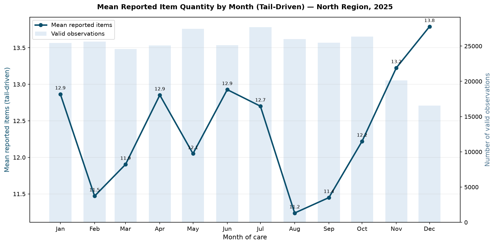
*Mean reported items (bars: valid observations; line: mean, tail-driven) — North Region, 2025.*
 
- The monthly mean reported quantity ranged from **11.2 items in August** to **13.8 in December** (~22.7% higher).
- The **median stayed at 1 item in every month**, indicating the mean is driven by a small number of high-quantity outliers rather than a shift in typical behavior.
- Valid observations dropped from ~27,698 (July) to ~16,551 (December), coinciding with the increase in the mean — a pattern consistent with reporting-lag effects rather than genuine volume growth.
- Overall, **93.27% of valid quantity records equal 1**, confirming that the mean is not representative of the typical record.

###### Quantity vs. Remuneration
 
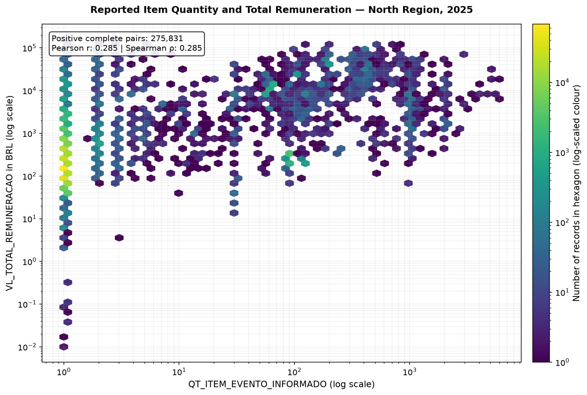
*Hexbin density plot, log-log scale — 275,831 positive complete pairs.*
 
- Quantity and remuneration show a **positive but modest association**:
  - Pearson correlation: **≈ 0.285**
  - Spearman correlation: **≈ 0.285**
- The similarity between Pearson and Spearman indicates the weak correlation is not an artifact of extreme values distorting a linear-only metric.
- At the most common quantity value (1 item), remuneration spans several orders of magnitude (R$ ~10 to R$ 100,000+), showing that quantity alone explains little of the financial variation.
- Procedure type, provider, and geography likely carry more predictive weight than quantity for remuneration.

###### Reported Quantity and Remuneration by Provider State
 
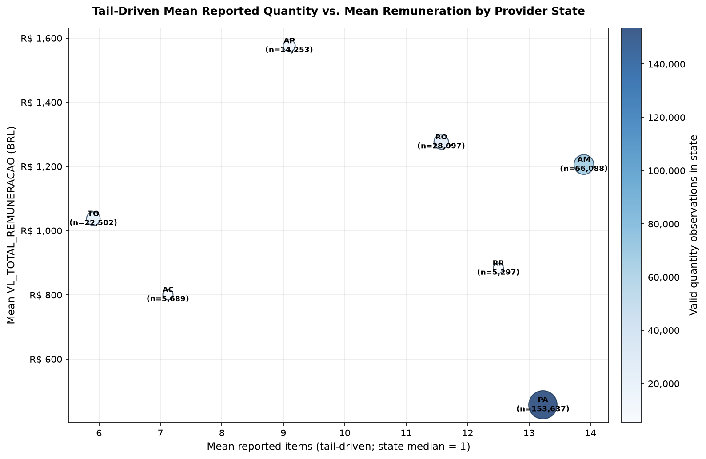
*Bubble size = valid quantity observations per state; state median quantity = 1 in all cases.*
 
- State-level **mean** reported quantity ranges from **≈ 5.9 to 13.9 items** (median remains 1 in every state — the variation is entirely in the tail-driven mean).
- **Amazonas (AM)** has the highest tail-driven mean quantity among high-volume states, but also the highest missingness for quantity: **15.93%** of records missing.
- **Pará (PA)** has the largest sample (n = 153,637) and very low missingness (**0.98%**), but the **lowest mean remuneration** (≈ R$457) — despite quantity levels comparable to AM.
- **Amapá (AP)** has the **highest mean remuneration** (≈ R$1,576), with a comparatively small sample (n = 14,253).
- The mismatch between PA's high quantity/high volume and its low remuneration, versus AM's similar quantity but much higher remuneration, reinforces finding 2.2: quantity does not predict remuneration well, and state-level procedure mix or pricing differences are more likely drivers.

###### High-Specificity Proxy by Age
 
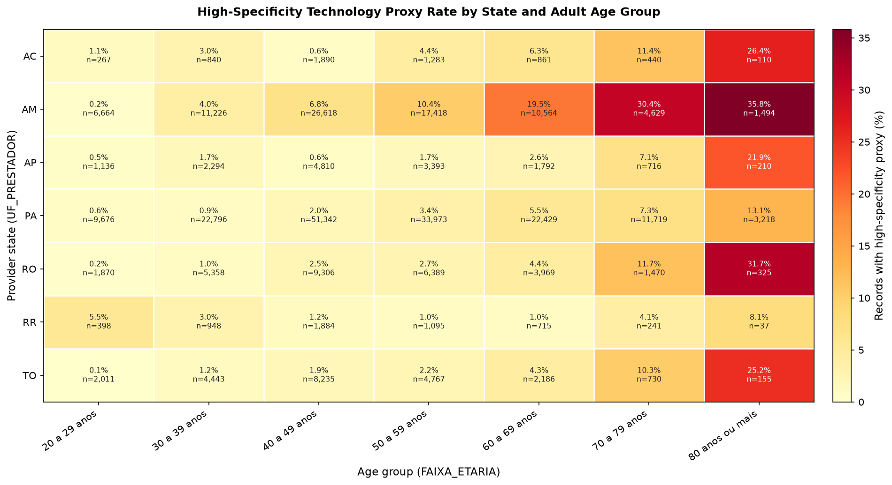
*Heatmap of the high-specificity proxy rate (%) by provider state and adult age group, with cell denominators — North Region, 2025.*
 
- `IND_HIGH_SPECIFICITY_PROXY` increases with age:
  - **≈ 0.5%** for ages 20–29
  - **≈ 21.2%** for ages 80+
- These are shares of billed **records**. The H3 analysis in Section 4.2.3 tests the same age-by-state relationship per **healthcare event**, flagging an event when any of its item rows carries the proxy, which places the 80+ rate at **23.2%** instead. The two figures count different units and are consistent with each other.
- This age pattern **varies by provider state**, suggesting an interaction effect between `FAIXA_ETARIA` and `UF_PRESTADOR` rather than a uniform national trend.
##### Chart Analysis — Methodological Implications
 
- `MES` (month), `FAIXA_ETARIA` (age group), and `UF_PRESTADOR` (provider state) should be tested as predictive features.
- The interaction between age and provider state should be evaluated explicitly, not assumed to be additive.
- Quantity alone is insufficient to predict remuneration; procedure code, provider, geography, and treatment-related variables should be incorporated.
- Model validation should report performance broken down by state and age group, given the dataset's geographic and demographic imbalance (e.g., PA alone accounts for ~50% of events).
- Regression modeling should compare raw, capped, and log-transformed versions of the numeric variables, given the skewness already documented.
##### Chart Analysis — Limitations
 
- The **mean is not representative** of the typical record for quantity-related variables, due to extreme values; the median (consistently 1) is a more reliable summary of typical behavior.
- **Late-year observations may be incomplete** due to ANS reporting delays of approximately **3 to 6 months** — the November/December drop in valid observations should not be read as reduced care volume.
- **Missing values must not be replaced with zero** — they reflect specific structural causes (e.g., bundled procedures, unmatched REM rows) documented under *Chart Analysis — Findings* above.
- `IND_HIGH_SPECIFICITY_PROXY` is an **administrative proxy**, not a confirmed diagnosis, treatment-eligibility indicator, or unique-patient measure — it should not be over-interpreted clinically.
- These charts show **exploratory associations only** and do not establish causality.
---
 
##### Chart Analysis — Technical Appendix
 
*Implementation details relevant for reproducibility, not for the main analytical narrative.*
 
- Charts were built with `matplotlib` (hexbin, bar/line combo, bubble scatter) using log-scaled axes where distributions were heavily right-skewed.
- The monthly chart uses a dual-axis layout (bar = valid observation count, line = tail-driven mean) with `matplotlib.dates` locators/formatters for month labeling.
- The quantity-vs-remuneration hexbin restricts to positive, complete pairs (n = 275,831) and uses a log-scaled color map for hexagon density.
- The state-level bubble chart encodes sample size as marker size and valid-observation count as color intensity; state labels annotate each bubble with its `n`.
- Dependency installation and general plotting/formatting boilerplate are omitted here — see the notebook ([`06_eda_charts.ipynb`](../notebooks/data_pipeline/06_eda_charts.ipynb)) for full code.
 

#### 4.2.2. Data Preprocessing

The preprocessing pipeline is implemented across four notebooks (`01_consolidate_base.ipynb`, `02_merge_north_states.ipynb`, `03_tuss_sboc_crosswalk.ipynb`, `04_data_treatment.ipynb`) and moves the data through four stages — `data/raw` → `data/interim` (per state, then merged) → `data/reference` (a clinical crosswalk) → `data/processed`; with the principle that every cleaning and transformation rule is written and validated exactly once, on the fully consolidated North Region base, rather than repeated per state. Within each notebook, every decision follows the same three-part pattern; a markdown cell stating the decision and its justification, the code cell that implements it, and a markdown cell reporting the real, executed result, so each choice below can be audited directly against the printed output that produced it.

##### 4.2.2.1. Per-state ingestion and consolidation

`01_consolidate_base.ipynb` is parameterized by a single `STATE` variable and executed once for each of the seven North Region states (AC, AM, AP, PA, RO, RR, TO). For every month of 2025 it downloads the three ANS TISS Ambulatorial files (DET — detailed, CONS — consolidated beneficiary/context, REM — reimbursement) from the ANS Open Data portal, aggregates REM by event (summing `VL_TOTAL_REMUNERACAO` and concatenating reimbursement models, since roughly 0.3% of events carry more than one REM row), and left-joins DET with CONS and the aggregated REM on `ID_EVENTO_ATENCAO_SAUDE`. Each month's merged table is written incrementally as a new row group to the state's output parquet, and memory is freed before the next month is read. No cleaning or typing is performed at this stage; columns remain string type, but two structural checks run per month: an assertion that no row lost its `ID_EVENTO_ATENCAO_SAUDE` key, and an assertion that row count matches DET exactly (ruling out join fan-out). Per-month exact duplicates are counted and reported, not removed, deferring that decision to the consolidated base.

##### 4.2.2.2. North Region merge

`02_merge_north_states.ipynb` concatenates the seven per-state parquet files into one raw file, `data/interim/north_region_ambulatorial_full_2025.parquet` (59,913,304 rows), applying no cleaning of its own. Before merging, it compares every state's column set against a reference schema (the first state, AC) and hard-fails if any state diverges; none did. States are then read and written one at a time as parquet row groups, again to bound peak memory, and each state's `UF` column is checked to contain only its own state code. After writing, the merged file's total row count is reconciled against the sum of the seven individually recorded per-state counts; any mismatch is treated as a blocking error rather than a warning, since it is the single check that would catch a corrupted merge.

##### 4.2.2.3. Clinical scope delimitation

Because TISS Ambulatorial carries no diagnosis (CID) field, breast-cancer relevance can only be established through billed procedure and drug codes, not through a diagnosis flag. `03_tuss_sboc_crosswalk.ipynb` builds this mapping independently: it downloads the official TUSS reference tables for drugs, procedures, and procedure groups from ANS [17,18], and matches them against clinical term lists manually extracted from the four SBOC breast-cancer guidelines; staging, neoadjuvant, adjuvant, and advanced disease, the only manually curated input in the entire pipeline. The drug term list required augmentation with roughly twenty commercial brand names (e.g. Perjeta, Enhertu, Kadcyla) because TUSS Table 20 indexes drugs by brand rather than generic name, and the procedure term list was written to match TUSS's own abbreviated naming conventions (e.g. "RM - Mama" rather than "ressonância magnética da mama"), both determined by direct inspection of the reference tables rather than assumed from the guidelines' prose. Matching is accent and case-insensitive substring search against normalized TUSS name fields. Every matched code is classified by specificity: broad staging exams used across many cancer types (chest/abdomen CT, brain MRI, bone scintigraphy, PET, bone densitometry) are tagged `generic_staging` and excluded from the inclusion filter, since there is no CID field to confirm they relate to breast cancer specifically; two further terms whose match could span any body site (`biopsia percutânea`, `biopsia de linfonodo`) are restricted to TUSS entries whose name also mentions the breast or axilla. This crosswalk is then applied to the merged base, filtering it, via a batched PyArrow membership test on the composite `(CD_TABELA_REFERENCIA, CD_PROCEDIMENTO)` key rather than a full in-memory load; from 59,913,304 rows down to 324,469 rows (0.5416%), which are then enriched with the matched clinical category, treatment line, and tumor subtype.

##### 4.2.2.4. Feature decomposition

The enrichment step can attach more than one treatment line or subtype to a single billed code (for instance, a chemotherapy agent cited across neoadjuvant, adjuvant, and advanced-disease guidelines). These multivalued fields, together with the reimbursement-model field aggregated during ingestion, are decomposed into binary indicator columns (`IND_LINE_*`, `IND_SUBTYPE_*`, `IND_REIMBURSEMENT_MODEL_*`), while the original human-readable columns are kept for traceability.

##### 4.2.2.5. Structural quality - keys and duplicates

After confirming no row lost its event key, 203 fully duplicated rows (0.063%) are removed, keeping the first occurrence. Because Ambulatorial data only records the realization date at monthly granularity, it is not possible to distinguish a genuine duplicate billing from a TISS retransmission artifact from the timestamp alone; removal was judged the lower-risk choice for a demand-volume estimation objective, and the affected volume is in any case negligible.

##### 4.2.2.6. Typing

Monetary and quantity columns are converted from Brazilian-format comma-decimal strings to floats; the realization and reference-month dates are parsed at monthly granularity only, since no day field exists in the source; and twenty-four nominal columns are cast to categorical dtype. `FAIXA_ETARIA` (age group) and `PORTE` (operator size) are left out of this step because both are ordinal and are encoded later, once known data-quality issues in `FAIXA_ETARIA` are resolved.

##### 4.2.2.7. Column pruning
 
Five columns are dropped outright from the merged base, each for a distinct, individually verified reason rather than a blanket rule. `IND_TABELA_PROPRIA` is dropped for zero variance, carrying a single value across all 324,266 rows at this stage. `LG_VALOR_PREESTABELECIDO` is dropped for being near-constant, with 99.999% of rows sharing the same value, leaving no meaningful signal to learn from. `SAUDE_OCUPACIONAL` is dropped for being 99.32% missing. `CD_MOTIVO_SAIDA` is dropped for being 69.95% missing combined with low conceptual relevance to the demand-volume objective, so the remaining 30% of populated values would not justify the column's inclusion. Finally, `CD_MODALIDADE` is dropped for redundancy: it maps 1:1 onto `NM_MODALIDADE`, and the latter is kept since it stores the operator modality as a readable label rather than a numeric code, making it more directly usable in the dashboard and in any downstream categorical analysis.
 
The table below documents the five columns dropped at this stage:
 
| Column | Classification | Origin | Justification |
|---|---|---|---|
| `IND_TABELA_PROPRIA` | Categorical (binary indicator) | Original — raw TISS DET field | Constant (1 unique value) — zero variance. |
| `LG_VALOR_PREESTABELECIDO` | Categorical (binary / logical) | Original — raw TISS DET field | Near-constant (99.999% the same value). |
| `SAUDE_OCUPACIONAL` | Categorical (binary indicator) | Original — raw TISS DET field | 99.31% missing. |
| `CD_MOTIVO_SAIDA` | Categorical (nominal code — exit/discharge reason) | Original — raw TISS CONS field | 69.93% missing and low conceptual relevance to the demand-volume objective. |
| `CD_MODALIDADE` | Categorical (nominal code — operator modality) | Original — raw TISS CONS field | Redundant with `NM_MODALIDADE` (1:1 correspondence); the readable version was kept. |

##### 4.2.2.8. Invalid demographic cluster

`FAIXA_ETARIA` occasionally carries ANS's own source-side error labels ("Informada Incorretamente" / "Não identificado") instead of an age bracket. These labels are found to co-occur exactly with a null `SEXO` and a null beneficiary municipality on the same 210 rows (0.065%); a single cluster consistent with a source-system fill failure rather than a pipeline defect. Because sex, age group, and geography are the project's core demographic and geographic segmentation axes, these 210 rows are removed outright rather than imputed, since imputing them would mean inventing a patient characteristic with no evidentiary basis.

##### 4.2.2.9. Age-implausibility removal

This step is documented here, immediately after the invalid demographic cluster, because that is where it runs in the notebook (Phase 7). It is a row-level plausibility decision on the same `FAIXA_ETARIA` column, and it is applied before the missing-value, outlier, encoding and normalization phases so that rows the project has already concluded are not breast-cancer events do not contribute to the statistics those phases compute — most consequentially the outlier bounds, which are a mean and a standard deviation taken across rows. All three signals the decision inspects are available at that point: `IND_HIGH_SPECIFICITY_PROXY` is only materialized later, in Proxy-quality validation, but it is a pure function of the `subtype` column produced by Feature decomposition, so the same evidence is read directly from `subtype` before any encoding has run.

A non-monetary outlier was found and removed at this stage: **13,716 rows (4.2326% of the base)** whose `FAIXA_ETARIA` falls under 20 years old (357 "Menos de 1 ano", 2,657 "1 a 4 anos", 3,530 "5 a 9 anos", 2,195 "10 a 14 anos", 4,977 "15 a 19 anos"). Unlike the monetary outliers in 4.2.2.11, this is not a statistical extreme, it is a clinical impossibility: breast cancer is a disease of adulthood, with negligible incidence before age 20 [12], and the four SBOC guidelines behind the project's own TUSS crosswalk are staging/treatment protocols written for an adult disease. The same lack of a diagnosis (CID) field that motivates the proxy-quality caveat in Section 4.2.2.14 is the root cause here too, applied along the age axis instead of sex: pediatric and adolescent oncology treats a different set of cancers (leukemias, lymphomas, sarcomas) with several of the same broad cytotoxic drugs (doxorubicin, cyclophosphamide) that the crosswalk had to include for adult breast-cancer chemotherapy. Real data confirms the contamination rather than assuming it: of these 13,716 rows, **99.93% (13,707)** carry the non-specific `"general"` subtype (only 9 rows carry a breast-specific subtype), the `IND_HIGH_SPECIFICITY_PROXY` rate inside this group is **0.0656%** against **4.66%** for the base as a whole at this point (the 324,056 rows this step reduces, a ~71× gap), and **41.72%** of these rows are male, over 40 times the ~1% incidence expected for male breast cancer even among adults. With three independent signals agreeing and no plausible scenario in which real breast-cancer demand comes from patients this age, these rows are dropped outright (324,056 → 310,340 rows) rather than flagged, unlike the `"general"`-subtype ambiguity in Section 4.2.2.14, which is kept and only flagged because it still contains a majority of genuine breast-cancer cases.

##### 4.2.2.10. Missing-value treatment

The remaining missing values are resolved in four groups, each with a different justification rather than a single blanket rule. First, values that are structurally explained by another column are filled with an explicit "not applicable" label: `UNIDADE_MEDIDA` is null in 100% of procedure/procedure-group rows (a unit of measure is only meaningful for drugs) and `TIPO_CONSULTA` is null whenever the event is not a consultation. Second, the reimbursement fields (`VL_TOTAL_REMUNERACAO`, `CD_MODELO_REMUNERACAO`, `N_LINHAS_REM`), null in roughly 6% of rows, are left null rather than filled with zero, since a zero would misrepresent "not yet reported" as "no cost"; a binary `IND_REIMBURSEMENT_REPORTED` flag is added instead, since ANS is known to process REM files with a lag relative to DET/CONS. Third, `QT_ITEM_EVENTO_INFORMADO`, `VL_ITEM_EVENTO_INFORMADO`, and `VL_ITEM_PAGO_FORNECEDOR` are confirmed null in exactly the rows where `IND_PACOTE = 1` (the item is billed within a bundle, so no individual value exists to report) and are likewise left null rather than assigned an invented value. Fourth, five columns with low-to-moderate, operationally unexplained missingness (`REGIME_ATENDIMENTO`, `TIPO_ATENDIMENTO`, `CD_CARATER_ATENDIMENTO`, `IND_ACIDENTE_DOENCA`, and `CBO`, the latter missing in roughly 44% of rows) are imputed with an explicit `"NOT_REPORTED"` category rather than dropped, since dropping would discard a disproportionate share of the base, particularly for `CBO`.

##### 4.2.2.11. Outlier treatment

The monetary and quantity columns are strongly right-skewed, as is typical of healthcare cost data (for example, `VL_TOTAL_REMUNERACAO` has a median of R$172.03 against a 99.9th percentile of R$ 63,613.35 and a maximum of R$ 157,496.59). A standard 1.5×IQR rule was explicitly rejected because it would remove exactly the highest-value events, expensive HER2-targeted infusions such as trastuzumab or trastuzumab deruxtecan, which represent the central commercial signal the model is meant to estimate, not noise to be discarded. Outliers are instead capped on a log scale: each column is log1p-transformed, and any value beyond five standard deviations above the mean in log space is clipped down to that bound (converted back to the original scale), with the deliberately generous five-sigma threshold chosen to preserve genuine high-cost treatments while still bounding the extreme tail. The capped values are stored in new `*_CAPPED` columns alongside the untouched originals, and the number and share of values affected per column is logged for audit.

##### 4.2.2.12. Encoding

Eleven low-cardinality nominal columns (including `SEXO`, `UF`, `NM_MODALIDADE`, `REGIME_ATENDIMENTO`, and the breast-cancer `category` tag) are one-hot encoded. `FAIXA_ETARIA` is ordinally encoded following its natural chronological order across twelve age brackets, and `PORTE` is ordinally encoded across `PEQUENO` / `MÉDIO` / `GRANDE`, with the special value `SEM BENEFICIÁRIOS` ("no active beneficiaries") set to a sentinel value (-1) outside the natural 0–2 range rather than forced onto the size scale, disambiguated by an accompanying binary flag (`IND_SIZE_NO_BENEFICIARIES`), since an operator with no beneficiaries is not meaningfully "smaller than small." Five high-cardinality columns, `CD_PROCEDIMENTO`, `ID_PLANO` (over 3,000 distinct values), `CD_MUNICIPIO_BENEFICIARIO`, `CD_MUNICIPIO_PRESTADOR`, and `CBO`, are deliberately left unencoded at this stage, since one-hot encoding would multiply the base's width by thousands of mostly-empty columns, and the more appropriate technique, such as frequency or target encoding, depends on a target variable that has not yet been defined.

##### 4.2.2.13. Normalization

The four capped monetary and quantity columns are additionally log1p-transformed and then min-max scaled to a 0–1 range, producing `*_CAPPED_LOG_NORM` columns. Scaling the raw values directly was rejected because the extreme tail would compress nearly all events, which cluster near the median, toward zero; applying the logarithm first preserves the relative position of the bulk of the data. Min-max was preferred over z-score scaling for the readability of a bounded 0–1 range in this report, with z-score noted as a straightforward alternative should a later modeling algorithm require it.

##### 4.2.2.14. Proxy-quality validation

Because eligibility for a given treatment is inferred from billed drugs and procedures rather than from a diagnosis field, most of the codes retained by the crosswalk fall under a `"general"` subtype, cytotoxic drugs such as doxorubicin or cyclophosphamide that are used across many cancer types, not only breast cancer. Cross-tabulating tumor subtype against sex shows a visibly elevated share of male beneficiaries within the `"general"` subtype relative to the roughly 1% incidence expected for male breast cancer, indicating that some of these events likely reflect other cancers treated with the same non-specific drugs. Rather than removing these rows, which would discard the majority of genuine breast-cancer cases that also rely on general-subtype drugs, a confidence flag, `IND_HIGH_SPECIFICITY_PROXY`, is added to distinguish subtype-specific from general-subtype evidence, leaving the decision of how to weight this distinction to the modeling stage.

##### 4.2.2.15. Output
 
The base reaches 324,056 rows after the row-level cleaning described in 4.2.2.1 through 4.2.2.8; the age-implausibility removal documented in Section 4.2.2.9 brings it down to **310,340 rows**, which is the base the missing-value, outlier, encoding and normalization steps that follow then operate on, and the final count which is what is exported to `data/processed/north_region_mama_2025_data_en.parquet`, alongside `data/processed/north_region_mama_2025_decisions_dictionary.csv`, a nineteen-entry log pairing every column- and row-level decision made in this section with its justification, so that the treatment applied to the base can be audited independently of the notebooks that produced it.
 
The table below summarizes the row-level filtering funnel applied before feature engineering:
 
| Stage | Rows retained | Share of raw base |
|---|---|---|
| Raw North Region base (7 states, 2025, all specialties) | 59,913,304 | 100% |
| After TUSS–SBOC clinical filter (breast cancer only) | 324,469 | 0.5416% |
| After exact-duplicate removal | 324,266 | 0.5413% |
| After invalid-demographic-cluster removal | 324,056 | 0.5409% |
| After age-implausibility (under-20) removal | 310,340 | 0.5180% |
 
The 119 columns retained in the final base fall into eight groups by classification, summarized below; to see the full per-column dictionary (data type, classification, origin, and justification) for all 119 columns retained in `north_region_mama_2025_data_en.parquet` — see [data_column_dictionary.md](./extras/data_column_dictionary.md).
 
| Classification | Columns | Description |
|---|---|---|
| Identifier (ID) | 1 | `ID_EVENTO_ATENCAO_SAUDE`, the unique event key used for traceability and duplicate checks. |
| Date/Time | 2 | `DT_REALIZACAO` and `MES`, the event date and reference month used for temporal aggregation. |
| Categorical (nominal) | 13 | Raw ANS/TISS fields not yet one-hot encoded (e.g. `CD_PROCEDIMENTO`, `ID_PLANO`, `FAIXA_ETARIA`, `CD_MUNICIPIO_BENEFICIARIO`, `PORTE`, `CBO`, `treatment_line`, `subtype`), plus high-cardinality fields deliberately left unencoded pending target definition. |
| Categorical (binary / one-hot) | 88 | One-hot columns produced in Encoding (`SEXO_*`, `UF_*`, `NM_MODALIDADE_*`, `REGIME_ATENDIMENTO_*`, `category_*`, etc.) and the binary indicators decomposed in Feature decomposition (`IND_LINE_*`, `IND_SUBTYPE_*`, `IND_REIMBURSEMENT_MODEL_*`), plus auxiliary flags such as `IND_REIMBURSEMENT_REPORTED`, `IND_SIZE_NO_BENEFICIARIES`, and `IND_HIGH_SPECIFICITY_PROXY`. |
| Numerical (encoded ordinal) | 2 | `FAIXA_ETARIA_ORDINAL` and `PORTE_ORDINAL`, the ordinal encodings from Encoding. |
| Numerical (continuous) | 5 | Raw monetary and quantity fields before outlier treatment (`VL_ITEM_EVENTO_INFORMADO`, `VL_ITEM_PAGO_FORNECEDOR`, `VL_TOTAL_REMUNERACAO`, `QT_ITEM_EVENTO_INFORMADO`, `N_LINHAS_REM`). |
| Numerical (continuous, outliers treated) | 4 | The `*_CAPPED` columns from Outlier treatment, kept alongside their untouched originals. |
| Numerical (continuous, log-normalized) | 4 | The `*_CAPPED_LOG_NORM` columns from Normalization, scaled to a 0–1 range. |

This file is the terminal artifact of the preprocessing pipeline and the starting point of the modeling stage. Section 4.3.2.8 adopts the Medicina de Grupo subset of these 310,340 item-level rows (70,004 rows, 1,052 of the 3,289 distinct `ID_PLANO` values in the treated base) as the project's official modeling population from that point on; Section 4.3.1 reads that filtered subset, aggregating it into the 1,052-row operator-level activity matrix that feeds the project's first clustering pass. Sections 4.3.1.1 and 4.3.5 note the caveat behind that "operator" shorthand: `ID_PLANO` is a plan identifier, not a verified ANS operator registration. Sections 4.2 and 4.2.3 above describe the full, unfiltered population.

#### 4.2.3. Hypotheses

Three exploratory hypotheses were formulated and tested in `07_hypothesis_analysis.ipynb`, over the fully treated North Region breast-cancer base (310,340 billed records, 291,864 unique healthcare events; see 4.2.2.15). For the full formulation, methodology, statistical tests, charts, and interpretation notes, see [07_hypothesis_analysis.ipynb](../notebooks/data_pipeline/07_hypothesis_analysis.ipynb).

Two limitations apply across all three hypotheses and should be kept in mind when reading the results below. First, billed records and healthcare events in this dataset do not represent unique patients: a single beneficiary can generate multiple billed items and multiple events, and no patient identifier is available to de-duplicate them. Second, `IND_HIGH_SPECIFICITY_PROXY` (used in H3) is an administrative billing proxy and does not represent a confirmed diagnosis, incidence, prevalence, clinical stage, or treatment eligibility.

**H1 — Concentration of observed demand across health plans.** The idea behind H1 was simple: a handful of health plans probably account for most of the observed breast-cancer-related activity, and just knowing an operator's declared size (`PORTE`) wouldn't be enough to tell which plans those are. That turned out to be the case. Out of 3,289 plans and 291,864 unique healthcare events, the busiest 1% of plans already account for 41.7% of all events; the top 10% account for 84.2%, and the top 20% for 92.9%. The Gini coefficient for events per plan comes out to 0.888, indicating strong concentration. The same pattern repeats inside every `PORTE` category, not just overall: even among `GRANDE` operators, the top 10% of plans still capture 88.0% of their events, and the same holds, a little less sharply, for `MÉDIO` (70.2%), `PEQUENO` (61.6%), and `SEM BENEFICIÁRIOS` (57.8%). The gap between mean and median makes the point well — `GRANDE` plans average 100.8 events each, but half of them have 6 or fewer. A few outlier plans are pulling the average up while most plans in every size bucket stay small. So H1 holds: `PORTE` is insufficient on its own for plan-level demand prioritization, and any prioritization built from this data should rank plans individually rather than leaning on operator size as a shortcut.

**H2 — Intermunicipal displacement for care.** H2 asked whether healthcare events in the North Region are recorded outside the beneficiary's home municipality often enough, and unevenly enough across states, to matter for how demand gets allocated. Looking at the 291,864 events with complete location data, 26.8% were billed in a municipality different from the beneficiary's municipality of residence. That average hides a fair amount of spread: Roraima sits at just 7.1%, Acre at 12.9%, Amazonas at 19.8%, Amapá at 20.4%, Rondônia at 22.6%, while Pará reaches 31.8% and Tocantins tops the list at 33.1% — a 26-point gap between the lowest and highest state. A chi-square test confirms recorded displacement isn't independent of provider state (χ² = 6,179.24, df = 6); with a sample this large, statistical significance alone does not establish practical importance. The more informative measure is Cramér's V, which lands at 0.146 — a real association, but a modest one. Provider state is associated with where care occurs relative to the beneficiary's municipality of residence, but it is not the main driver of the observed variation. H2 is supported, with that caveat attached: beneficiary and provider geography should be modeled as two separate signals going forward, since a model that assumes healthcare events are recorded in the beneficiary's own municipality would be wrong for roughly a quarter of all events. This measure reflects recorded intermunicipal displacement based on differing municipality codes; it does not establish physical patient travel, distance traveled, access barriers, network authorization, or formal *Tratamento Fora de Domicílio* (TFD).

**H3 — Interaction between age and geography.** The third hypothesis examined two related questions: does the share of events carrying a high-specificity breast-cancer proxy rise with age, and does that rise look the same in every state? The age trend is unambiguous — it climbs steadily from 0.5% in the 20–29 bracket to 1.8%, 3.2%, 5.1%, 9.0%, 13.8%, and finally 23.2% for beneficiaries 80 and older, a consistent increase across every adult age group (χ² = 10,280.17, df = 6; Cramér's V = 0.188 overall). State differences were then checked separately within each age bracket. Among the youngest adults (20–29), Cramér's V is only 0.101 — states barely differ at that age. That association gets steadily stronger as age increases, reaching 0.163 at 50–59, then jumping to 0.329 at 70–79 before settling slightly to 0.317 for the oldest group — more than triple the state-level effect seen among the youngest adults. This pattern suggests a possible interaction and supports testing it explicitly during modeling, rather than confirming that geography and age operate independently: the state-level effect grows markedly larger among older beneficiaries. H3 is supported on both counts, and the possible interaction specifically argues for testing an explicit age-by-state term in future models, or using a tree-based approach that can pick up this kind of non-additive pattern on its own.

One methodological caveat applies to the second half of H3. Because the state comparison is run once per adult age bracket, those seven chi-square tests form a single family, and reading each of them at α = 0.05 in isolation would inflate the family-wise error rate. The notebook therefore reports Holm step-down adjusted p-values next to the raw ones and prints the Bonferroni per-test threshold (0.00714) explicitly. The adjustment turns out to be inconsequential here — all seven strata survive it — which is the expected result at this sample size, where the chi-square statistic grows with the denominator. That is exactly why the conclusion above is stated in terms of the trend in Cramér's V rather than in terms of significance: a monotone rise in effect size across brackets is not something a family-wise correction can manufacture or remove. The correction is reported so that the multiplicity is explicit and auditable.

### 4.3. Data Preparation and Modeling

The modeling stage begins with an unsupervised segmentation step because TISS Ambulatorial records billed procedures, drugs and reimbursements without an observed outcome field or a diagnosis (CID) field. The same gap that constrained the clinical scope in Section 4.2.2.3 means there is no directly observed label for supervised learning. The project therefore defines a target only after identifying the operationally active population: a K-Means pass [26] over the operator-level activity matrix separates operators with sustained breast-cancer-related billing from those whose presence in the base is marginal, and only the retained operators form the final analytical dataset. "Active" is used in that strictly observational sense throughout, and is defined operationally in Section 4.3.2.6.

Supervised learning remains possible through a *constructed* target: `volume_demanda_proxy`, billed item quantities aggregated to the `ID_PLANO × treatment_line_primary × UF_PRESTADOR × MES` grain and defined in Section 4.3.6, subject to the measurement-quality rule recorded there. It is a utilization-volume proxy, not a patient count, and that distinction is fundamental to every claim made about it. Section 4.3.7 documents a Linear Regression forecast, Section 4.3.8 a Decision Tree and Section 4.3.9 a Random Forest, each trained independently on the retained population; Section 4.3.10 compares the three, and Section 4.3.11 validates the treatment-line rule that defines the target's grain. The methodological structure is therefore two-stage: unsupervised segmentation establishes *which* operators enter the modeling population, and the supervised candidates predict *how much* billed volume they generate. The segmentation does not depend on the supervised sections; all three supervised candidates depend entirely on the retained population and the constructed target.

Sections 4.3.1–4.3.6 form a single methodological pipeline rather than separate template submissions. They first build the operator-level and operator-municipality activity matrices, then apply K-Means clustering to separate sustained breast-cancer-related billing from marginal activity, and finally define the feature set and gating rules that generate the supervised target. Section 4.3.5 evaluates whether the non-hospital market-share snapshot can support a verticalization signal; it concludes that the source alone cannot identify that signal. Section 4.3.6 integrates these outputs into the supervised target definition and keeps incomplete network, verticalization and full-year activity candidates out of the training matrix until they are available without leaking prediction-time information. The focus of Section 4.3 is therefore to define the eligible modeling population and the target used by the candidate models in Sections 4.3.7–4.3.10.

#### 4.3.1. Operator-level activity matrix

[`09_activity_matrix_operator.ipynb`](../notebooks/09_activity_matrix_operator.ipynb) reads `data/processed/north_region_mama_2025_data_en_medicina_de_grupo.parquet` — the Medicina de Grupo subset of the treated base, 70,004 rows and 119 columns, produced by [`data_pipeline/08_filter_medicina_de_grupo.ipynb`](../notebooks/data_pipeline/08_filter_medicina_de_grupo.ipynb) and adopted as the project's official modeling population from this notebook onward (Section 4.3.2.8) — and writes two operator-level artifacts. It performs no cleaning of its own: every row-level decision was already made and audited in Section 4.2.2, and the project writes each rule exactly once. Instead, it changes the grain of the data and selects, transforms and validates the variables the first clustering stage sees. Like Section 4.2.2, each step is a markdown cell stating the decision, the code implementing it, and a markdown cell reporting the result, so every figure below can be audited against the notebook output that produced it.

##### 4.3.1.1. Granularity change and unit of analysis

K-Means partitions observations, so the matrix must first define an observation. The treated base is at item-event grain — one row per item billed within a health-care event — so a single operator contributes from one to several thousand rows. Clustering it directly would cluster billing lines rather than operators, implicitly weighting each operator by how much it billed.

The notebook therefore aggregates by `ID_PLANO`, one row per operator: **70,004 item-level rows collapse to 1,052 operator-level rows**, the count of distinct Medicina de Grupo plans confirmed by the filter notebook (Section 4.3.2.8).

`ID_PLANO` identifies the beneficiary's health plan/insurer and is the project's central unit of analysis, since the business objective is to estimate demand by insurer. Following the notebook, each `ID_PLANO` is called an "operator": the term names that plan registration, the finest operator-side unit TISS Ambulatorial exposes, **not a verified ANS operator registration**. Section 4.3.5 finds zero exact overlap between claims `ID_PLANO`/`CD_PLANO` and either ANS market-share plan key, so no claims-to-ANS crosswalk is established anywhere in this project; every "operator" count in Sections 4.3.1–4.3.4 is a count of distinct `ID_PLANO` values, reported under that name for readability.

##### 4.3.1.2. Definition of activity metrics

The matrix captures operator activity along four complementary dimensions, so that clustering is driven by distinct evidence rather than by several restatements of volume. Distinct counts (`nunique`) are used wherever the concept is "how many different", so an operator is not credited twice for one encounter billed as several items.

| Dimension | Metric | Aggregation | Rationale |
|---|---|---|---|
| Volume | `total_eventos` | `nunique` of `ID_EVENTO_ATENCAO_SAUDE` | Observed scale of health-care activity, counted in encounters rather than billing lines. |
| Volume (auxiliary) | `total_itens` | row count (`size`) | Retained initially as a cross-check on `total_eventos` and to derive the items-per-event ratio; screened out before the feature set was fixed (Section 4.3.1.3). |
| Temporal presence | `meses_ativos` | `nunique` of `MES` | Persistence of activity over time; separates an operator present all year from one that appears in a single month. |
| Geographic presence (demand side) | `municipios_beneficiarios` | `nunique` of `CD_MUNICIPIO_BENEFICIARIO` | Geographic reach of the operator's beneficiary population. |
| Geographic presence (supply side) | `municipios_prestadores` | `nunique` of `CD_MUNICIPIO_PRESTADOR` | Geographic reach of service provision. |
| Operational diversity | `procedimentos_distintos` | `nunique` of `CD_PROCEDIMENTO` | Breadth of the procedure and drug portfolio the operator actually paid for. |

The descriptive statistics of the matrix (1,052 operators) already confirm the premise behind the clustering stage:

| Metric | Mean | Std. dev. | Min | 25% | Median | 75% | Max |
|---|---|---|---|---|---|---|---|
| `total_eventos` | 64.77 | 343.14 | 1 | 3 | 7 | 24 | 6,859 |
| `total_itens` | 66.54 | 344.83 | 1 | 3 | 7 | 25 | 6,859 |
| `meses_ativos` | 5.85 | 4.03 | 1 | 2 | 5 | 10 | 12 |
| `municipios_beneficiarios` | 4.08 | 7.81 | 1 | 1 | 2 | 4 | 112 |
| `municipios_prestadores` | 1.81 | 1.95 | 1 | 1 | 1 | 2 | 33 |
| `procedimentos_distintos` | 2.92 | 2.50 | 1 | 1 | 2 | 4 | 18 |

The median operator records **7 events, in 2 beneficiary municipalities, through 1 provider municipality, across 2 distinct procedures, over 5 active months**, and the mean sits far above the median on every volume and reach metric. A large share of the 1,052 registrations is residual — the distinction the first clustering stage exists to draw.

##### 4.3.1.3. Redundancy screening and feature selection

Two ratios were explored before the feature set was fixed: `itens_por_evento` (`total_itens` / `total_eventos`) and `eventos_por_mes_ativo` (`total_eventos` / `meses_ativos`). K-Means weights every dimension equally, so two features carrying the same information double its weight in the distance; redundancy was therefore screened explicitly. All three volume-derived candidates were rejected:

| Pair | Pearson r | Decision and reason |
|---|---|---|
| `total_eventos` × `total_itens` | **0.9997** | `total_itens` dropped. In the Medicina de Grupo, breast-cancer-filtered base an event almost always carries a single item, so the two variables are near-duplicates. |
| `total_eventos` × `itens_por_evento` | **−0.0311** | `itens_por_evento` dropped — not for redundancy, but for absence of signal (see below). |
| `total_eventos` × `eventos_por_mes_ativo` | **0.9982** | `eventos_por_mes_ativo` dropped. It restates event volume almost exactly and would double its weight in the clustering. |

`itens_por_evento` is independent of volume but carries almost nothing: **mean 1.0541, median exactly 1.0000, standard deviation 0.1626, maximum 2.0000**. For most operators every event carries exactly one item, so the variable is near-constant and cannot separate operators. This also explains why `total_itens` could be discarded without loss — it differs from `total_eventos` by a factor that is almost always 1.

The five retained features are `total_eventos`, `meses_ativos`, `municipios_beneficiarios`, `municipios_prestadores` and `procedimentos_distintos`. Their pairwise correlations range from **0.2516** (`total_eventos` × `meses_ativos`) to **0.7235** (`municipios_beneficiarios` × `municipios_prestadores`) — moderate throughout, with nothing near the redundancy that disqualified the discarded candidates:

| | `total_eventos` | `meses_ativos` | `municipios_beneficiarios` | `municipios_prestadores` |
|---|---|---|---|---|
| `meses_ativos` | 0.2516 | — | | |
| `municipios_beneficiarios` | 0.6516 | 0.4689 | — | |
| `municipios_prestadores` | 0.3996 | 0.4216 | 0.7235 | — |
| `procedimentos_distintos` | 0.3668 | 0.7019 | 0.6154 | 0.5573 |

The two geographic measures (0.7235) were kept separate deliberately. They describe opposite sides of the care network — where beneficiaries live versus where care is delivered — and the gap between them is the signal opportunity **O03 (Mapping "health tourism" reveals expansion areas)** relies on; its anticipation plan in Section 4.1.5 cross-references the beneficiary's municipality against the provider's. Merging them would discard that gap by construction.

##### 4.3.1.4. Skewness treatment

K-Means minimizes squared Euclidean distance to the centroids, so it is structurally sensitive to extremes: one operator far from the centre contributes more to the objective than hundreds of typical operators combined, pulling centroids toward the tail. The retained features were therefore tested for skewness:

| Feature | Skewness before | Transformation | Skewness after |
|---|---|---|---|
| `total_eventos` | 13.8916 | `log1p` | **1.1112** |
| `municipios_beneficiarios` | 6.6992 | `log1p` | **1.5936** |
| `municipios_prestadores` | 6.5551 | `log1p` | **2.0918** |
| `procedimentos_distintos` | 2.1539 | `log1p` | **0.8166** |
| `meses_ativos` | 0.3287 | none | 0.3287 |

The ranking of the four skewed features differs from the full-population run — there `municipios_prestadores` was the least skewed at 3.68, here it is second most skewed at 6.56, while `procedimentos_distintos` falls from third to least skewed at 2.15 — because skewness is a property of the population measured, not of the column, and Medicina de Grupo operators spread differently across provider municipalities. Which features are transformed is unchanged: the notebook names the same four columns explicitly rather than applying an automatic threshold.

`log1p` cut skewness for `total_eventos` by more than an order of magnitude and brought all four into a comparable, near-symmetric range. It was preferred over a plain logarithm defensively — it is defined at zero, so it stays valid if a future run produces a zero count — and, being monotone, it compresses the right tail without reordering operators.

`meses_ativos` was left untransformed: its skewness of 0.3287 is already near-symmetric, and it is bounded to 1–12 by construction, since the base covers the twelve months of 2025. It has no tail to compress, and a logarithm would only distort the spacing between values, such as between 10 and 12 active months.

##### 4.3.1.5. Standardization

After the skewness treatment the five features are still on incompatible scales: `meses_ativos` spans 1 to 12, while `total_eventos_LOG` spans roughly 0.69 to 8.83. Euclidean distance sums squared raw differences, so the widest-ranged feature would dominate cluster assignment for reasons of units rather than information. The five features were therefore standardized with `StandardScaler` (z-score) to mean zero and unit variance.

The scaled means are zero to floating-point precision, and each standard deviation reads 1.000476 rather than 1.000 — expected, not a defect: `StandardScaler` divides by the population standard deviation while `describe()` reports the sample one, a ratio of √(1052 / 1051) = 1.000476.

| Scaled feature | Min | Median | Max |
|---|---|---|---|
| `total_eventos_LOG` | −1.1549 | −0.2270 | 4.2937 |
| `meses_ativos` | −1.2018 | −0.2096 | **1.5267** |
| `municipios_beneficiarios_LOG` | −0.7866 | −0.2156 | 4.8953 |
| `municipios_prestadores_LOG` | −0.5917 | −0.5917 | 6.5747 |
| `procedimentos_distintos_LOG` | −1.0319 | −0.2352 | 3.3916 |

`meses_ativos` reaches only 1.53 standard deviations above its mean, against 3.39 to 6.57 for the log-transformed features. Bounded at twelve months, it saturates: it separates marginal from persistent operators well, but adds little discrimination among the most active, where it sits at its ceiling. `municipios_prestadores_LOG`'s median equalling its minimum follows directly from the population change: at least half of Medicina de Grupo operators use exactly one provider municipality, so the 25th and 50th percentiles coincide at the feature's floor.

**Relationship to Section 4.2.2.13 and Attachment 7.3.** This differs deliberately from the Min-Max normalization applied to monetary and quantity columns in Section 4.2.2.13. That section chose Min-Max for a readable 0–1 range and named z-score as the alternative if a later algorithm required it; a distance metric is that requirement. It also follows the rule in Attachment 7.3(a): heavy skew and extreme outliers call for standardization, since Min-Max would squeeze the bulk of a long-tailed distribution into a sliver near zero. As Attachment 7.3(a) notes, standardization does not correct skew, which is why it is applied *after* the `log1p` step: the logarithm corrects the shape, the z-score corrects the units.

Attachment 7.3(a) also requires that, in model training, scaling statistics be fit on the training partition alone to avoid leakage. That does not apply here, for a structural reason: there is no target and no held-out partition for information to leak across. The 1,052 operators are the complete Medicina de Grupo population in the base, and the cluster assignment describes that population rather than predicting unseen operators, so fitting the scaler on all rows is correct. If this matrix later feeds a supervised model, the scaler must be refit on that model's training partition.

##### 4.3.1.6. Integrity checks and manual aggregation validation

An aggregation error would be invisible downstream: a wrong distinct count still yields a well-formed, plausible matrix. It was therefore checked on two levels.

Structurally, the matrix holds **1,052 operators, 0 duplicate `ID_PLANO` values, 0 missing values across the five clustering features, and a final shape of (1,052, 5)**. The Section 4.3.1.2 statistics close the gap a null check leaves: `nunique` returns 0 rather than null for an all-missing group, so a silently empty count would pass `isna` — but the observed minimum is 1 for all six metrics, so every operator contributes at least one distinct value to each.

Second, a reproducible manual validation: five operators sampled with `random_state=42` (IDs 1483742, 236911, 210316, 241199 and 228816) had their metrics recalculated independently from the item-level base and compared through six equality assertions, one per metric. All six passed:

| `ID_PLANO` | `total_eventos` | `total_itens` | `meses_ativos` | `municipios_beneficiarios` | `municipios_prestadores` | `procedimentos_distintos` |
|---|---|---|---|---|---|---|
| 1483742 | 6 | 6 | 4 | 2 | 1 | 1 |
| 236911 | 1 | 1 | 1 | 1 | 1 | 1 |
| 210316 | 44 | 44 | 8 | 1 | 1 | 2 |
| 241199 | 31 | 31 | 12 | 1 | 1 | 4 |
| 228816 | 13 | 13 | 8 | 1 | 1 | 2 |

One table suffices because the recalculated and aggregated values were identical. Assertions make a mismatch halt execution rather than rely on a reader noticing it, and the seed means anyone re-running the notebook validates the same five operators. The scope is limited: with a median of 7 events, a random sample of five lands mostly in the low-activity range, as it did — four at or below the median, and one (210316, 44 events) well above. This validates the aggregation logic, not the high-volume tail, which is inspected next.

##### 4.3.1.7. Extreme activity patterns

The aggregated metrics have a pronounced upper tail:

| Quantile | `total_eventos` | `municipios_beneficiarios` | `municipios_prestadores` | `procedimentos_distintos` |
|---|---|---|---|---|
| 0.50 | 7.00 | 2.00 | 1.0 | 2.0 |
| 0.90 | 87.90 | 8.00 | 3.0 | 6.0 |
| 0.95 | 190.30 | 15.45 | 5.0 | 8.0 |
| 0.99 | 1,099.51 | 39.00 | 9.0 | 12.0 |
| 1.00 | 6,859.00 | 112.00 | 33.0 | 18.0 |

The 99th percentile of event volume is about 157 times the median, and the maximum a further 6.2 times the 99th percentile. Ranking separately by volume, beneficiary reach and procedure diversity shows the tail is not one homogeneous block of large operators — high activity splits along different axes:

| `ID_PLANO` | `total_eventos` | `meses_ativos` | `municipios_beneficiarios` | `municipios_prestadores` | `procedimentos_distintos` | Profile |
|---|---|---|---|---|---|---|
| 239258 | 6,859 | 12 | 96 | 18 | 11 | Leads on volume and ranks second on both geographic measures, with a mid-tier procedure portfolio (11 against the leader's 18, eighteenth overall). |
| 226458 | 520 | 12 | **112** | 5 | 9 | Widest beneficiary reach, with under a tenth of the leading volume. |
| 230117 | 624 | 12 | 29 | 5 | **18** | Broadest procedure portfolio, with modest volume and reach. |

This argues for keeping the four unbounded features rather than one size score, since operators with near-identical volume differ sharply on reach and diversity. It also confirms the ceiling effect from Section 4.3.1.5: 22 of the 23 operators in any of the three top-ten rankings have `meses_ativos = 12`, the exception being `ID_PLANO` 572290 (1,268 events over 9 months), so temporal presence is saturated across almost the whole upper tail.

**These observations were neither removed nor capped**, a difference in kind from earlier outlier handling. Section 4.2.2.9 removed rows because they were not breast-cancer events at all — a validity problem. Section 4.2.2.11 capped monetary extremes at five sigma in log space, keeping the row but bounding its leverage on statistics. Neither applies here: high activity is not a distortion of the phenomenon, it *is* the phenomenon this stage exists to detect, and trimming the tail would delete the very group to be identified. Its influence is instead bounded by the `log1p` compression of Section 4.3.1.4, without removing anyone from the population.

##### 4.3.1.8. Output

The notebook writes two artifacts, both keyed by `ID_PLANO`:

| Artifact | Path | Contents |
|---|---|---|
| Raw activity matrix | `data/interim/north_region_mama_2025_activity_matrix.parquet` | `ID_PLANO`, the six aggregated metrics in original units, the two ratios discarded in Section 4.3.1.3, and the four `*_LOG` columns. |
| Scaled activity matrix | `data/processed/north_region_mama_2025_activity_matrix_scaled.parquet` | `ID_PLANO` and the five standardized clustering features — the direct input to the first K-Means stage. |

Keeping both makes the clusters interpretable: a centroid expressed as the z-score of a logarithm means nothing to a business reader, whereas joining cluster labels back to the raw matrix describes each group in natural units — events, municipalities, distinct procedures. The interim file also preserves the evidence behind the Section 4.3.1.3 exclusions without carrying those columns into the model.

#### 4.3.2. K-Means operator segmentation

[`10_kmeans_operator.ipynb`](../notebooks/10_kmeans_operator.ipynb) builds the first candidate model: it partitions the 1,052 Medicina de Grupo operators into activity groups and derives from them the list of operators treated as active. It covers items (b) and (c) of this section — the candidate model and the justification for the value of K.

##### 4.3.2.1. Model choice and input contract

The notebook loads both artifacts of Section 4.3.1.8 — the scaled matrix `(1,052, 6)`, with `ID_PLANO` and the five standardized features, and the raw matrix `(1,052, 13)`, with the same operators in original units — and performs **no re-scaling and no feature engineering of its own**. The features were selected, screened, log-transformed and standardized in Section 4.3.1 precisely so they could be handed to a distance-based algorithm unchanged.

K-Means fits that preparation: the `log1p` compression of Section 4.3.1.4 and the z-score standardization of Section 4.3.1.5 exist to make Euclidean distance a meaningful dissimilarity between operators. No alternative clustering algorithm is compared (Section 4.3.2.7).

Before clustering, the notebook asserts that the scaled matrix's columns are exactly `["ID_PLANO"]` plus the five expected features, and re-checks for duplicate IDs and missing values. This is a contract test against the upstream notebook: any future change to the Section 4.3.1 feature set makes this notebook fail at load time instead of silently clustering a different feature space. Both checks passed — 0 duplicate IDs, 0 missing values, input shape `(1,052, 5)`.

The k-sweep (Section 4.3.2.2) and the final model (Section 4.3.2.3) both use `random_state = 42` and `n_init = 10`, so every result below is reproducible. The seed is varied only in the stability check of Section 4.3.2.4, whose purpose is to test whether the result depends on it.

##### 4.3.2.2. Selecting the number of clusters

Two complementary criteria were computed over k = 2 to 10: **inertia** (within-cluster sum of squares, read through the elbow heuristic) and the **average silhouette score** (cohesion and separation of the clusters). The marginal-reduction column is derived from inertia rather than printed by the notebook, since the elbow is about successive differences, not levels:

| k | Inertia | Marginal reduction | Average silhouette |
|---|---|---|---|
| **2** | 2,375.05 | — | **0.5096** |
| 3 | 1,611.81 | 32.1% | 0.4450 |
| 4 | 1,306.48 | 18.9% | 0.3806 |
| 5 | 1,131.31 | 13.4% | 0.4088 |
| 6 | 993.07 | 12.2% | 0.3822 |
| 7 | 899.90 | 9.4% | 0.3653 |
| 8 | 832.70 | 7.5% | 0.3369 |
| 9 | 766.37 | 8.0% | 0.3508 |
| 10 | 729.75 | 4.8% | 0.3480 |

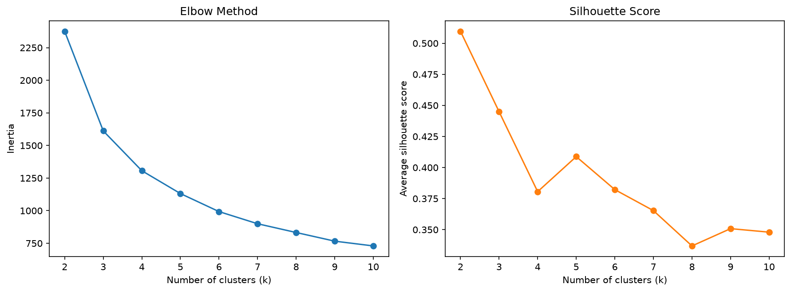
*Left: inertia against k, a smooth convex decay with no pronounced bend. Right: average silhouette score against k, peaking at k = 2 before falling to a plateau, with a secondary local rise at k = 5.*

**The silhouette is decisive and points to k = 2, though less sharply than on the full population.** It peaks at **0.5096 at k = 2**, 0.0647 above the runner-up (k = 3, 0.4450) — a relative margin of 14.5%, against 16.4% on the full 3,289-operator base before the Medicina de Grupo filter (Section 4.3.2.8). Every solution from k = 4 upward falls between 0.3369 and 0.4088, with k = 5 (0.4088) the closest competitor after k = 3 — a larger secondary rise than the full-population curve showed.

**The elbow is consistent with a small k but does not, alone, choose between k = 2 and k = 3.** The largest inertia reduction is from k = 2 to k = 3 (32.1%), after which marginal reductions decay through 18.9%, 13.4%, 12.2%, 9.4%, 7.5%, 8.0% and 4.8% with no pronounced bend. Under the standard reading — the elbow is where extra clusters stop paying — this places the elbow at k = 3, as the full-population curve also did, so the elbow is compatible with a low-k solution rather than independently selecting k = 2.

**`k = 2` is adopted.** It is the clear optimum on the criterion that measures cluster quality, lies within the region the elbow supports, and matches the question at this stage: separating active from marginal operators. Its margin over k = 3 is thinner here than on the full population (14.5% against 16.4%) and k = 5 sits closer behind than any k did there, but k = 2 remains the unambiguous silhouette maximum across k = 2 to 10.

##### 4.3.2.3. Training the final model

The final model, fit on the complete standardized matrix with `k = 2`, yields an uneven but substantial split: **713 operators in cluster 0 and 339 in cluster 1**.

##### 4.3.2.4. Assignment validation and cluster stability

All **1,052 operators received exactly one label, with 0 null labels and 0 duplicated `ID_PLANO`**, and the labelled row count equals the number of distinct operators in the raw matrix — closing the loop with Section 4.3.1.6 and ruling out rows lost or duplicated between the two notebooks.

A second check addresses a K-Means-specific risk. It converges to a local optimum that depends on the starting centroids, and `n_init = 10` only keeps the best of ten initializations *by inertia*, which says nothing about whether another seed would converge to a different partition of similar inertia. The notebook therefore re-fits the model **30 times with independent seeds (100 to 129)** and compares each run's labels with the reference partition using the **Adjusted Rand Index** — pairwise agreement between two partitions, invariant to relabeling, scoring 0 at chance and 1 for exact agreement.

Across all 30 runs the ARI has **mean 1.0, standard deviation 0.0, minimum 1.0 and maximum 1.0**: every re-run reproduced the reference partition exactly, operator for operator. The active/marginal split is not an artifact of the seed — which matters because every downstream stage depends on the operators it retains.

Each re-run keeps `n_init = 10`, so what is shown to be seed-independent is the configuration the project actually deploys, not single-initialization K-Means. That is the relevant reproducibility guarantee, and perfect agreement across every run is strong evidence that the groups are separated widely enough for initialization not to matter; it is not, strictly, the harsher `n_init = 1` test.

##### 4.3.2.5. Cluster profiling in original units

Clusters were formed in the standardized space of Section 4.3.1 — four log-transformed count features plus `meses_ativos`, standardized without a log step — whose coordinates carry no business meaning. Labels are therefore joined back onto the raw matrix on `ID_PLANO`, the reason both artifacts were persisted in Section 4.3.1.8, and profiled in original units:

| Metric | Cluster 0 — mean | Cluster 0 — median | Cluster 1 — mean | Cluster 1 — median |
|---|---|---|---|---|
| `total_eventos` | 6.0 | 4.0 | 188.4 | 43.0 |
| `total_itens` | 6.2 | 4.0 | 193.4 | 46.0 |
| `meses_ativos` | 3.6 | 3.0 | 10.6 | **11.0** |
| `municipios_beneficiarios` | 1.5 | 1.0 | 9.5 | 6.0 |
| `municipios_prestadores` | 1.2 | 1.0 | 3.1 | 2.0 |
| `procedimentos_distintos` | 1.7 | 2.0 | 5.4 | 5.0 |
| **Operators** | **713 (67.8%)** | | **339 (32.2%)** | |

Cluster 1 is higher on all six metrics at once, on both mean and median. That co-movement is the substantive finding: the separation is not one dominant variable with the rest following, but operators that are jointly larger, more persistent, and broader in geography and procedure mix. The typical cluster-1 operator records **43.0 events against 4.0 in cluster 0**, a factor of roughly eleven.

Two details connect to earlier sections. The median `meses_ativos` in cluster 1 is **11.0**, one month short of the variable's ceiling of 12.0 — the analogous full-population cluster reached the ceiling exactly (Section 4.3.2.8) — so temporal presence saturates slightly less sharply within Medicina de Grupo alone. And the right skew of Section 4.3.1.7 persists *within* cluster 1, whose mean event count (188.4) is more than four times its median (43.0), so the median remains the representative summary of a typical member.

##### 4.3.2.6. Criterion for classifying an operator as active

An operator is **active** if it belongs to the cluster with the higher mean `total_eventos`. The ranking is computed after assignment, on the original-unit matrix, not read off the centroids, whose corresponding coordinate is a z-scored `total_eventos_LOG` rather than an event count. The two cluster means are **6.00 and 188.38 events**, so cluster 1 is selected: **339 active operators — 32.2% of the 1,052 in the base**.

**The label is operational, not clinical.** "Active" means higher observed activity in the TISS records retained by the breast-cancer proxy of Section 4.2.2.3, as measured by the five clustering variables of Section 4.3.1 — event volume, temporal persistence, beneficiary- and provider-side reach, and procedure diversity. It says nothing about an operator's real clinical activity, eligible population or ultimate demand for breast-cancer care, and three properties of the data separate the two. The base has no diagnosis field, so breast-cancer relevance is inferred from billed codes rather than confirmed, with the residual ambiguity documented in Section 4.2.2.14. Absence from these records is not absence from the market: care may be reported late or not at all — the reporting lag visible in the reimbursement fields of Section 4.2.2.10 and in the Q4 volume drop of Section 4.2.1. And the metrics count events and codes, not patients. "Marginal" therefore means marginal *in this base over 2025*, not inactive.

The criterion was framed this way for three reasons. It invents no threshold: `k = 2` already yields a hard partition, so "active" reduces to cluster membership, with no tuned cut point to justify or re-tune. It uses the primary volume signal, `total_eventos`, which Section 4.3.1.3 showed to be positively associated with the other retained metrics, so ranking by it is consistent with the full feature set. And it produces the binary distinction the next stage needs, not a finer tiering the silhouette does not support.

The rule is also insensitive to the ranking metric. Cluster 1 leads on all six profiled metrics, on mean and median, and the gap between cluster means on `total_eventos` is a factor of roughly 31, so no plausible alternative criterion would select a different cluster. Relying on `total_eventos` in the code is an implementation detail, not an assumption the result rests on.

##### 4.3.2.7. Output, scope and limitations

The active operator list is written to `data/processed/active_operators.parquet` — **339 rows and 8 columns** (`ID_PLANO`, the assigned `cluster`, and the six activity metrics in original units), validated on write for duplicate IDs and missing values, both zero. Following the convention of reserving `data/processed/` for analysis-ready outputs, it is the operator population the subsequent stages consume.

Four limitations accompany it:

- **Only the active subset is persisted.** All 1,052 operators are labelled in memory, but the fully labelled matrix is not written to disk, so the marginal cluster is recoverable only by anti-joining `active_operators.parquet` against the interim matrix — a minor auditing friction worth resolving if the marginal group later needs its own analysis.
- **Of this notebook's two figures, only the elbow and silhouette curve is written to `assets/`** (`assets/kmeans-elbow-silhouette.png`), so the embedded image can be regenerated by re-running the notebook. The stability histogram renders inline only and is not embedded here. Notebooks 15 and 17 export further figures to `assets/` (`decision-tree-*.png`, `demand-rf-*.png`); of these, only notebook 17's SHAP figures (`demand-rf-shap-*.png`) are embedded, in Section 4.4.5.
- **`k = 2` answers the current question, not the final one.** The partition isolates active operators without describing structure *within* them. The silhouette's next-best value (k = 5, at 0.4088, closer to the peak than on the full population) suggests a finer partition is not far from competitive on this smaller population, so segmenting the active cluster is worth revisiting if the population stays fixed — though the evidence still favours k = 2 as tested.
- **No alternative clustering algorithm has been evaluated.** The k = 2..10 sweep is a hyperparameter search within K-Means, not a comparison of algorithms; Section 4.4.4 compares this candidate with the operator-municipality segmentation of Section 4.3.4.

##### 4.3.2.8. Adoption of Medicina de Grupo as the official population, and what changed

Sections 4.3.1 and 4.3.2 describe the *current*, official run of this stage, on the Medicina de Grupo population. It was adopted from [`data_pipeline/08_filter_medicina_de_grupo.ipynb`](../notebooks/data_pipeline/08_filter_medicina_de_grupo.ipynb), which applies `NM_MODALIDADE_Medicina De Grupo == 1` to the treated base — 70,004 of 310,340 rows (22.56%), 1,052 of 3,289 plans (32.0%) — as an explicit product decision to scope the modeling population to this modality. Every notebook from `09_activity_matrix_operator.ipynb` through `17_random_forest.ipynb` (14 excepted, see its own scope note) now reads that filtered base.

Before this decision, Sections 4.3.1 and 4.3.2 ran on the full 3,289-operator population, with `k = 2` selected by the same criterion at **0.5442**, a split of **1,064 operators (32.4%) active against 2,225 (67.6%) marginal**, and cluster means of **263.39 against 5.22 events**. The structure carries over largely unchanged — `k = 2` remains the silhouette optimum, the partition is seed-independent across 30 runs, and the active cluster leads on every profiled metric — but three things move:

- **The silhouette margin narrows.** k = 2's lead over its runner-up drops from 16.4% to 14.5%, and the third-best k, k = 5 in both runs, closes in on the peak: from 0.3926 (0.152 below it) to 0.4088 (0.101 below).
- **The active share is close but the membership is not identical.** 32.2% of Medicina de Grupo operators are active against 32.4% of the full population, but the lists disagree at the margin: of the 1,064 operators active on the full population, 295 (27.7%) are Medicina de Grupo and all 295 remain active here, while this run additionally classifies 44 plans as active that the full-population run called marginal, all small (7 to 134 events, median 16). No plan moves from active to marginal.
- **The gap between clusters narrows in absolute terms.** The active/marginal ratio on mean `total_eventos` falls from roughly 50× to roughly 31×, because the top of the distribution is lower without the largest plans of the other five modalities: 6,859 events for the largest Medicina de Grupo plan against 12,153 for the largest in the full base.

The active/marginal boundary is drawn relative to the population being clustered, so restricting that population to one modality was expected to move it; the direction and size of that movement are now on record. `active_operators.parquet` holds the Medicina de Grupo result (339 rows) going forward, and the full-population numbers above are kept for comparison only, not recomputed by any notebook still in the pipeline.

#### 4.3.3. Operator-municipality activity matrix

Sections 4.3.1 and 4.3.2 answer "which operators are active" at operator grain. They do not answer *where* that activity is concentrated — a distinct question for network and access planning, since two operators with the same event volume can have very different geographic footprints. [`11_activity_matrix_operator_municipality.ipynb`](../notebooks/11_activity_matrix_operator_municipality.ipynb) rebuilds the Section 4.3.1 matrix at one row per `(ID_PLANO, CD_MUNICIPIO_BENEFICIARIO, CD_MUNICIPIO_PRESTADOR)` triple instead of one per `ID_PLANO`. `CD_MUNICIPIO_BENEFICIARIO` is where the beneficiary resides (demand side) and `CD_MUNICIPIO_PRESTADOR` where the service was provided (supply side); they stay separate grouping keys, since merging them would discard the beneficiary/provider distinction Section 4.3.1.3 argued is worth preserving.

The partner requested this granularity, but not blindly: `documents/extras/target_definition_potencial_pacientes.md` (Section 5) had already warned that adding municipality to the key would push many groups toward single-observation sparsity — "statistical noise from excessive granularity" (Section 4.1.5). The notebook proceeds anyway and treats the warning as a hypothesis to check against its own numbers, with the same audit discipline as Sections 4.2 and 4.3.1.

##### 4.3.3.1. Granularity change and dropped metrics

The notebook reads the same 70,004-row, 119-column Medicina de Grupo base as Section 4.3.1 (`data/processed/north_region_mama_2025_data_en_medicina_de_grupo.parquet`, again **1,052 distinct operators**, 581 distinct beneficiary municipalities and 49 distinct provider municipalities) and groups by the three-column key, producing **5,089 operator-municipality pairs** — roughly 4.8 per operator on average, though Section 4.3.3.4 shows that average is not representative.

`municipios_beneficiarios` and `municipios_prestadores` are dropped rather than recomputed: once the key fixes one beneficiary and one provider municipality per row, both are constant at 1 by construction. The other three metrics — `total_eventos`, `meses_ativos` and `procedimentos_distintos` — still vary within a pair and keep their Section 4.3.1.2 definitions.

##### 4.3.3.2. Sparsity check

The matrix confirms the target-definition document's concern before any feature engineering:

| Metric | Mean | Std. dev. | Min | 25% | Median | 75% | Max |
|---|---|---|---|---|---|---|---|
| `total_eventos` | 13.39 | 125.40 | 1 | 1 | 2 | 4 | 5,747 |
| `total_itens` | 13.76 | 126.13 | 1 | 1 | 2 | 5 | 5,747 |
| `meses_ativos` | 2.98 | 3.03 | 1 | 1 | 2 | 4 | 12 |
| `procedimentos_distintos` | 1.56 | 0.98 | 1 | 1 | 1 | 2 | 11 |

**2,140 pairs (42.1%) record exactly one distinct event, and 1,992 pairs (39.1%) consist of exactly one item row.** The median pair is a two-month, two-event occurrence — far thinner than the operator-level median of 7 events across 2 municipalities (Section 4.3.1.2). This is Risk R03 realized numerically, not an aggregation defect: split across every municipality it touches, an operator's activity is mostly one-off appearances, with a few municipalities carrying sustained presence. Single-event pairs are kept as real if minimal observations, consistent with the project's practice of not removing data for being small; the "active" criterion of Section 4.3.4 should accordingly be read as *activity concentrated in that specific municipality*.

##### 4.3.3.3. Manual aggregation validation

Section 4.3.1.6's validation is repeated with one adjustment the sparsity requires: a blind random sample of five pairs would very likely land entirely on the single-event mass (39.1% of rows) and never exercise the `nunique()`-over-months logic. The sample was therefore stratified — the highest-volume pair, the pair with the most active months, a pair nearest the median event count, and two pairs drawn with `random_state=42` — so it can catch a bug in any of the four metrics, not only in the degenerate case:

| `ID_PLANO` | `CD_MUNICIPIO_BENEFICIARIO` | `CD_MUNICIPIO_PRESTADOR` | `total_eventos` | `total_itens` | `meses_ativos` | `procedimentos_distintos` |
|---|---|---|---|---|---|---|
| 1173218 | 130260 | 130260 | 5,747 | 5,747 | 12 | 10 |
| 1169857 | 150140 | 150140 | 121 | 138 | 12 | 4 |
| 266963 | 355030 | 130406 | 8 | 8 | 6 | 2 |
| 1169447 | 150420 | 150553 | 2 | 2 | 2 | 2 |
| 163444 | 110020 | 110012 | 1 | 1 | 1 | 1 |

All four metrics were recalculated independently from the item-level base for these pairs and compared through four equality assertions; all passed for every pair. Because the sample includes pairs with `meses_ativos = 12`, it genuinely exercises the distinct-months aggregation, which a naive sample would likely miss given the mass at `meses_ativos = 1`.

##### 4.3.3.4. Extreme activity patterns

The long tail of Section 4.3.1.7 reappears at the finer grain:

| Quantile | `total_eventos` | `meses_ativos` | `procedimentos_distintos` |
|---|---|---|---|
| 0.50 | 2.0 | 2.0 | 1.0 |
| 0.90 | 14.0 | 8.0 | 3.0 |
| 0.95 | 29.0 | 11.0 | 3.0 |
| 0.99 | 177.6 | 12.0 | 5.0 |
| 1.00 | 5,747.0 | 12.0 | 11.0 |

The most extreme pair — `ID_PLANO` 1173218, with beneficiary and provider municipality both 130260 — records 5,747 distinct events over all 12 months and 10 distinct procedures, from 5,747 item rows (an items-per-event ratio of exactly 1.0). It is the operator ranking second by volume at operator level (5,792 events across its full footprint, behind `ID_PLANO` 239258's 6,859 in Section 4.3.1.7), so nearly all of its volume sits in a single municipality pair. Re-querying the treated base for this triple reproduces the same row count and month/procedure coverage, confirming a real concentration of activity. As in Section 4.3.1.7, it is kept rather than capped or removed: concentrated activity in one location is what this notebook exists to detect.

##### 4.3.3.5. Redundancy screening, skewness treatment and standardization

The preparation of Sections 4.3.1.3 to 4.3.1.5 was repeated and reached the same qualitative conclusions on the three features available at this grain:

| Pair | Pearson r | Decision |
|---|---|---|
| `total_eventos` × `total_itens` | 0.9996 | `total_itens` dropped — near-duplicate of `total_eventos`, matching the redundancy already found in Section 4.3.1.3. |
| `total_eventos` × `meses_ativos` | 0.2455 | Both retained. |
| `total_eventos` × `procedimentos_distintos` | 0.3958 | Both retained. |
| `meses_ativos` × `procedimentos_distintos` | 0.6576 | Both retained. |

Skewness of the retained features was **31.88 for `total_eventos`, 2.84 for `procedimentos_distintos`, and 1.75 for `meses_ativos`.** Which features to log-transform was matched by hand to Section 4.3.1.4's operator-level choice: `total_eventos` and `procedimentos_distintos` received `log1p` (down to 2.22 and 1.51), while `meses_ativos`, bounded to 1–12, was left untransformed. **On this population the numbers no longer justify that split on their own**: only `total_eventos` carries order-of-magnitude skew, while `procedimentos_distintos` (2.84) and `meses_ativos` (1.75) sit close together, so no data-driven threshold separates them. `meses_ativos` is also more skewed here than at operator level (1.75 against 0.33), a direct consequence of the sparsity in Section 4.3.3.2, since most pairs are active in only one or two months. The choice therefore rests on comparability: matching the operator-level treatment keeps the two granularities aligned, which is why it is hand-made rather than read off an automatic rule.

The resulting features (`total_eventos_LOG`, `meses_ativos`, `procedimentos_distintos_LOG`) were standardized with `StandardScaler`, giving means at floating-point zero and standard deviations of 1.000098 — the same population/sample-variance artifact explained in Section 4.3.1.5 (√(5089 / 5088) = 1.000098). Section 4.3.1.5's argument for fitting on the full population also applies: the 5,089 pairs are every operator-municipality combination in the Medicina de Grupo base, so there is no partition boundary to leak across.

##### 4.3.3.6. Output

Two artifacts are written, named distinctly from Section 4.3.1.8's files so the granularities cannot be confused on disk:

| Artifact | Path | Shape | Contents |
|---|---|---|---|
| Raw activity matrix | `data/interim/north_region_mama_2025_activity_matrix_by_municipality.parquet` | (5,089, 9) | The three group keys, the three retained metrics, `total_itens`, and the two `*_LOG` columns. |
| Scaled activity matrix | `data/processed/north_region_mama_2025_activity_matrix_by_municipality_scaled.parquet` | (5,089, 6) | The three group keys and the three standardized clustering features — the direct input to Section 4.3.4. |

Both were checked before writing for duplicate `(ID_PLANO, CD_MUNICIPIO_BENEFICIARIO, CD_MUNICIPIO_PRESTADOR)` keys and missing clustering values; both returned zero. They follow Section 4.3.1.8's `data/interim` → `data/processed` convention at a finer granularity, alongside the operator-level artifacts rather than replacing them.

#### 4.3.4. K-Means operator-municipality segmentation

[`12_kmeans_operator_municipality.ipynb`](../notebooks/12_kmeans_operator_municipality.ipynb) applies K-Means to the Section 4.3.3 matrix to segment operator-municipality pairs by activity and derive an "active" criterion at that grain — Section 4.3.2's goal, applied to the finer unit. It loads both Section 4.3.3.6 artifacts unchanged and does no re-scaling or feature engineering, for the reason given in Section 4.3.2.1. Both inputs were re-validated on load — shapes (5,089, 9) and (5,089, 6), zero duplicate keys, zero missing clustering values — before any clustering.

##### 4.3.4.1. A methodological error, caught and corrected during peer review

An earlier version selected `k` as Section 4.3.2.2 did: sweep the silhouette over k on the full scaled matrix and take the maximum. Extended here to k = [2, 3, 5, 10, 15, 20, 25, 30, 40] on all 5,089 rows, the score has no peak in that range, but it is not monotonic either: it drops from **0.6694 at k = 2 to a trough of 0.6017 at k = 3** (a 10.1% relative drop), the largest change on the curve, then climbs with one small dip (0.6970 at k = 15 to 0.6942 at k = 20) to **0.7903 at k = 40**, crossing back above the k = 2 value already between k = 5 (0.6250) and k = 10 (0.6834). The practical conclusion stands: from k = 3 onward, "pick the highest silhouette" has essentially no stopping point, and pushed further it keeps favoring larger k toward the degenerate limit where every point is its own cluster and the score approaches 1 by construction. A version reviewed in a merge request selected `k = 10` on this basis before the problem below was identified.

The cause is structural, not a matter of range. The three features take very few distinct combinations at this grain: the 5,089 rows occupy only **596 distinct feature-space positions**, and **1,992 rows (39.1%)** sit on exactly one of them — the 1-event, 1-month, 1-procedure point, the single-event mass of Section 4.3.3.2. A point identical to roughly 1,990 others is at near-zero distance from most of its cluster almost regardless of `k`, so any partition keeping that mass together scores near-maximal silhouette on it alone, and the average inherits the inflation. As `k` grows and the algorithm can also carve small, clean single-point clusters out of the tail, the average keeps rising — not because separation improves, but because more of the score comes from near-perfect matches on the repeated point. The k = 10 result was not an arithmetic error; the metric simply was not measuring separation on this matrix.

##### 4.3.4.2. Corrected k-selection on deduplicated positions — and a result that no longer settles cleanly on k = 2

The fix runs k-selection on the 596 *distinct* positions, each counted once however many rows share it, with the same standardized features and the same K-Means/silhouette machinery. This removes the mechanical inflation without changing the features or their preparation:

| k | Inertia | Silhouette (deduplicated) |
|---|---|---|
| **2** | 1,442.74 | 0.3726 |
| 3 | 1,041.44 | 0.3334 |
| 4 | 801.35 | 0.3309 |
| 5 | 656.22 | 0.3418 |
| 6 | 565.93 | 0.3097 |
| 7 | 503.42 | 0.3066 |
| 8 | 444.79 | 0.3394 |
| 9 | 399.37 | 0.3373 |
| 10 | 363.23 | 0.3371 |
| 15 | 252.26 | 0.3459 |
| 20 | 186.16 | 0.3699 |
| 25 | 145.82 | 0.3844 |
| 30 | 121.34 | 0.3766 |
| **40** | 87.40 | **0.3896** |

**On the Medicina de Grupo population the corrected silhouette no longer peaks cleanly at k = 2.** The maximum is **k = 40 (0.3896)**, with k = 2 fourth at **0.3726** — only 0.0170 below, a **4.6% relative margin**, against the roughly 3× wider margin of the full-population check, where k = 2 was the global maximum over the same range at 0.3777 against k = 3's 0.3316 (13.9%). The top of this curve is a shallow plateau rather than a peak: k = 40 (0.3896), k = 25 (0.3844) and k = 30 (0.3766) sit within 0.013 of each other, with k = 2 close behind.

**k = 2 is adopted anyway, by design rather than by argmax**, for three reasons, none of them "the silhouette says so":

- The margin is too thin to trust as a structural signal. A shallow plateau where four values of k sit within rounding distance, computed on 596 distinct positions with 39.1% of rows on one degenerate point, is exactly the curve Section 4.3.4.1 warns against over-reading; treating a 4.6% margin as decisive would repeat that lesson in miniature.
- The downstream criterion (Section 4.3.4.6) is built for a binary split: it names "the cluster with the higher mean `total_eventos`" as active and everything else marginal. That rule does not generalize to k = 40, where a single top-mean cluster of forty selects a handful of extreme outlier pairs, not "active" in the sense this workstream defines.
- k = 2 keeps this result on the same footing as Section 4.3.2's operator-level result, the comparison Section 4.3.4.6 is built on.

The elbow does not resolve the tie either: inertia decays smoothly from 1,442.74 to 87.40 with no sharp bend (the largest single drop, 27.8%, is again k = 2 to k = 3), the same shape as the full-population curve — compatible with a small k, but not independent evidence for k = 2.

`k = 2` is therefore adopted deliberately, consistent with Section 4.3.2, and the notebook records the argmax it overrides rather than silently discarding it.

##### 4.3.4.3. Training the final model and assignment validation

The final model was fit on the complete standardized matrix with `k = 2` (`random_state = 42`, `n_init = 10`, as in Section 4.3.2.1), giving an uneven split of **874 pairs in cluster 1 and 4,215 in cluster 0**. All 5,089 pairs received exactly one label, with **0 null labels and 0 duplicated `(ID_PLANO, CD_MUNICIPIO_BENEFICIARIO, CD_MUNICIPIO_PRESTADOR)` keys**, mirroring Section 4.3.2.4.

##### 4.3.4.4. Cluster stability

The 30-seed re-fitting of Section 4.3.2.4 was repeated (seeds 100–129, `n_init = 10` each), comparing each run to the reference partition with the Adjusted Rand Index: **mean ARI 1.0, standard deviation 0.0, minimum and maximum 1.0** across all 30 runs — every re-run reproduces the reference exactly.

With 39.1% of rows on one identical point, **any** partition that keeps that mass together will look stable under re-initialization almost by definition, since no seed can easily split it. Perfect ARI is therefore necessary but not sufficient, and says nothing about whether k = 2 is the best-*separated* choice — Section 4.3.4.2 shows it is not the clear winner, only the deliberately adopted one. This section establishes the narrower point: given k = 2, the split K-Means converges to is reproducible and not a seed artifact.

##### 4.3.4.5. Cluster profiling in original units

Labels were joined back onto the raw matrix of Section 4.3.3.6 and profiled in original units, as in Section 4.3.2.5:

| Metric | Cluster 0 — mean | Cluster 0 — median | Cluster 1 — mean | Cluster 1 — median |
|---|---|---|---|---|
| `total_eventos` | 2.13 | 1.0 | 67.68 | 16.5 |
| `total_itens` | 2.21 | 2.0 | 69.44 | 17.0 |
| `meses_ativos` | 1.78 | 1.0 | 8.78 | 9.0 |
| `procedimentos_distintos` | 1.27 | 1.0 | 2.98 | 3.0 |
| **Pairs** | **4,215 (82.8%)** | | **874 (17.2%)** | |

Cluster 1 leads on every metric, on mean and median — the co-movement Section 4.3.2.5 found at operator level, reproduced here. The typical cluster-1 pair records 16.5 events against 1 in cluster 0; the mean gap (31.7×) is narrower than the roughly 38-fold difference in the equivalent full-population clusters, consistent with separating a thinner, sparser distribution (Section 4.3.3.2) and with this population's lower ceiling on extreme volume (Section 4.3.1.7).

##### 4.3.4.6. Criterion for classifying a pair as active

A pair is **active** under the rule of Section 4.3.2.6: it belongs to the cluster with the higher mean `total_eventos`, computed after assignment on the original-unit matrix. The cluster means are **2.13 and 67.68 events**, so cluster 1 is selected: **874 active pairs, 17.2% of the 5,089 pairs**, spanning **428 distinct operators**.

Against Section 4.3.2.6, 339 operators (32.2% of 1,052) are active overall, while 428 distinct operators (40.7% of 1,052) appear in at least one active pair here. The counts are close in spirit but answer different questions over different units — an operator's aggregate activity versus activity within one municipality — and an operator can be in one list but not the other: high overall volume spread thinly across many municipalities may leave no single pair above the finer threshold, while an operator marginal overall may still be concentrated and active in one municipality. The two lists are complementary evidence.

As in Section 4.3.2.6, the criterion invents no tuned threshold — k = 2 already yields the hard partition — and it is insensitive to the ranking metric, since cluster 1 leads on all four profiled metrics with a large gap on `total_eventos` (roughly 32 times between cluster means).

##### 4.3.4.7. Output, scope and limitations

The active pairs are written to `data/processed/active_operator_municipality_pairs.parquet` — **874 rows**, with the three group keys, the assigned `cluster` and the four activity metrics in original units, validated on write for duplicate keys and missing values, both zero. The filename is distinct from Section 4.3.2.7's `active_operators.parquet` because the unit of observation differs.

The limitations of Section 4.3.2.7 still apply at this grain and are not repeated; four specific to this notebook are recorded:

- **The naive silhouette failure of Section 4.3.4.1 is a risk for any future granularity added to this pipeline.** A key fine enough to create a large repeated-value mass — for example adding a time dimension to operator and municipality — would very likely reproduce the inflation unless k-selection again runs on deduplicated positions.
- **k = 2 is a deliberate choice on this population, not the corrected metric's clear winner.** Section 4.3.4.2 records this explicitly: the deduplicated argmax is k = 40, only 4.6% above k = 2. Unlike the full-population run, where the check was unambiguous, this should be read as "k = 2 remains defensible and keeps the workstream comparable to Section 4.3.2", not as "k = 2 is what the evidence points to on its own".
- **The active cluster is necessarily broad.** As on the full population, it groups pairs from solidly sustained to moderately active, without the finer tiering a higher k might offer — a limitation the thin margin in Section 4.3.4.2 makes more salient here.
- **No figure from this notebook is exported to `assets/`.** As with notebook 10 (Section 4.3.2.7), the elbow and naive-versus-corrected silhouette plots render inline only; reproducing them here would require adding `savefig` calls.

#### 4.3.5. Verticalization target feasibility from non-hospital market share

[`14_verticalization_audit.ipynb`](../notebooks/14_verticalization_audit.ipynb) asks whether the partner-supplied network weights can identify the common economic control between an operator and a specialized provider that defines verticalization here. The answer is **UNKNOWN / TARGET NOT IDENTIFIABLE**: concentration is observable, common ownership is not. The audit changes nothing downstream — no redefined demand outcome, no verticalization feature — so this summary is deliberately short; the full evidence, diagnostic tables and 20 technical checks are in the notebook.

**Population (unchanged by the Medicina de Grupo decision).** Sections 4.3.1–4.3.4 and 4.3.6–4.3.10 run on the Medicina de Grupo subset of the treated base (Section 4.3.2.8). This notebook is deliberately excluded from that change and keeps auditing the full 3,289-operator population: under the partner-confirmed rule in [`data_pipeline/08_filter_medicina_de_grupo.ipynb`](../notebooks/data_pipeline/08_filter_medicina_de_grupo.ipynb) every Medicina de Grupo operator is already `VERTICALIZED_OPERATOR = 1`, so restricting the audit to that subset would make the question it asks — whether verticalization can be identified from market-share data — circular.

##### 4.3.5.1. What the snapshot is, and what it supports

The input is a partner-supplied non-hospital market-share CSV of **10,000 operator–plan–provider relationships, 46 plans, 3 operators and 1,365 distinct CNES identifiers across all 27 states** — wider than the North-only claims base, and with no reference or publication date of its own; July 2025 in the claims dictionary and August 2025 in the project narrative remain unverified and conflicting context. The public ANS pipeline does not produce it (notebooks 01–13 do not calculate its weights), and substituting the [official ANS non-hospital registry](https://dadosabertos.ans.gov.br/FTP/PDA/operadoras_e_prestadores_nao_hospitalares/) would not reproduce its unknown weighting. The original export query, allocation quantities, numerator, denominator and facility-selection rules were not located.

What the file measures: the key `(CD_OPERADORA, ID_PLANO, CD_CNES)` is unique, and `MARKET_SHARE_PCT` behaves as percentage points within a plan — compatible with `100 × provider allocation quantity / total allocation quantity in that plan`, with the allocation quantity unknown and no patient, encounter, revenue or capacity reading established; a value of 1 means 1%, not an ownership flag. `N_PRESTADORES_NO_GRUPO` is constant within a plan and equals the observed distinct provider count in **45 of 46 plans**, supporting a plan-network aggregation reading and nothing stronger; uniform weighting `100 / N_PRESTADORES_NO_GRUPO` does not reproduce the varying weights. `MARKET_SHARE_PCT_INT` holds whole percentage points, not a binary integration label: a largest-remainder reconstruction reproduces all **10,000** integer values exactly, showing arithmetic compatibility with, not the identity of, the unavailable generating program. The export is also incomplete — the final plan, `16192433`, carries **227 of 584 declared providers** and only **84.558 percentage points** — so integer totals of 100 are no evidence of completeness.

##### 4.3.5.2. Why ownership is not identifiable

The audit grades every ownership candidate against an explicit evidence standard:

| Evidence level | Requirement | Application in this audit |
| --- | --- | --- |
| `DIRECT` | Dated authoritative common-control relationship, or an explicit sufficiently scoped negative, linked to the exact entities | No verified records |
| `STRONG_PROXY` | Independently corroborated structural evidence validated against direct labels, with an explicit project decision accepting it | No validated candidate |
| `WEAK_PROXY` | Network membership, concentration, size or activity patterns | Concentration diagnostics only |
| `UNKNOWN` | Missing, inconsistent, incomplete or unlinked ownership evidence | Every ownership candidate |

Nothing in the snapshot goes beyond `WEAK_PROXY`. Network membership is not ownership: 484 providers serve more than one observed operator and 69 serve all three. Concentration is measurable — top-one, top-three and top-five shares and `HHI = sum(p_j²)` — but network size mechanically constrains it (Spearman ≈ −0.947 between provider count and HHI across count-complete plans) and plans share providers, so it validates nothing about ownership. High share, concentration, group count with share, and weighted concentration are all rejected **as labeling rules for these inputs**; without independent ownership labels, no accuracy, AUC or p-value can be reported either way.

The linkage gap is decisive and separate. To compare ownership with activity, notebook 14 reproduces both activity rules in memory from the treated base itself (`KMeans(n_clusters=2, n_init=10, random_state=42)` in each case) rather than reading the artifacts notebooks 09–12 leave on disk, which now hold the filtered population and would make the comparison circular for the one modality it could test. The reconstruction returns **1,064 ATUANTE and 2,225 MARGINAL** claims IDs across 3,289 operators, on cluster means of **263.39 against 5.22** events — matching the full-population result Section 4.3.2 reported before the Medicina de Grupo change (Section 4.3.2.8) — and the municipality rollup over **25,482 operator-municipality pairs** gives 1,168 ATUANTE and 2,121 MARGINAL. Neither redoes model selection or changes the activity definition. The comparison still fails: claims `ID_PLANO` and ANS operator registration are not shown to be the same identifier, and there are **zero exact overlaps** between the 3,289 claims IDs and either market-share plan key. Activity cannot be assigned to the three market-share operators at all, and the audit records `UNKNOWN_UNLINKED`. `VERTICALIZED_PROVIDER`, `VERTICALIZED_OPERATOR`, `VERTICALIZATION_INTENSITY` and `VERTICALIZED_MARKET_SHARE` therefore stay nullable, and `VERTICALIZATION_TARGET = "Unknown"` for all three observed operators. **Unknown is never imputed to zero**: an operator-level negative needs an explicit valid negative or a complete scoped assessment, and non-hospital North-region data cannot show the absence of owned capacity elsewhere.

Closing the question would require the full export and its generating query, the original allocation quantities and denominator, dated operator-to-provider common-control records, a validated identifier crosswalk, an explicit service and geographic scope, and validated positive *and* negative reference labels. [ANS owned-network reporting guidance](https://www.gov.br/ans/pt-br/assuntos/operadoras/compromissos-e-interacoes-com-a-ans-1/envio-de-informacoes-1/envio-de-registro-de-rede-propria) illustrates the identifiers such evidence would carry, but no operator-specific records were obtained. Public references were checked on September 9, 2026. Until they are satisfied, **VERTICALIZATION TARGET CANNOT BE DIRECTLY IDENTIFIED FROM NON-HOSPITAL MARKET SHARE ALONE** — a constraint on any definitive verticalization labeling or feature decision, not a replacement for the separately defined demand outcome.

##### 4.3.5.3. The temporal gate this places on the concentration family

Since concentration *is* measurable, the audit states when it could become a feature. Its allocation basis, scope, reference period and actual availability date must first be established: a share derived from demand inside the forecast horizon would leak the outcome, full-year activity classifications use information later than many within-year cutoffs, and ownership evidence must be valid at the relevant date, since using a label-defining ownership flag to predict that same label would be circular. Section 4.3.6 records the resulting candidate contract and keeps all these fields out of `X`.

##### 4.3.5.4. Access and reproduction

The market-share CSV is **partner-supplied confidential data**, excluded from version control, so its download link appears in neither the notebook nor this document. The notebook reads it from `NON_HOSPITAL_MARKET_SHARE_URL` in a `.env` file at the repository root; `.env` is gitignored, and the committed `.env.example` shows the expected variable. To reproduce this section, copy `.env.example` to `.env` and fill in the link, or place the CSV at `data/raw/ans_ambulatorial/market_share_nao_hospitalar_todas_ufs.csv`, which is reused before any download. If neither is available the notebook stops with an explicit instruction rather than substituting another dataset, and `scripts/run_pipeline.py` skips this stage with the same explanation. The audited snapshot is identified by SHA-256 `33473f6690ad73946da19d528ce9e3b58d9a0c4848fe899ce0b705e537bed853`, asserted on every run; reference-specific numeric checks apply only when the hash matches, and a different version forces every diagnostic to be recomputed.

Otherwise the notebook is self-contained: Python 3.10+ in Jupyter or Colab, dependencies installed into the active kernel, results held in memory and shown inline, nothing written to disk. Claims and prior activity artifacts are optional cross-checks whose absence is reported. A full run on the audited snapshot passes 20 technical checks covering keys, integer reconstruction, incomplete extraction, weight conservation, operator-scenario reconciliation and preservation of unknown targets.

#### 4.3.6. Feature proposal update and training-integration gate

[`13_modeling_matrix.ipynb`](../notebooks/13_modeling_matrix.ipynb) incorporates the audit without changing the demand definition. The target remains `volume_demanda_proxy = SUM(QT_ITEM_EVENTO_INFORMADO)` at `ID_PLANO x treatment_line_primary x UF_PRESTADOR x MES`, under an explicit measurement-quality rule: `IND_PACOTE_1 = 1` marks rows whose quantities are unavailable because they were billed as a package. Of the 10,302 observed target groups, 26 are entirely bundled and stay null, and 128 mix bundled and itemized rows and so give only a lower bound. Both classes remain available for diagnostics but are excluded from the training target and from historical demand windows; Section 4.3.11.2 measures how much of the target this rule makes depend on the treatment-line grain. Missing months are set to zero from each operator's first observed claim to the end of the data: a month without a claim is zero *billed* volume, a claims-based rule rather than evidence of enrollment.

The modeling population is still restricted to `ATUANTE` operators, but **as of each month**. An earlier version merged the full-year notebook 11/12 classification onto every month and ran each operator's panel to its last claim of the year, so an early-2025 row could exist because of activity observed months later — a population-selection leak that excluding `STATUS_ATUACAO` from `X` did not remove. Notebook 13 now re-applies the notebook 11/12 method to the claims dated before each month (verified to reproduce notebook 12 exactly on the full year) and keeps a row for month *s* only if its operator was ATUANTE on those prior claims and its `operator × line × UF` combination had already been billed. Lag features are computed on the complete panel before that filter, so no row's history is broken. Every persisted row is one a forecaster could have been asked for at the start of its month, and any split on `MES` is free of look-ahead. `STATUS_ATUACAO` lives only in the in-memory analytical table, outside `X_current` and the persisted training matrix; the full-year classification is kept only for traceability and the comparison with notebook 10. Section 4.3.8.6 reports what the fix changed.

The audit revises the earlier conclusion that network information was wholly unavailable: the non-hospital market-share source supports proposals for network size and concentration, though not yet integration with the claims modeling grain. The candidate contract:

| Proposed field | Source | Formula / transformation | Aggregation level and incomplete-plan handling | Temporal availability | Status |
| --- | --- | --- | --- | --- | --- |
| `N_PRESTADORES_NO_GRUPO` | Non-Hospital Market Share, audited in notebook 14 | Take the single declared value only after asserting it is constant within each plan | Plan snapshot; it is not a scalar operator attribute. Retain the count-incomplete plan for diagnostics and exclude it from feature roll-ups | Source reference and publication dates are unknown; both must precede the prediction cutoff | **PENDING candidate; excluded from `X`** |
| `N_PRESTADORES` | Same source, `CD_CNES` | `nunique(CD_CNES)` | Operator-plan snapshot. Do not calculate it from `df_norte`, which has no `CD_CNES`. Count-incomplete plans are under-counted and remain diagnostic only | Same unknown snapshot availability | **PENDING candidate; excluded from `X`** |
| `MARKET_SHARE_TOTAL` | Same source, `MARKET_SHARE_PCT` | For positive-mass plans, `p_j = share_j / sum(share)`, then `sum(p_j)` | Plan-level weight-conservation check; equals 1 after normalization | Same unknown snapshot availability | **DIAGNOSTIC; excluded from `X` because it has no variance** |
| `MARKET_SHARE_MAX` | Same source, `MARKET_SHARE_PCT` | `max(p_j)` | Plan snapshot; an operator scenario may equally average normalized weights across count-complete, positive-mass plans only | Must be dated, available before the cutoff, and based on a non-forecast-horizon numerator | **PENDING candidate; excluded from `X`** |
| `MARKET_SHARE_TOP3` | Same source, `MARKET_SHARE_PCT` | Sum of the three largest `p_j` values | Same plan/scenario rule; exclude count-incomplete plans from the operator scenario | Same restriction | **PENDING candidate; excluded from `X`** |
| `MARKET_SHARE_TOP5` | Same source, `MARKET_SHARE_PCT` | Sum of the five largest `p_j` values | Same plan/scenario rule; exclude count-incomplete plans from the operator scenario | Same restriction | **PENDING candidate; excluded from `X`** |
| `HHI_NETWORK` | Same source, `MARKET_SHARE_PCT` | `sum(p_j ** 2)` on a 0–1 scale | Same plan/scenario rule; exclude count-incomplete plans from the operator scenario | Same restriction | **PENDING candidate; excluded from `X`** |
| `N_MUNICIPIOS_BENEFICIARIO_TRAILING` | `df_norte.CD_MUNICIPIO_BENEFICIARIO` | Historical `nunique` | By `ID_PLANO` and prediction cutoff; the window must end before the target month | Strictly historical window only; notebook-09/11 full-year counts are not reusable | **CANDIDATE requiring historical-window engineering** |
| `N_MUNICIPIOS_PRESTADOR_TRAILING` | `df_norte.CD_MUNICIPIO_PRESTADOR` | Historical `nunique` | By `ID_PLANO` and prediction cutoff | Strictly historical window only | **CANDIDATE requiring historical-window engineering** |
| `N_PROCEDIMENTOS_DISTINTOS_TRAILING` | `df_norte.CD_PROCEDIMENTO` | Historical `nunique` | By `ID_PLANO` and prediction cutoff | Strictly historical window only; a full-year count would contain future information | **CANDIDATE requiring historical-window engineering** |

Proposal status is deliberately separate from training approval. Before any network or concentration candidate enters `X`, the project must validate a claims-to-ANS/operator identifier crosswalk, check source reference and publication dates against the prediction cutoff, reconcile the national 27-state snapshot with the North-only claims scope, define the plan-to-model aggregation rule, and assert the intended join cardinality without row multiplication. None of these gates passes yet, so notebook 13 documents the candidates without merging them into `modeling_matrix_v1` or `X_current`.

The concentration family is also substantially redundant. Across count-complete plans, observed provider count has Spearman coefficients of about −0.947 with HHI and −0.899 with maximum provider share, and maximum share and HHI about 0.961; `N_PRESTADORES_NO_GRUPO` equals the observed provider count in 45 of 46 plans. If the gates later pass, provider count, maximum, top-three and top-five share and HHI must be screened jointly, not treated as independent signals.

Verticalization remains a different question from concentration:

| Pending field | Evidence required | Current decision |
| --- | --- | --- |
| `VERTICALIZED_PROVIDER` | Dated operator-provider common-control evidence; a zero requires an explicit valid negative | `Unknown` / NA; excluded from `X` |
| `VERTICALIZED_OPERATOR` | At least one verified owned provider for 1; explicit valid negative or complete scoped assessment for 0 | `Unknown` / NA; excluded from `X` |
| `VERTICALIZATION_INTENSITY` | Verified owned-provider numerator and complete dated in-scope network denominator | NA; excluded from `X` |
| `VERTICALIZED_MARKET_SHARE` | Verified ownership joined to a validated, dated allocation mass and denominator | NA; excluded from `X` |
| `VERTICALIZATION_TARGET` | Evidence-backed Verticalized / Non-verticalized / Unknown classification | `Unknown`; pending evidence and never converted to zero |

This preserves the audit's core distinction: network concentration is measurable in the supplied snapshot; verticalization is not identifiable from it alone. The predictor contract contains only approved historical demand fields, `PORTE_ORDINAL` and `MONTH`. Notebook 13 persists `north_region_mama_2025_modeling_matrix_atuantes_v1.parquet` with only model keys, the usable demand target and those predictors, and the companion `north_region_mama_2025_modeling_matrix_atuantes_v1_feature_contract.csv` records each column's role, source, transformation, aggregation, temporal availability and status. Full-year activity fields, `STATUS_ATUACAO`, target-quality diagnostics and all pending network or verticalization fields stay out of the training artifact. The eight approved predictors, each with its formula and the reason it is in `X`:

| Feature | Formula | Source | Rationale |
| --- | --- | --- | --- |
| `DEMAND_LAG_1M` | `volume_demanda_proxy.groupby(ID_PLANO, treatment_line_primary, UF_PRESTADOR).shift(1)` | `modeling_matrix_v1`, derived from notebook 13's own target column | Most recent observed demand for the same panel unit; the single strongest autocorrelation signal available, and strictly prior to the target month by construction. |
| `DEMAND_LAG_3M` | Same grouping, `.shift(3)` | Same | Captures a quarterly echo of demand independent of the immediately preceding month, at the cost of more burn-in NaN (Sections 4.3.8.1 and 4.3.9.1). |
| `DEMAND_LAG_6M` | Same grouping, `.shift(6)` | Same | Captures a semiannual echo; retained despite covering only panel units with at least six prior observed months, since it is a distinct signal from the 1- and 3-month lags rather than a smoothed version of them. |
| `DEMAND_MEAN_3M` | `.shift(1).rolling(3, min_periods=1).mean()` | Same | Smooths short-term noise in `DEMAND_LAG_1M` by averaging the three months strictly before the target month; the leading `shift(1)` keeps the rolling window entirely in the past. |
| `DEMAND_MEAN_6M` | `.shift(1).rolling(6, min_periods=1).mean()` | Same | Same smoothing over a longer, more stable window; retained alongside `DEMAND_MEAN_3M` to give the model both a short- and a medium-term trend estimate rather than only one. |
| `DEMAND_STD_3M` | `.shift(1).rolling(3, min_periods=2).std()` | Same | Recent demand volatility for the panel unit. A model can treat a historically volatile unit differently from a stable one at the same lagged level, an uncertainty signal none of the mean-based features provide. |
| `PORTE_ORDINAL` | Ordinal encoding of the operator's declared beneficiary-size tier (`PEQUENO`/`MÉDIO`/`GRANDE`), fixed at Section 4.2.2.12 | `df_norte.PORTE_ORDINAL`, confirmed constant per `ID_PLANO` in Section 4.3.6 | The only static, non-target-derived predictor available. Time-invariant per operator, so it carries no temporal-leakage risk, unlike every activity-based candidate audited in Section 4.3.6. |
| `MONTH` | `MES.dt.month` | `modeling_matrix_v1.MES` | Calendar month, known with full certainty at any prediction time. Encodes the seasonal pattern already documented in Attachment 7.1 (a dip around August–September, a rise in November–December consistent with Pink October) without needing a value from the target series itself. |

#### 4.3.7. Linear Regression demand forecast

[`16_linear_regression.ipynb`](../notebooks/16_linear_regression.ipynb) fits and evaluates a **supervised** candidate from one of the two algorithm families named in Section 4.1.3b ("classical supervised Machine Learning model, built using algorithms such as Random Forest or Regression"). It covers items (a), (b) and (c) of the supervised track: problem modeling and feature selection, at least three test-set metrics, and the candidate model with a discussion of its results.

##### 4.3.7.1. Model choice and reused contract

The notebook consumes `data/processed/north_region_mama_2025_modeling_matrix_atuantes_v1.parquet` (11,526 rows, 13 columns, 507 operators) and its feature-contract CSV exactly as notebook 13 and `scripts/diagnose_modeling_matrix.py` left them, redefining nothing. This is the as-of construction of Section 4.3.10.2, built on the Medicina de Grupo population adopted in Section 4.3.2.8. The unit of observation is `ID_PLANO x treatment_line_primary x UF_PRESTADOR x MES` and the target is `volume_demanda_proxy`, `SUM(QT_ITEM_EVENTO_INFORMADO)` per unit. As `documents/extras/target_definition_potencial_pacientes.md` (Section 1) records, the TISS/ANS source has no beneficiary identifier, so the target is a utilization/demand-volume proxy with no derivable patient count — the same gap behind the proxy reasoning of Section 4.1.5 (R01).

The eight approved predictors are already numeric and need no encoding:

| Feature | Transformation | Temporal availability |
|---|---|---|
| `DEMAND_LAG_1M` | `shift(1)` within group | strictly prior to target |
| `DEMAND_LAG_3M` | `shift(3)` | prior |
| `DEMAND_LAG_6M` | `shift(6)` | prior |
| `DEMAND_MEAN_3M` | `shift(1).rolling(3).mean()` | prior (entire window in the past) |
| `DEMAND_MEAN_6M` | `shift(1).rolling(6).mean()` | prior |
| `DEMAND_STD_3M` | `shift(1).rolling(3).std()` | prior |
| `PORTE_ORDINAL` | none | pre-period |
| `MONTH` | `.dt.month` | known with full advance certainty |

##### 4.3.7.2. Feature selection rationale

Every candidate in notebook 13's Feature Proposal Matrix (Section 4.3.6) had to pass one rule before being marked `APPROVED`: exist strictly before the prediction month, at the right granularity, without being a contemporaneous derivation of the target. The approved predictors form two groups. **Historical demand** (`DEMAND_LAG_1M/3M/6M`, `DEMAND_MEAN_3M/6M`, `DEMAND_STD_3M`) encodes month-to-month autocorrelation: an operator x treatment-line x state unit with high recent volume is expected to continue, and the rolling standard deviation captures how volatile — and so how hard to predict — that history is. **Structural** features capture operator size (`PORTE_ORDINAL`, a pre-period, time-invariant attribute expected to scale volume upward) and, a priori, calendar seasonality (`MONTH`), including the Pink October effect documented elsewhere in the project. `ID_PLANO`, `treatment_line_primary`, `UF_PRESTADOR` and `MES` identify the unit and are excluded from `X` as grouping keys; `ID_PLANO` alone has 507 levels, an exclusion already justified in notebook 13. Section 4.3.7.4's split puts October-December only in the test set, so the model never trains on an actual October row; whether `MONTH` earns its place, and whether Pink October is even testable here, is revisited in Section 4.3.7.7.

One caveat specific to a **linear** model is carried through: `PORTE_ORDINAL` encodes size as `{-1, 0, 1, 2}`, where `-1` means "no beneficiaries" — a different regime, not a size below tier `0`. A linear model reads it as a numeric distance, an approximation fixed in Section 4.3.7.7.

##### 4.3.7.3. Skew in the target and predictors, and the log-log specification

The target is heavily skewed and zero-inflated: **45.8% of rows are exactly zero, skewness is 12.39, the median is 1 and the maximum is 6,974**. Since Linear Regression assumes a roughly linear, homoscedastic relationship, two decisions follow. **Decision 1**: the model is fit on `log1p(y)`, and every metric below is computed after back-transforming with `expm1` and clipping negative predictions to zero, so results are always read in the original business unit. **Decision 2**, carried over from the original full-population diagnosis (Section 4.3.10.2): the six historical-demand predictors are past values of the same skewed variable as the target, so fitting `log1p(y)` against their raw scale risks unstable extrapolation. Those six are therefore also `log1p`-transformed, a standard log-log specification for demand/elasticity modeling; `PORTE_ORDINAL` and `MONTH` stay on their original scale, since neither is skewed count data.

##### 4.3.7.4. Temporal train/test split

Per the *Temporal split* report of `scripts/diagnose_modeling_matrix.py`, the split follows `MES` chronologically. The lags are built with `groupby.shift`, so a random split would let `DEMAND_LAG_1M` carry a test month's own target into training, and even `GroupKFold`, which avoids that leak, would mix calendar periods across folds unlike a real forecast. The last three months, **October to December 2025, are the test set (3,810 rows)**; everything before is training: **7,716 rows, February to September 2025**. January never appears under the as-of construction (Section 4.3.10.2), since a row exists only once its operator has a prior claim to look back on.

##### 4.3.7.5. Missing values, multicollinearity and the initial fit

Lag and rolling features are `NaN` for a unit's first months by construction: `DEMAND_LAG_6M` is missing for **56.77%** of training rows (0.83% for `DEMAND_LAG_1M`, 18.44% for `DEMAND_LAG_3M`, 1.83% for `DEMAND_MEAN_3M`, 2.62% for `DEMAND_MEAN_6M`, 9.07% for `DEMAND_STD_3M`). The first-candidate default is median imputation, fit on the training split only inside a `Pipeline` so test months never leak into the statistic.

In a linear model, correlated predictors do not hurt accuracy but do inflate coefficient variance, so the Variance Inflation Factor was checked on the imputed, log-transformed training matrix:

| Feature | VIF |
|---|---|
| `DEMAND_MEAN_3M` | 52.19 |
| `DEMAND_MEAN_6M` | 34.78 |
| `DEMAND_LAG_1M` | 8.98 |
| `DEMAND_STD_3M` | 4.81 |
| `DEMAND_LAG_3M` | 3.62 |
| `DEMAND_LAG_6M` | 1.77 |
| `MONTH` | 1.25 |
| `PORTE_ORDINAL` | 1.02 |

Both rolling means sit well above the conventional threshold of 10, and further above it than on the full population — expected, since they come from the same `volume_demanda_proxy` history as the lags and this smaller, more autocorrelated panel sharpens that redundancy. A `Pipeline` (median imputer, then `LinearRegression`) fit on this specification gives the initial candidate's test-set metrics, against two naive references — the training-set mean for every row, and persistence, `DEMAND_LAG_1M` as-is:

| Model | R2 | MAE | RMSE | MedAE | Volume ratio |
|---|---|---|---|---|---|
| Baseline: train mean | -0.061 | 73.849 | 123.722 | 61.604 | 1.928 |
| Baseline: persistence (LAG_1M) | 0.611 | 19.721 | 74.895 | 1.000 | 1.043 |
| Linear Regression (log-log) | 0.563 | 19.218 | 79.363 | 0.543 | 0.565 |

R², MAE and RMSE are computed on the original volume scale, per the documented success criteria (Section 4.1.3e). Median Absolute Error is a fourth, outlier-robust metric given the extreme tail, and Volume ratio (predicted total ÷ actual total) a fifth: the dashboard sums predicted volume across operators, lines and states, so a value away from 1.0 signals a biased aggregate, not just individual misses. The initial candidate clears the mean baseline and beats persistence on MAE (19.218 vs. 19.721) and MedAE (0.543 vs. 1.000) but loses on R2 (0.563 vs. 0.611) and RMSE (79.363 vs. 74.895), and its retransformed predictions carry a **44% low bias in aggregate volume** (volume ratio 0.565). The mean log-scale residual is close to zero (-0.0228, std 0.9301), so the raw-scale gap is Jensen's inequality acting through the residuals' *variance* alone, not a biased mean prediction on the log scale — the same mechanism the full-population run diagnosed. Section 4.3.7.7 tests specific fixes.

##### 4.3.7.6. Ridge regularization: a log-scale win, not a raw-scale one

Ridge Regression was tested as the standard remedy for the VIF above, with `alpha` chosen by expanding-window cross-validation inside the training period (the last three training months, each scored against everything strictly before it, mirroring the diagnostic script's folds, on the `log1p(y)` scale). The CV curve is a shallow bowl: error improves **0.75%** from near-zero regularization (RMSE 0.917554 in log1p(y) space) to the selected `alpha = 3,000` (RMSE 0.910638), then rises sharply to 1.795562 at `alpha = 1,000,000`, where the model has shrunk back to the training mean.

On the held-out test set the CV-selected Ridge loses to plain OLS on R2 (0.544 vs. 0.563), MAE (19.814 vs. 19.218) and RMSE (81.142 vs. 79.363), and is essentially level on MedAE (**0.542 vs. 0.543**). A diagnostic sweep of `alpha` on the test set (`alpha` was already fixed by CV) shows MAE and RMSE degrading monotonically as `alpha` grows, but **MedAE does not follow**: it improves slightly and bottoms out at `alpha = 300`, one step *before* the CV choice — on the full population the same check found the optimum one step *past* it, so the direction is population-dependent while the finding is the same: MedAE is optimized on a different scale than `alpha` was tuned on. The L2 penalty shrinks the most collinear features hardest in relative terms (`DEMAND_MEAN_3M`, `-31.1%`; `DEMAND_LAG_1M`, `-26.5%`; `DEMAND_MEAN_6M`, `-17.8%`), and `expm1`'s convexity turns that into disproportionately different predictions for the most lag-driven units, which raw-scale RMSE and R2 — dominated by a handful of high-volume rows (Section 4.3.7.8) — penalize more than MedAE does. Multicollinearity here is a coefficient-interpretability problem, not a raw-scale accuracy one; the alternative remedy, dropping the redundant features, is tested next.

**Two standardized coefficients change sign under Ridge** on this run: `DEMAND_STD_3M` from `-0.0710` to `+0.1698`, and `DEMAND_LAG_6M` from `-0.0136` to `+0.0523` — unlike the full-population run, where none crossed zero. Both are small next to `DEMAND_LAG_1M` (0.6161) and `DEMAND_MEAN_3M` (0.5807) either side of the shrinkage, so these are read as regularization moving two already-marginal, noisy coefficients across zero rather than a substantive change in what the model learned — a concrete instance of why standardized-coefficient comparisons across a regularization change should be read directionally, not as fixed evidence of an effect's sign.

##### 4.3.7.7. Refining the candidate: decisions made on cross-validation, not the test set

Choosing each change below by checking the Oct-Dec test set would quietly turn it into a repeatedly used validation set. Every decision is instead made on the Section 4.3.7.6 expanding-window CV folds (Jul/Aug/Sep 2025, scored inside the training period only) under an explicit rule: a change is kept if it improves at least three of the four CV metrics (R2, MAE, RMSE, MedAE) without a severe regression on the fourth. That rule was applied once, on the full-population matrix, when this sequence was designed; the notebook applies the resulting sequence unconditionally rather than re-running the rule on whichever population is loaded. The table below therefore reports how that fixed sequence performs here, and Section 4.3.7.9 discusses where its original justification no longer holds:

| Step | CV R2 | CV MAE | CV RMSE | CV MedAE | CV Volume ratio |
|---|---|---|---|---|---|
| Baseline: persistence | -0.110 | 30.970 | 141.088 | 1.000 | 1.310 |
| Initial OLS (8 features) | 0.586 | 24.361 | 127.327 | 0.873 | 0.901 |
| Drop `DEMAND_MEAN_3M`/`DEMAND_MEAN_6M` | 0.495 | 25.893 | 117.321 | 0.900 | 1.016 |
| + `PORTE_ORDINAL` clean/flag | 0.495 | 25.867 | 117.108 | 0.904 | 1.017 |
| Impute = zero | 0.490 | 26.407 | 122.840 | 0.905 | 0.955 |
| Impute = median + indicator | 0.480 | 26.428 | 116.349 | 0.918 | 1.087 |
| MONTH cyclical alone | 0.401 | 27.572 | 123.256 | 0.939 | 1.145 |
| MONTH cyclical + indicator | 0.576 | 25.930 | 112.335 | 0.896 | 0.996 |
| Median + indicator, Duan-smeared | -1.033 | 54.001 | 222.389 | 1.928 | n/a |
| Median + indicator, **no MONTH** | 0.447 | 26.481 | 118.603 | 0.922 | 1.089 |

**On this population the sequence's first step — dropping `DEMAND_MEAN_3M`/`DEMAND_MEAN_6M` — fails the rule that originally justified it.** Three of four CV metrics worsen (R2 0.586 → 0.495, MAE 24.36 → 25.89, MedAE 0.873 → 0.900; only RMSE improves, 127.33 → 117.32). Every later step inherits that regression, since each is evaluated on top of the previous one rather than against the original eight-feature baseline. This follows directly from Section 4.3.7.5's VIF finding: the two rolling means carry more of the model's signal here (VIF 52.19 and 34.78, both higher than on the full population) precisely because there is less independent information across the six historical-demand features in this smaller, more autocorrelated panel, so removing them costs more. The persisted feature set is a versioned artifact (Section 4.3.7.9), not re-derived per run, so the discrepancy is reported rather than acted on.

- **Dropping `DEMAND_MEAN_3M` and `DEMAND_MEAN_6M`.** As above, this no longer clears the three-of-four bar here. It stays in the fixed sequence for continuity with the full-population design and because every remaining VIF falls under 4 (3.54 at most, previously up to 52.19) — a real collinearity improvement, even though it costs accuracy on this population's folds.
- **Cleaning the `PORTE_ORDINAL` sentinel.** `-1` becomes `0`, plus a new binary flag. On CV it is close to a wash here too (R2 0.4952 → 0.4946, MedAE 0.9001 → 0.9037), kept on the same principled rather than metric grounds: it is directionally correct and removes a documented approximation.
- **Missingness indicators for the imputation.** Zero-imputation is rejected (R2 0.490 vs. 0.495 for the prior step). Median plus a per-feature indicator **also fails the three-of-four rule here**: only RMSE improves (117.11 → 116.35), while R2 (0.495 → 0.480), MAE (25.87 → 26.43) and MedAE (0.904 → 0.918) worsen. On the full population it improved R2, MAE and RMSE and was adopted on that basis; it is kept for the same continuity reason, with the cost stated.
- **Dropping `MONTH` entirely.** `MONTH` remains confounded with the burn-in pattern the missingness indicators absorb, October-December never appear in training under Section 4.3.7.4's split, so any seasonal reading would be extrapolation, and the Pink October hypothesis (Section 4.3.7.2) is untestable on this split regardless. That structural argument holds independently of population and is why the step stays — even though on this population's folds removing `MONTH` *worsens* all four metrics (R2 0.480 → 0.447, MAE 26.43 → 26.48, RMSE 116.35 → 118.60, MedAE 0.918 → 0.922), the opposite of the full-population finding.
- **Two adjustments tested and rejected on the CV folds.** Cyclical (`sin`/`cos`) `MONTH` alone loses badly to the plain-integer baseline (R2 0.401 vs. 0.495); combined with the missingness indicators it beats the plain-integer, indicator-augmented baseline on **all four** metrics here (R2 0.576 vs. 0.480, MAE 25.93 vs. 26.43, RMSE 112.34 vs. 116.35, MedAE 0.896 vs. 0.918) — the opposite of the full-population finding — but is not adopted regardless, since the extrapolation argument applies to any encoding of `MONTH`. Duan's smearing correction [19] for the log-scale retransformation bias is rejected on the folds, where mean R2 collapses to -1.033 against the median-plus-indicator baseline's 0.480. One confirmatory test-set look at the already-fitted model (which cannot bias a decision CV settled) is more mixed and reported as such: smearing factor 1.783, R2 0.672 and RMSE 68.765 **better** than the refined candidate's 0.638 and 72.298, MAE 18.398 marginally worse than its 18.325, MedAE 0.983 clearly worse than its 0.571. The CV collapse settles it: one multiplicative correction cannot serve both the ~46% exact-zero mass and the long right tail.

##### 4.3.7.8. Final model, results and discussion

Combining every change in the fixed sequence — dropping `DEMAND_MEAN_3M`/`DEMAND_MEAN_6M`, cleaning `PORTE_ORDINAL`, median-plus-indicator imputation, dropping `MONTH`, and the naive `expm1` back-transform — gives the `v1` (legacy) candidate (10 columns after indicator expansion: 6 substantive predictors plus 4 missingness flags). Only here is the Oct-Dec test set used to report this candidate's held-out metrics, as opposed to the incidental numbers of Sections 4.3.7.5-4.3.7.6; Section 4.3.7.10 reports the `v2` candidate separately:

| Model | R2 | MAE | RMSE | MedAE | Volume ratio |
|---|---|---|---|---|---|
| Baseline: train mean | -0.061 | 73.849 | 123.722 | 61.604 | 1.928 |
| Baseline: persistence (LAG_1M) | 0.611 | 19.721 | 74.895 | 1.000 | 1.043 |
| Linear Regression (v1, legacy sequence) | **0.638** | **18.325** | **72.298** | **0.571** | 0.669 |

**On this test-set look the refined model leads persistence on all four accuracy metrics** — R2 (0.638 vs. 0.611), MAE (18.325 vs. 19.721), RMSE (72.298 vs. 74.895) and MedAE (0.571 vs. 1.000), the last being the widest in relative terms: a typical error under one billed item against exactly one for persistence. That ordering reverses in the low-volume band, where persistence posts a perfect 0.000. Volume ratio breaks the pattern: predictions sum to 0.669 of actual test demand against persistence's 1.043, so this model under-predicts total volume by roughly a third while persistence over-predicts by 4% — the Jensen's-inequality consequence of fitting on `log1p(y)` (Section 4.3.7.5). Whether the accuracy lead is real or noise from 3,810 rows is checked next.

A by-operator bootstrap (2,000 resamples of the test-set operators, resampling whole operators so autocorrelated history is not treated as independent evidence) shows the RMSE, R2, MAE **and** MedAE differences all straddling zero (RMSE mean diff -2.663, 95% CI [-9.832, 5.903]; R2 +0.026, [-0.064, 0.097]; MAE -1.425, [-2.869, 0.242]; MedAE -0.229, [-0.459, 0.560]) — **not** distinguishable from persistence on any accuracy metric, even though every point estimate favours the refined model. Only Volume ratio excludes zero (mean diff -0.374, 95% CI [-0.394, -0.351]): a real aggregate under-prediction. This differs from the full-population run, where MedAE alone was a confirmed edge; here none of the four clears that bar, so the single-look win above is suggestive, not established.

The pooled point estimates and the bootstrap disagree for the same structural reason found on the full population: **the top 10 of 3,810 test rows account for 47.8% of the refined model's squared error** (top 50: 73.2%; top ~1%, 38 rows: 68.9%), so R2 and RMSE are effectively scored on a handful of large operators, and a small test set makes their contribution noisy. Splitting by the 90th percentile of `DEMAND_LAG_1M` — known before prediction, the variable persistence itself predicts with — puts the refined model ahead in **both** bands: the bottom 90% (3,473 rows: MAE 7.641 vs. 7.882, RMSE 39.941 vs. 40.935) and the top 10% (337 rows: MAE 128.433 vs. 141.730, RMSE 206.529 vs. 214.819, MedAE 84.036 vs. 112.000) — cleaner than the full-population run, where the edge was confined to specific metrics per band. Persistence still posts a perfect MedAE (0.000) in the bottom 90%, where last month's value is more often than not exactly right. **In short: every point estimate favours the refined model, but the bootstrap confirms none of R2, MAE, RMSE or MedAE as a real edge — only the aggregate-volume under-prediction is statistically stable.** With Section 4.3.7.7's finding that the feature-engineering sequence no longer clears its own CV bar here, this is a plausible improvement, not a demonstrated one.

Coefficients were re-derived on the refined feature set rather than carried over from Section 4.3.7.5's eight features. `DEMAND_LAG_1M` carries by far the largest standardized coefficient (1.2406), followed by `DEMAND_LAG_3M` (0.3665) and `DEMAND_STD_3M` (0.2146); the missingness indicators for the shorter lags carry small positive coefficients (0.0283 and 0.1131), and `PORTE_SEM_BENEFICIARIOS` is the largest non-history effect (-0.0624). The unstandardized log-log coefficient on `DEMAND_LAG_1M` (0.6157) reads as an elasticity, since that feature is still in log1p space: a 1% increase in last month's demand is associated with roughly a 0.62% increase in predicted demand, other retained features fixed. `PORTE_ORDINAL_CLEAN` and `PORTE_SEM_BENEFICIARIOS` are not log-transformed, so their coefficients are plain slopes on `log1p(y)`: an operator flagged `PORTE_SEM_BENEFICIARIOS` (coefficient -0.3112) is associated with `exp(-0.3112) - 1`, roughly 27% *lower* predicted demand than the sentinel's replacement value implies, controlling for history — close to the full-population figure of roughly 26%. `PORTE_ORDINAL_CLEAN` is nearly inert (0.0009), smaller than on the full population and consistent with H1 (Section 4.3.9.10): operator size carries little independent signal once demand history is available.

Limitations are carried forward rather than hidden. **Zero-inflation is the one open structural issue**: nothing in Section 4.3.7.7 targets it, and the Duan-smearing failure independently confirms that a single continuous-target linear model cannot represent the exact-zero mass; a two-stage model — classify zero versus non-zero, then fit this log-log regression on the non-zero subset — is the clear next step within linear methods. **This model forecasts next-month billed volume for units already in the panel, not the Section 4.1.3b "hidden demand in non-integrated operators" estimate**: `volume_demanda_proxy` is billed volume already flowing through the claims data and says nothing about operators or activity the data never sees. **Nov/Dec test rows use the real Oct/Nov values as lags** (computed from actual history, not the model's own predictions), so this is a one-step-ahead forecast repeated three times, not a genuine three-month-ahead one. Comparison with the Decision Tree and Random Forest (Sections 4.3.8 and 4.3.9) belongs to Section 4.3.10, not this notebook.

##### 4.3.7.9. The feature-engineering sequence is a fixed, legacy artifact — not re-derived for this population

The model above is persisted as `linear_regression_v1` (`MODEL_VERSION = "1.1.0"`, `SELECTED_FOR_DASHBOARD = False`) in `data/processed/model_registry/linear_regression_v1.json`, alongside its metrics and an explicit `metrics_caveat` field recording that the skill and gap-over-persistence figures come from a single test-set bootstrap that finds the aggregate-volume gap significant but not the accuracy metrics. The registry's `selection_method` field states plainly that this is a **legacy** sequence, carried over unconditionally from the full-population design rather than selected by CV on Medicina de Grupo: Section 4.3.7.7 shows the same CV protocol, re-run here, would not select its first step. The notebook's feature-engineering code is not coupled to the population it loads — notebooks 09 through 13 all re-derive their outputs from whichever base is on disk — but this sequence of kept and dropped features was decided once and is not re-decided by re-running it, which is why the mismatch surfaces as a CV table arguing against a step the code still takes, rather than as an error. It does not make the model wrong: Section 4.3.7.8's test-set numbers are real, computed on this population's held-out rows, whichever route the feature set took. Section 4.3.7.10 re-runs the protocol from scratch, with no continuity carried over.

##### 4.3.7.10. A from-scratch re-derivation for Medicina de Grupo, persisted as `linear_regression_v2`

Section 14.8 of `16_linear_regression.ipynb` reruns Section 4.3.7.7's rule — a change is kept only if it improves at least three of the four CV metrics against whichever specification currently leads — from the same eight-feature starting point, deciding every step fresh from this population's CV numbers, in the order Section 4.3.7.7's steps were first tested. Nothing is carried over: rejecting a step changes what the next is tested against, so no step inherits a population change introduced earlier in the sequence.

**Only one change survives.** Cleaning the `PORTE_ORDINAL` sentinel clears the bar against the untouched eight-feature baseline (R2 0.5870 vs. 0.5856, MAE 24.3227 vs. 24.3609, RMSE 127.2066 vs. 127.3267, MedAE 0.8760 vs. 0.8728 — three of four improve). Every later candidate tested against that new baseline fails: the missingness indicator (R2 and RMSE improve, MAE and MedAE worsen), zero-imputation (worse on all four), both `MONTH`-cyclical variants (the strongest, cyclical plus indicator, carries only R2 and MedAE), and dropping `MONTH` outright (worse on three of four). Dropping the two correlated rolling means turns out to be load-bearing for the indicator and cyclical-encoding wins Section 4.3.7.7 reports: neither earns its place once it can no longer piggyback on that reduction. `REFINED_X_V2` is therefore the eight approved features plus the `PORTE_ORDINAL` cleanup and nothing else — six historical-demand features (including the two rolling means `v1` drops), `PORTE_ORDINAL_CLEAN`, `PORTE_SEM_BENEFICIARIOS` and `MONTH`, with plain median imputation and no missingness indicator.

**This CV-stage lead does not repeat on the held-out test set.** `v1` still leads `v2` on R2 (0.638 vs. 0.564), MAE (18.325 vs. 19.219) and RMSE (72.298 vs. 79.330); only MedAE favours `v2` (0.527 vs. 0.571). Three CV folds inside a seven-month training window is a small sample to pick a winner from, and neither the by-operator bootstrap nor the tail-concentration checks of Section 4.3.7.8 have been run for `v2`, so this single test-set look is not more settled than the CV numbers that produced each candidate. Both versions are persisted side by side — `linear_regression_v1.json`/`.joblib` (legacy, relabeled to say plainly that CV does not select it here) and `linear_regression_v2.json`/`.joblib` — and both are scored in the four-candidate comparison of Section 4.3.10, rather than `v2` silently replacing `v1`.

#### 4.3.8. Decision Tree demand forecast

[`15_decision_tree.ipynb`](../notebooks/15_decision_tree.ipynb) trains and evaluates a single decision tree regressor on the problem of Section 4.3.7, with the same data, split, metric and predictors as `17_random_forest.ipynb` (Section 4.3.9), so the two tree-based candidates are compared on identical terms (Section 4.3.10). This section covers the tree alone: its hyperparameter search, fit and verdict.

##### 4.3.8.1. Model choice and reused contract

The notebook consumes notebook 13's `north_region_mama_2025_modeling_matrix_atuantes_v1.parquet` (Section 4.3.6) unchanged: **11,526 rows, 507 operators, 1,460 forecasting units (operator × line × UF), February to December 2025**, with no duplicated key and no missing or negative target. The eight approved predictors (`DEMAND_LAG_1M/3M/6M`, `DEMAND_MEAN_3M/6M`, `DEMAND_STD_3M`, `PORTE_ORDINAL`, `MONTH`) come unchanged from the feature contract, and the target is not redefined. A look-ahead audit re-checks on the file itself that every row belongs to an operator already `ATUANTE` on earlier claims and follows its combination's first claim, and that every lag/rolling feature matches a recalculation from the treated base within floating-point tolerance (11,526 of 11,526 rows checked on both eligibility conditions; between 3,703 and 9,823 rows per demand feature, depending on the history each requires; 0 failures, maximum absolute difference 3.3 × 10⁻¹¹), so no row carries information from its own month or later.

`DecisionTreeRegressor` implements the CART algorithm of Breiman et al. [20] and needs no scaling or imputation: scikit-learn splits natively on missing values (from 1.3 for `DecisionTreeRegressor` and 1.4 for `RandomForestRegressor`; 1.9.0 here), so the burn-in `NaN`s (0.75% to 38.50% of rows, depending on the window) are left as-is, as Section 4.3.9 does for the Random Forest. Two properties of the target are confirmed before fitting: it is heavily zero-inflated and right-skewed (45.8% exact zeros, median 1.0, mean 51.80, skew 12.39), and the zero share grows through the year (27.5% in February to 60.4% in December). Later months are thus mechanically easier to score and absolute errors are not comparable across periods, which is why the skill score against the naive forecast, on the same rows, is what is read.

##### 4.3.8.2. Evaluation metric, baselines and validation design

MAE is the primary metric for the three reasons Section 4.3.9.2 gives: the skew would let squared-error metrics be dominated by a few large operator-months, MAE is in the target's business unit, and it supports a skill score against the naive forecast, `1 − MAE_model / MAE_naive`. RMSE, R², MAE on `log1p` and the volume ratio (predicted total ÷ observed total) are secondary diagnostics. Every test metric is computed over all rows and over observed rows only, with skill recomputed against the naive MAE of the same row set. Predictions are clipped at zero, though a tree's leaf means are never negative, so the clip changes nothing.

The split is the project's standard temporal one, shared with Section 4.3.9: **7,716 training rows (February–September 2025)** and **3,810 test rows (1,217 in October, 1,279 in November, 1,314 in December)**, with three expanding-window validation folds inside training (July, August, September: 4,238/5,324/6,478 training rows against 1,086/1,154/1,238 validation rows). The baselines are the seasonal-naive forecast (`DEMAND_LAG_1M`, 0 where absent) and the group-mean forecast (training mean of the operator × line × UF group). On the validation folds the naive forecast reaches a mean MAE of **30.980** (37.47 / 28.74 / 26.73 for July/August/September) with mean R² −0.109, dragged negative by a poor September fold (R² −1.939); the group mean posts a worse mean MAE of 32.224 but a higher mean R² (0.351) — a reminder that the two baselines are not uniformly ordered across metrics even before a tree is fit.

##### 4.3.8.3. Hyperparameter search

The registered grid sweeps `max_depth` ∈ {3, 4, 5, 6, 8, 10, None} × `min_samples_leaf` ∈ {20, 50, 100, 200} × `ccp_alpha` ∈ {0, 10⁻³, 10⁻²} — 84 configurations, each cross-validated on the three folds and selected on lowest mean validation MAE, with ties broken toward the simpler tree (fewer leaves, then shallower, then larger leaves, then more pruning).

| Leaf size (at depth 6) | Validation MAE |
|---|---|
| 20 | **31.333** |
| 50 | 32.829 |
| 100 | 34.531 |
| 200 | 36.564 |

Leaf size dominates: at every depth the smallest leaf size (20) is best, and MAE rises steadily with it. Depth matters mainly up to 6 (34.481 at depth 3 to 31.333 at depth 6, a 3.1-point drop); beyond it the metric moves less than a point and non-monotonically (31.896 at depth 8, 31.871 at depth 10, 31.911 unconstrained). `ccp_alpha` barely matters: the largest change any value causes, at any depth/leaf pair, is 0.017 MAE against a fold-to-fold standard error of about 3.1. Three configurations tie at the minimum validation MAE of 31.3327, differing only in `ccp_alpha`, and the tie-break toward more pruning selects **`max_depth = 6, min_samples_leaf = 20, ccp_alpha = 0.01`**, the configuration reported throughout.

**No configuration reaches the naive forecast, but the gap is now narrow.** Its validation MAE of 30.980 sits below all 84 grid configurations; the selected tree's 31.333 is only 1.1% worse — far smaller than the double-digit gap on the full population. The one-standard-error rule (threshold 34.474, one standard error 3.142) would pick the more conservative `max_depth = 4, min_samples_leaf = 20` (MAE 34.391, about 13 leaves on average against 32), which is further from the naive forecast, not closer.

A grid-boundary check extends both edges the search landed on (leaf sizes 1, 5 and 10; pruning strengths 1, 10 and 100) on the same folds, as a robustness check rather than a re-selection: the registered grid is the contract shared with the Random Forest, and moving it after seeing results would make the searches unequal. The best configuration outside the grid, `max_depth = 5, min_samples_leaf = 10`, reaches validation MAE **31.326**, essentially tied with the selected tree (0.007 apart, far inside one standard error of 3.142), and **0 of 72** outside configurations reach the naive forecast either. The verdict does not depend on where the grid's edges were drawn.

The search's own cost and reliability are checked in the same terms. The grid is priced at **252 fits** (84 candidates × 3 folds) plus the final refit, a figure known before launching it; one further hyperparameter with four values would quadruple it to 1,008 fits whether or not it changed a prediction. Because a grid spends that budget re-testing the values it was handed, a **random search on the identical 252-fit budget** was run beside it, drawing `max_depth` from `randint(3, 21)` and the two scale parameters log-uniformly (`min_samples_leaf` over 1–200, `ccp_alpha` over 10⁻³–10³). It explores 18 depths, 44 leaf sizes and 84 pruning strengths against the grid's 7, 4 and 3, and its best draw (`max_depth = 5, min_samples_leaf = 8, ccp_alpha = 0.0644`) reaches validation MAE **31.134** — 0.6% below the selected tree, still inside one standard error, **0.5% above the naive forecast**, and **none of its 84 draws reaches it**.

**Nested cross-validation** then tests whether 31.333 is inflated by being the minimum of 84 noisy estimates: inner two-month windows select a configuration, and an outer month that took no part in that selection scores it. The three outer months select three different configurations (July: the unconstrained-depth tie-break; August: `max_depth = 4`; September: `max_depth = 5`), and the nested estimate — the mean of those genuinely out-of-sample scores — is **33.364**, 2.031 above the non-nested minimum but within one standard error (3.142). The optimism is real but small relative to fold-to-fold noise, so **31.333 is a reasonable, if slightly optimistic, estimate of out-of-sample performance**, and the verdict does not rest on a number the search inflated beyond what noise explains.

##### 4.3.8.4. Final fit and test results

The selected tree reaches **depth 6 with 36 leaves**. An unconstrained tree fit for comparison reaches **depth 33 with 3,863 leaves** and memorizes the training months (training MAE 1.634, against 29.373 for the selected tree), collapsing to a test MAE of 26.931. Regularization works as intended: the selected tree's test MAE is 29.2% lower than the unconstrained tree's, and R² rises from −1.309 to 0.444.

| Row set | Model | MAE | RMSE | R² | MAE (log1p) | Volume ratio | Skill vs naive |
|---|---|---|---|---|---|---|---|
| All rows (3,810) | Naive baseline | 19.724 | **74.895** | **0.611** | 0.522 | 1.043 | 0.000 |
| | Group-mean baseline | 31.126 | 128.766 | −0.149 | 0.859 | 1.670 | −0.578 |
| | Decision Tree (selected) | **19.065** | 89.590 | 0.444 | 0.726 | 1.018 | **+0.033** |
| Observed rows (1,674) | Naive baseline | 38.216 | 108.679 | 0.605 | 0.701 | 0.951 | 0.000 |
| | Group-mean baseline | 44.455 | 124.514 | 0.481 | 0.568 | 1.307 | −0.163 |
| | Decision Tree (selected) | **31.806** | **97.197** | **0.684** | **0.465** | 0.858 | **+0.168** |

**Unlike the full-population run, this tree beats the naive forecast on both row sets.** On all rows it edges ahead on MAE (19.065 vs. 19.724, skill +0.033) while losing on RMSE (89.590 vs. 74.895) and R² (0.444 vs. 0.611), since the squared-error metrics still favour the naive forecast's exact zeros over the tree's smallest leaf prediction (0.77). On observed rows it leads on **every** metric: MAE (31.806 vs. 38.216), RMSE (97.197 vs. 108.679), R² (0.684 vs. 0.605) and `log1p` MAE (0.465 vs. 0.701), for a skill of +0.168 — substantively different from the full-population run, where the tree lost on every metric on both row sets.

**Where the result comes from.** By month, the tree loses to the naive forecast only in October (skill −0.015, MAE 21.361 vs. 21.048) and wins in November (+0.084) and December (+0.023), where the naive forecast over-predicts more than the tree does (volume ratio 1.144 against 1.058). By state, it wins where the volume is: Amazonas carries 95.1% of test volume, and the tree beats the naive forecast there on MAE (38.360 vs. 40.160) and WAPE (59.5% vs. 62.3%); it loses narrowly in Pará (4.5% of volume, MAE 2.398 vs. 2.224) and by wide relative margins in the smallest states, where a handful of rows make WAPE unstable (Roraima: 63 rows, tree WAPE 4,770.7% against naive's 600.0%, on 0.001% of test volume). By row kind, **the observed rows are where the tree earns its overall positive skill**: on the 1,674 observed test rows its total absolute error is 10,730 items lower than the naive forecast's, while on the 2,136 structural-zero rows it is 8,221 items higher, since its smallest possible prediction (0.766) is never the exact zero the naive forecast gets right on 75.2% of those rows. The two net to a small overall win.

##### 4.3.8.5. Fitted tree structure and feature importance

The fitted tree sorts units by recent volume, more concentrated on one feature than the full-population tree was. 54.8% of training rows (`DEMAND_MEAN_3M ≤ 2.4` and `DEMAND_MEAN_6M ≤ 5.5 or missing`) land in the largest leaf, predicting the floor value **0.77**, and a further 12.5% in the second-largest (`2.4 < DEMAND_MEAN_3M ≤ 13.8` with `DEMAND_MEAN_6M ≤ 5.5 or missing`, predicting 3.66). The five largest leaves hold 78.8% of training rows, and leaves predicting under 10 items hold 72.6%; predictions range from 0.77 to 2,591.90 across the 36 leaves. The high-volume tail is thin but well calibrated: across the 26 leaves test rows actually reach, the correlation between a leaf's prediction and its observed test-row mean is 0.973 on the `log1p` scale.

By impurity, `DEMAND_MEAN_3M` alone accounts for **92.1%** of the tree's squared-error reduction, with `DEMAND_MEAN_6M` a distant second at 4.0% — 96.1% together. **`DEMAND_LAG_1M`, the second-most-important feature on the full population (19.6% of impurity there), contributes essentially nothing here (0.09%).** Permutation importance on the test set confirms the ordering: shuffling `DEMAND_MEAN_3M` raises test MAE by 33.57, `DEMAND_MEAN_6M` by 2.30 and `DEMAND_LAG_3M` by 0.88, while shuffling `DEMAND_LAG_1M` changes it by exactly 0.00 (the tree does split on it, but on no path the test rows take), and `MONTH` and `DEMAND_LAG_6M` score at or below zero, i.e. noise. This single-feature concentration — sharper than the roughly even three-way split Section 4.3.9.6 finds for the forest — is again a property of one greedy, irrevocable split sequence, not evidence that `DEMAND_MEAN_3M` alone carries all the signal (Section 4.3.10.4 compares the two models directly).

##### 4.3.8.6. Leakage sanity check

A null model — the selected configuration refit on a randomly permuted training target — drops to a test MAE of 69.417, close to the no-skill level of a constant forecast (73.849 for the training mean everywhere) and far above the 19.065 the tree reaches on the intact target. With the look-ahead audit of Section 4.3.8.1, this confirms the evaluation is leakage-free: the tree's skill comes from each unit's own history, all of which predates the month it predicts.

##### 4.3.8.7. Verdict, discussion and limitations

**Verdict: the decision tree clears the naive-forecast bar on observed rows, but not decisively, and not on the metric designated primary for the all-rows read.** In validation, no configuration of the registered grid, none of the 72 tested outside it and none of the 84 random-search draws on the same budget reaches the naive MAE of 30.980 — the closest come within about 0.5 to 1.1%. On the test set the tree posts positive skill on all rows (+0.033) and observed rows (+0.168), reversing the full-population result, but the all-rows win is thin and comes with worse RMSE and R² than the naive forecast, so it is not an unambiguous win on every criterion Section 4.4.1 lists. It is retained as the project's **explanatory** artifact: Risk R05 (Section 4.1.5) requires the partner to follow the reasoning in plain language, and a depth-6 tree with 36 leaves supports that in a way an ensemble of hundreds of trees cannot — here without the accuracy trade-off being as one-sided as before.

| Item | Value |
|---|---|
| Algorithm | `DecisionTreeRegressor` (scikit-learn 1.9.0), `criterion = "squared_error"`, `random_state = 42` |
| Selection | lowest mean validation MAE over a 7×4×3 grid, three expanding-window folds (July–September) |
| Selected configuration | `max_depth = 6`, `min_samples_leaf = 20`, `ccp_alpha = 0.01`; depth 6, 36 leaves |
| Validation MAE | 31.333 (naive forecast: 30.980); nested-CV estimate 33.364, optimism 2.031 |
| Search cost | 252 fits (84 candidates × 3 folds) + 1 refit; a random search on the same budget reaches 31.134, still 0.5% above the naive forecast |
| Test, all rows | MAE 19.065, RMSE 89.590, R² 0.444, skill **+0.033** |
| Test, observed rows | MAE 31.806, RMSE 97.197, R² 0.684, skill **+0.168** |

**Why the tree's story changed on this population**: Medicina de Grupo is a smaller, more homogeneous panel (507 operators against 1,331), and one feature, `DEMAND_MEAN_3M`, now carries almost all the splittable signal (92.1% of impurity against 79.3% before, with `DEMAND_LAG_1M`'s former share essentially gone). A tree sorting on one dominant, well-behaved feature has less to lose from being shallow than one balancing several correlated signals — a plausible mechanical reason the gap to the naive forecast narrows and observed-row skill turns positive. **What stays the same**: the naive forecast remains the harder bar on the primary all-rows metric; most of the test set is still zero rows, where the tree's smallest prediction (0.77) is never exactly right; and the tree still names the same one or two demand-history features as decisive, the story Section 4.3.9 also tells.

Limitations carried forward: `treatment_line_primary` rests on notebook 13's priority rule, validated in Section 4.3.11 as a series-partition convention rather than a clinical label; the test is a one-step-ahead forecast repeated three times, not a genuine three-month-ahead one; training and test differ in missingness for the longer lags (`DEMAND_LAG_6M` missing in 56.8% of training rows against 1.5% of test rows); the selection signal is noisy enough (fold-to-fold standard error ≈ 3.1) that a one-standard-error rule would pick a shallower, further-from-naive tree without materially changing the verdict; and the small-state WAPE figures in Section 4.3.8.4 are computed on a handful of rows each and are not reliable per-state accuracy estimates.

#### 4.3.9. Random Forest demand forecast

[`17_random_forest.ipynb`](../notebooks/17_random_forest.ipynb) trains and evaluates an ensemble of regression trees on the problem of Sections 4.3.7 and 4.3.8. It shares the as-of matrix, temporal split and metric functions of the Decision Tree (Section 4.3.8) — both are refit in this notebook on the same rows, so they are directly comparable in Section 4.3.10 — and this section documents the ensemble's own choices, results and robustness checks.

##### 4.3.9.1. Model choice and reused contract

Same matrix as Section 4.3.8.1 (`north_region_mama_2025_modeling_matrix_atuantes_v1.parquet`, 11,526 rows), same eight approved predictors, same target (`volume_demanda_proxy`). `RandomForestRegressor` implements Breiman's random forest [21], the ensemble counterpart to the single tree: averaging many bootstrapped trees should stabilize predictions in the heavy right tail a single greedy tree fits erratically, at the cost of the single tree's plain-language readability (Section 4.3.8.7). Like the tree, it needs no imputation: burn-in `NaN`s are split on natively, so no history is manufactured.

##### 4.3.9.2. Evaluation metric and validation design

MAE is the primary metric, for the reasons in Section 4.3.8.2: the zero-inflated, right-skewed target would let RMSE/R² be dominated by a few large operator-months, MAE is in the target's business unit, and it supports a skill score against the naive forecast. RMSE, R², `log1p` MAE and the volume ratio are secondary, and every metric is computed on all rows and on observed rows only. The design matches Section 4.3.8.2: train on the 7,716 rows before 1 October 2025, validate on three expanding folds (July/August/September), and hold out the 3,810 October–December rows untouched until the final read.

##### 4.3.9.3. Hyperparameter search

Four configurations span the ensemble's capacity range rather than sampling twice in one place; `n_estimators`, `max_depth` and `min_samples_leaf` vary together because in a forest they trade off against each other.

| Config | `n_estimators` | `max_depth` | `min_samples_leaf` | Validation MAE | ± across folds |
|---|---|---|---|---|---|
| `rf_deep_large` | 600 | `None` | 5 | **31.01** | 2.43 |
| `rf_mid` | 300 | 12 | 20 | 31.26 | 3.26 |
| `rf_deep_regularized` | 600 | 20 | 50 | 32.94 | 2.72 |
| `rf_small_shallow` | 150 | 6 | 100 | 33.89 | 3.35 |

`min_samples_leaf` never goes below 5, since leaves of one or two rows would memorize individual operator-months in a target that is nearly half zeros. `max_features` stays at the regression default (1.0): with only eight predictors, subsampling features per split would discard much of the signal at every node. `rf_deep_large` is selected, though only narrowly ahead of `rf_mid` (31.01 against 31.26, well inside either configuration's fold-to-fold spread of roughly 2.5 to 3.3), and **the gap to the naive forecast has closed almost entirely on this population**: against the naive forecast's mean validation MAE of 30.98, the selected forest is behind by 0.03 — essentially a tie, against the double-digit gap on the full population. The four-way ranking is otherwise monotone in capacity, as before.

##### 4.3.9.4. Test results

| Row set | Model | MAE | RMSE | R² | MAE (log1p) | Skill vs naive |
|---|---|---|---|---|---|---|
| All rows (3,810) | Random Forest | **18.141** | 91.405 | 0.421 | 0.583 | +0.080 |
| Observed rows (1,674) | Random Forest | **30.155** | **91.757** | **0.718** | **0.471** | **+0.211** |

**Unlike the full-population run, the forest now beats the naive forecast on both row sets.** Its all-rows skill (+0.080) is the largest of the four variants with holdout results (Section 4.3.10.3), even though its all-rows R² (0.421) and RMSE (91.4) trail Linear Regression's (0.638 and 72.3) by a wide margin — the two metrics disagree on which candidate looks best on all rows, for the zero-inflation reason discussed throughout. On observed rows the forest is unambiguously the strongest of those four variants, leading on every metric.

One number worth flagging rather than smoothing over: **the CV-selected `rf_deep_large` is not the best-performing configuration on the actual test set.** `rf_deep_regularized` (600 trees, `max_depth = 20`, `min_samples_leaf = 50`) reaches test R² 0.659 and RMSE 70.14 on all rows, both better than the selected configuration's 0.421 and 91.4, and posts the best all-rows MAE of the four, 17.34 against 18.14, with `rf_mid` second at 17.61. This is expected variance, not a selection error: `rf_deep_large` was chosen on validation-fold MAE, the project's designated primary metric, and it does lead there (31.01 against 32.94); a different metric or three different months could easily have favoured another configuration among four this close. It is recorded because Section 4.3.10 compares across model families using whichever configuration each notebook selects, and that selection is shown to matter.

In the current run, a full retrain of the selected forest took 0.686 s with all cores and 4.652 s on one thread, against 0.007 s for the single decision tree (notebook 17, Section 6.2). Those wall-clock measurements depend on the machine and its load; either way, training remains much faster than the ANS ingestion step that dominates the pipeline.

##### 4.3.9.5. Structural-zero sensitivity: a different answer this time

With nearly half the matrix at zero, the natural suspicion is that the training population, not the algorithm, is the problem. Two standard reformulations were tested on the same 1,674 observed holdout rows:

| Formulation | MAE | RMSE | R² | Skill vs naive |
|---|---|---|---|---|
| Forest trained on all rows (adopted) | 30.155 | 91.757 | 0.718 | 0.211 |
| Forest trained on observed rows only | **29.418** | **89.436** | **0.732** | **0.230** |
| Two-stage hurdle, `P(y>0) × E[y|y>0]` | 30.745 | 91.426 | 0.720 | 0.196 |

**On the full population, dropping the zero rows made the model worse; here it makes it slightly better on every metric.** The gain is modest (MAE improves by 0.7, skill by 0.02) and well within the fold-to-fold variation Section 4.3.9.3 shows, so it is not a reversal of the underlying mechanism — the zero rows still carry information about which operator-months are quiet, the argument the full-population run made for keeping them. What changed is which effect dominates on a smaller, more homogeneous panel: with fewer observed rows to begin with (4,575 of the 7,716 training rows), training on all of them rather than diluting the fit with an even larger zero-row share may cost less here. The two-stage hurdle again does not clearly help (MAE 30.745, between the other two). Since the gain from dropping zero rows is small and the single-model formulation is simpler and already adopted, **the single-stage forest trained on all rows remains the model this section reports**, with the sensitivity recorded as a candidate refinement rather than acted on.

##### 4.3.9.6. Explainability

Both impurity-based `feature_importances_` and holdout **permutation importance** (the MAE increase when a column is shuffled, `n_repeats=10`) are reported; permutation is the less biased, since impurity is computed on training data and favours high-cardinality continuous inputs (six of the eight predictors here):

| Feature | Impurity | Permutation (ΔMAE) |
|---|---|---|
| `DEMAND_MEAN_3M` | 0.4770 | **22.308 ± 0.442** |
| `DEMAND_MEAN_6M` | 0.3042 | 7.925 ± 0.155 |
| `DEMAND_LAG_6M` | 0.0087 | 0.228 ± 0.062 |
| `DEMAND_LAG_1M` | 0.0701 | 0.073 ± 0.030 |
| `DEMAND_LAG_3M` | 0.0366 | 0.035 ± 0.037 |
| `MONTH` | 0.0191 | 0.000 ± 0.000 |
| `PORTE_ORDINAL` | 0.0006 | -0.017 ± 0.015 |
| `DEMAND_STD_3M` | 0.0837 | -0.107 ± 0.030 |

**The two measures disagree more sharply here than on the full population** (Spearman rank correlation 0.500, against much tighter agreement before). By impurity, `DEMAND_STD_3M` ranks third (0.0837); by the honest, holdout-scored permutation measure it ranks *last*, slightly negative (-0.107 ± 0.030), indistinguishable from noise or mildly harmful. `DEMAND_LAG_6M` conversely ranks seventh by impurity but third by permutation. The top two are not in dispute — `DEMAND_MEAN_3M` and `DEMAND_MEAN_6M` carry 78.1% of impurity and, more tellingly, 30.2 of the 30.5 total MAE points the permutation test attributes across all eight predictors — but impurity rank beyond the top two should not be treated as informative on this population; the permutation ranking is the one to trust, and it disagrees with impurity past second place.

A separate check looks for leakage through the history: shuffling `DEMAND_LAG_1M` within each `(operator × line × UF)` group in the **training** data and refitting moves holdout MAE from 18.141 to 17.669 on all rows — an *improvement*, the opposite of what the check expects, as the notebook's own comment flags — and from 30.155 to 30.317 on observed rows, the expected small degradation. The all-rows result shows that shuffling one of several correlated predictors during training can let the refit lean harder on the others at no clear net cost; it is not evidence of a problem. The permutation column above, which shuffles at *prediction* time where the model cannot compensate by retraining, is the test that isolates this feature's contribution, and it finds a small, real, positive effect (0.073 ± 0.030 MAE points). No leakage is detected either way — the look-ahead audit of Section 4.3.8.1 establishes that directly, on the data rather than the model.

**Communication guidance.** The model is an autoregressor on recent demand. For a non-technical audience: *it predicts that an operator's billed volume next month will resemble its recent billed volume, adjusted for how variable that history has been.* Because `DEMAND_MEAN_3M` and `DEMAND_MEAN_6M` are correlated encodings of one signal, attributing the forecast to either alone would be an artifact of which column the estimator credited more. `tier` (Section 4.3.9.8) is a relative ranking of predicted utilization volume, never a patient count, and a per-line figure must be described as "predicted volume of items cited in that guideline chapter" (Section 4.3.6), never as demand from patients at that disease stage.

Section 4.4.5 explains the same forest with SHAP. It confirms the top two predictors and the demotion of `DEMAND_STD_3M`, and it shows one thing neither importance measure above can: `MONTH` is not inert but carries September's level forward to the holdout months, which permutation cannot detect by construction.

##### 4.3.9.7. `treatment_line_primary` sensitivity — and a reversal at the operator grain

Notebook 13 adopts the priority rule `advanced > adjuvant > neoadjuvant > staging`, validated in Section 4.3.11 as a series-partition convention; under it **92.3% of item volume is assigned to `advanced`**, far more concentrated than the near-even split of the full-population base. The concentration is in volume, not row count: the combinations resolving to `advanced` are 14.4% of item rows and 92.3% of volume, with `NJA` (neoadjuvant+adjuvant+advanced) alone carrying 66.2% of volume on 7.9% of rows, while the most common combination by row count, `SNJ` at 54.9%, resolves to `adjuvant` and carries 4.7% of volume. The forest was retrained under three rules, with each model's line predictions summed into `operator × UF × month` cells (2,031 measurable holdout cells; the naive reference is last month's true cell total, MAE 32.201):

| Line rule | Cell MAE | Skill | Mean prediction ÷ mean truth |
|---|---|---|---|
| current (A>J>N>S) | 30.957 | **+0.039** | 0.990 |
| reverse (S>N>J>A) | 30.333 | **+0.058** | 0.969 |
| no line split | 31.909 | +0.009 | 1.106 |

**At the operator × UF × month grain the forest now beats last month's value under every rule tested**, reversing the full-population finding, where no rule produced positive skill at this grain. The reverse rule scores marginally higher than the current one (+0.058 against +0.039), a smaller and less decisive gap than the full-population comparison, and both remain close to the naive forecast rather than clearly ahead. Volume ratios are near 1.0 under the current and reverse rules (0.990 and 0.969) and drift under no line split (1.106) — the same qualitative pattern as before: the current rule is not obviously worse than the alternatives, and a validated clinical rule remains a separate decision for the partner, since it could change the labels' truth value independently of which rule scores better.

**This changes the reading of Section 4.3.9.4's finer-grain result, but only partially.** The line grain is no longer the *only* place this model beats last month's value. The operator-level margin is thin (0.009 to 0.058, against 0.080 to 0.211 at the finer grain), so the case for promoting the forest to the operator-level default is stronger than on the full population without being the clear-cut trigger Section 4.3.9.9 describes ("skill > 0 for two consecutive months"): this is a single held-out three-month window, not two consecutive months of live monitoring, and the plan's trigger should be the standard applied before promoting it. Section 4.3.10.5 revisits the operational-default recommendation accordingly.

##### 4.3.9.8. Final model artifact and prediction base

The selected forest (`RandomForestRegressor(n_estimators=600, max_depth=None, min_samples_leaf=5, random_state=42)`) is fit on the 7,716 training rows and serialized, with its metadata, population definition and caveats, as `north_region_mama_2025_demand_forest_v1.joblib`. Predictions go to `north_region_mama_2025_demand_predictions_forest_v1.parquet` / `.csv`: one row per eligible `operator × treatment line × UF` in every holdout month (3,843 rows, including months after an operator went quiet and groups whose quantity cannot be measured). Each row carries `volume_previsto`; `volume_observado`, filled only where the quantity is a complete measurement; the flags `target_measured`, `is_structural_zero` and `has_recent_history`; and a `tier` label — `alto` (1,281 rows), `medio` (1,263) and `baixo` (1,299), the terciles of predicted volume. The forecast covers 73.6% of the holdout groups that actually billed (1,674 of 2,273), carrying 83.3% of their volume; the rest are operators or combinations first billed after the cutoff (52 operators billed for the first time in the holdout window), which no demand-history model can forecast.

##### 4.3.9.9. Contingency plan

The seasonal-naive forecast (`ŷ = DEMAND_LAG_1M`) needs no fitting and remains the operator-level default in practice (Section 4.3.10.5), even though Section 4.3.9.7 finds a small positive skill for the forest at that grain on this one held-out window. The plan runs both ways: promote the forest when it earns it on live, repeated evidence, and fall back to the naive forecast at the line grain if it stops beating it there:

| Trigger | Threshold | Action |
|---|---|---|
| Operator-level skill vs naive (`operator × UF × month`) | > 0 for two consecutive months | Promote the forest to the operator-level default |
| Line-level skill vs naive on observed rows | ≤ 0 for two consecutive months | Use the naive forecast at the line grain too; investigate before refitting |
| Zero-row share of the scored panel | Moves more than ~5 points from 55.7% (the full-population reference) or 56.1% (this population's test-set zero share) | Panel assumptions changed; re-audit notebook 13 before trusting any metric |
| Share of rows with null `DEMAND_LAG_1M` | Rises materially above the current burn-in level | Cold-start population growing |
| Top-decile prediction churn | Ranking unstable month over month | Investigate before circulating a new `tier` list |

**Cold start is the model's structural weak point**: essentially all predictive power comes from two demand-history features (Section 4.3.9.6), so a combination with little history has nulls in most of them and a prediction resting on almost nothing — precisely the new entrants a market-intelligence user most wants to see. `has_recent_history` exists so `tier` is never circulated for such rows without that caveat. A live service must reproduce the as-of construction each month (recompute `ATUANTE` status on claims available at the forecast date, forecast only already-billed combinations) rather than reuse a full-year classification, since that is exactly the leak Section 4.3.6 fixed.

##### 4.3.9.10. Hypothesis check

The three hypotheses of Section 4.2.3 were tested on the full base before modeling; the supervised stage re-examines two against a fitted model and shows the third was never incorporated. **H1 (concentration across plans, `PORTE` insufficient alone) is confirmed from the opposite direction, more sharply than on the full population**: `PORTE_ORDINAL` is worth -0.017 MAE points by permutation importance, indistinguishable from zero and if anything slightly negative, once demand history is available — so plans must be ranked individually, exactly what `tier` does. **H2 (intermunicipal displacement) is supported in the data but not used by the model**: `UF_PRESTADOR` appears only in the unit-of-observation key, never as a predictor, and municipality does not enter the model; the trailing-window municipality counts of Section 4.3.6 remain behind an unmet integration gate, and closing that gap is a more promising route to beating the naive baseline than a different formulation (Section 4.3.9.5). **H3 (age × geography interaction) is untested**: a tree-based model can capture non-additive structure unprompted, but neither `FAIXA_ETARIA` nor any geographic variable is in the eight-feature contract, so there is no interaction to find.

##### 4.3.9.11. People affected and ethical notes

The model ranks **operators**, not patients, and produces no individual-level output; its inputs are aggregated billing counts with no persistent beneficiary identifier. The consequential risk is indirect: a `tier` list steers commercial attention toward operators with high recent billed volume, and since the model is an autoregressor, that ranking largely restates where activity already is. Acted on mechanically, it would concentrate attention on already-served populations and overlook regions whose low billed volume reflects *access barriers* rather than absent need — the distinction Section 4.1.1's regional-inequality citation and H2's displacement findings warn about. Two safeguards follow: `tier` ships with `is_structural_zero`, `has_recent_history` and `target_measured`, so a low ranking caused by missing history is never mistaken for low demand; and per-line output carries the `treatment_line_primary` caveat (Sections 4.3.9.7 and 4.3.11) until the partner confirms the reporting convention for co-flagged systemic agents — bearing in mind that a clinically truer rule may make the model less accurate, a trade-off for the partner to see, not for the modeling team to settle alone.

#### 4.3.10. Comparison of the supervised model families

Sections 4.3.7, 4.3.8 and 4.3.9 cover three supervised model families: Linear Regression, Decision Tree and Random Forest. The holdout comparison covers four variants: Linear Regression v1 and v2, Decision Tree and Random Forest. Notebook 18 also evaluates a regularized-linear specification on validation only; notebook 20 gives it its first holdout read and adds an improved forest, `forest_v2` (Section 4.3.12). This section compares the available results on shared ground and reads them (Section 4.3.10.5); the final recommendation, alongside the unsupervised comparison, is in Section 4.4.

Decision Tree and Random Forest already share one harness: both are refit in `17_random_forest.ipynb` on the same `train`/`holdout` split and scored by the same `evaluate()` function, so every comparison between them in Sections 4.3.8 and 4.3.9 is like for like. Linear Regression was not: it fits on `log1p(y)` with its own six-feature, CV-refined set and imputation (Section 4.3.7), scored in its own notebook. To avoid an unequal side-by-side, `16_linear_regression.ipynb` serializes its fitted pipeline as a `.joblib` bundle, which `17_random_forest.ipynb` loads and scores on the exact same holdout rows with the exact same metric functions. The four-variant holdout comparison below is therefore computed once, in one notebook.

##### 4.3.10.1. Reusable search protocol

[`18_model_comparison.ipynb`](../notebooks/18_model_comparison.ipynb) provides the reusable search skeleton for future reruns of the three original candidate families and a regularized-linear alternative. It loads notebook 13's persisted as-of matrix and feature contract without rebuilding either, discovers the available periods dynamically, removes the last three as an untouched holdout, and builds three expanding-window validation folds inside the remaining training partition. Shuffled `KFold` is not used, because later rows contain lagged values derived from earlier targets. MAE on the original billed-volume scale is the primary selection metric; RMSE, R2, `log1p` MAE and volume ratio are secondary validation diagnostics.

The notebook preserves each candidate's completed specification. Linear Regression v2 gets a fixed-specification cross-validation evaluation, with its preprocessing and `log1p` target transformation inside the pipeline, rather than an artificial hyperparameter grid. The Decision Tree and the Random Forest are searched with `GridSearchCV`: the tree exhausts its registered 84-candidate grid and the forest the four curated configurations already analyzed. A fourth specification searches Ridge, Lasso and ElasticNet on the same v2 features and raw-scale MAE (Section 5.1 of the notebook). All four results use one common schema. Holdout evaluation remains a separate, disabled-by-default gate; the committed run executes all four specifications but leaves that gate closed, so it makes no final-model decision. It runs in `scripts/run_pipeline.py` after notebooks 15 to 17 and before notebook 20 (`--skip-search` skips it).

Two checks guard the search before and after it runs:

- **A rolling-origin audit.** Each fold is one forecast origin: fit on every month before it, score the origin month, then roll forward one month. The audit asserts that the origins are consecutive months (July, August, September 2025), that every fit window starts in February and grows by exactly one month, and that the only predictors missing entirely from a fit window are history features still in burn-in. It finds exactly one: `DEMAND_LAG_6M` at the July origin, whose February–June window has no month six months back. `SimpleImputer` drops that column for the Linear Regression fit of that fold, and the search now silences only this specific warning instead of all warnings. The audit also scores the seasonal-naive forecast on each origin and fails unless it reproduces notebook 15's baselines (37.471 / 28.743 / 26.728, mean 30.980), which confirms these are the same origins the candidate notebooks tuned on. The validation zero share rises across the origins (40.5%, 44.6%, 52.9%), the same drift Section 4.3.8.1 reports for the whole year.
- **A consistency check against notebooks 15 and 17.** `GridSearchCV` must search the same grids and select the same configurations as the custom loops in those notebooks, with the same validation MAE, or the run fails. It does: the tree selects `max_depth = 6, min_samples_leaf = 20, ccp_alpha = 0.01` at 31.332727 (identical to notebook 17's re-run of notebook 15's grid), and the forest selects `rf_deep_large` at 31.011184 (notebook 17: 31.0112). No configuration difference needed correcting.

Its validation leaderboard on notebook 13's matrix (11,526 rows; three folds, July–September 2025). The naive reference's MAE is scored by notebook 18's rolling-origin audit; its RMSE and R² come from notebook 15 (Section 4.3.8.2):

| Candidate | Search | Candidates | Fits incl. refit | Mean validation MAE | ± across folds | Mean validation RMSE | Mean validation R² |
|---|---|---|---|---|---|---|---|
| Regularized linear (ElasticNet, `alpha=0.01`, `l1_ratio=0.5`, mean imputation) | `GridSearchCV` | 72 | 217 | **24.17** | 6.19 | **126.53** | **0.587** |
| Linear Regression v2 (fixed specification) | fixed-spec CV | 1 | 4 | 24.32 | 6.38 | 127.21 | 0.587 |
| Random Forest (`rf_deep_large`) | `GridSearchCV` | 4 | 13 | 31.01 | 2.43 | 143.78 | 0.273 |
| Decision Tree (`max_depth = 6, min_samples_leaf = 20, ccp_alpha = 0.01`) | `GridSearchCV` | 84 | 253 | 31.33 | 4.44 | 152.91 | 0.353 |
| Seasonal-naive forecast (reference) | none | — | — | 30.98 | — | 141.09 | −0.109 |

The three original families' selected configurations and validation MAEs match what their own notebooks report (Sections 4.3.7.10, 4.3.8.3 and 4.3.9.3). The "± across folds" column is the fold-to-fold standard deviation, not the standard error Section 4.3.8.3 quotes. **The regularized-linear specification leads validation by 0.155 MAE points over v2**, a small difference beside their fold-to-fold spreads (6.19 and 6.38). Its nested estimate is 24.193 against the non-nested 24.168 (an optimism gap of 0.025), and neither retained rolling-mean coefficient is near zero (notebook 18, Sections 9.2–9.3). The forest trails the naive forecast by 0.03 points, effectively a tie, and the tree by 0.35. Section 4.4.3 separates the regularized candidate's validation result from the holdout results available for the original families. Notebook 20 reproduces this leaderboard to the third decimal and adds `forest_v2` at **23.95**, below every row of it (Section 4.3.12).

##### 4.3.10.2. Robustness of the comparison

Two checks establish that the ranking is a property of the algorithms, not an artifact of how the matrix or target was formulated.

**The full-year-leakage fix left the ranking's shape unchanged, though every number moved with the population.** Notebook 13's training matrix used to select its population and months with information from after the prediction cutoff in three ways: which operators counted as `ATUANTE` (fit on the full year), which months a unit's panel contained (run to its *last* claim of the year), and which zero-filled rows existed (from the full year). Notebook 17 re-implements the corrected as-of construction independently, confirms it reproduces the persisted 11,526-row matrix exactly (identical in every key and value column), and re-runs the same selection and evaluation on a rebuilt copy of the old, leaky matrix:

| | Old: full-year | New: as-of |
|---|---|---|
| Training-matrix rows / operators | 14,780 / 428 | 11,526 / 507 |
| Random Forest skill, observed rows | +0.213 | **+0.211** |
| Decision Tree skill, observed rows | +0.149 | +0.168 |
| Selected forest configuration | `rf_deep_large` | `rf_deep_large` |
| Selected tree configuration | `(None, 20, 0.01)` | `(6, 20, 0.01)` |

The matrices share only 10,436 rows: the removed rows are ones no forecaster could have been asked for (January, each combination's first billed month, operators not yet `ATUANTE`), and the new ones are months after an operator's last claim that the old panel cut off (4 operators appear only in the old construction, 83 only in the new). The forest's observed-row skill barely moves (+0.213 → +0.211), the tree's improves slightly (+0.149 → +0.168, both already positive here, unlike the full-population run where the fix moved the tree from negative to less negative), and the same forest configuration is selected either way: the fix changed which rows are honest to score, not the conclusion. The tree's *selected configuration* does change, from the deepest allowed setting to a shallow 6-level tree — a reminder that its hyperparameter search is more sensitive to which exact rows it sees than the forest's.

**Dropping or reformulating the zero rows does not change which model wins, even though the direction of the effect reversed.** Section 4.3.9.5 tests the forest trained on observed rows only and a two-stage hurdle on the same 1,674 observed holdout rows: here training on observed rows only is marginally *better* than the adopted all-rows formulation (skill 0.230 against 0.211), the opposite of the full-population finding, but the margin is small, within normal fold-to-fold variation, and neither reformulation changes which candidate leads.

##### 4.3.10.3. Results across the four candidates

Two Linear Regression versions are scored: `v1` (Section 4.3.7's legacy, full-population feature sequence) and `v2` (Section 4.3.7.10's from-scratch re-derivation for Medicina de Grupo). Holdout metrics, all rows (n = 3,810):

| Model | MAE | RMSE | R² | Skill vs naive |
|---|---|---|---|---|
| Seasonal-naive baseline | 19.724 | 74.895 | 0.611 | 0.000 |
| Group-mean baseline | 31.126 | 128.766 | -0.149 | -0.578 |
| Decision Tree | 19.065 | 89.590 | 0.444 | +0.033 |
| Random Forest | **18.141** | 91.405 | 0.421 | **+0.080** |
| Linear Regression (v1, legacy) | 18.326 | **72.298** | **0.638** | +0.071 |
| Linear Regression (v2, CV-derived) | 19.219 | 79.330 | 0.564 | +0.026 |

Holdout metrics, observed rows only (n = 1,674; skill recomputed against the naive baseline's own observed-row MAE):

| Model | MAE | RMSE | R² | Skill vs naive |
|---|---|---|---|---|
| Seasonal-naive baseline | 38.216 | 108.679 | 0.605 | 0.000 |
| Group-mean baseline | 44.455 | 124.514 | 0.481 | -0.163 |
| Decision Tree | 31.806 | 97.197 | 0.684 | +0.168 |
| Random Forest | **30.155** | **91.757** | **0.718** | **+0.211** |
| Linear Regression (v1, legacy) | 37.615 | 106.299 | 0.622 | +0.016 |
| Linear Regression (v2, CV-derived) | 39.626 | 117.108 | 0.541 | **-0.037** |

**Random Forest, Decision Tree and Linear Regression v1 all beat the naive forecast on both row sets — materially different from the full-population run, where two of three lost on all rows — but `v2` does not repeat that on observed rows.** On all rows, Random Forest has the highest skill (+0.080), narrowly ahead of `v1` (+0.071), Decision Tree (+0.033) and `v2` (+0.026), while `v1` has by far the best R² (0.638 against 0.421) and RMSE (72.3 against 91.4): MAE and the squared-error metrics disagree, the zero-inflation divergence Sections 4.3.8.2 and 4.3.9.2 flag. 56.1% of the holdout is a known combination with no claim that month, trivially predicted by anything near zero, and `v1`'s `log1p`/`expm1` fit compresses toward zero more aggressively than a tree's leaf mean on that mass, inflating its RMSE/R² advantage more than its MAE advantage. On observed rows, **Random Forest leads outright on every metric**, ahead of Decision Tree throughout and well ahead of `v1`, whose observed-row skill (+0.016) is barely positive; `v2` is the only supervised candidate with a **negative** observed-row skill (-0.037), losing to last month's own value once the trivially predictable zero mass is excluded — the specification Section 4.3.7.10 derives clears its own CV bar but generalizes to this window less well than the legacy sequence it replaces. Section 4.3.10.5 reads both columns together rather than picking whichever favours one candidate.

**This ranking is fair on the metric, not on modeling effort per candidate.** All six rows are scored on identical holdout rows with identical `evaluate()` code. But both Linear Regression versions fit a transformed target rather than the raw eight-feature contract the trees split on natively — `v1` on a CV-refined, four-history-feature set never re-derived for this population (Section 4.3.7.9), `v2` on a six-history-feature set re-derived here but differing from the untouched baseline only by the `PORTE_ORDINAL` cleanup (Section 4.3.7.10). Section 4.3.7.8 additionally tests `v1` against a by-operator bootstrap, which finds none of its accuracy-metric advantages over persistence statistically distinguishable from noise — a check this table repeats for none of the four candidates. Read this table for which candidate wins on these metrics, and Sections 4.3.7–4.3.9 for the scrutiny behind each number.

Training cost, for reference: Decision Tree and Random Forest are fit in this notebook, while Linear Regression is loaded from its persisted pipeline (Section 4.3.7) and not refit, so it has no comparable fit time. In the current run, the tree took 0.007 s and the selected 600-tree forest 0.686 s on all cores. These measurements depend on the machine and its load (Section 4.3.9.4).

##### 4.3.10.4. Explainability agreement across model families

Decision Tree and Random Forest agree less closely here than on the full population: Spearman ρ ≈ 0.71 between their impurity vectors (against ≈ 0.91 before), though both still put the same two demand-history predictors on top, carrying 96.1% of the tree's impurity and 78.1% of the forest's. On the permutation measure the forest's top two are close together (22.3 and 7.9 MAE points, Section 4.3.9.6), while the tree concentrates almost everything in one feature (`DEMAND_MEAN_3M`, 92.1% of impurity, with `DEMAND_LAG_1M` reduced to 0.09%, Section 4.3.8.5). **The disagreement runs deeper than "how the credit is distributed": within the forest itself, impurity and permutation importance agree only at Spearman 0.500** (Section 4.3.9.6) — `DEMAND_STD_3M` ranks third by impurity and last, slightly negative, by the holdout-scored measure. A single greedy tree must commit to one of several near-equivalent correlated splits and cannot revisit it, so its first pick absorbs the credit, while bagging spreads it more evenly; but here at least one feature the forest's impurity credits (`DEMAND_STD_3M`) does not help predictions on held-out data, a distinction impurity alone cannot surface. Both models still agree, by impurity and permutation, that `MONTH` and `PORTE_ORDINAL` add essentially nothing once recent demand is known (Sections 4.3.8.5, 4.3.9.6). SHAP later qualifies this for `MONTH` alone: it does move the forest's holdout forecasts, as a September level carried forward that permutation cannot see (Section 4.4.5.3). The `PORTE_ORDINAL` finding stands under all three measures — the supervised-stage confirmation of **H1** (Section 4.2.3), which argued from concentration statistics alone that `PORTE` cannot prioritize plans, now reached independently by two model families on this population as on the full one.

##### 4.3.10.5. Reading of the results and recommendation

**On all holdout rows, all four previously evaluated supervised specifications beat the seasonal-naive forecast, unlike the full-population run.** Decision Tree (+0.033), Random Forest (+0.080), Linear Regression v1 (+0.071) and v2 (+0.026) all post positive skill: the zero rows that used to sink two candidates no longer do on this smaller, more homogeneous population. **Excluding the zero rows separates v2 from the rest**: Random Forest leads on observed rows (+0.211), Decision Tree follows (+0.168), v1 falls to a bare +0.016 — its all-rows strength is concentrated in the trivially predictable zero mass, the same reading Section 4.3.10.3 gives the R²/RMSE-versus-MAE split — and v2 is negative (−0.037), the one candidate losing to last month's own value on the observed row set. The regularized-linear specification, read on the holdout later in notebook 20, sits next to v2 (+0.039 on all rows, −0.018 on observed rows; Section 4.3.12.5).

**Validation points the other way.** Under the selection rule of Section 4.3.10.1 (lowest mean validation MAE), the new regularized-linear specification leads at 24.17, narrowly ahead of v2 at 24.32; notebook 18 keeps its holdout gate closed. Neither tree-based model beats the naive forecast in validation: Random Forest is at 31.01, effectively tied with the naive forecast's 30.98, and the Decision Tree at 31.33. Among the previously evaluated models, the holdout ranking is close to the reverse: v2 is the weakest supervised candidate there, and the only one with negative observed-row skill. The Random Forest's lead therefore rests on the holdout, the three months the protocol reserves for a final read, not for choosing between candidates. Naming it the candidate model *because* it wins there would turn the holdout into a selection set.

**Within notebook 18's leaderboard, the regularized-linear specification is the validation leader, and Random Forest remains only a provisional candidate.** That leader had no holdout estimate there, while the forest's stronger holdout result among the earlier candidates is evidence for further evaluation, not a basis for promoting it. The disagreement is unresolved, so no supervised model is promoted. Section 4.4.6 states the recommendation and the evidence needed to settle it.

**Notebook 20 changes the validation leader, not the verdict.** `forest_v2` (Section 4.3.12) — the forest refit on `log1p(y)`, retuned and blended with last month's value — leads validation on the project's three-origin MAE (23.95 against the ElasticNet's 24.17) and on a stricter five-origin rule fixed in advance. Its single holdout read is mixed: the best all-rows RMSE and R² of any candidate, the only all-rows gain over the naive forecast a by-operator bootstrap confirms, and the best operator-grain skill (+0.086), but an observed-row skill (+0.030) significantly below `forest_v1`'s (+0.211) and a volume ratio of 0.662. The validation–holdout disagreement therefore persists in a new form: the validation leader is now a forest, and it still loses to `forest_v1` on the observed rows.

**Random Forest's case for the operator-level operational default is stronger than before, but still short of the plan's own trigger.** The personas of Section 4.1 rank *operators*, and at the `operator × UF × month` level Section 4.3.9.7 now finds small positive skill under every treatment-line rule tested (current: +0.039; reverse: +0.058), reversing the full-population finding that no model beat last month's value there. That is genuine evidence in the forest's favour, but it is a single held-out three-month window, not the two consecutive months of live evidence Section 4.3.9.9's contingency plan requires before promotion. **The seasonal-naive forecast therefore remains the operator-level default for now** — not because the evidence points away from the forest, but because the plan's own bar has not been cleared on live data. Clearing it runs through monitoring live skill at that grain and, separately, through new predictors (the geography and network signals behind Section 4.3.6's integration gates) if the current forest's live performance does not hold up.

**Where Linear Regression fits.** No linear specification is promoted, but `v1`'s story changed most on this population: it nearly matches Random Forest's all-rows skill and clearly beats the naive forecast there, which the full-population run did not produce this cleanly. It remains the weakest of the positive-skill candidates on observed rows, and Section 4.3.7.9 states plainly that it is a **legacy** sequence carried over from the full-population design rather than selected by CV here. `v2` (Section 4.3.7.10) is the population-derived alternative that led the original three-family validation comparison, but it does not repeat that lead on the holdout: it trails `v1` on three of four metrics on both row sets and posts the only negative observed-row skill in the earlier table. The regularized-linear specification narrowly leads notebook 18's validation leaderboard. Notebook 20 scores it and v2 on the holdout and at the `operator × UF × month` grain that decides the operational-default question (skill +0.053 and +0.041, against `forest_v2`'s +0.086; Section 4.3.12.5); v1 is still unscored there.

#### 4.3.11. Validation of the `treatment_line_primary` rule

[`19_treatment_line_validation.ipynb`](../notebooks/19_treatment_line_validation.ipynb) validates the priority rule `advanced > adjuvant > neoadjuvant > staging`, which notebook 13 introduced as an unvalidated placeholder and which fixes the `treatment_line_primary` component of the target's grain. The rule is load-bearing: it decides 99.67% of item rows, the share carrying more than one `IND_LINE_*` flag. The notebook is **read-only** — it recomputes the rule exactly as notebook 13 defines it on the Medicina de Grupo base, asserts that it reproduces notebook 13's printed counts, and retrains nothing — so no other number in this document moves.

##### 4.3.11.1. Determinacy, coverage and what the rule separates

The rule is a pure function of the four line flags, so enumerating the observed flag patterns characterises it fully. Nine of the fifteen non-empty patterns occur; every row resolves, the `unclassified` class stays empty, the result does not depend on row order, and the class returned is always the highest-acuity line the crosswalk actually flagged. The same enumeration shows that **`staging` is never assigned**: it is flagged on 57,542 of the 70,004 rows but never alone, so the highest-acuity rule always resolves those rows to a later line. The nominally four-level grain is three-level in practice, and `staging` should not be described as a class this target contains.

The resulting classes are materially different, which is what justifies splitting at all:

| Assigned line | Rows | Share of rows | Share of measured volume | Item mix |
| --- | --- | --- | --- | --- |
| `adjuvant` | 42,390 | 60.55% | 5.56% | 91.7% procedure, 8.2% procedure group |
| `neoadjuvant` | 17,564 | 25.09% | 2.14% | 100% procedure |
| `advanced` | 10,050 | 14.36% | 92.30% | 84.8% drug, 15.2% procedure |

This confirms quantitatively what Section 4.3.9.7 conjectured: the rule separates drug administration from imaging and procedural billing almost cleanly, yielding more homogeneous series than an unsplit operator series. `advanced` is 14.4% of rows but **92.3% of measured quantity**, because billed drug quantities are orders of magnitude larger; an unsplit series would be dominated by that component with no way to see it.

##### 4.3.11.2. How far the rule reaches into the target

The decisive question is how far the rule's influence reaches, and the answer has two parts.

**Raw billed volume is invariant.** The rule relabels rows without creating, dropping or reweighting any, so summing `SUM(QT_ITEM_EVENTO_INFORMADO)` back over the line dimension returns the same operator × state × month quantity under any tie-break. The notebook asserts this for the adopted rule and its exact reverse: maximum deviation **0.0** across all **7,315** operator × state × month cells, on **822,851** raw billed items. This would hold for *any* relabelling, which is precisely why it is not sufficient evidence on its own.

**The training target is not invariant.** Notebook 13 does not train on raw billed volume. Its measurement-quality rule (Section 4.3.6) operates at group level: a target group is usable only if none of its rows is a package (`IND_PACOTE_1 = 1`), since a bundled row's quantity is unknown. Because `treatment_line_primary` is part of the grouping key, the rule decides which rows share a group, and therefore which groups a package row contaminates — moving a package row into a clean group disqualifies that whole group, and moving it out can make a group eligible again:

| Line rule | Groups | Trainable groups | Training target volume | vs adopted |
| --- | --- | --- | --- | --- |
| current (adopted) | 10,302 | 10,148 | 821,383 | — |
| reverse | 9,299 | 9,145 | 819,848 | **−0.19%** |
| no line split | 7,330 | 7,177 | 737,417 | **−10.22%** |

The adopted rule's group counts reproduce Section 4.3.6 exactly (10,302 groups, 26 entirely bundled, 128 partly bundled), confirming this is the rule the persisted matrix was built with. The mechanism is group contamination rather than lost volume: a coarser partition puts more rows in each group, so one package row disqualifies more billed volume with it.

**The size of that effect depends on the base, so it must be re-measured whenever the population changes.** On the Medicina de Grupo base the reverse rule costs only **0.19%** of the training target, because packages are rare here — just 154 of 10,302 groups are affected at all — while removing the line split entirely still costs **10.22%**. On the earlier, unfiltered base the same reverse comparison cost 13.68%. The effect is a property of how packages happen to fall across groups in a given population, not a constant of the rule.

**What this bounds, and what it does not.** Demand *reported* at the operator × state × month grain is untouched, so no operator-level demand figure in this project depends on the rule. What does depend on it is which groups are measurable, and therefore the rows the supervised models train and are scored on: changing the rule later would require re-running notebooks 13 and 15–17, and their numbers would move. Section 4.3.9.7 already measures what one such change costs the forecast. The partition itself is substantial — 2,305 `operator × line × UF` series under the adopted rule, against 1,443 unsplit and 1,886 reversed — and the adopted and reversed rules agree on exactly 0.33% of rows, precisely the 232 single-flag rows, so the checks exercise the rule at full strength.

##### 4.3.11.3. Clinical grounding, verdict and scope

The flags come from notebook 03's TUSS/SBOC crosswalk, which maps a billed code to every treatment line whose SBOC guideline cites it. Multi-mapping is intended: TISS Ambulatorial has no diagnosis field, so a code cited in several guidelines cannot be resolved from the claim alone. 130 of the 322 drug entries map to `neoadjuvant, adjuvant, advanced` at once, and for those the rule reports `advanced`, the highest-acuity line consistent with the claim. That ordering is monotone in the SBOC disease course, so it is a convention with a direction rather than an arbitrary tie-break, and it never asserts a line the crosswalk did not flag. It also **keeps high-cost volume together while overstating the advanced share by construction**: reporting every multi-line systemic agent as `advanced` concentrates the systemic-therapy volume in one class, which is useful for seeing where high-cost capacity is consumed, but part of that volume belongs to patients in earlier lines. The `advanced` figure must therefore never be presented as the size of the advanced-disease segment. This matters commercially, because Enhertu sits in exactly this group of multi-line agents, so an unqualified figure would overstate its addressable segment to the partner.

**All five checks pass** — determinacy and coverage, class separation, reach into the target, partition effect and clinical grounding — and the rule is **validated as a series-partition convention for a utilization-volume proxy**, with its reach measured on both sides: invariant for reported demand, quantified for the training target. It is explicitly *not* validated as a clinical statement about individual patients: with no diagnosis field and no beneficiary identifier, nothing in this dataset can establish that an item labelled `advanced` was billed for a patient in advanced disease, and the `advanced` class must not be read as the size of that segment. What remains with the partner is confirming whether `advanced` is the reporting convention it wants for co-flagged systemic agents, knowing that it overstates the advanced share. Section 4.3.9.7 shows a clinically truer rule could make the forecast worse while making the labels truer, and Section 4.3.11.2 bounds what such a change would cost: reported operator-level demand is untouched, but the training target moves, so the supervised notebooks would have to be re-run.

#### 4.3.12. Improving the Random Forest: loss alignment, retuning and a naive blend (`forest_v2`)

[`20_demand_model_improvement.ipynb`](../notebooks/20_demand_model_improvement.ipynb) revisits the Random Forest of Section 4.3.9, which only ties the seasonal-naive forecast on validation (mean MAE 31.01 against 30.98, Section 4.3.10.1). It reads notebook 13's matrix and the Medicina de Grupo treated base exactly as notebook 17 does, and it never overwrites notebook 17's artifacts: the selected model is persisted beside them as `forest_v2`, and `forest_v1` stays as it was.

##### 4.3.12.1. Why the forest tied the naive forecast

Two properties of `forest_v1` explain most of the gap. **It optimizes the wrong loss.** Its squared-error criterion estimates a conditional mean, while the project selects on MAE, which a conditional median minimizes; on a target with 45.8% exact zeros and skew 12.39, a few operators billing thousands of items pull every leaf mean up. **Its search was narrow.** Four curated configurations were compared, with `max_features` fixed at 1.0 and never tested, although the six history predictors are strongly correlated (VIFs up to 52.19, Section 4.3.7.5), which is the case where drawing a random subset of predictors per split decorrelates the trees of a forest [21].

Before scoring anything new, the notebook checks that its harness is the one the documented numbers came from. It rebuilds notebook 13's matrix from the treated base and matches all 11,526 rows in every key and value column, and it reproduces notebook 18's three-origin validation MAE for the naive forecast (30.980), `forest_v1` (31.011), Linear Regression v2 (24.323) and the selected ElasticNet (24.168).

**Every number in this section is tied to its inputs.** A forest's bootstrap samples depend on the order of the training rows as well as on the seed, and `forest_v2` (one predictor per split, deep trees) is sensitive enough that a different row order moves its holdout MAE by several hundredths. The notebook therefore sorts the matrix on the text form of its keys before fitting anything, records a SHA-256 of each input file and an order-independent fingerprint of the matrix's content (`71efeb0d6d84023f`), and stops if the fingerprint differs or if a headline result quoted below (the selected candidate, its validation skill and three-origin MAE, the nested estimate, and its holdout MAE, skills, volume ratio and operator-grain skill) is not reproduced. The code is identified the same way: a SHA-256 of the notebook's code cells (`531dac4ecc5f1089`), which the notebook's last cell checks against the code actually executed in the session, rather than a repository commit, which need not match the code behind the outputs. The provenance is also stored in the `forest_v2` bundle and its registry entry. As a check, notebooks 09 to 13 and 17 were regenerated through `scripts/run_pipeline.py`: the matrix, the treated base and the feature contract came out byte-identical, and the regenerated `forest_v1` differs from the previous one only by floating-point noise (at most 2 × 10⁻¹³ items, the same holdout MAE of 18.141).

##### 4.3.12.2. A selection rule fixed in advance

Three validation origins are a thin basis for choosing between candidates whose MAEs differ by tenths (fold-to-fold spreads of 2.4 to 6.4 points), and raw MAE is not comparable across months, because the zero share rises through the year. The notebook therefore writes down its rule before any new candidate is scored:

1. **Five expanding-window origins**, May to September 2025, each fitted on every earlier month. The last three are exactly the July–September folds of Section 4.4.1, so the old three-origin MAE is still reported for every candidate.
2. **Primary metric:** mean skill against the seasonal-naive forecast over the five origins, computed per origin, so every month counts equally whatever its zero share [22].
3. **Eligibility:** the candidate beats the naive forecast on at least 4 of 5 origins; its pooled validation volume ratio (sum of predictions ÷ sum of actuals) lies within [0.90, 1.10], because the dashboard sums predicted volume; and it uses only predictors notebook 13's feature contract marks `APPROVED`.
4. **Selection:** the eligible candidate with the highest mean skill; if none is eligible, `forest_v1` stays.
5. **Holdout:** read once, after the selection is locked, with no re-selection afterwards.

Under this rule none of the existing candidates is eligible. Both linear models lose to the naive forecast in May and predict only about three quarters of the validation volume (pooled ratio 0.739 for v2 and 0.746 for ElasticNet), and `forest_v1` beats the naive forecast on only three of five origins and over-predicts volume (1.179).

##### 4.3.12.3. What was tested

85 candidates were scored on the same five origins. The main steps, in the order the notebook takes them:

| Step | Candidate | MAE, 3 origins | Mean skill, 5 origins | Wins | Volume ratio | Eligible |
|---|---|---|---|---|---|---|
| Reference | Seasonal-naive forecast | 30.980 | 0.000 | — | 1.148 | — |
| Reference | `forest_v1` (`rf_deep_large`) | 31.011 | +0.037 | 3 / 5 | 1.179 | No |
| Reference | Linear Regression v2 | 24.323 | +0.150 | 4 / 5 | 0.739 | No |
| Reference | ElasticNet (notebook 18) | 24.168 | +0.156 | 4 / 5 | 0.746 | No |
| Loss | `forest_v1`'s hyperparameters on `log1p(y)` | 26.577 | +0.129 | 5 / 5 | 0.857 | No |
| Loss | Gradient boosting, absolute-error loss | 28.645 | +0.090 | 4 / 5 | 1.057 | Yes |
| Grid (50 configurations) | Best forest on `log1p(y)`: `max_features = 1`, `min_samples_leaf = 1`, `max_depth = 10` | 23.966 | +0.163 | 5 / 5 | 0.799 | No |
| Grid (18 configurations) | Best gradient boosting (`learning_rate = 0.03`, 15 leaves) | 26.540 | +0.142 | 4 / 5 | 0.997 | Yes |
| Volume bias | Best forest × out-of-bag ratio calibration | 31.853 | +0.009 | 3 / 5 | 1.183 | No |
| Volume bias | Best forest × Duan smearing [19] | 32.575 | −0.006 | 3 / 5 | 1.223 | No |
| Volume bias | **0.7 × best forest + 0.3 × last month's value** | **23.946** | **+0.178** | **5 / 5** | **0.903** | **Yes** |
| Hurdle | 0 when `P(bill) < 0.5`, else log forest fitted on positive rows | 25.372 | +0.165 | 5 / 5 | 1.023 | Yes |
| Features (not in contract) | Best forest + treatment line and state | 23.700 | +0.168 | 4 / 5 | 0.786 | No |
| Features (not in contract) | Best forest + history-shape features | 24.200 | +0.158 | 5 / 5 | 0.769 | No |

- **The loss is most of the story.** The same `rf_deep_large` forest fitted on `log1p(y)` and back-transformed with `expm1` moves from +0.037 to +0.129 mean skill and beats the naive forecast on every origin, the transformation Linear Regression has used since Section 4.3.7.3.
- **`max_features` is the hyperparameter that matters.** Averaged over the other two axes, mean skill falls from +0.128 with one predictor per split to +0.112 with all eight, `forest_v1`'s setting. Leaves of 1 to 5 rows score alike and 20 is clearly worse; a depth cap of 10 changes almost nothing. The best forest is the first tree-based model to beat the linear models on the project's own three-origin MAE (23.97 against 24.17).
- **Every log-scale fit under-predicts volume**, the retransformation bias of Section 4.3.7.5. Multiplicative corrections restore the total and destroy the forecast (skill near zero), for the reason Section 4.3.7.7 gave for Linear Regression: one factor large enough for the few large units inflates every small one. **Blending with last month's value works**, because the naive forecast over-predicts volume where the log forest under-predicts, and their errors are partly independent: skill rises to +0.182 at weight 0.8 (volume ratio 0.868, outside the band) and the highest-skill blend inside the band is weight 0.7.
- **The hurdle model becomes competitive once its zero rule follows the median.** Notebook 17 combined its two stages as `P(y > 0) × E[y | y > 0]`, the conditional mean; the conditional median is 0 whenever `P(y > 0) < 0.5`, so the hurdle now predicts 0 below that threshold. Only that decision follows from the median: above the threshold, the amount is the back-transformed output of a forest fitted by squared error on `log1p(y)` of the positive rows, a geometric-type central value rather than a conditional median, so the hurdle as a whole is motivated by MAE rather than MAE-optimal. With that rule it has the best observed-row validation skill of all candidates (+0.180) and a volume ratio of 1.023.
- **No predictor outside the contract earns its place.** Line and state add +0.005 skill with one win fewer, and history-shape features (months since first and last claim, billed-month counts, six-month maximum, two ratios of approved features) make the forecast worse. Only line and state are worth a formal proposal in notebook 13's contract.

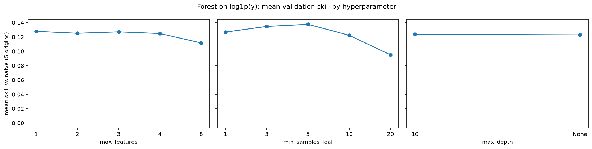

##### 4.3.12.4. Selection, optimism and stability

The rule selects **`forest_v2 = 0.7 × forest + 0.3 × last month's value`**, where the forest is a 600-tree `RandomForestRegressor` fitted on `log1p(y)` with `max_features = 1`, `min_samples_leaf = 1` and `max_depth = 10`. It beats the naive forecast on every origin and also has the lowest three-origin MAE among the eligible candidates (23.95). Against the linear models it wins May to July and loses August and September, so the two families are strong on different months.

**The winning score is optimistic.** Nested selection, which applies the rule on the origins before each of July, August and September and scores the pick on that origin, chooses gradient boosting once and the hurdle twice and reaches a mean skill of 0.132 on those months, against 0.224 for the final winner: an optimism of 0.092 skill points, far larger than the tree's (Section 4.3.8.3) after about 80 candidates on five origins. The top eligible candidates are not reliably separable on this much data. The nested estimate is still well above `forest_v1`'s +0.037, so the improvement over the forest it would replace does not depend on picking the single best configuration. Four seeds and 300 or 600 trees keep mean skill between 0.174 and 0.180.

##### 4.3.12.5. The holdout, read once

The selection above is final; the October–December holdout was then scored once, next to the references. `forest_v1` and Linear Regression v2 reproduce notebook 17's holdout MAE (18.141 and 19.219), and notebook 18's ElasticNet is read on the holdout for the first time; its selection was already locked there, so the read cannot change it.

| Model | MAE | RMSE | R² | Volume ratio | Skill, all rows | Skill, observed rows | Skill, operator × UF × month |
|---|---|---|---|---|---|---|---|
| Seasonal-naive baseline | 19.724 | 74.895 | 0.611 | 1.043 | 0.000 | 0.000 | 0.000 |
| Random Forest v1 (`rf_deep_large`) | **18.141** | 91.405 | 0.421 | 0.987 | **+0.080** | **+0.211** | +0.039 |
| Linear Regression v2 | 19.219 | 79.330 | 0.564 | 0.565 | +0.026 | −0.037 | +0.041 |
| ElasticNet (notebook 18) | 18.959 | 78.246 | 0.576 | 0.583 | +0.039 | −0.018 | +0.053 |
| **Random Forest v2 (`forest_v2`)** | 18.157 | **69.803** | **0.662** | 0.662 | +0.079 | +0.030 | **+0.086** |

A by-operator bootstrap (2,000 resamples of whole operators, the test Section 4.3.7.8 ran for v1 only) now covers every model:

| Comparison | Rows | MAE difference (mean) | 95% interval | Reading |
|---|---|---|---|---|
| `forest_v2` − naive | all | −1.517 | [−2.912, −0.035] | better; the only all-rows gain over naive the bootstrap confirms |
| `forest_v1` − naive | all | −1.468 | [−4.365, 2.843] | not distinguishable |
| `forest_v2` − `forest_v1` | all | −0.049 | [−3.665, 2.106] | tied |
| `forest_v1` − naive | observed | −7.986 | [−11.593, −4.413] | better |
| `forest_v2` − naive | observed | −1.068 | [−4.116, 2.094] | not distinguishable |
| `forest_v2` − `forest_v1` | observed | +6.918 | [5.080, 8.843] | **worse** |
| ElasticNet − naive | observed | +0.786 | [−2.543, 4.611] | not distinguishable |

**The result is mixed.** On all rows `forest_v2` ties `forest_v1` on MAE, has the lowest RMSE and highest R² of any candidate evaluated in this project (ahead of Linear Regression v1's 72.298 and 0.638, Section 4.3.10.3), and is the only model whose gain over the naive forecast survives the bootstrap. At the `operator × UF × month` grain the personas act on, its skill (+0.086) more than doubles `forest_v1`'s (+0.039). **But on observed rows it is significantly worse than `forest_v1`**, and **its volume ratio fell from 0.903 on validation to 0.662 on the holdout**: the pooled guardrail did not hold out of sample. Both findings point to one mechanism. Holdout volume is concentrated in a few large `advanced`-line units in Amazonas (Sections 4.3.8.4 and 4.3.11.1), and the log fit shrinks exactly those, trading accuracy on the largest units for accuracy on the typical one. That helps RMSE and R² (the sudden stop of Section 4.4.5.5 falls from 2,921 predicted items to 810) and hurts observed-row MAE and total volume (the largest billing unit, 3,023 items, is predicted at 1,672 against `forest_v1`'s 2,866). ElasticNet's first holdout read matches Linear Regression v2 closely: its validation lead does not become a materially different holdout result.

**How precise these numbers are.** Every figure above uses seed 42. Refitting both forests with ten other seeds on the same rows moves all-rows MAE between 18.10 and 18.29 for `forest_v1` and between 18.10 and 18.27 for `forest_v2`, so the third decimal of either MAE is noise, and the two models tie on all-rows MAE for any seed. The findings the decision rests on do not move: observed-row skill stays between +0.206 and +0.212 for `forest_v1` and between +0.025 and +0.035 for `forest_v2`, and `forest_v2`'s volume ratio between 0.661 and 0.671.

##### 4.3.12.6. Artifacts

`forest_v2` is saved as `north_region_mama_2025_demand_forest_v2.joblib`, with its prediction base in `north_region_mama_2025_demand_predictions_forest_v2.parquet` / `.csv` and a registry entry in `data/processed/model_registry/random_forest_v2.json` (`selected: false`). The bundle stores the forest as a `TransformedTargetRegressor`, so `predict()` returns items, and records the blend in its metadata (`forest_weight = 0.7`, naive feature `DEMAND_LAG_1M` filled with 0), the same recipe-in-metadata approach as Linear Regression v2's `reconstruction_note`; the notebook asserts that the reloaded bundle reproduces the prediction base. The bundle metadata and the registry entry also carry the input provenance of Section 4.3.12.1 and the holdout's seed spread. The base has `forest_v1`'s schema and its 3,843 rows. The two rankings largely agree: 83.7% of rows keep their `tier`, no row moves between `alto` and `baixo`, and the Spearman correlation of predicted volume is 0.922. Notebook 20 runs as the last stage of `scripts/run_pipeline.py` (`--skip-improvement` skips it).

##### 4.3.12.7. Verdict and limitations

**`forest_v2` is the new validation leader and has a final holdout estimate, but it does not replace `forest_v1`'s prediction base.** It closes the validation gap to the linear models and beats them on the project's own three-origin MAE, and on the holdout it improves every all-rows squared-error metric and the operator-grain skill. It is also significantly worse on observed rows and under-predicts total volume by a third, and the holdout cannot choose between two models that each win on different criteria without becoming a selection set. It also fails the promotion gate of Section 4.3.12.8 on both the validation origins and the holdout months, although its `tier` list ranks the units about as well as `forest_v1`'s. The dashboard therefore keeps reading `forest_v1`, and Section 4.4.6 gives each model its role.

Limitations carried forward: one calendar year and five origins, with a nested optimism of 0.092 skill points; a volume guardrail pooled over validation months that did not generalize (Section 4.3.12.8 defines a per-origin version); the hurdle model, the closest eligible alternative, was not read on the holdout and can only be compared on new origins; and `MONTH` still routes October–December down September's branch (Section 4.4.5.7), while sudden starts still need predictors from outside the claims history (Section 4.3.6).

##### 4.3.12.8. A promotion gate for the prediction base

The rule of Section 4.3.12.2 picks the **validation leader**. Replacing the published prediction base is a different decision: the base feeds the `tier` list, so a challenger should replace the incumbent only if it is at least as good at what that list is used for. The holdout showed that the selection rule does not guarantee this, since its volume band was pooled and it says nothing about observed rows or about the ranking itself. Section 14 of notebook 20 therefore defines a promotion gate.

**How production tiers are assigned.** The prediction base labels a row `alto`, `medio` or `baixo` from the terciles of predicted volume over **every row scored in one publication**, including rows whose target cannot be measured (Section 4.3.9.8). The current files are one publication covering October–December (3,843 rows, 3,810 of them measurable). From here on the gate assumes **one publication per forecast month**, with the terciles taken over all rows scored for that month. The gate evaluates that assignment exactly; the actual volume needed to score it exists only for measured rows, so capture and correlation are computed on those.

The gate applies to any future challenger of the incumbent base (today `forest_v1`), on monthly forecast origins that took no part in selecting the challenger. A challenger replaces the base only if all four criteria pass on at least three such months:

| # | Criterion | Why |
|---|---|---|
| G1 | Skill against the naive forecast above 0 on every month but at most one | The model must beat a forecast that needs no fitting |
| G2 | Volume ratio within [0.90, 1.10] on **every** month, absolute and not pooled | The dashboard sums predicted volume; a pooled band hid the holdout miss |
| G3 | Observed-row MAE no higher than the incumbent's on a majority of months, **and** a by-operator bootstrap does not find the pooled observed-row difference significantly positive | The rows that billed are the ones the business acts on |
| G4 | **Published `alto` tier, non-inferior:** the share of measured volume billed by rows in the published `alto` tier is at least the incumbent's minus **1.0 percentage point** on a majority of months, **and** the mean Spearman correlation between predicted and measured volume is at least the incumbent's minus **0.02** | The `tier` list is a ranking; forecast error alone does not show which list ranks better, and a negligible difference should neither block nor justify a switch |

**Status of the thresholds.** The volume band of G2 and the two margins of G4 are proposals for the business team to confirm before the gate's first real use. Following the review, G2 stays an **absolute** per-month requirement: an incumbent that misses the band is a reason to monitor its own volume error, not to make the criterion relative. The G4 margins were chosen after seeing the descriptive comparison below, so they cannot be validated on these months. This is one more reason why applying the gate to the validation and holdout months, which have already been seen, is a **description only**.

Evaluated for `forest_v2` against `forest_v1` on the five validation months and the three holdout months:

| Criterion | Validation (5 months) | Holdout (3 months) |
|---|---|---|
| G1 skill above 0 | pass (5/5) | pass (2/3) |
| G2 volume ratio in band on every month | **fail** (0.75 to 1.21) | **fail** (0.57 to 0.76) |
| G3 observed-row MAE vs `forest_v1` | pass: significantly **better**, 95% interval [−6.38, −1.38] | **fail**: significantly worse, [5.01, 8.82] |
| G4 published `alto` tier, non-inferior | pass: largest shortfall 0.44 points; Spearman 0.757 vs 0.744 | pass: largest shortfall 0.81 points; Spearman 0.710 vs 0.678 |

The published files themselves, exactly as the dashboard receives them (one October–December publication):

| Published tier | Rows scored / measured | Measured volume in `alto` | Best possible | Spearman (measured rows) |
|---|---|---|---|---|
| `forest_v1` | 3,843 / 3,810 | **96.7%** | 99.7% | 0.677 |
| `forest_v2` | 3,843 / 3,810 | 96.3% | 99.7% | **0.710** |
| Last month's value (reference) | 3,843 / 3,810 | 90.1% | 99.5% | 0.679 |

- **The two published `tier` lists are nearly equivalent.** `forest_v2`'s `alto` tier holds 0.4 points less measured volume and orders the whole list slightly better; with one publication per month it stays within the 1-point margin in all eight months. **Keeping `forest_v1` therefore rests on G2 and G3, not on the ranking:** `forest_v2` under-predicts volume in every holdout month and is worse on the rows that billed.
- **A monthly ranking diagnostic is reported separately.** On measured rows only, the top third of each month's rows by prediction captures 96.7% (`forest_v1`) and 96.3% (`forest_v2`) of holdout volume, and both place 98.2% of the month's largest billing units in it. It describes ranking quality without the tier rule's unmeasurable rows, but it is not the tier the dashboard receives, so it is not part of the gate.
- **G3 reverses between the two periods.** On validation, `forest_v2` is significantly *better* than `forest_v1` on observed rows; on the holdout it is significantly worse. This is the validation–holdout disagreement measured directly, and it is why the gate asks for new months rather than trusting either period alone.
- **The incumbent misses G2 too.** `forest_v1` falls outside the band in four of the eight months (1.11, 1.35 and 1.71 in July to September, 0.899 in October), which calls for monitoring its volume error while it remains the base.

The template's Item (d)—selection and justification of a recommendation system—remains open, and Section 4.3 is incomplete until it is addressed. Notebook 17's `tier` column is a candidate input, not the final selection. For the final candidate comparison and project recommendation, see Sections 4.4.3 and 4.4.6.

### 4.4. Model Comparison

This section compares three supervised model families through six specifications: Linear Regression v1, v2 and a regularized-linear alternative, Decision Tree, and Random Forest v1 and v2. It states the evaluation criteria (Section 4.4.1), documents tuning (Section 4.4.2) and compares their available results (Section 4.4.3). Notebook 18 evaluates four of these specifications on shared validation folds; the v1 validation result comes from notebook 16 on the same folds, and notebook 20 reproduces those folds and adds `forest_v2`. Holdout results are available for every specification: notebook 17 scores v1, v2, the Decision Tree and `forest_v1`, and notebook 20 scores `forest_v2` and gives the regularized-linear specification its first holdout read. The unsupervised track has its own comparison: Section 4.4.4 sets the two K-Means segmentations side by side and explains which one defines the supervised population. Section 4.4.5 explains both Random Forests with SHAP, and Section 4.4.6 states the final recommendation. Each original family's derivation lives in Sections 4.3.7 to 4.3.9, `forest_v2`'s in Section 4.3.12, and Section 4.3.10 holds the detailed holdout tables, the robustness checks and the cross-model explainability reading that this section summarizes. The comparison looks for the model with the best balance between predictive accuracy, robustness to large errors and ability to capture variation in demand, and it respects one rule throughout: candidates are selected on validation, and the holdout is read only as a final estimate.

#### 4.4.1. Evaluation Metrics

Since the target variable represents a continuous demand-volume measure, the problem is formulated as a regression task. Therefore, regression metrics were selected to evaluate model performance. The choice of metrics was based on the characteristics of the target variable and on the aspects that are most relevant for assessing the quality of demand forecasts in the context of the project.

**Mean Absolute Error (MAE)** was selected as the primary metric because it measures the average absolute difference between predicted and observed demand. Since it is expressed in the same unit as the target variable, MAE provides an intuitive interpretation of the typical magnitude of the model's forecasting error. This is particularly relevant because the objective is to produce demand estimates that are as close as possible to the observed demand volume.

**Root Mean Squared Error (RMSE)** was selected as a complementary metric because it assigns greater weight to large prediction errors. This is particularly relevant to the problem because the demand-volume target is highly skewed and contains observations with substantially higher volumes than the majority of the dataset. RMSE therefore helps identify models that may produce occasional but very large forecasting errors, which may be less apparent when considering MAE alone.

**R² (coefficient of determination)** was selected as a complementary measure of how well the models capture variation in demand volume. While MAE and RMSE focus directly on prediction error, R² provides an additional perspective on the model's ability to explain differences in demand across the evaluated observations. Therefore, R² is not interpreted as an accuracy measure and is not used in isolation to determine model quality.

The three metrics are used together because they capture different aspects of model performance: MAE reflects the typical prediction error, RMSE emphasizes large errors, and R² evaluates the model's ability to capture variation in the target variable. This combination provides a more comprehensive assessment of model quality than relying on a single metric.

Three conventions govern how the metrics are read in the comparison below:

- **Skill against the seasonal-naive forecast.** Every candidate is compared with last month's own value (`DEMAND_LAG_1M`, 0 where absent) through the skill score `1 − MAE_model / MAE_naive`, one minus the relative MAE against the naive benchmark, the scale-free comparison Hyndman and Koehler recommend for forecast accuracy [22]. A positive skill means the model beats a forecast that needs no fitting at all, and that is the bar a supervised model has to clear to be worth deploying.
- **All rows and observed rows.** 56.1% of the holdout rows are known combinations with no claim that month, which anything close to zero predicts well. Every holdout metric is therefore reported on all 3,810 rows and on the 1,674 observed rows, with skill recomputed against the naive MAE of the same row set. The observed-rows read is the more demanding of the two, and it is the one the business ranking depends on.
- **Validation selects, the holdout confirms.** Hyperparameters and candidates are chosen on mean MAE over three expanding-window validation folds (July, August and September 2025, each trained only on earlier months). The October–December holdout is the final estimate of the chosen candidate. It is not a second tuning signal. Notebook 20 keeps these three origins and adds a stricter rule of its own, fixed before it scored any candidate: mean skill over five origins (May–September 2025), at least four wins against the naive forecast, and a pooled validation volume ratio within [0.90, 1.10] (Section 4.3.12.2).

#### 4.4.2. Hyperparameter tuning per candidate

[`18_model_comparison.ipynb`](../notebooks/18_model_comparison.ipynb) evaluates four supervised specifications on the same three expanding-window folds inside the February–September training window (4,238/5,324/6,478 training rows against 1,086/1,154/1,238 validation rows). Linear Regression v2 receives fixed-specification cross-validation; the Decision Tree and Random Forest searches are reproduced with `GridSearchCV`. Section 5.1 adds one regularized-linear search over genuine Ridge, Lasso and ElasticNet estimators on the same v2 features and raw-scale MAE. All four specifications were executed on notebook 13's 11,526-row Medicina de Grupo matrix; the family notebooks hold the fuller earlier analyses:

| Candidate | Tuning method | Search space | Fits | Selection rule | Selected configuration |
|---|---|---|---|---|---|
| Linear Regression — Ridge variant | Grid over `alpha`, custom loop on the same three origins, scored on the `log1p` scale, on the initial eight-feature specification (notebook 16, Section 4.3.7.6); not part of notebook 18's search | `alpha` ∈ 15 values from 0.01 to 1,000,000 | 45 + refit | Lowest mean CV RMSE on `log1p(y)` | `alpha = 3,000` (0.910638 against 0.917554 at 0.01), **not adopted** |
| Linear Regression — regularized grid (Ridge/Lasso/ElasticNet), notebook 18 Section 5.1 | `GridSearchCV` with `model__regressor` itself as a grid parameter, on the `v2` feature specification and raw-scale MAE | Ridge: `alpha` (6 values) × `impute__strategy` (2) = 12; Lasso: same shape = 12; ElasticNet: `alpha` (6) × `l1_ratio` (4, strictly between 0 and 1) × `impute__strategy` (2) = 48; total 72 configurations | 216 + refit | Lowest mean validation MAE; nested-CV and coefficient-overlap diagnostics in notebook 18 Sections 9.2–9.3 | **ElasticNet**, `alpha=0.01`, `l1_ratio=0.5`, mean imputation; validation MAE **24.168 ± 6.193**. The best Ridge scores 24.204 (`alpha=10`, mean imputation), and the best Lasso 24.192 (`alpha=0.001`, mean imputation). Nested estimate 24.193; neither rolling-mean coefficient is near zero. Holdout gate remains closed. |
| Linear Regression v1 (legacy) | Feature-engineering sequence decided step by step on CV (Section 4.3.7.7) | 9 candidate steps (drop rolling means, `PORTE` cleanup, imputation, `MONTH` encodings, smearing) | not a grid | Keep a step if it improves three of four CV metrics, applied once on the full population | 6 predictors + 4 missingness flags, median imputation, no `MONTH`, plain OLS |
| Linear Regression v2 (CV-derived) | The same three-of-four rule, re-run from scratch on Medicina de Grupo (Section 4.3.7.10), then fixed-specification CV in notebook 18 | Same 9 steps | 3 + refit in notebook 18 | Same rule, every step against the current leader | 8 approved features + `PORTE_ORDINAL` cleanup, median imputation, plain OLS |
| Decision Tree | Exhaustive grid search, custom loop in notebook 15 (Section 4.3.8.3); reproduced with `GridSearchCV` in notebook 18 | `max_depth` (7 values) × `min_samples_leaf` (4) × `ccp_alpha` (3) = 84 | 252 + refit | Lowest mean validation MAE, ties broken toward the simpler tree | `max_depth = 6`, `min_samples_leaf = 20`, `ccp_alpha = 0.01` |
| Random Forest [21] | Exhaustive search over curated configurations, custom loop in notebook 17 (Section 4.3.9.3); reproduced with `GridSearchCV` in notebook 18 | 4 configurations varying `n_estimators`, `max_depth` and `min_samples_leaf` together | 12 + refit | Lowest mean validation MAE | `rf_deep_large`: 600 trees, `max_depth = None`, `min_samples_leaf = 5` |
| Random Forest v2 (`forest_v2`) | Custom loop in notebook 20 over a grid fixed in advance, then bias corrections, a naive blend, a hurdle model and exploratory predictors (Section 4.3.12.3) | Forest on `log1p(y)`: `max_features` (5 values) × `min_samples_leaf` (5) × `max_depth` (2) = 50; gradient boosting with absolute-error loss: 18; 85 candidates in all | 425 on five origins + refit | Highest mean skill over five origins among candidates with at least 4 wins, a volume ratio within [0.90, 1.10] and only approved predictors | 0.7 × forest (600 trees, `max_features = 1`, `min_samples_leaf = 1`, `max_depth = 10`, `log1p` target) + 0.3 × `DEMAND_LAG_1M`; three-origin MAE 23.95, five-origin skill +0.178 |

Notebooks 15 and 17 run their searches as custom loops over the same expanding-window folds. Notebook 18 re-runs both with scikit-learn's `GridSearchCV` on the same folds and metric, and the two implementations select the same configurations with the same validation MAE (tree 31.3327, forest 31.0112), an independent check on both searches. Notebook 18 now asserts this agreement on every run, and it also audits the three forecast origins themselves (Section 4.3.10.1).

**How the Ridge search connects to notebook 18.** Notebook 16's earlier Ridge grid used 15 values of `alpha` from 0.01 to 1,000,000, scored by RMSE on `log1p(y)` on the initial eight-feature specification. It selected `alpha=3,000` and then kept plain OLS after a test-set look; that historical choice is recorded in Section 4.3.7.6. Notebook 18 evaluates v2 with plain `LinearRegression` and separately searches Ridge, Lasso and ElasticNet on v2's features, selecting by raw-scale validation MAE. Its best Ridge configuration (`alpha=10`, mean imputation) scores 24.204, against 24.168 for the selected ElasticNet and 24.323 for plain v2. This closes the Ridge re-score on a comparable metric without using the holdout to choose among them.

Five points qualify the table:

- **The earlier Ridge rejection used the test set.** Notebook 16's CV-selected `alpha=3,000` improved log-scale RMSE by 0.75% but lost to plain OLS on the October–December test set (MAE 19.814 against 19.218, RMSE 81.142 against 79.363). Notebook 18's new grid avoids using that result as a selection rule: Ridge, Lasso and ElasticNet compete on raw-scale validation MAE. L1-based feature selection could conflict with the three-of-four rule that produced v2, but the selected ElasticNet keeps both rolling means (Section 9.3). The 72-candidate search has a small nested-CV optimism gap (24.193 − 24.168 = 0.025), yet its lead over plain v2 (0.155) remains small compared with the variation across folds; neither diagnostic justifies promotion without further validation.
- **v1's sequence is legacy, v2's is population-derived.** On Medicina de Grupo the rule that produced v1 would not select its first step (dropping the two rolling means). v2 is what the same rule selects when it is re-run on this population: only the `PORTE_ORDINAL` cleanup survives (Sections 4.3.7.9 and 4.3.7.10).
- **The tree's search was stress-tested beyond its grid.** A boundary extension (72 more configurations), a random search on the same 252-fit budget (best 31.134) and nested cross-validation (33.364, an optimism of 2.031) all stay within one fold-to-fold standard error of the selected 31.333, and none of them reaches the naive forecast's 30.980 (Section 4.3.8.3).
- **The forest's selected configuration is not its best configuration on the holdout.** `rf_deep_regularized` posts a lower holdout MAE (17.34 against 18.14). It trails on validation (32.94 against 31.01), so the selection stands, and the gap is recorded as evidence of how noisy a four-way choice this close is (Section 4.3.9.4).
- **`forest_v2`'s score is optimistic.** It is the best of 85 candidates on five origins. Nested selection, which picks on earlier origins only, reaches a mean skill of 0.132 on July–September against the winner's 0.224, an optimism of 0.092 skill points. The nested estimate is still well above `forest_v1`'s +0.037 (Section 4.3.12.4).

#### 4.4.3. Supervised candidates side by side

Validation metrics come from notebook 18's committed run, apart from v1, which notebook 18 does not score: its figure is the final row of notebook 16's CV table (Section 4.3.7.7), on the same three folds. Holdout metrics for the previously evaluated candidates come from notebook 17, which scores them with one `evaluate()` function on identical holdout rows (Section 4.3.10.3). Notebook 20 scores the regularized-linear specification and `forest_v2` on the same rows with the same function, after reproducing notebook 17's figures for `forest_v1` and v2 (Section 4.3.12.5):

| Candidate | Validation MAE (mean ± SD across folds) | Holdout MAE, all rows | Holdout RMSE, all rows | Holdout R², all rows | Skill, all rows | Skill, observed rows |
|---|---|---|---|---|---|---|
| Seasonal-naive forecast (reference) | 30.98 | 19.724 | 74.895 | 0.611 | 0.000 | 0.000 |
| Group-mean forecast (reference) | 32.22 | 31.126 | 128.766 | −0.149 | −0.578 | −0.163 |
| Linear Regression v1 (legacy) | 26.48 | 18.326 | 72.298 | 0.638 | +0.071 | +0.016 |
| Linear Regression v2 (CV-derived) | 24.32 ± 6.38 | 19.219 | 79.330 | 0.564 | +0.026 | −0.037 |
| Regularized linear (selected ElasticNet) | 24.17 ± 6.19 | 18.959 | 78.246 | 0.576 | +0.039 | −0.018 |
| Decision Tree | 31.33 ± 4.44 | 19.065 | 89.590 | 0.444 | +0.033 | +0.168 |
| Random Forest v1 (`forest_v1`) | 31.01 ± 2.43 | **18.141** | 91.405 | 0.421 | **+0.080** | **+0.211** |
| Random Forest v2 (`forest_v2`) | **23.95 ± 3.03** | 18.157 | **69.803** | **0.662** | +0.079 | +0.030 |

**The previously evaluated candidates rank almost in reverse across validation and holdout.** On validation MAE, the new ElasticNet specification narrowly leads v2 (24.17 against 24.32), and both lead v1 (26.48). Neither tree-based model beats the naive forecast: the forest ties it (31.01 against 30.98) and the tree trails it slightly (31.33). Among the candidates with holdout results, the forest has the lowest MAE and the highest skill on both row sets, the tree is second on observed rows, and v2 loses to last month's value on observed rows (skill −0.037). v1 has the best all-rows RMSE and R² among these, but almost all of its advantage comes from the zero rows, and its observed-row skill is barely positive (+0.016). The selected ElasticNet, read on the holdout in notebook 20, lands next to v2 (+0.039 on all rows, −0.018 on observed rows), as its validation result suggested. **`forest_v2` breaks the pattern only in part:** it leads validation and posts the best all-rows RMSE (69.803) and R² (0.662) of the table, but its observed-row skill (+0.030) is far below `forest_v1`'s (Section 4.3.12.5). Section 4.3.10.3 explains the split between MAE and the squared-error metrics on all rows; Section 4.4.6 states the recommendation with the new validation result kept separate.

**Both leading linear specifications vary substantially across folds.** The standard deviations for v2 (6.38) and the selected ElasticNet (6.19) are more than twice the forest's (2.43), while their mean MAEs differ by only 0.155. Three gaps were open in this comparison; notebook 20 narrows all three:

- **The significance test now covers most of the table.** Notebook 20's by-operator bootstrap covers both forests, v2 and the ElasticNet (Section 4.3.12.5). Only `forest_v2` is confirmed better than the naive forecast on all rows, only `forest_v1` on observed rows, and `forest_v2` is confirmed worse than `forest_v1` on observed rows. v1 keeps its own test (Section 4.3.7.8); the tree has none.
- **The regularized-linear specification now has a holdout estimate.** Notebook 18 locked its selection with the holdout gate closed, and notebook 20 read it once afterwards. The best Ridge is still reported on validation only (Section 4.4.2).
- **The operator grain now covers four models.** Notebook 20 scores both forests, v2 and the ElasticNet at `operator × UF × month`: `forest_v2` +0.086, ElasticNet +0.053, v2 +0.041 and `forest_v1` +0.039 (Section 4.3.12.5). Linear Regression v1 and the tree are still unscored there.

#### 4.4.4. Unsupervised candidates: operator-level versus operator-municipality segmentation

The unsupervised track produced two K-Means candidates for the same question: which Medicina de Grupo operators are *active*. The first clusters operators on their aggregate activity (notebook 10, Section 4.3.2), and the second clusters operator-municipality pairs (notebook 12, Section 4.3.4). With no label to score against, they are compared on the evidence behind their number of clusters, the stability of their partitions, what they classify as active and what the supervised stage does with them:

| Criterion | K-Means, operator level (notebook 10) | K-Means, operator × municipality (notebook 12) |
|---|---|---|
| Unit and size | 1,052 operators | 5,089 pairs, on only 596 distinct feature-space positions |
| Features | 5 standardized: event volume, temporal persistence, beneficiary- and provider-side municipal reach, procedure diversity | 3 standardized: event volume, temporal persistence, procedure diversity |
| k search | k = 2 to 10, elbow and silhouette | k = 2 to 40, silhouette on deduplicated positions (the naive silhouette is inflated at this grain, Section 4.3.4.1) |
| Selected k and evidence | k = 2, the silhouette maximum (0.5096, 14.5% above k = 3) | k = 2 **by design**: the corrected maximum is k = 40 (0.3896), with k = 2 only 4.6% below it (0.3726) |
| Stability, 30 seeds (ARI) | 1.0 on every run | 1.0 on every run; necessary but not sufficient, since 39.1% of rows sit on one point |
| Active group | 339 operators (32.2%) | 874 pairs (17.2%), spanning 428 operators (40.7%) |
| Active vs marginal, mean events | 188.4 vs 6.0 (≈ 31×) | 67.68 vs 2.13 (≈ 32×) |
| Role downstream | Traceability and comparison only | Defines `ATUANTE`, re-applied as of each month to select the supervised population (Section 4.3.6) |

The silhouette values are not comparable across the two columns: the feature spaces differ, and the pair-level score is computed on deduplicated positions. Each value is read only against the other values of k within its own candidate. On that reading, **the operator-level candidate has the stronger evidence for k = 2.** There it is the clear silhouette optimum. At the pair level it is a deliberate choice on a shallow plateau, justified by the binary active/marginal criterion and by comparability with notebook 10 rather than by the metric.

**The two candidates agree on most operators but not all.** Notebook 13 cross-tabulates the full-year classifications of all 1,052 operators:

| | Operator-level: active | Operator-level: marginal |
|---|---|---|
| **Municipality-level: `ATUANTE`** | 302 | 126 |
| **Municipality-level: `MARGINAL`** | 37 | 587 |

They agree on 889 operators (84.5%) and disagree on 163 (15.5%). Cohen's kappa [23], computed from this table, is 0.67: substantial agreement beyond chance, but not interchangeable definitions. The disagreement is mostly one-sided. 126 operators are marginal in aggregate but have at least one sustained municipality pair, while only 37 are active in aggregate without any pair above the finer threshold. The pair-level method therefore admits more operators, typically ones concentrated in one locality, which is the case Section 4.3.4.6 describes.

**The operator × municipality candidate is the one the project adopts, as a population filter rather than as a prediction.** Notebook 13 re-implements the notebook 11/12 method, verifies that it reproduces notebook 12 exactly for all 1,052 operators on the full year, and then applies it to the claims dated before each month, holding k = 2 fixed. The number of `ATUANTE` operators grows from 243 in February to 438 in December, and 507 operators are `ATUANTE` in at least one month, against 428 on the full-year classification. Notebook 13 describes this as a deliberate choice for this version of the matrix, not a claim that the pair-level definition is the correct one. The operator-level result stays in the repository for traceability and for this comparison.

Three limitations belong to the unsupervised comparison as a whole:

- **No alternative clustering algorithm was evaluated.** Both candidates are K-Means, and their k sweeps are hyperparameter searches within one algorithm. Density-based or hierarchical methods, or a Gaussian mixture, might handle the single-event mass at the pair grain differently.
- **"Active" has no external validation.** It is an operational label derived from billed activity (Section 4.3.2.6), and nothing in the data can confirm it against real clinical activity.
- **The supervised results were not re-run on the operator-level population.** Every metric in Section 4.4.3 is conditional on the pair-level `ATUANTE` filter. How much the supervised ranking depends on that filter has not been measured.

#### 4.4.5. Explainability: SHAP analysis of the Random Forest

The metrics above measure how accurate the Random Forest is (`rf_deep_large`, Section 4.3.9). They do not say which predictors drive its forecasts, how each one moves a forecast, or why a given operator-month received the value it did. That question matters for the personas of Section 4.1: Lucas needs to trust a statistical estimate over subjective judgment, and a ranking whose drivers cannot be stated is hard to defend. The forest was therefore explained with **SHAP (SHapley Additive exPlanations)** [24], in Section 17 of [`17_random_forest.ipynb`](../notebooks/17_random_forest.ipynb). The environment is `shap==0.52.0`, set up and verified by `scripts/shap_smoke_test.py` (see `documents/extras/shap_environment_setup.md`).

The explained configuration is the one that also heads the Random Forest row of Section 4.3.10's validation leaderboard (mean validation MAE 31.01). Section 4.4.6 keeps it as the shipped prediction base and a provisional challenger, while `forest_v2` (Section 4.3.12) now leads validation. Explaining the forest does not change that status; it shows what the model under evaluation has learned. Section 4.4.5.7 repeats the analysis for `forest_v2`.

##### 4.4.5.1. Method

SHAP splits each prediction into one additive contribution per predictor:

```math
\hat{y}(x) = \phi_0 + \sum_{j=1}^{8} \phi_j(x)
```

Here $`\phi_0`$ is the explainer's expected value and $`\phi_j(x)`$ is predictor $`j`$'s contribution to row $`x`$, in the target's own unit (billed items per month). The contributions are Shapley values, the only attribution that is additive, gives zero to an unused predictor, and treats symmetric predictors symmetrically [24]. `shap.TreeExplainer` computes them **exactly** for tree ensembles, with no sampling approximation [25]. Five design choices keep the analysis honest:

- **The persisted model, not a refit.** The notebook loads the forest from the `joblib` bundle written in Section 4.3.9.8. Before explaining it, it asserts that the bundle matches the run: the same eight columns, the same 7,716 training rows, the same cutoff (2025-10-01) and the same holdout predictions.
- **Rows explained.** A fixed-seed sample of **1,000 of the 3,810 holdout rows** (`RANDOM_STATE = 42`). The full holdout takes several minutes on 600 fully grown trees and gives the same picture. The sample is representative on the dimension that matters most here: 56.4% structural zeros, against 56.1% in the full holdout.
- **Reference point.** With shap's default `tree_path_dependent` mode, the expected value is the forest's mean prediction over its training data (61.611 items per month, against a training target mean of 61.604). Every SHAP value therefore reads as *"items per month this predictor moves the forecast away from the average training row"*.
- **Additivity is checked, not assumed.** `expected_value + sum(SHAP)` reproduces `predict()` on every explained row. The maximum gap is 1.8 × 10⁻¹⁰ items, on the 1,000 sampled rows and again on the local-explanation rows. The forest never predicts below zero, so the zero clip applied in evaluation never fires, and the explanation decomposes exactly the forecast that Section 4.3.9 reports.
- **Missing predictors are not imputed.** The forest was trained with the lag burn-in `NaN`s left in place (Section 4.3.9.1), and scikit-learn learns at each split which branch a missing value follows. `TreeExplainer` reads that same routing, so a row with a `NaN` predictor is explained along exactly the path it was predicted on, and the `NaN` receives its own SHAP value. Imputing would explain an input the model never scored. 39 sampled rows (136 in the full holdout) carry at least one `NaN`, and additivity holds on them too.

##### 4.4.5.2. Global importance

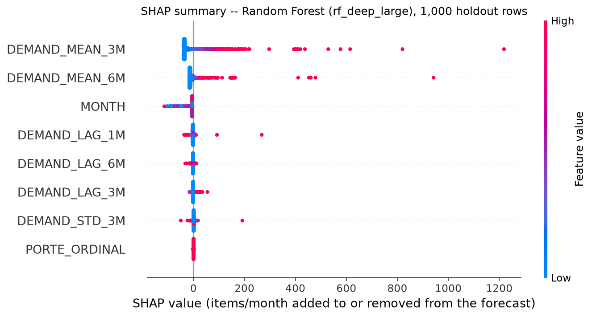

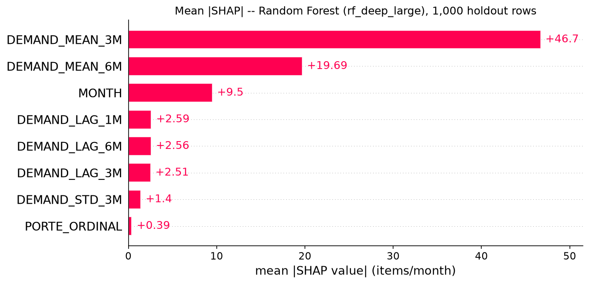

In the beeswarm, each dot is one holdout row. Its horizontal position is the predictor's contribution to that row's forecast, and its colour is the predictor's value (red high, blue low, grey `NaN`). The bar chart averages the absolute contributions:

| Predictor | Mean \|SHAP\| (items/month) | Share | SHAP rank | Impurity rank | Permutation rank |
|---|---|---|---|---|---|
| `DEMAND_MEAN_3M` | **46.70** | 54.7% | 1 | 1 | 1 |
| `DEMAND_MEAN_6M` | **19.69** | 23.1% | 2 | 2 | 2 |
| `MONTH` | 9.50 | 11.1% | 3 | 6 | 6 (exactly 0) |
| `DEMAND_LAG_1M` | 2.59 | 3.0% | 4 | 4 | 4 |
| `DEMAND_LAG_6M` | 2.56 | 3.0% | 5 | 7 | 3 |
| `DEMAND_LAG_3M` | 2.51 | 2.9% | 6 | 5 | 5 |
| `DEMAND_STD_3M` | 1.40 | 1.6% | 7 | 3 | 8 |
| `PORTE_ORDINAL` | 0.39 | 0.5% | 8 | 8 | 7 |

**The two rolling means drive the forecast.** `DEMAND_MEAN_3M` and `DEMAND_MEAN_6M` carry 77.8% of all SHAP mass, each with a monotone colour gradient: high recent volume raises the forecast, low recent volume lowers it. Their effect is asymmetric. Most holdout rows sit below the training average and are pulled down by a few dozen items, while a small number of large operator-months are pushed up by hundreds. In the fixed 1,000-row SHAP sample, `DEMAND_MEAN_3M` reaches +1,219 items for a single row; `DEMAND_MEAN_6M` reaches +942. The three lags and `DEMAND_STD_3M` matter only for a handful of large, volatile units. `PORTE_ORDINAL` barely moves anything (0.39 items per month), a third independent confirmation of **H1** after impurity and permutation (Section 4.3.9.10): once demand history is known, operator size adds nothing.

##### 4.4.5.3. Agreement with impurity and permutation importance

The three measures answer different questions. Impurity credits a predictor for the training-set variance its splits removed. Permutation measures how much holdout MAE worsens when the column is shuffled. SHAP measures how far the predictor moves holdout forecasts away from the training average.

- **Where they agree.** All three rank `DEMAND_MEAN_3M` first and `DEMAND_MEAN_6M` second, and put `PORTE_ORDINAL` last or next to last. The reading of Section 4.3.9.6 therefore holds under three different measures: the forest is a demand-history model led by two rolling means.
- **SHAP sides with permutation.** Spearman rank correlation is **0.810** between SHAP and permutation and **0.643** between SHAP and impurity, against 0.500 between impurity and permutation themselves. Like permutation, SHAP is computed on holdout rows, so it does not inherit impurity's training-set bias toward continuous predictors.
- **`DEMAND_STD_3M`** is third by impurity, seventh by SHAP and last by permutation. On the typical holdout row it moves the forecast by only 1.4 items, which confirms that impurity overstates it. SHAP adds a nuance: the effect is small on average but large on the most volatile units (+414 items on the worst-predicted row, Section 4.4.5.5).
- **The three lags are tied** under SHAP (2.51 to 2.59 items per month), so ranks 4 to 6 carry no information under any measure. The lags duplicate what the rolling means already contain.
- **`MONTH` is the one real disagreement**: third by SHAP, and exactly zero by permutation, with zero variance.

**Why `MONTH` scores zero by permutation and third by SHAP.** Training ends in September, so a tree can only split `MONTH` at thresholds between training months. Across the 53,041 `MONTH` splits in the 600 trees, the highest threshold is 8.5. October, November and December are all above it, so every tree sends every holdout row down the branch it built for **September**. Shuffling `MONTH` within the holdout therefore cannot change a single prediction, which is why permutation reads exactly zero. That zero shows the test is blind to this effect, not that `MONTH` is unused. SHAP does see the effect, because its reference is the training average. Mean training volume per row falls from 66–78 items (February to July) to 48.6 in August and **30.2 in September**, as the as-of panel accumulates quiet months of operators that stopped billing. The forest applies that September level to the whole holdout, a median of **−5.0 items per row**, and it scales the shift with unit size. Holdout volume per row was 39.8, 30.3 and 26.2 in October to December, so the shift pointed the right way. It is still **extrapolation, not seasonality**: with one calendar year, the forest has never seen an October and carries September forward. This corrects the reading of Section 4.3.10.4, where both importance measures found `MONTH` negligible. `MONTH` does act in the forecast, as a "latest level" correction, and it would mislead in a year whose last quarter did not resemble September.

##### 4.4.5.4. How the top predictors act

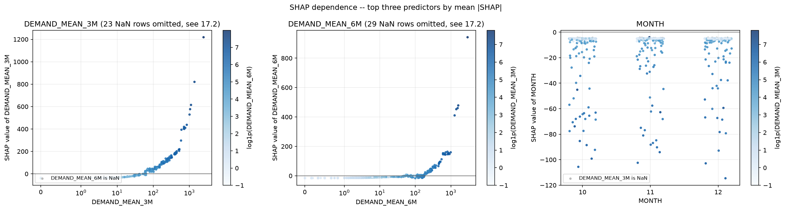

- **`DEMAND_MEAN_3M`** is monotone and strongly convex. Every unit averaging a few items or fewer gets the same floor of about −35 items per month. The contribution turns positive only once the three-month mean reaches the tens of items, then rises steeply, to hundreds of items for the few units averaging over a thousand. In effect, the model forecasts next month at the recent level, with a floor for small units and a steep top.
- **`DEMAND_MEAN_6M`** has the same shape, but stays flat up to about a hundred items per month. It contributes mainly for large units, where the longer window confirms or tempers the three-month level. The colouring shows the two means rise together: they are two views of one signal, so the forecast should never be attributed to either one alone (Section 4.3.9.6).
- **`MONTH`** splits into two groups. Small units sit at about −5 in every holdout month, while units with large recent volume fall to between −20 and −115. The September correction is proportional to unit size, an interaction the forest learned without being told.

##### 4.4.5.5. Local explanations

Four holdout rows were explained individually, each chosen by a fixed rule rather than by hand. Each waterfall starts at the expected value of 61.6 items and adds one bar per predictor, ending at the forecast.

| Case | Operator · line · UF · month | Observed | Predicted | Largest contributions |
|---|---|---|---|---|
| Largest error in Section 4.3.9's residual table | 147828 · `advanced` · AM · 2025-10 | 0 | 2,921.2 | `DEMAND_MEAN_3M` +1,359, `DEMAND_MEAN_6M` +1,058, `DEMAND_STD_3M` +414 |
| Largest under-prediction among the ten worst | 1169698 · `advanced` · AM · 2025-11 | 1,111 | 0.2 | `DEMAND_MEAN_3M` −35, `DEMAND_MEAN_6M` −16, `MONTH` −5 |
| Typical observed row (median volume) | 1169857 · `adjuvant` · PA · 2025-11 | 5 | 4.3 | `DEMAND_MEAN_3M` −34, `DEMAND_MEAN_6M` −12 |
| Largest observed row with missing history | 234693 · `neoadjuvant` · AM · 2025-12 | 15 | 4.4 | `DEMAND_MEAN_3M` (`NaN`) −34, `DEMAND_MEAN_6M` (`NaN`) −12, `DEMAND_STD_3M` (`NaN`) −4 |

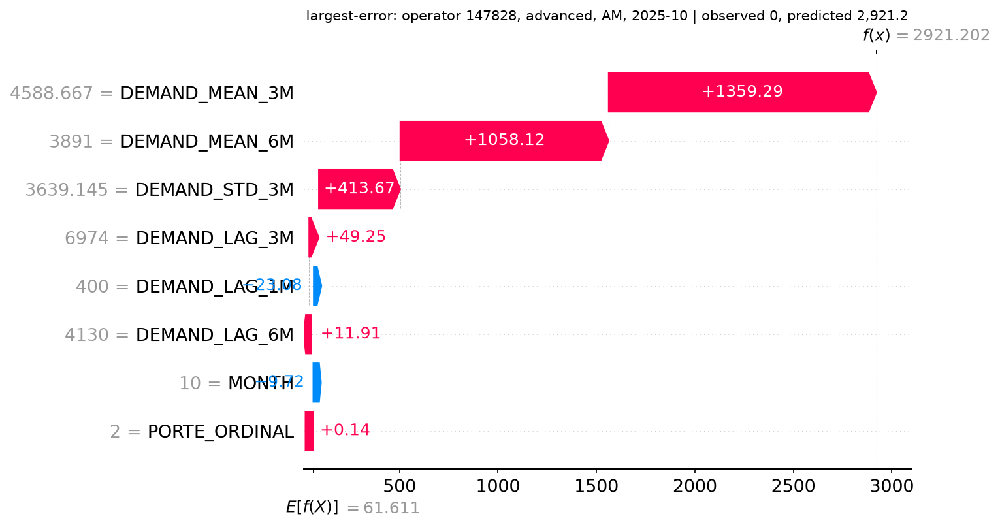

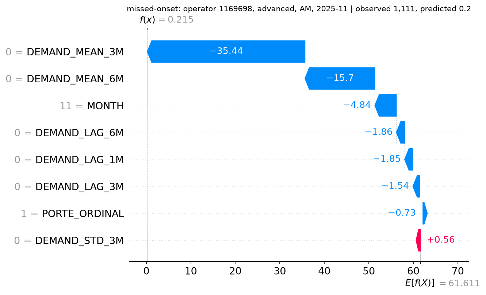

- **A sudden stop.** The largest error is an operator-month that billed nothing after months in the thousands. The rolling means (4,589 and 3,891) still remember the large months and build almost the whole forecast. The one predictor that saw the collapse, `DEMAND_LAG_1M` = 400 (down from 6,974 three months earlier), subtracts only 23 items. The next month of the same unit repeats the error (2,749 predicted, 0 observed).
- **A sudden start.** The largest under-prediction comes from an all-zero history: every history predictor pulls the forecast to the floor, and nothing in the eight-feature contract signals the jump to 1,111 items.
- **The typical row** is a small, stable unit, as most observed rows are. Its rolling means of about 5 bring the forecast from 61.6 down to 4.3 against an observed 5: a stable history gives an accurate forecast.
- **Missing history is read as little history.** With both rolling means `NaN`, the missing-value routing pulls the forecast down almost exactly as a near-zero history would, so the forest under-forecasts this row (4.4 against 15). Across the sample, a missing `DEMAND_MEAN_3M` subtracts 32.7 items on average, against 11.1 when the value is present. This is why the prediction base carries a `has_recent_history` flag (Section 4.3.9.8): a low `tier` on such a row reflects missing data, not measured low demand.

The waterfalls for the typical and missing-history rows are exported alongside these two (`assets/demand-rf-shap-waterfall-typical.png`, `assets/demand-rf-shap-waterfall-missing-history.png`).

##### 4.4.5.6. What this means, and its limits

**The forest is a level-following model of recent demand**, and SHAP shows it with numbers attached. Two rolling means set the forecast. Volatility and the lags refine it for large units. Operator size is irrelevant. `MONTH` carries September's level forward. Its two largest failure modes, sudden stops and sudden starts, come from the predictor contract rather than from the algorithm: no combination of these eight inputs could have anticipated either one. These two failures would therefore remain whichever model family Section 4.4.6 eventually promotes: reducing them needs better predictors (Section 4.3.6), not a different estimator on the same eight columns. That is a statement about these failure modes only; it does not settle the validation–holdout disagreement between the forest and Linear Regression v2.

For communication, the statement in Section 4.3.9.6 stands and can now be backed row by row: *the model predicts that an operator's billed volume next month will resemble its recent billed volume.* Each forecast in the prediction base can be accompanied by its waterfall.

The explanation has six limits:

- **`treatment_line_primary` is a placeholder key.** Every explained row is an `operator × line × UF × month` series under the priority rule of Section 4.3.11. SHAP explains how the forest forecasts those series, not anything about disease stages: the `advanced`, `adjuvant` and `neoadjuvant` rows above are item families, not patient cohorts. A different line rule would cut different series and produce different explanations.
- **SHAP explains the model, not the world.** A large contribution means the forest relies on a predictor, not that the predictor causes demand.
- **Correlated predictors share credit arbitrarily.** The split between the two rolling means, and among the three lags, follows how the trees happened to split. Their sum is robust; their individual shares are not.
- **One sample, one window.** The global picture comes from 1,000 fixed-seed rows of a single three-month holdout, and `MONTH`'s role in particular is tied to that window.
- **Proxy, not patients.** Every SHAP value is in billed items per month (`volume_demanda_proxy`), never in patients.
- **It explains the forest only.** Section 4.4.6 promotes no supervised model. If the regularized-linear specification were promoted, its own fitted coefficients would need a fuller explanation than notebook 18's two-coefficient overlap check; v2 would likewise need an explanation from its persisted pipeline (Section 4.3.7.10). If the forest were retrained or reconfigured, this SHAP analysis would have to be re-run on the new bundle; `forest_v2` is that case, and Section 4.4.5.7 re-runs it.

##### 4.4.5.7. `forest_v2`: the forest component, and the complete recipe

Section 13 of [`20_demand_model_improvement.ipynb`](../notebooks/20_demand_model_improvement.ipynb) re-runs the analysis on `forest_v2`'s persisted bundle (Section 4.3.12.6), for the same 1,000 holdout rows (same seed) and, for comparison, re-explains `forest_v1` on those rows. `forest_v2`'s published forecast has three parts, a forest fitted on `log1p(y)`, the `expm1` back-transform and a blend that adds 30% of `DEMAND_LAG_1M` directly, so the analysis has two levels. The first explains the **forest component** only; two things differ there from Section 4.4.5.1:

- **Units.** `forest_v2`'s forest is fitted on `log1p(y)`, so `TreeExplainer` decomposes its prediction on that scale and every SHAP value is in `log1p` items. Additivity holds there (maximum gap 1.2 × 10⁻¹³). These values describe the forest component only; the complete recipe is explained separately below, and its attribution turns out to differ.
- **Reference point.** The expected value is 1.592 in `log1p` units, 3.9 items, where `forest_v1`'s is 61.6 items. A log fit centres on the typical unit rather than on the arithmetic mean of the training target, which is the point of changing the loss.

Since the units differ, the forest component and `forest_v1` are compared by each predictor's share of total mean |SHAP|:

| Predictor | `forest_v2` component share | Component rank | `forest_v1` share | `forest_v1` rank |
|---|---|---|---|---|
| `DEMAND_MEAN_3M` | 19.0% | 1 | 54.7% | 1 |
| `DEMAND_LAG_1M` | 18.6% | 2 | 3.0% | 4 |
| `DEMAND_MEAN_6M` | 18.4% | 3 | 23.1% | 2 |
| `DEMAND_LAG_3M` | 13.1% | 4 | 2.9% | 6 |
| `DEMAND_LAG_6M` | 10.0% | 5 | 3.0% | 5 |
| `DEMAND_STD_3M` | 9.9% | 6 | 1.6% | 7 |
| `MONTH` | 8.6% | 7 | 11.1% | 3 |
| `PORTE_ORDINAL` | 2.3% | 8 | 0.5% | 8 |

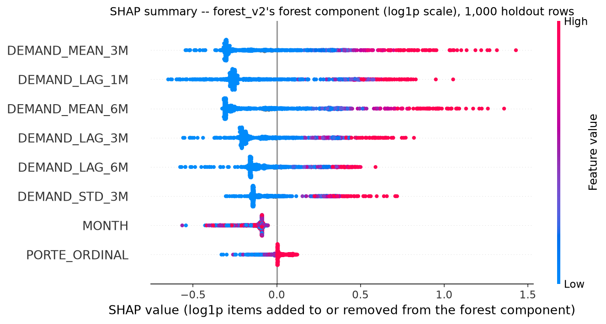

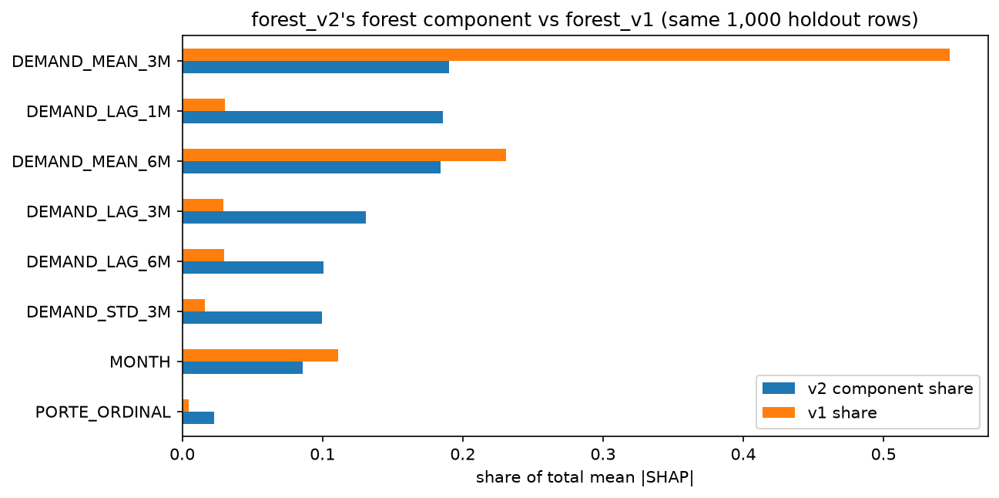

- **The component spreads its attribution.** Its top three predictors are nearly tied at about 19% each, where `forest_v1` gives `DEMAND_MEAN_3M` 54.7%. This is the direct effect of `max_features = 1`: each split sees one random predictor, so every history column has to carry part of the forest's forecast. The rankings still agree broadly (Spearman 0.690), with the same leader and the same last place.
- **`PORTE_ORDINAL` is last in the component too** (2.3%).
- **`MONTH` weighs less in the component but acts the same way.** It falls from third to seventh (8.6% against 11.1%), but the highest `MONTH` threshold across the 600 trees is still 8.5, so October to December are still routed down September's branch: the "latest level" extrapolation of Section 4.4.5.3 persists at a smaller weight.
- **The monotone reading stands for the component.** In the beeswarm, every history predictor raises the forest's forecast when high and lowers it when low, the level-following behaviour Section 4.4.5.6 describes.

**The complete recipe.** The component's shares do not show how much each predictor moves the **published** forecast, `f(x) = 0.7 · expm1(forest(x)) + 0.3 · DEMAND_LAG_1M` (0 where missing): `expm1` scales contributions differently at different forecast levels, and the blend adds last month's value outside the forest. Section 13.1 of the notebook therefore explains `f` itself with **exact** Shapley values (all 2⁸ coalitions of the eight predictors) against an interventional background of 100 training rows, for 300 of the 1,000 rows (exact enumeration costs 25,600 forecasts per row). The values are in items, and `base value + Σ SHAP` reproduces the published forecast (maximum gap below 10⁻¹¹ items, base value 11.89 items). On the same 300 rows:

| Predictor | Complete recipe share | Recipe rank | Component share | Component rank | `forest_v1` share | `forest_v1` rank |
|---|---|---|---|---|---|---|
| `DEMAND_LAG_1M` | **51.0%** | 1 | 18.5% | 2 | 3.0% | 6 |
| `DEMAND_MEAN_3M` | 13.2% | 2 | 19.2% | 1 | 55.5% | 1 |
| `DEMAND_MEAN_6M` | 12.1% | 3 | 18.4% | 3 | 22.1% | 2 |
| `DEMAND_LAG_3M` | 7.8% | 4 | 13.5% | 4 | 3.2% | 4 |
| `MONTH` | 6.3% | 5 | 8.5% | 7 | 11.3% | 3 |
| `DEMAND_LAG_6M` | 4.6% | 6 | 10.1% | 5 | 3.1% | 5 |
| `DEMAND_STD_3M` | 3.0% | 7 | 9.7% | 6 | 1.3% | 7 |
| `PORTE_ORDINAL` | 2.0% | 8 | 2.1% | 8 | 0.5% | 8 |

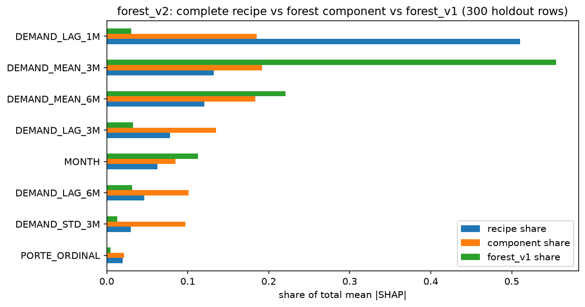

- **The shares do not carry over; the order largely does.** Last month's value carries 51.0% of the published forecast's attribution, against 18.5% in the component, because the blend's `0.3 × DEMAND_LAG_1M` is additive and its whole effect lands on that predictor, while the forest's contributions are scaled by the 0.7 weight and by `expm1`'s slope at each row's level. The rank order stays close (Spearman 0.905 between recipe and component).
- **The two published forecasts rest on different inputs** (Spearman 0.619 against `forest_v1`). For a non-technical reader, `forest_v2` forecasts next month mostly from last month's billed volume, corrected by the recent level; `forest_v1` forecasts it from the three-month average (Section 4.3.9.6). This is also why the sudden stop of Section 4.4.5.5 (`DEMAND_LAG_1M` = 400 after months in the thousands) is forecast far lower by `forest_v2` (Section 4.3.12.5).
- **H1 holds for the published forecast too.** `PORTE_ORDINAL` is last under all three explanations (2.0% of the recipe), a further confirmation that operator size adds nothing once demand history is known (Section 4.3.9.10).

The limits of Section 4.4.5.6 apply as they stand, with one addition: the recipe explanation depends on its background sample, and a different background of training rows would move the base value and, to a lesser degree, the shares.

#### 4.4.6. Final recommendation

**No supervised model is promoted to replace the seasonal-naive forecast, and `forest_v1` remains the shipped prediction base.** Notebook 20's `forest_v2` (Section 4.3.12) is the new validation leader: 23.95 on the project's three-origin MAE, against the ElasticNet's 24.17, and +0.178 mean skill over five origins under a rule fixed before any candidate was scored. Its single holdout read improves what no earlier candidate could: the best all-rows RMSE and R² of the project, the only all-rows gain over the naive forecast a by-operator bootstrap confirms, and the best skill at `operator × UF × month` (+0.086). But on the observed rows, the read the business ranking depends on, it is significantly worse than `forest_v1` (skill +0.030 against +0.211), and it under-predicts total holdout volume by a third (volume ratio 0.662). It also fails the promotion gate of Section 4.3.12.8 on both periods. Its published `alto` tier is non-inferior to `forest_v1`'s (96.3% of measured holdout volume against 96.7%), so the gate fails on volume and observed rows, not on ranking: replacing `forest_v1` would give up observed-row accuracy and volume without a better `tier` list, and choosing between the two because of the holdout would turn it into a selection set. The project therefore gives each model a defined role instead of naming a deployed winner:

| Role | Model | Basis |
|---|---|---|
| Validation leader, with a final holdout estimate | Random Forest v2 (`forest_v2`: 0.7 × forest on `log1p(y)` + 0.3 × last month's value) | Three-origin validation MAE 23.95 ± 3.03; five-origin skill +0.178 (nested estimate 0.132); holdout skill +0.079 on all rows and +0.030 on observed rows; operator-grain skill +0.086. Fails the promotion gate on volume and holdout observed rows; its published `alto` tier is non-inferior (Section 4.3.12.8). Explained with SHAP, forest component and complete recipe (Section 4.4.5.7). Persisted beside `forest_v1` with `selected: false` |
| Shipped prediction base and provisional challenger | Random Forest v1 (`rf_deep_large`) | Strongest holdout result on observed rows (+0.211, confirmed by the bootstrap against both the naive forecast and `forest_v2`), volume ratio 0.987 and operator-grain skill +0.039; its published `alto` tier holds 96.7% of measured holdout volume, against 96.3% for `forest_v2` (Section 4.3.12.8); it misses the gate's volume band in four of eight months, so its own volume error should be monitored. Explained with SHAP (Section 4.4.5). Its `tier` output stays published as provisional |
| Operational default for operator-level decisions | Seasonal-naive forecast (`ŷ = DEMAND_LAG_1M`) | The contingency plan's promotion trigger, positive operator-level skill for two consecutive live months, is not met (Section 4.3.9.9): `forest_v2`'s +0.086 is one held-out window, not live evidence |
| Previously evaluated linear baselines | Regularized linear (ElasticNet, `alpha=0.01`, `l1_ratio=0.5`) and Linear Regression v2 | Validation MAE 24.17 ± 6.19 and 24.32 ± 6.38; holdout skill +0.039 and +0.026 on all rows, −0.018 and −0.037 on observed rows |
| Explanatory artifact | Decision Tree (depth 6, 36 leaves) | Readable in plain language for the partner, as Risk R05 requires, with positive holdout skill on both row sets (Section 4.3.8.7) |
| Population filter | K-Means, operator × municipality, re-applied as of each month | Defines `ATUANTE` for the supervised matrix (Section 4.4.4) |

**The disagreement between validation and holdout persists, in a new form.** Before notebook 20, the linear models led validation and lost the holdout; now the validation leader is a forest, and it still loses to `forest_v1` on observed rows. Two explanations fit this evidence, and neither favours a particular candidate:

- **Too little validation evidence.** Five origins are still one calendar year. Nested selection shows an optimism of 0.092 skill points for the winner, and it picks a different candidate on each outer origin, so the top eligible candidates are not reliably separable (Section 4.3.12.4).
- **The months differ in kind.** The zero share grows from 27.5% in February to 60.4% in December (Section 4.3.8.1), and holdout volume is concentrated in a few large `advanced`-line units in Amazonas. `forest_v2`'s volume ratio, 0.903 on validation and 0.662 on the holdout, is a concrete instance: a guardrail met on July–September did not carry over to October–December.

**What would settle it, in order of priority:**

1. **Confirm the gate's thresholds with the business team.** G2 stays an absolute per-month band, as the review decided; the team still has to confirm that [0.90, 1.10] is the acceptable volume range and that the G4 margins (1.0 point of captured volume, 0.02 of Spearman) are negligible differences for the `tier` list (Section 4.3.12.8).
2. **Apply the promotion gate on new forecast origins.** As 2026 months arrive, publish one prediction base per forecast month and evaluate `forest_v2` and the hurdle model, the closest eligible alternative, which was never read on the holdout (Section 4.3.12.3), against `forest_v1`. The prediction base moves only to a challenger that passes all four criteria on at least three new months; meanwhile, `forest_v1`'s own volume error is monitored against the same band.
3. **Complete the coverage.** Linear Regression v1 and the Decision Tree are still unscored at `operator × UF × month`, and the tree has no by-operator bootstrap (Section 4.4.3).
4. **Extend the predictor contract where the evidence supports it.** Treatment line and provider state were the only exploratory predictors that helped (Section 4.3.12.3), and are worth a formal proposal in notebook 13's contract; the sudden starts and stops still need the external signals behind Section 4.3.6's integration gates.
5. **Close the remaining population gap.** Re-running the supervised comparison on the operator-level population of notebook 10 (Section 4.4.4) remains open.

Until this evidence exists, any operator-level decision should use last month's value, and `forest_v1`'s `tier` list should circulate only as a provisional ranking, with the caveats Section 4.3.9.11 attaches to it. `forest_v2`'s prediction base, with the same schema and rows, is available beside it for comparison (Section 4.3.12.6).

### 4.5. Evaluation

```
* Describe the final predictive model solution and justify its selection. Align your reasoning with Section 4.1, referencing business understanding and personas.
* Describe a contingency plan in case the model fails.
* Discuss model explainability (if applicable) and test the hypotheses.
* Use equations, tables, and visualizations where applicable to support your arguments.

Remove this block at the end
```

## <a name="c5"></a>5. Conclusions and Recommendations

This section closes the project. It summarizes what was built and how well it performed (Section 5.1), states which model we recommend and why (Section 5.2), gives the business partner concrete guidance on how the predictions should and should not be used (Section 5.3), lists the assumptions and limitations behind every number (Section 5.4), discusses the people and organizations that decisions informed by the model can affect (Section 5.5), and describes how the model should be monitored and improved (Section 5.6). Section 5.7 proposes supporting material for the Attachments section, and Section 5.8 closes with final considerations. Every figure quoted here comes from Sections 4.3 and 4.4, where it is derived in full.

### 5.1. Summary of results

**What was built.** The project delivers a reproducible pipeline that turns public ANS data into a monthly demand forecast for breast-cancer-related care in the North Region. Because TISS claims carry no diagnosis and no patient identifier, the forecast target is a constructed proxy, `volume_demanda_proxy`: the number of billed items per `operator × treatment line × state × month`, selected through a TUSS/SBOC crosswalk [17,18] (Sections 2.2 and 4.3.6). It measures **billed utilization volume, not patients**. The pipeline has two stages:

- **Unsupervised stage.** K-Means applied to `operator × municipality` activity separates operators with sustained breast-cancer-related billing (`ATUANTE`) from marginal ones. It is re-applied month by month, so a row only enters the model if the operator was already active before that month. Across 2025, 507 Medicina de Grupo operators were `ATUANTE` in at least one month (Section 4.4.4).
- **Supervised stage.** Linear Regression (v1, v2 and a regularized ElasticNet), a Decision Tree and two Random Forests (`forest_v1` and `forest_v2`) were trained on the 7,716 rows before October 2025. They were selected on expanding-window validation folds and then read once on the October–December holdout (3,810 rows, of which 1,674 actually billed something) (Sections 4.3.7–4.3.12).

**How the models were judged.** MAE is the primary metric because it is expressed in billed items and is not dominated by a few very large operators. RMSE and R² complement it (Section 4.4.1). The decisive test is the **skill score** against the seasonal-naive forecast, `1 − MAE_model / MAE_naive`, where the naive forecast simply repeats last month's value [22]. A model with positive skill beats a forecast that needs no training at all. Skill is reported on all rows, on observed rows (the units that billed, which the business ranking depends on) and on the `operator × UF × month` grain at which the personas actually make decisions.

**Final evaluation metrics** (Sections 4.4.3 and 4.3.12.5; "—" marks a value not computed in this project, here the operator-grain skill of the two earlier models; volume ratios are pooled over all holdout rows):

| Model | Validation MAE | Holdout MAE, all rows | Holdout R², all rows | Skill, all rows | Skill, observed rows | Skill, `operator × UF × month` | Volume ratio |
|---|---|---|---|---|---|---|---|
| Seasonal-naive forecast (reference) | 30.98 | 19.724 | 0.611 | 0.000 | 0.000 | 0.000 | 1.043 |
| Linear Regression v1 (legacy) | 26.48 | 18.326 | 0.638 | +0.071 | +0.016 | — | 0.669 |
| Linear Regression v2 | 24.32 | 19.219 | 0.564 | +0.026 | −0.037 | +0.041 | 0.565 |
| Regularized linear (ElasticNet) | 24.17 | 18.959 | 0.576 | +0.039 | −0.018 | +0.053 | 0.583 |
| Decision Tree | 31.33 | 19.065 | 0.444 | +0.033 | +0.168 | — | 1.018 |
| Random Forest v1 (`forest_v1`) | 31.01 | **18.141** | 0.421 | **+0.080** | **+0.211** | +0.039 | 0.987 |
| Random Forest v2 (`forest_v2`) | **23.95** | 18.157 | **0.662** | +0.079 | +0.030 | **+0.086** | 0.662 |

**How to read the comparison.** Random Forest is the principal candidate. Its two versions hold the best result on almost every column: `forest_v1` has the lowest holdout MAE, the highest skill on observed rows and a total predicted volume within 1.3% of the truth. `forest_v2` leads validation and has the best R² and operator-grain skill. A by-operator bootstrap confirms `forest_v1`'s gain over the naive forecast on observed rows and `forest_v2`'s gain on all rows (Section 4.3.12.5). But the two versions disagree with each other. `forest_v2` is significantly worse than `forest_v1` on the rows that billed and under-predicts total volume by a third, while `forest_v1` only ties the naive forecast on validation (31.01 against 30.98). The linear models rank well on validation but lose to last month's value on the observed holdout rows. When the selection period and the final test point in different directions, the honest reading is that the evidence does not yet separate the candidates reliably. Nested selection confirms this with an optimism of 0.092 skill points for `forest_v2` (Section 4.3.12.4).

**The operational grain is the critical point.** At `operator × UF × month`, the level at which an operator is prioritized, the forests beat last month's value only by small margins: +0.039 for `forest_v1` and +0.086 for `forest_v2`. Both figures come from a single three-month holdout window, and no significance test was run at that grain. The contingency plan requires positive skill for two consecutive live months before the model replaces the naive forecast there (Section 4.3.9.9), and that has not happened. **The Random Forest has therefore not yet demonstrated superiority over the naive baseline at the operational level.** This is the most important conclusion of the project for the partner.

**What explains the forecasts.** Permutation importance and SHAP [24,25] agree that the forest is a level-following model. Its forecasts rest almost entirely on recent demand history: the three- and six-month rolling means for `forest_v1`, and last month's value for `forest_v2`'s blend. Operator size (`PORTE_ORDINAL`) adds nothing once that history is known, which confirms H1 (Sections 4.3.9.10 and 4.4.5). In plain words, the model predicts that an operator's billed volume next month will resemble its recent billed volume. That is why it cannot anticipate sudden starts or stops.

**Results against the objectives.** The table below measures the outcome against the objectives of Section 2.1 and the success criteria of Section 4.1.3(e):

| Objective / criterion | Status | Evidence |
|---|---|---|
| Satisfactory accuracy on a held-out set | **Partially met** | Every supervised model beats the naive forecast on all holdout rows, but by small margins, and only on one three-month window |
| Estimate for non-vertically-integrated operators, consistent with the integrated benchmark | **Not demonstrated** | The model runs on Medicina de Grupo operators, which the partner-confirmed rule classifies as vertically integrated (Section 4.3.5). Ownership cannot be identified from the market-share data, and the benchmark comparison is not reported in this document |
| Auditable and reproducible | **Met** | `scripts/run_pipeline.py` regenerates the matrix, the treated base and the feature contract byte for byte; notebook 20 hashes its inputs and its code (Section 4.3.12.1) |
| Prediction base usable by the business team | **Met, as provisional** | `.parquet`/`.csv` prediction base with `volume_previsto`, `tier` and qualifying flags (Section 4.3.9.8) |
| Interactive dashboard reflecting model outputs, filterable by operator, service, region and patient profile | **Partially met** | `Dashboard/` (React frontend, Express API): the filters are operator, treatment line, provider state, forecast month and opportunity tier, over the `forest_v1` prediction base. There is no patient-profile (sex, age group) or city filter in the current build |
| Reusable asset | **Met** | Documented notebooks and a single pipeline script that can be re-run on a later ANS release |

**Hypotheses revisited.** The three exploratory hypotheses tested in Section 4.2.3, over the fully treated base of 310,340 billed records and 291,864 unique events, each returned a verdict that shaped the modeling design:

- **H1 — concentration of observed demand across health plans — is accepted.** The busiest 1% of 3,289 plans account for 41.7% of all events, the top 10% for 84.2% and the top 20% for 92.9% (Gini 0.888), and the concentration holds inside every declared-size band, so `PORTE` is not a usable proxy for plan-level demand. The supervised stage confirms this: once demand history is known, `PORTE_ORDINAL` adds nothing (Section 4.3.9.10). H1 is reflected in the shipped per-plan ranking, which ranks each `ID_PLANO` individually rather than by size band.
- **H2 — intermunicipal displacement for care — is accepted, with a caveat.** 26.8% of events are billed outside the beneficiary's municipality of residence, varying from 7.1% (Roraima) to 33.1% (Tocantins); displacement is not independent of provider state (χ² = 6,179.24, df = 6) but the association is modest (Cramér's V = 0.146). The models do not yet use this signal — no municipality-level feature is in the eight-feature contract — so H2 is a documented finding that sets a next feature to add, through the trailing-window municipality counts held behind the integration gate of Section 4.3.6.
- **H3 — interaction between age and geography — is accepted as an exploratory finding, but untested in the models.** The proxy-positive share rises monotonically with age (0.5% at 20–29 to 23.2% at 80+; Cramér's V = 0.188 overall), and the within-bracket state effect climbs from 0.101 (20–29) to 0.329 (70–79); all seven strata survive Holm correction against the Bonferroni threshold of 0.00714. Neither age bracket nor any geographic variable is in the feature contract, so the suggested interaction has not been tested; the recommendation is to add an explicit age-by-state term in a future iteration (Section 4.3.9.10).

### 5.2. Recommended model and rationale

**We recommend keeping `forest_v1` as the published prediction base, as a provisional ranking, and keeping the seasonal-naive forecast as the operational default for operator-level decisions.** `forest_v2` stays beside it as the challenger. The roles follow Section 4.4.6:

| Role | Model | Why |
|---|---|---|
| Published prediction base (provisional) | `forest_v1` | Best result on the rows that billed (+0.211, confirmed by the bootstrap), a total volume close to the truth (ratio 0.987), and the `alto` tier holding 96.7% of measured holdout volume |
| Challenger | `forest_v2` | Validation leader and best operator-grain skill, but it fails the promotion gate on volume and on observed rows (Section 4.3.12.8) |
| Operational default for operator-level decisions | Seasonal-naive forecast (last month's value) | Its replacement requires live evidence the project does not yet have |
| Explanatory support | Decision Tree | Readable in plain language, as Risk R05 requires (Section 4.1.5) |
| Population filter | K-Means, `operator × municipality` | Defines which operators enter the model each month |

**Why a Random Forest.** A forest averages many decision trees trained on different samples, which makes it stable on a skewed target and able to use missing history without imputation [21]. It is also explainable row by row through SHAP, so every forecast in the prediction base can be accompanied by the reasons behind it (Section 4.4.5). Among the candidates, it is the only family whose gain over the naive forecast on the holdout is confirmed by the by-operator bootstrap (the Decision Tree was not tested, Section 4.4.3).

**Why not promote it further yet.** Choosing between `forest_v1` and `forest_v2` because of the holdout would turn the test set into a selection set. Their published `tier` lists are nearly equivalent anyway: 83.7% of rows keep the same tier and no row moves between `alto` and `baixo` (Section 4.3.12.6). What separates the model's **current capability** from its **limitation** is the following:

| The model can currently… | The model cannot yet… |
|---|---|
| Rank already-active operators by their expected billed volume next month, with its `alto` tier capturing about 96% of measured volume | Prove that it beats last month's value at `operator × UF × month` on live data |
| Forecast total holdout volume with small bias (`forest_v1`, ratio 0.987), although it misses the monthly volume band in four of eight months | Forecast operators or combinations with no billing history; 52 operators billed for the first time in the holdout window |
| Explain each prediction in terms of recent demand history | Anticipate sudden starts or stops, which need signals outside the claims history |
| Cover 73.6% of the holdout units that billed, carrying 83.3% of their volume | Estimate numbers of patients, disease stages or treatment eligibility |
| Run on Medicina de Grupo operators in the North Region for 2025 | Be applied to other modalities, regions or the non-vertically-integrated segment without being re-validated |

### 5.3. Recommendations to the business partner

The recommendations below are addressed to Daiichi Sankyo's Market Access team, and in particular to the roles described by the personas in Section 4.1.6.

**How the predictions should be used:**

1. **As a provisional prioritization list, not as a final answer.** The `tier` label (`alto`, `medio`, `baixo`) is a relative ranking of expected billed volume. It is useful to decide *where to look first*, for example which operators the Value Strategy Manager reviews before a planning cycle. Each ranking should be checked against the naive forecast and against the team's own field knowledge before any resources are committed.
2. **Always together with its flags.** Every row carries `target_measured`, `is_structural_zero` and `has_recent_history`. A low prediction for a row without recent history means *the model knows little*, not *the demand is low* (Section 4.3.9.9). The flags should travel with the number whenever it is exported, copied into a slide or passed on to the Field Manager, who receives the information already processed by someone else.
3. **In the correct unit.** Predictions are billed items per month. They should be described as "expected billed volume" and, per treatment line, as "predicted volume of items cited in that guideline chapter" (Section 4.3.9.6), never as patients or as people at a disease stage.
4. **Aggregated where possible.** The model is more reliable on totals and rankings than on individual operator-months. Decisions about a portfolio or a state are on firmer ground than a decision about one operator in one month.
5. **With last month's value as the operational reference.** Until the promotion trigger is met, operator-level decisions should use the seasonal-naive forecast, with the forest's `tier` as complementary evidence (Section 4.4.6).

**How the predictions should not be used:**

- **Not as a patient count or epidemiological estimate.** The target is a utilization proxy; one patient can generate many billed items, and no beneficiary identifier exists to remove duplicates (Section 4.2.3).
- **Not for clinical or eligibility decisions.** The model has no clinical information, and the treatment-line split is a reporting convention. Under it, 92.3% of item volume is assigned to `advanced`, so it does not describe how many patients are at each stage (Sections 4.3.9.7 and 4.3.11).
- **Not as an evaluation of an operator's quality, cost behavior or vertical integration status.** A high tier only means high recent billing, and integration status could not be identified (Section 4.3.5).
- **Not for new entrants or markets outside the scope.** Operators with no history, other modalities, other regions and years other than the one the model was trained on are outside what it was validated for.
- **Not as a reason to reduce effort in low-volume regions on its own.** A low ranking may reflect access barriers rather than low need (Section 5.5).

**Decisions the partner needs to take.** Three points depend on the partner's judgment rather than on the modeling team: (i) confirming that [0.90, 1.10] is an acceptable monthly volume band and that the G4 margins are negligible differences for the `tier` list (Section 4.3.12.8); (ii) confirming the reporting convention for treatment lines, knowing that a clinically truer rule may make the model less accurate (Section 4.3.9.11); and (iii) deciding whether access to ownership and network data can be provided, which is the only way to address the non-vertically-integrated segment that motivated the project.

### 5.4. Limitations, assumptions and appropriate use cases

**Assumptions.** The forecast is valid only to the extent that the following assumptions hold:

- Billed item volume is a reasonable proxy for the demand Market Access cares about, and the TUSS/SBOC crosswalk correctly identifies breast-cancer-related items [17,18].
- A month without a claim is zero billed volume, from an operator's first claim onward. This is a claims-based rule, not evidence of enrollment (Section 4.3.6).
- Next month's billing resembles recent billing. This is what the model learns, and it holds poorly when an operator starts or stops abruptly.
- The patterns of 2025 continue into the forecast months, and the `ATUANTE` filter defines a sensible population.

**Limitations:**

- **One year, one region, one modality.** The data covers 2025, the North Region and Medicina de Grupo operators. Selection used five validation origins and the holdout is three months long, which is why the candidates cannot be reliably separated.
- **The non-vertically-integrated segment is not yet covered.** The modeled population is classified as vertically integrated, and the market-share data cannot identify common ownership, so the project's original visibility gap remains open (Section 4.3.5).
- **Data delay.** ANS claims arrive with a delay of about three to six months (Section 1), so a "next month" forecast is next month in the data, not in the calendar.
- **Measurement gaps.** Package billing makes quantities unavailable in 26 target groups and only a lower bound in 128 (Section 4.3.6).
- **Cold start.** Combinations with little history get predictions that rest on almost nothing (Section 4.3.9.9).
- **No age, sex or detailed geography.** The forecast grain is `operator × treatment line × state × month`. Patient-profile and municipality views are therefore descriptive, not predicted, and the age × geography interaction of H3 was never tested in the model (Section 4.3.9.10).
- **Explanations describe the model, not causes.** SHAP shows what the forest relies on, not what drives demand in the real world (Section 4.4.5.6).

**Appropriate and inappropriate use cases:**

| Appropriate | Inappropriate |
|---|---|
| Building a shortlist of already-active operators to review in a planning cycle | Deciding alone, without human review, where to allocate commercial resources |
| Comparing the expected volume of states or treatment lines at an aggregated level | Reporting the number of breast-cancer patients in an operator or state |
| Answering ad-hoc requests from the commercial team with a documented, reproducible figure | Estimating demand for new operators, other modalities or other regions |
| Monitoring how the ranking changes month to month | Supporting clinical, coverage or eligibility decisions about any person |

### 5.5. Strategic and ethical considerations

The model does not produce any output about individuals: its inputs are aggregated billing counts without a beneficiary identifier, and it ranks operators, not patients (Section 4.3.9.11). Its ethical risks are therefore indirect. They come from *how decisions informed by the ranking* change where commercial attention, and eventually access effort, is directed. The table identifies the affected stakeholders, the risk for each one and the safeguard the project proposes:

| Stakeholder | How the model can affect them | Main risk | Safeguard |
|---|---|---|---|
| Breast-cancer patients in the North Region (Camila, Section 4.1.6) | They are the object of the prediction, not users; where Market Access focuses can influence how quickly therapies reach each place | The model ranks by past billing, so regions where low volume reflects access barriers may be ranked low and receive even less attention. INCA reports marked regional differences related to unequal access [12], and 26.8% of events are billed outside the beneficiary's municipality of residence (H2, Section 4.2.3), so where care is billed is not always where the need is | A low tier is never read as low need; prioritization decisions about regions are cross-checked with epidemiological sources such as INCA's estimates [12] before any region is deprioritized |
| Health plan operators | They are ranked by the model | A tier being read as a judgment of the operator, or circulated outside the company | `tier` is used only internally, described as "expected billed volume", and never presented as an evaluation of quality, cost or integration status |
| Daiichi Sankyo users (Lucas, Pedro, Ricardo and Jenifer) | They make or receive decisions based on the output | Over-reliance on the model, or misreading items as patients. Users' trust should match how often the model is actually right [27], and here its advantage over a simple rule is still small | Plain-language explanations and flags travel with every number; the naive forecast stays as the visible reference; a user manual (Section 5.7) explains what each field means |
| Field teams and providers | They receive processed rankings, often without the caveats | Caveats lost in the hand-off between the analyst and the field | Exports and dashboard views keep the flags and the provisional label attached to the ranking |
| Daiichi Sankyo and Inteli | Responsible for the data and the analysis | Disclosure of confidential partner data or the partner's name (Risk R06); personal data of dashboard users | Partner files stay outside version control (Section 4.3.5.4); dashboard data is handled under the privacy policy of Section 4.1.8 and the LGPD [28] |

**Strategic recommendations.** Four recommendations follow from the analysis:

1. **Use the model as decision support, with a human in the loop.** The ranking narrows the search; the commercial decision remains with the team, which knows context the claims data does not contain.
2. **Invest in the data, not only in the algorithm.** The two largest failure modes, sudden starts and stops, come from the predictor contract and would remain with any model family (Section 4.4.5.6). Ownership records, a validated identifier crosswalk and dated network data are what would close the visibility gap for non-vertically-integrated operators (Section 4.3.5.2).
3. **Expand only after validating.** The pipeline can be re-run for other modalities or regions (Opportunity O05, Section 4.1.5), but each new population needs its own validation before its ranking is used.
4. **Keep the trade-offs visible.** When a choice improves accuracy at the cost of clinical meaning, as with the treatment-line rule, it should be presented to the partner for decision rather than settled silently by the modeling team.

### 5.6. Monitoring, validation and future improvement

**Monitoring.** The model should be re-scored every time a new month of ANS data becomes available, with one prediction base published per forecast month (Section 4.3.12.8). Each publication should be checked against the triggers already defined in the project:

| What to monitor | Threshold | Action |
|---|---|---|
| Skill against the naive forecast at `operator × UF × month` | > 0 for two consecutive months | Promote the forest to operator-level default |
| Skill on observed rows | ≤ 0 for two consecutive months | Use the naive forecast at the line grain too; investigate before refitting |
| Monthly volume ratio | Outside [0.90, 1.10] | Review the forecast before the dashboard sums it; `forest_v1` already missed this band in four of eight months |
| Zero-row share | Moves more than about 5 points from 56.1% | Re-audit the modeling matrix before trusting any metric |
| Share of rows without recent history | Rises above the current level | Cold-start population growing; widen the caveat on new rankings |
| Top-decile churn | Ranking unstable month to month | Investigate before circulating a new `tier` list |

**Validation.** A challenger such as `forest_v2`, or the hurdle model that was never read on the holdout, should replace `forest_v1` only if it passes all four criteria of the promotion gate (G1 to G4) on at least three new months that took no part in its selection (Section 4.3.12.8). This rule protects the partner from switching models because of chance differences in one period.

**Future improvements**, in order of priority (Section 4.4.6):

1. Confirm the gate thresholds and the treatment-line convention with the business team.
2. Accumulate live months and apply the promotion gate to `forest_v2` and the hurdle model.
3. Score Linear Regression v1 and the Decision Tree at the operator grain, and run the by-operator bootstrap for the tree.
4. Propose treatment line and provider state as formal predictors, the only exploratory features that helped (Section 4.3.12.3), and test the age × state interaction suggested by H3.
5. Integrate external network and ownership signals once their availability dates are established, and re-run the supervised comparison on the operator-level population.
6. Extend the history beyond 2025 so that selection rests on more than one calendar year.

### 5.7. Proposed supporting material for the Attachments section

The following materials are proposed for Section 7. None of them has been written yet, apart from the existing data dictionary, which would be adapted:

| Proposed attachment | Audience | Content | Status |
|---|---|---|---|
| **A. Model card** for `forest_v1` and `forest_v2`, following Mitchell et al. [29] | Partner's data team and reviewers | Intended use, out-of-scope uses, training data and population, metrics on all three row sets, explainability summary, limitations and ethical considerations, in one page per model. The content already exists in Sections 4.3.9, 4.3.12, 4.4 and 5 | Proposed |
| **B. User manual** for the prediction base and dashboard | Value Strategy Manager, Product Manager and Data Analyst | What each column means (`volume_previsto`, `volume_observado`, `tier` and the three flags), how to read a tier, the "should / should not" rules of Section 5.3, and a worked example of one row with its SHAP explanation | Proposed |
| **C. Data dictionary and dataset documentation**, in the spirit of datasheets for datasets [30] | Data Analyst and future maintainers | Adaptation of [`data_column_dictionary.md`](extras/data_column_dictionary.md), adding the target definition, the `ATUANTE` filter and the package-billing rule | Existing, to be adapted |
| **D. Monthly monitoring and promotion checklist** | Data Analyst | The triggers of Section 5.6 and the four gate criteria as a fill-in form for each new publication | Proposed |

### 5.8. Final considerations

The project delivers what a commercial team needs to use a forecast responsibly: a reproducible pipeline, a ranked prediction base, explanations for every prediction and an honest statement of how far the evidence goes. The Random Forest is the strongest candidate the project produced, but at the operator level its advantage over simply repeating last month's value is small, comes from a single three-month window and still has to be confirmed on live data. Our formal recommendation is therefore to use it as a provisional, explained ranking alongside the naive forecast, to monitor it month by month under the rules above, and to treat access to ownership and network data as the next step that would let the solution reach the non-vertically-integrated market it was designed for.

## <a name="c6"></a>6. References

*Entries are numbered in Vancouver style, in order of first citation in the text; every numbered entry is cited at least once. Works consulted during the project but not cited by name — reference works, academic papers and image credits — are listed unnumbered under **Additional sources consulted**, so that no number in the list above is left without a citation.*

1. Daiichi Sankyo. About us [Internet]. Tokyo: Daiichi Sankyo; 2026 [cited 2026 Aug 11]. Available from: https://www.daiichisankyo.com/about_us/
2. Panorama Farmacêutico. Fábrica da Daiichi-Sankyo recebe aporte de R$ 400 milhões [Internet]. [place unknown]: Panorama Farmacêutico; 2026 Mar 13 [cited 2026 Aug 13]. Available from: https://panoramafarmaceutico.com.br/fabrica-da-daiichi-sankyo-recebe-aporte-de-r-400-milhoes/
3. Agência Nacional de Vigilância Sanitária (Anvisa). Enhertu (trastuzumabe deruxtecana): nova indicação [Internet]. Brasília: Anvisa; 2026 May 14 [cited 2026 Sep 18]. Available from: https://www.gov.br/anvisa/pt-br/assuntos/medicamentos/novos-medicamentos-e-indicacoes/enhertu-trastuzumabe-deruxtecana-1
4. Daiichi Sankyo. Daiichi Sankyo unveils new five-year business plan focused on oncology leadership and innovation [Internet]. Tokyo: Daiichi Sankyo; 2026 May 11 [cited 2026 Sep 18]. Available from: https://www.daiichisankyo.com/files/news/pressrelease/pdf/202605/20260511_E.pdf
5. Daiichi Sankyo. História no Brasil [Internet]. São Paulo: Daiichi Sankyo Brasil; 2026 [cited 2026 Aug 14]. Available from: https://daiichisankyo.com.br/historia-no-brasil/
6. Chapman P, Clinton J, Kerber R, Khabaza T, Reinartz T, Shearer C, et al. CRISP-DM 1.0: step-by-step data mining guide [Internet]. Chicago: SPSS Inc.; 2000 [cited 2026 Sep 10]. Available from: https://www.the-modeling-agency.com/crisp-dm.pdf
7. Wirth R, Hipp J. CRISP-DM: towards a standard process model for data mining. In: Proceedings of the 4th International Conference on the Practical Applications of Knowledge Discovery and Data Mining; 2000; Manchester, UK. Blackpool (UK): Practical Application Company; 2000. p. 29-39.
8. Provost F, Fawcett T. Data science for business: what you need to know about data mining and data-analytic thinking. Sebastopol (CA): O'Reilly Media; 2013.
9. Roche. Ten-year APHINITY data show Roche's Perjeta-based regimen reduced the risk of death by 17% in people with HER2-positive early-stage breast cancer [Internet]. Basel: Roche; 2025 May 13 [cited 2026 Aug 14]. Available from: https://www.roche.com/media/releases/med-cor-2025-05-13
10. Agência Nacional de Vigilância Sanitária (Anvisa). Anvisa aprova medicamentos para câncer de mama e asma grave [Internet]. Brasília: Anvisa; 2022 Jul 4 [cited 2026 Sep 18]. Available from: https://www.gov.br/anvisa/pt-br/assuntos/noticias-anvisa/2018/anvisa-aprova-medicamentos-para-cancer-de-mama-e-asma-grave
11. Agência Nacional de Vigilância Sanitária (Anvisa). Anvisa aprova novas indicações terapêuticas para medicamento que trata câncer de mama [Internet]. Brasília: Anvisa; 2026 Sep 9 [cited 2026 Sep 18]. Available from: https://www.gov.br/anvisa/pt-br/assuntos/noticias-anvisa/2026/anvisa-aprova-novas-indicacoes-terapeuticas-para-medicamento-trodelvy
12. Instituto Nacional de Câncer (INCA). Estimativa 2026: incidência de câncer no Brasil [Internet]. Rio de Janeiro: INCA; 2026 [cited 2026 Aug 14]. Available from: https://www.gov.br/inca/pt-br/assuntos/cancer/numeros/estimativa/introducao
13. Agência Nacional de Saúde Suplementar (ANS). Dados gerais [Internet]. Brasília: ANS; 2026 [cited 2026 Aug 14]. Available from: https://www.gov.br/ans/pt-br/acesso-a-informacao/perfil-do-setor/dados-gerais
14. Cooper A, Reimann R, Cronin D, Noessel C. About face: the essentials of interaction design. 4th ed. Indianapolis (IN): Wiley; 2014.
15. Dykes T. Personas make users memorable [Internet]. Fremont (CA): Nielsen Norman Group; 2018 [cited 2026 Aug 12]. Available from: https://www.nngroup.com/articles/persona/
16. Gibbons S. Journey mapping 101 [Internet]. Fremont (CA): Nielsen Norman Group; 2018 [cited 2026 Aug 12]. Available from: https://www.nngroup.com/articles/journey-mapping-101/
17. Sociedade Brasileira de Oncologia Clínica (SBOC). Diretrizes SBOC 2025: câncer de mama – estadiamento (v9), neoadjuvante (v6), adjuvante (v6), doença avançada (v12). São Paulo: SBOC; 2025.
18. Agência Nacional de Saúde Suplementar (ANS). Terminologia Unificada da Saúde Suplementar (TUSS) [Internet]. Brasília: ANS; 2026 [cited 2026 Aug 14]. Available from: https://dadosabertos.ans.gov.br/FTP/PDA/terminologia_unificada_saude_suplementar_TUSS-049/
19. Duan N. Smearing estimate: a nonparametric retransformation method. J Am Stat Assoc. 1983;78(383):605-10.
20. Breiman L, Friedman JH, Olshen RA, Stone CJ. Classification and regression trees. Belmont (CA): Wadsworth; 1984.
21. Breiman L. Random forests. Mach Learn. 2001;45(1):5-32.
22. Hyndman RJ, Koehler AB. Another look at measures of forecast accuracy. Int J Forecast. 2006;22(4):679-88.
23. Cohen J. A coefficient of agreement for nominal scales. Educ Psychol Meas. 1960;20(1):37-46.
24. Lundberg SM, Lee SI. A unified approach to interpreting model predictions. In: Advances in Neural Information Processing Systems 30 (NIPS 2017). Red Hook (NY): Curran Associates; 2017. p. 4765-74.
25. Lundberg SM, Erion G, Chen H, DeGrave A, Prutkin JM, Nair B, et al. From local explanations to global understanding with explainable AI for trees. Nat Mach Intell. 2020;2(1):56-67.
26. Lloyd SP. Least squares quantization in PCM. IEEE Trans Inf Theory. 1982;28(2):129-37.
27. Ma S, Lei Y, Wang X, Zheng C, Shi C, Yin M, et al. AI or myself? Leveraging human and AI correctness likelihood to promote appropriate trust in AI-assisted decision-making. In: CHI Conference on Human Factors in Computing Systems; 2023; Hamburg. Proceedings of the 2023 CHI Conference on Human Factors in Computing Systems. New York: ACM; 2023. Article 759, p. 1-19. Available from: https://doi.org/10.1145/3544548.3581058
28. Brasil. Lei nº 13.709, de 14 de agosto de 2018. Lei Geral de Proteção de Dados Pessoais (LGPD) [Internet]. Brasília: Presidência da República; 2018 [cited 2026 Oct 6]. Available from: https://www.planalto.gov.br/ccivil_03/_ato2015-2018/2018/lei/l13709.htm
29. Mitchell M, Wu S, Zaldivar A, Barnes P, Vasserman L, Hutchinson B, et al. Model cards for model reporting. In: Proceedings of the Conference on Fairness, Accountability, and Transparency (FAT* '19); 2019; Atlanta (GA). New York: ACM; 2019. p. 220-9. Available from: https://doi.org/10.1145/3287560.3287596
30. Gebru T, Morgenstern J, Vecchione B, Vaughan JW, Wallach H, Daumé III H, et al. Datasheets for datasets. Commun ACM. 2021;64(12):86-92. Available from: https://doi.org/10.1145/3458723

### Additional sources consulted

- Christensen CM, Hall T, Dillon K, Duncan DS. Competing against luck: the story of innovation and customer choice. New York: HarperBusiness; 2016.
- Cao S, Huang CM. Understanding user reliance on AI in assisted decision-making. Proc ACM Hum-Comput Interact. 2022 Nov;6(CSCW2):Article 471, p. 1-23. Available from: https://doi.org/10.1145/3555572
- Scheuerman MK, Woodruff A, Brubaker JR. How data workers shape datasets: the role of positionality in data collection and annotation for computer vision. Proc ACM Hum-Comput Interact. 2025 Oct;9(7):Article CSCW300, p. 1-42. Available from: https://doi.org/10.1145/3757481
- You Y, et al. The medical authority of AI: a study of AI-enabled consumer-facing health technology. In: CHI Conference on Human Factors in Computing Systems; 2021; Yokohama. Proceedings of the 2021 CHI Conference on Human Factors in Computing Systems. New York: ACM; 2021. Article 207, p. 1-16. Available from: https://doi.org/10.1145/3411764.3445657
- Favre L. A man with a beard and white shirt [Internet]. Unsplash; 2023 [cited 2026 Aug 8]. Available from: https://unsplash.com/photos/a-man-with-a-beard-and-white-shirt-A_X5mJK5nJ4
- Gil C. Um homem com os braços cruzados sorrindo [Internet]. Unsplash; 2024 [cited 2026 Aug 9]. Available from: https://unsplash.com/pt-br/fotografias/um-homem-com-os-bracos-cruzados-sorrindo-S4CXgCbs9BE
- Kakaroto J. Man crossing both arms [Internet]. Unsplash; 2021 [cited 2026 Aug 9]. Available from: https://unsplash.com/photos/man-crossing-both-arms-KIPqvvTOC1s
- Santos M. Woman in blue long sleeve shirt standing on green grass field during daytime [Internet]. Unsplash; 2020 [cited 2026 Aug 8]. Available from: https://unsplash.com/photos/woman-in-blue-long-sleeve-shirt-standing-on-green-grass-field-during-daytime-wX969iVwU78
- Unsplash. Página inicial [Internet]. 2026 [cited 2026 Aug 9]. Available from: https://unsplash.com/pt-br
- Unsplash. Vertical warm toned portrait of bald adult woman wearing headscarf looking at camera while posing in minimal home interior alopecia and cancer awareness copy space [Internet]. 2026 [cited 2026 Aug 8]. Available from: https://unsplash.com/photos/vertical-warm-toned-portrait-of-bald-adult-woman-wearing-headscarf-looking-at-camera-while-posing-in-minimal-home-interior-alopecia-and-cancer-awareness-copy-space-dpvNK8NHa0o
- Wocintechchat C. Crossed arm woman smiling [Internet]. Unsplash; [date unknown] [cited 2026 Aug 9]. Available from: https://unsplash.com/photos/crossed-arm-woman-smiling-lFntEHwQvi4
- Ferro C. Daiichi Sankyo expansion to receive R$420 million investment [Internet]. Panorama Farmacêutico; [date unknown] [cited 2026 Aug 7]. Available from: https://panoramafarmaceutico.com.br/expansao-da-daiichi-sankyo-aporte/
- Giussani D. This Japanese giant is betting on technology to cure cancer — and includes Brazil in its strategy [Internet]. Exame; [date unknown] [cited 2026 Aug 7]. Available from: https://exame.com/negocios/esta-gigante-japonesa-aposta-em-tecnologia-para-curar-o-cancer-e-inclui-o-brasil-na-estrategia/
- Machado R. Daiichi Sankyo expands factory in Brazil and plans to incorporate medicines into SUS [Internet]. Futuro da Saúde; [date unknown] [cited 2026 Aug 9]. Available from: https://futurodasaude.com.br/daiichi-sankyo-expande-fabrica-no-brasil/

## <a name="c7"></a>7. Attachments


### 7.1. Introduction

This section picks three quantitative variables from the project's dataset and puts them through two checks: whether each one is normally distributed, and, based on that answer, which scaling technique — standardization or normalization — actually fits it. The normality check combines a formal hypothesis test with two visual/descriptive cross-checks (histograms and the mean-median gap), so the conclusion for each variable does not rest on a single number. The scaling choice that follows is not a formality either: it is what we use to justify why `VL_TOTAL_REMUNERACAO` and `QT_ITEM_EVENTO_INFORMADO` cannot simply be Min-Max scaled the way the monthly aggregate can (Section 7.3 spells out why). Two of the three variables are measured per ambulatory event; the third is a monthly aggregate — that difference in grain matters later and is called out explicitly wherever it affects how a table or a statistic should be read. All three cover the same North Region breast-cancer base described in Section 4, for the 2025 reference period, and rows missing the variable under test are dropped only for that specific test (the same `dropna()` step already used for missing-value treatment in Section 4.2.2.10).

| Variable | Level | Relevance to the Project |
|---|---|---|
| `VL_TOTAL_REMUNERACAO` | Per event | The reimbursement value tied to each medical event — the closest thing we have to a revenue proxy, feeding directly into the TAPI's goal of guiding resource and commercial-effort allocation. |
| `QT_ITEM_EVENTO_INFORMADO` | Per event | The procedure quantity per event — the most direct proxy for patient demand, and the basis of the TAPI's central prediction target. |
| Mean of `QT_ITEM_EVENTO_INFORMADO` by month | Aggregated (n = 12) | Shows the year's seasonality. The Central Limit Theorem is a plausible explanation for the normality seen at this aggregation level, though with only 12 months and likely dependence between consecutive ones, that reading stays suggestive rather than conclusive. Commercially, it points to when effort should concentrate: a dip around August–September, a rise in November–December that tracks clinical/awareness cycles like Pink October. Unlike the other two variables, this one is a monthly aggregate rather than an event-level record — the grain difference that Section 7.3(e) has to account for explicitly. |

### 7.2. Analysis and normality testing of quantitative variables

#### a) Statement to Be Tested and Hypotheses

We test whether each of the three selected variables — `VL_TOTAL_REMUNERACAO` (reimbursement value per event), `QT_ITEM_EVENTO_INFORMADO` (procedure quantity per event), and the monthly mean of procedure quantity — is normally distributed in the population it was drawn from. The same pair of hypotheses is applied to all three, with X standing for whichever variable is under test:

> **H₀:** X ~ N(μ, σ²) — X is normally distributed in the population.
> **H₁:** X ≁ N(μ, σ²) — X is not normally distributed in the population.

Using one fixed hypothesis pair lets the same test travel across variables measured at different grains — individual events for the first two, monthly aggregates for the third — without changing the criterion for what counts as "normal" between them.

#### b) Significance Level and Relationship to the p-value

We fix α = 0.05 for all three tests — a 5% tolerance for a Type I error (rejecting a true H₀) — and hold it constant across variables so the three conclusions stay comparable. The p-value is not "the probability H₀ is true": it is the probability, assuming H₀ *is* true, of seeing a test statistic at least this extreme. In other words, it measures how surprising the result would be under normality, nothing more. The decision rule is mechanical: p < α rejects H₀ (significant evidence against normality); p ≥ α fails to reject it (not enough evidence to rule normality out). Section 7.2(c) applies this rule to each variable's actual p-value.

#### c) Normality Testing

We used the Shapiro–Wilk test (`scipy.stats.shapiro`), the standard choice for checking normality in continuous quantitative data: it compares the shape of the observed sample against what a true Normal would produce, returning a statistic (W) and a p-value. The catch is that Shapiro-Wilk gets overly sensitive past roughly 5,000 observations — at that scale it starts flagging deviations too small to matter practically, which is exactly the situation with a dataset this size. So any variable with more than 5,000 rows is tested on a random sample of n = 5,000 instead of the full column, drawn with a fixed seed (`random_state=42`) so the same rows come up on every run. That seed buys reproducibility, not representativeness — it doesn't guarantee those 5,000 rows speak for the whole population. Given how sensitive the test still is at this sample size, we don't read its p-values in isolation: the histograms (8.2(d)), the Q–Q plots, and the mean-median comparison (8.2(e)) all back up or challenge the same conclusion independently.
<br>
```python
import pandas as pd
from scipy import stats

df = pd.read_parquet("data/processed/north_region_mama_2025_data_en.parquet")

def test_normality(name, series, alpha=0.05):
    """Runs Shapiro-Wilk on a series and prints statistics + conclusion."""
    s = pd.Series(series).dropna()
    n = len(s)
    if n < 3:
        print(f"{name}: insufficient n ({n})")
        return

    # Shapiro-Wilk is more reliable up to n=5000; above that, sample
    sample = s.sample(5000, random_state=42) if n > 5000 else s
    stat, p = stats.shapiro(sample)

    mean_ = s.mean()
    median_ = s.median()
    skew_ = stats.skew(s)
    kurt_ = stats.kurtosis(s)

    print(f"\n=== {name} ===")
    print(f"n = {n:,} | n_test = {len(sample):,}")
    print(f"Shapiro-Wilk: W = {stat:.4f} | p-value = {p:.4g}")
    print(f"Mean = {mean_:.3f} | Median = {median_:.3f} | Skewness = {skew_:.3f} | Kurtosis = {kurt_:.3f}")
    if p < alpha:
        print(f"p-value < alpha ({alpha}) -> REJECT H0 -> does NOT follow a normal distribution")
    else:
        print(f"p-value >= alpha ({alpha}) -> FAIL TO REJECT H0 -> compatible with a normal distribution")


test_normality("VL_TOTAL_REMUNERACAO (per event)", df["VL_TOTAL_REMUNERACAO"])

test_normality("QT_ITEM_EVENTO_INFORMADO (per event)", df["QT_ITEM_EVENTO_INFORMADO"])

monthly_mean = df.groupby("MES")["QT_ITEM_EVENTO_INFORMADO"].mean().sort_index()
print("\nMean of QT_ITEM_EVENTO_INFORMADO by month:")
print(monthly_mean)
test_normality("Mean of QT_ITEM_EVENTO_INFORMADO by MONTH (aggregated, n=12)", monthly_mean)
```
<br>
The test returned the following table:

| Variable | Level | n | n (tested) | Shapiro–Wilk W | p-value | Conclusion (α = 0.05) |
|---|---|---|---|---|---|---|
| `VL_TOTAL_REMUNERACAO` | Per event | 290,637 | 5,000 | 0.1240 | 9.65 × 10⁻⁹³ | **Reject H₀** — statistically significant evidence against normality |
| `QT_ITEM_EVENTO_INFORMADO` | Per event | 295,563 | 5,000 | 0.1038 | 2.83 × 10⁻⁹³ | **Reject H₀** — statistically significant evidence against normality |
| Mean of `QT_ITEM_EVENTO_INFORMADO` by month | Monthly aggregate | 12 | 12 | 0.9549 | 0.7096 | **Fail to reject H₀** — no evidence against normality in this 12-month aggregate; interpret cautiously given the small sample (n = 12) and the temporal dependence between consecutive months |


Both per-event variables reject H₀ outright — their p-values are astronomically below α = 0.05. The skewness (12.71 for `VL_TOTAL_REMUNERACAO`, 20.36 for `QT_ITEM_EVENTO_INFORMADO`) and kurtosis (213.76 and 715.60) back this up; a true Normal sits at roughly 0 on both. This is the shape you'd expect from healthcare billing: most events are cheap, routine, low-volume — a consultation, one exam, a single item — and a small minority of complex or high-cost cases (bundled procedures, oncological treatment) stretch the right tail out disproportionately far. The mean-median gap tells the same story from a different angle: `VL_TOTAL_REMUNERACAO`'s mean (842.46) is nearly five times its median (172.03), and `QT_ITEM_EVENTO_INFORMADO`'s median sits at 1.0 against a mean of 12.33 — more than half the events involve exactly one item, while a handful of much larger ones drag the average up. The kurtosis values (213.76, 715.60) are just the numerical signature of that same handful of extreme outliers.

The monthly aggregate of `QT_ITEM_EVENTO_INFORMADO` (n = 12) is the opposite case: p = 0.7096, well above α, so H₀ stands. Skewness here is 0.08 (essentially symmetric) and excess kurtosis is −1.04 — flatter than a Normal, not heavier-tailed, which is the kind of thing 12 points can't reliably distinguish from noise anyway. The Central Limit Theorem is the natural explanation: each monthly mean averages roughly 25,000 individual events, and that much averaging tends to pull a mean toward normality even when the underlying data is this skewed. Two caveats keep this from being a proven result rather than a suggestive one: the test itself only has 12 data points to work with, and those 12 aren't independent draws — they're consecutive months within one year, and the seasonal pattern below is itself evidence of the month-to-month dependence that a textbook application of the CLT assumes doesn't exist. That seasonal pattern (a dip around August–September, a rise in November–December) is worth acting on regardless of the CLT caveat: it's a reasonable cue for timing commercial and educational outreach — building up support and supply ahead of the year-end rise, which plausibly tracks increased screening tied to breast cancer awareness campaigns like Pink October, and pushing outreach harder during the naturally quieter months instead.

#### d) Variable Distributions and Histograms

To see whether each variable's shape actually matches its test result, we plotted a density histogram with a fitted Normal curve for all three, using the code below.

```python
import pandas as pd
import numpy as np
import matplotlib.pyplot as plt
from scipy import stats

df = pd.read_parquet("data/processed/north_region_mama_2025_data_en.parquet")
media_por_mes = df.groupby("MES")["QT_ITEM_EVENTO_INFORMADO"].mean().sort_index()

def plot_with_normal_fit(ax, series, bins, color, title, xlabel):
    """Plots a density histogram overlaid with the fitted N(mean, std) curve."""
    s = pd.Series(series).dropna()
    mu, sigma = s.mean(), s.std()

    ax.hist(s, bins=bins, color=color, edgecolor="black", density=True)
    x = np.linspace(s.min(), s.max(), 500)
    ax.plot(x, stats.norm.pdf(x, mu, sigma), color="red", linewidth=2,
            label=f"Normal fit\n(μ={mu:.2f}, σ={sigma:.2f})")
    ax.set_title(title)
    ax.set_xlabel(xlabel)
    ax.set_ylabel("Density")
    ax.legend()

fig, axes = plt.subplots(1, 3, figsize=(18, 5))

plot_with_normal_fit(axes[0], df["VL_TOTAL_REMUNERACAO"], 100, "#4C72B0",
                      "VL_TOTAL_REMUNERACAO (per event)", "Reimbursement value (R$)")

plot_with_normal_fit(axes[1], df["QT_ITEM_EVENTO_INFORMADO"], 100, "#DD8452",
                      "QT_ITEM_EVENTO_INFORMADO (per event)", "Procedure quantity")

plot_with_normal_fit(axes[2], media_por_mes, 8, "#55A868",
                      "Mean QT_ITEM_EVENTO_INFORMADO by month (n=12)", "Monthly mean")

plt.tight_layout()
plt.savefig("assets/normality-testing-histograms.png", dpi=150, bbox_inches="tight")
plt.show()
```

After running it, the following graphs were obtained:

<div align="center">
Figure 11: Density histograms with fitted Normal curve for `VL_TOTAL_REMUNERACAO`, `QT_ITEM_EVENTO_INFORMADO`, and the monthly mean of `QT_ITEM_EVENTO_INFORMADO`.

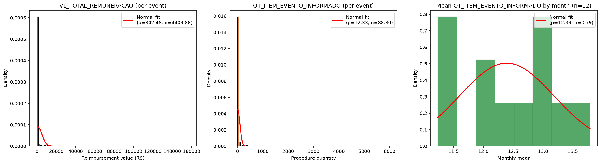

Source: Authors (2026).
</div>

All three plots line up with what Shapiro–Wilk already told us.

`VL_TOTAL_REMUNERACAO` shows a tall, narrow spike at the low end and almost nothing across the rest of the R$0–160,000 range. The fitted curve (μ=842.46, σ=4409.86) should be a wide, smooth bell given that σ — instead it's crushed flat against the x-axis, nowhere near the actual spike. That mismatch between "spike" and "flat wide bell" is about as clear a visual rejection of H₀ as you'll get.

`QT_ITEM_EVENTO_INFORMADO` does the same thing, only worse: nearly everything piles into one spike near zero while the axis stretches to 6,000 to fit the rare extreme values. The fitted curve (μ=12.33, σ=88.80) is again flattened to nothing and matches nothing about the real shape.

The monthly mean of `QT_ITEM_EVENTO_INFORMADO` breaks the pattern: its range is narrow and realistic (11.2–13.8), and the fitted curve (μ=12.39, σ=0.79) actually sits on top of the data at a comparable scale instead of being squashed flat. The 12 bars aren't a smooth bell — with only 12 points that's expected, and the two tallest bins land at opposite ends rather than the center, which is what that negative excess kurtosis (−1.04) is picking up — but there's no long tail and no dominant spike either. Visually, this is a clean contrast with the two per-event variables, and it matches the test's failure to reject H₀.

#### Complementary Evidence: Q–Q Plots

To back up the histograms in 8.2(d) from a different angle, we also produced a Q–Q (quantile–quantile) plot per variable: sample quantiles against the theoretical quantiles of a Normal. A Normally-distributed variable hugs the dashed reference line; systematic curvature away from it signals a departure, and which way it curves tells you what kind (an upward-bending tail, for instance, means right skew).

```python
import pandas as pd
import matplotlib.pyplot as plt
from scipy import stats

df = pd.read_parquet("data/processed/north_region_mama_2025_data_en.parquet")
media_por_mes = df.groupby("MES")["QT_ITEM_EVENTO_INFORMADO"].mean().sort_index()

def qq_plot(series, title, color, path):
    s = pd.Series(series).dropna()

    fig, ax = plt.subplots(figsize=(7, 7))
    (osm, osr), (slope, intercept, r) = stats.probplot(s, dist="norm")
    ax.scatter(osm, osr, color=color, alpha=0.7, label="Observed data")
    ax.plot(osm, slope * osm + intercept, "k--", linewidth=2, label="Reference line (normal)")
    ax.set_title(title)
    ax.set_xlabel("Theoretical quantiles (Normal)")
    ax.set_ylabel("Sample quantiles")
    ax.legend()
    plt.tight_layout()
    plt.savefig(path, dpi=150, bbox_inches="tight")
    plt.show()

qq_plot(df["VL_TOTAL_REMUNERACAO"], "Q-Q Plot - VL_TOTAL_REMUNERACAO",
        "#4C72B0", "assets/q_q_plot_vl_total_remuneracao.png")

qq_plot(df["QT_ITEM_EVENTO_INFORMADO"], "Q-Q Plot - QT_ITEM_EVENTO_INFORMADO",
        "#DD8452", "assets/q_q_plot_qt_item_evento_informado.png")

qq_plot(media_por_mes, "Q-Q Plot - Mean QT_ITEM_EVENTO_INFORMADO by month",
        "#55A868", "assets/q_q_plot_mean_qt_item_evento_informado.png")
```

<div align="center">
Figure 12: Q–Q plot of `VL_TOTAL_REMUNERACAO` against a theoretical Normal distribution.

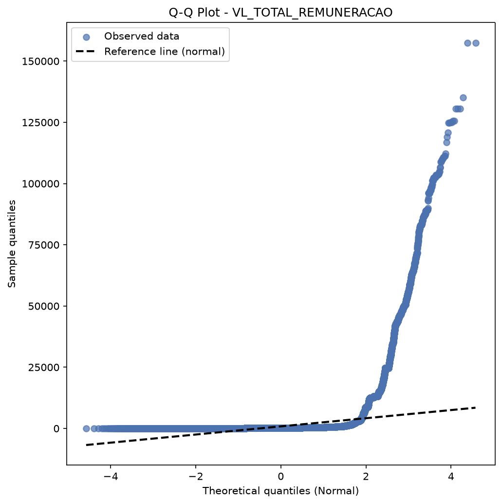

Source: Authors (2026).
</div>

For `VL_TOTAL_REMUNERACAO`, most points hug the reference line near the origin, but the upper tail breaks away sharply, reaching sample quantiles above 150,000 against a theoretical quantile of roughly 4.5. That's the textbook shape of a right-skewed distribution with extreme high-end outliers — another visual vote for rejecting H₀.

<div align="center">
Figure 13: Q–Q plot of `QT_ITEM_EVENTO_INFORMADO` against a theoretical Normal distribution.

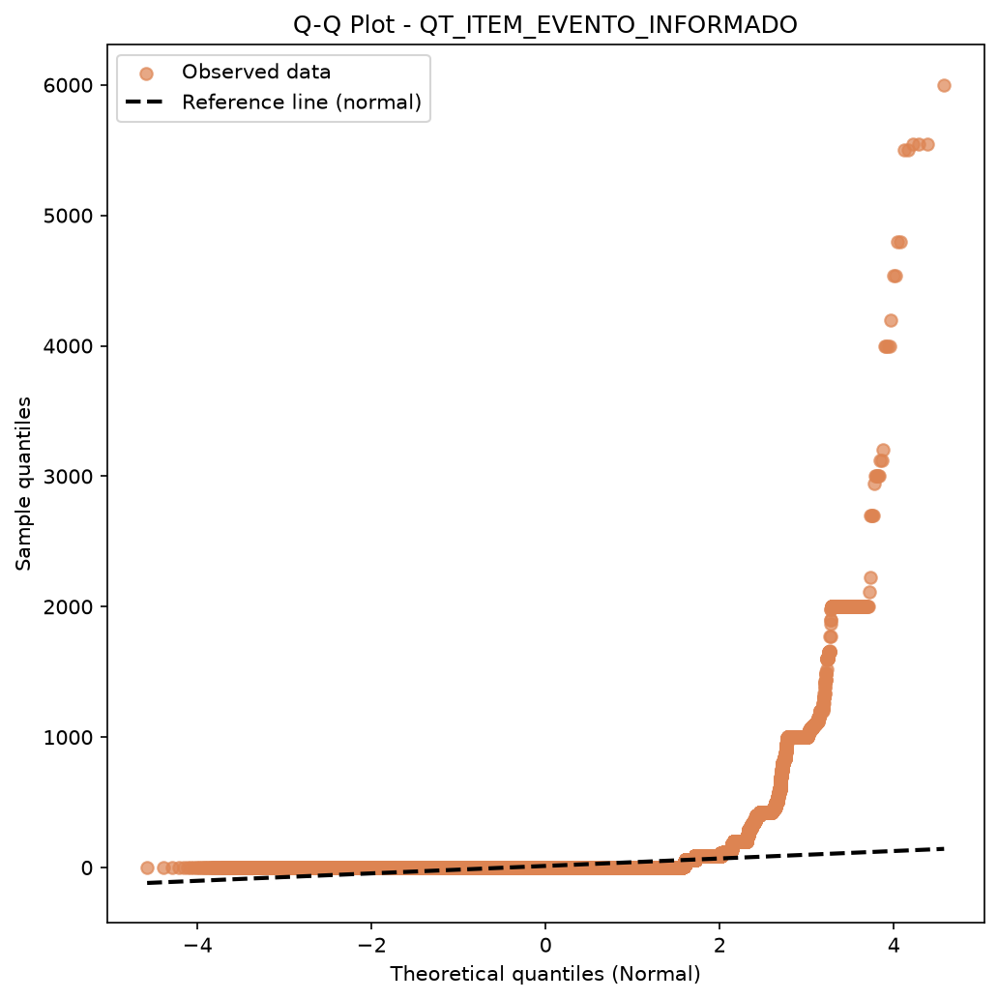

Source: Authors (2026).
</div>

`QT_ITEM_EVENTO_INFORMADO` shows the same break, more extreme: the tail leaves the line earlier and climbs to a dense plateau around 2,000 by a theoretical quantile of roughly 3.3, with isolated points reaching up to 6,000 — consistent with its higher skewness and kurtosis, and another rejection of H₀.

<div align="center">
Figure 14: Q–Q plot of the monthly mean of `QT_ITEM_EVENTO_INFORMADO` against a theoretical Normal distribution.

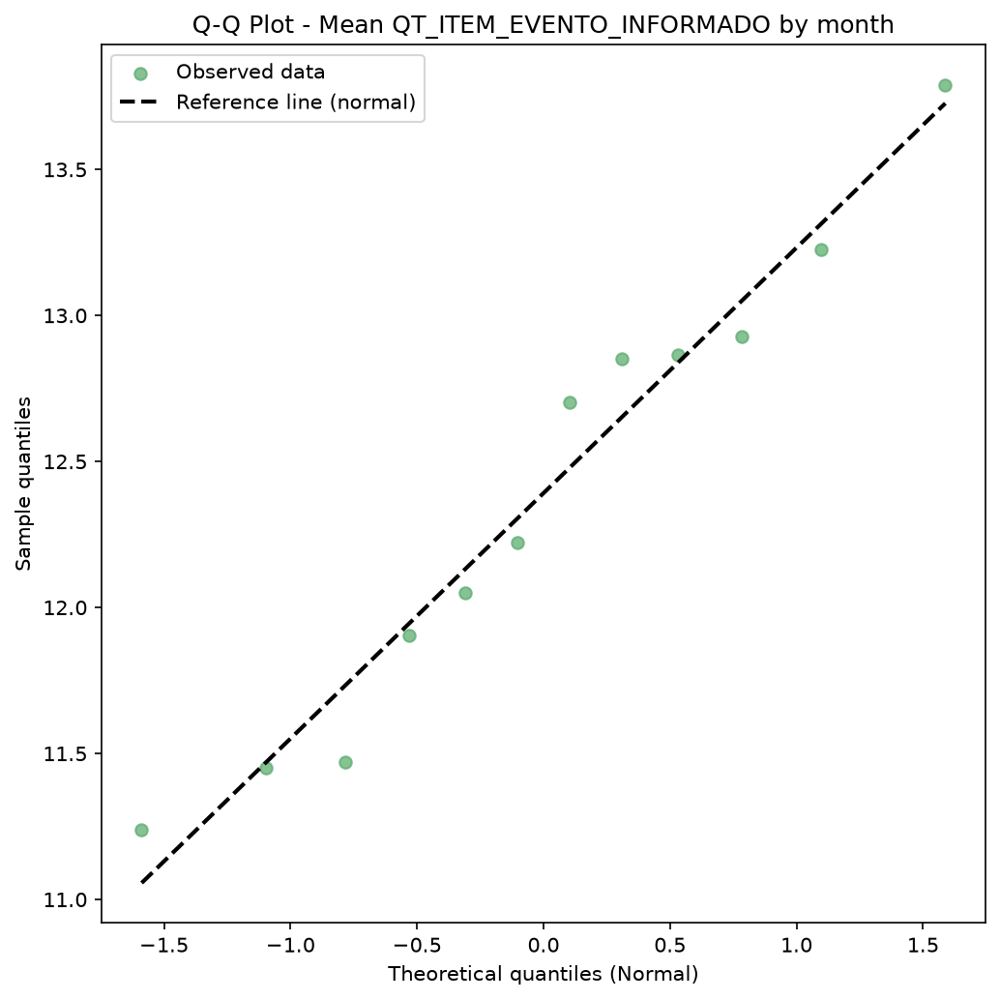

Source: Authors (2026).
</div>

The monthly mean of `QT_ITEM_EVENTO_INFORMADO` is a different picture: all 12 points sit close to the reference line across the whole range, with no systematic curve at either tail — just the minor scatter you'd expect from 12 points. Compared to the two per-event variables, this is a much tighter fit to the line, matching the test's failure to reject H₀.

#### e) Comparison of Mean and Median

`VL_TOTAL_REMUNERACAO`'s mean (842.46) sits far above its median (172.03). In a Normal distribution mean and median coincide, since the distribution is symmetric; here, a small number of high-value reimbursements drag the mean well past the typical case — exactly what right-skewed financial data looks like, and exactly what we'd expect given H₀ was rejected.

`QT_ITEM_EVENTO_INFORMADO` shows an even bigger gap: mean 12.33 against a median of just 1.00. Most ambulatory events report a single procedure; a smaller set reporting much larger quantities pulls the average well above that. Same story, more extreme.

The monthly mean of `QT_ITEM_EVENTO_INFORMADO` flips this: mean 12.39, median 12.46 — essentially equal, matching the test's failure to reject H₀. That's the aggregation effect at work: averaging procedure quantities within each month smooths out the extreme values that dominate the event-level data, leaving a distribution of monthly averages that's roughly symmetric, as the Central Limit Theorem would predict.

**Summary:**

| Variable | Mean | Median | Gap | Interpretation |
|---|---|---|---|---|
| `VL_TOTAL_REMUNERACAO` | 842.46 | 172.03 | Mean ≈ 4.9× median | Large gap → right-skewed, consistent with **Reject H₀** |
| `QT_ITEM_EVENTO_INFORMADO` | 12.33 | 1.00 | Mean ≈ 12.3× median | Very large gap → strongly right-skewed, consistent with **Reject H₀** |
| Mean of `QT_ITEM_EVENTO_INFORMADO` by month | 12.39 | 12.46 | ≈ 0 | Mean and median nearly coincide → symmetric, consistent with **Fail to reject H₀** |

Worth flagging: `QT_ITEM_EVENTO_INFORMADO` is a discrete count (non-negative integers only), so it can never fit a continuous Normal exactly, regardless of sample size. Shapiro–Wilk is being used here as an approximate-normality diagnostic, not a literal fit test — and it lines up with the strong right-skew the mean/median gap already showed.

Put together, the mean-median gap tracks the normality-test conclusions across all three variables perfectly: a large gap where H₀ was rejected, near-agreement where it wasn't.

### 7.3. Scaling (Standardization or Normalization) of quantitative variables

#### a) Scaling Method Selection and Justification

| Variable | Scaling method | Justification |
|---|---|---|
| `VL_TOTAL_REMUNERACAO` | **Standardization (Z-score)** | Highly skewed (skewness = 12.71) with extreme outliers (kurtosis = 213.76). Min-Max normalization would compress almost all values into a tiny sliver near 0, since the range is dominated by a handful of very large reimbursement values, destroying resolution among the majority of "typical" events. |
| `QT_ITEM_EVENTO_INFORMADO` | **Standardization (Z-score)** | Even more extreme skew (skewness = 20.36, kurtosis = 715.60). Same reasoning applies, only more severely — Min-Max would push over half the dataset (the events with quantity = 1, the median) into a value indistinguishable from 0. |
| Mean of `QT_ITEM_EVENTO_INFORMADO` by month | **Normalization (Min-Max)** | This variable is approximately normal, has no extreme outliers, and spans a naturally bounded, narrow range (~11.2 to ~13.8). With no long tail to worry about, Min-Max scaling maps it cleanly to [0, 1] without distortion, and preserves the relative spacing between months for easy visual comparison. |

**General rule applied:** heavy skew/outliers → standardization (Min-Max under those conditions squeezes almost every "typical" value into a sliver near 0, since a handful of extreme values set the range); a bounded, low-skew range → normalization (a simple, interpretable [0,1] scale). One precision worth stating plainly: standardization only changes the *units*. It doesn't fix skew, doesn't blunt the influence of outliers on the mean/σ it's built from, and preserves the distribution's shape exactly — the side-by-side histograms in 8.3(d) show this directly.

**Note on consistency with Section 4:** what's demonstrated here is plain Z-score/Min-Max applied straight to the raw variables, to illustrate the two techniques on their own terms. That's not what the project's actual preprocessing pipeline does (Section 4.2.2.11 and 4.2.2.13) — there, these same columns get log1p-transformed and outlier-capped *before* Min-Max scaling, producing the `*_CAPPED_LOG_NORM` columns used to train the model. The two aren't in tension; this section exists to show why raw Z-score/Min-Max alone falls short on variables this skewed, which is exactly the gap the pipeline's log1p + cap step closes. For the same reason, every scaling constant below is computed on the full dataset purely for illustration — actual model training fits scaling statistics on the training set only, then applies them to validation/test, to avoid leakage.

#### b) Statistical Values Used for Scaling (full dataset)

| Variable | Minimum | Maximum | Mean | Population Std. Dev. (σ) |
|---|---|---|---|---|
| `VL_TOTAL_REMUNERACAO` | 0.00 | 157,496.59 | 842.4637 | 4,409.8484 |
| `QT_ITEM_EVENTO_INFORMADO` | 1.00 | 6,000.00 | 12.3315 | 88.8002 |
| Mean of `QT_ITEM_EVENTO_INFORMADO` by month | 11.2388 | 13.7898 | 12.3916 | 0.7593 |

These are computed on the **full dataset** (290,637 and 295,563 observations for the first two variables, all 12 monthly means for the third) — not the 5,000-row sample from Section 7.2(c)'s Shapiro-Wilk test. That sample-size ceiling is specific to Shapiro-Wilk; it doesn't apply here, so the scaling constants use all the precision available.

#### c) Scaling Equations

**Z-score Standardization:** $`x' = \frac{x - \bar{x}}{\sigma}`$

- `VL_TOTAL_REMUNERACAO`: $`x' = \frac{x - 842.4637}{4{,}409.8484}`$
- `QT_ITEM_EVENTO_INFORMADO`: $`x' = \frac{x - 12.3315}{88.8002}`$

**Min-Max Normalization:** $`x' = \frac{x - x_{min}}{x_{max} - x_{min}}`$

- Mean of `QT_ITEM_EVENTO_INFORMADO` by month: $`x' = \frac{x - 11.2388}{13.7898 - 11.2388} = \frac{x - 11.2388}{2.5510}`$

#### d) Histograms — Scaled vs. Original

Both scaling methods are linear, so all either one does is shift and rescale the x-axis — skewness, kurtosis, and modality all survive unchanged. The before/after histograms below confirm that directly.

Each of the six histograms applies the scaling method assigned to its variable in 8.3(a), using the constants from 8.3(b), via the code below.

```python
import pandas as pd
import matplotlib.pyplot as plt

df = pd.read_parquet("data/processed/north_region_mama_2025_data_en.parquet")
media_por_mes = df.groupby("MES")["QT_ITEM_EVENTO_INFORMADO"].mean().sort_index()

def plot_histogram(series, bins, color, title, xlabel, ylabel, path):
    """Plots the frequency histogram of one variable, before or after scaling."""
    fig, ax = plt.subplots()
    ax.hist(series, bins=bins, color=color)
    ax.set_title(title)
    ax.set_xlabel(xlabel)
    ax.set_ylabel(ylabel)
    plt.tight_layout()
    plt.savefig(path, dpi=150, bbox_inches="tight")
    plt.show()

# Z-score on the two per-event variables: the mean and the population standard
# deviation (ddof=0) are exactly the constants tabulated in Section 7.3(b).
for column, color, xlabel, name in [
    ("VL_TOTAL_REMUNERACAO", "#4C72B0", "R$", "vl_total_remuneracao"),
    ("QT_ITEM_EVENTO_INFORMADO", "#DD8452", "Quantity", "qt_item_evento_informado"),
]:
    s = df[column].dropna()
    plot_histogram(s, 50, color, f"{column} (original)", xlabel, "Frequency",
                   f"assets/{name}_og.png")
    plot_histogram((s - s.mean()) / s.std(ddof=0), 50, color,
                   f"{column} (standardized, z-score)", "z-score", "Frequency",
                   f"assets/{name}_z_score.png")

# Min-Max on the monthly aggregate.
minimum, maximum = media_por_mes.min(), media_por_mes.max()

plot_histogram(media_por_mes, 8, "#55A868",
               "Mean QT_ITEM_EVENTO_INFORMADO by month (original)",
               "Mean quantity", "Frequency (months)",
               "assets/mean_qt_item_evento_informado.png")

plot_histogram((media_por_mes - minimum) / (maximum - minimum), 8, "#55A868",
               "Mean QT_ITEM_EVENTO_INFORMADO by month (normalized, min-max)",
               "Normalized value [0,1]", "Frequency (months)",
               "assets/mean_qt_item_evento_informado_normal.png")
```

`VL_TOTAL_REMUNERACAO`'s original histogram piles almost everything near R$0, with a thin tail barely visible out to R$157,496.59. Standardized, it's the same shape, just recentered at 0 with that same tail now reaching a z-score of roughly **36**. That's the point made concrete: standardization relabels the axis, it doesn't touch skew or outliers.

<div align="center">
Figure 15: Original distribution of `VL_TOTAL_REMUNERACAO`.

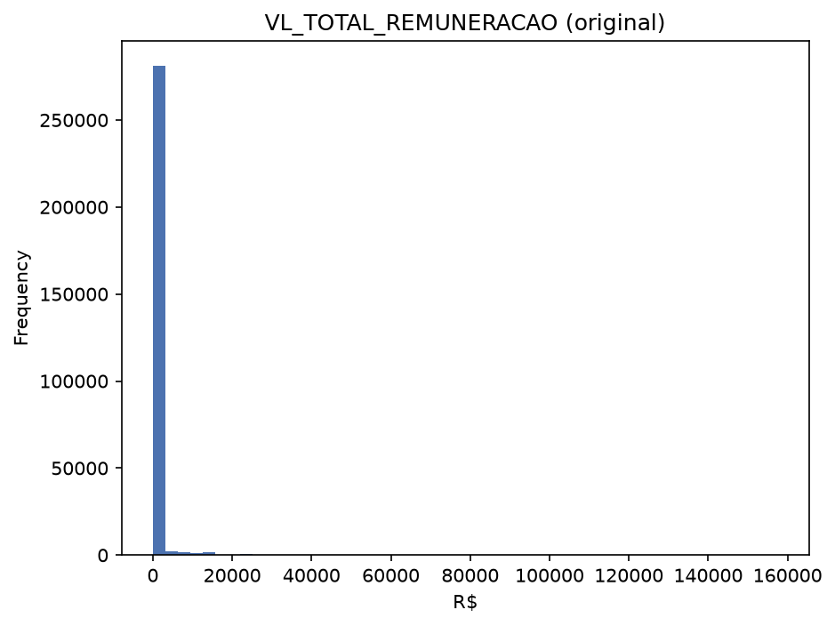

Source: Authors (2026).
</div>

<div align="center">
Figure 16: Standardized (Z-score) distribution of `VL_TOTAL_REMUNERACAO`.

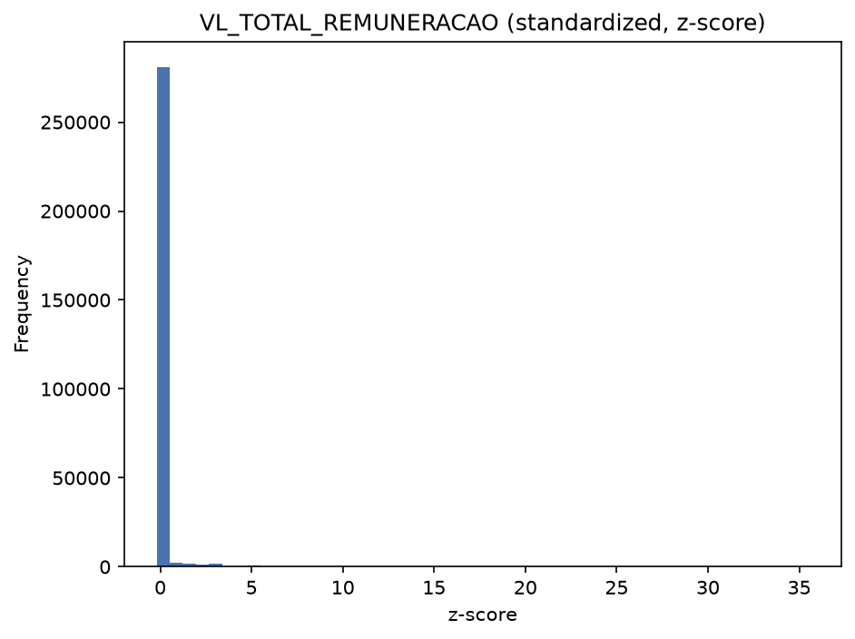

Source: Authors (2026).
</div>

`QT_ITEM_EVENTO_INFORMADO` behaves the same way, just more so — its standardized tail runs out to a z-score of roughly **67**, tracking its even sharper skewness and kurtosis.

<div align="center">
Figure 17: Original distribution of `QT_ITEM_EVENTO_INFORMADO`.

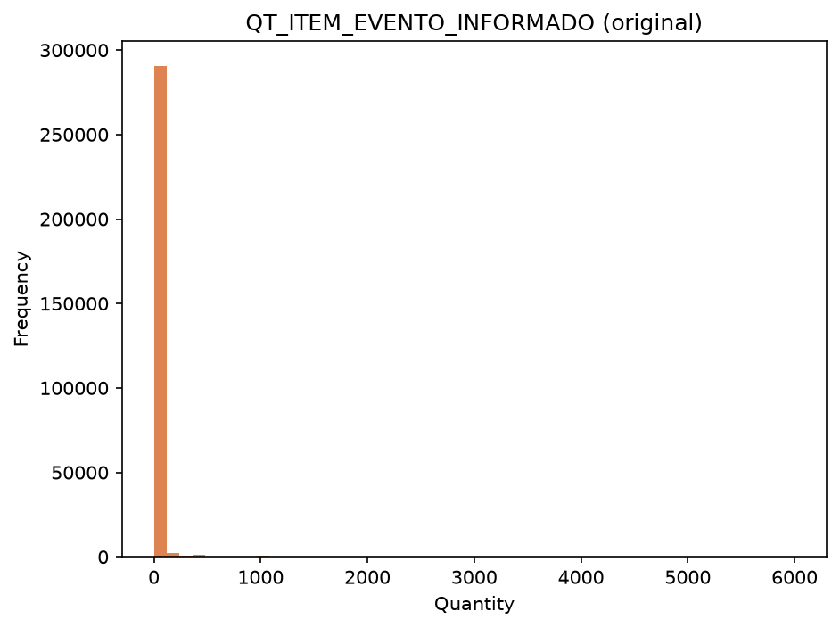

Source: Authors (2026).
</div>

<div align="center">
Figure 18: Standardized (Z-score) distribution of `QT_ITEM_EVENTO_INFORMADO`.

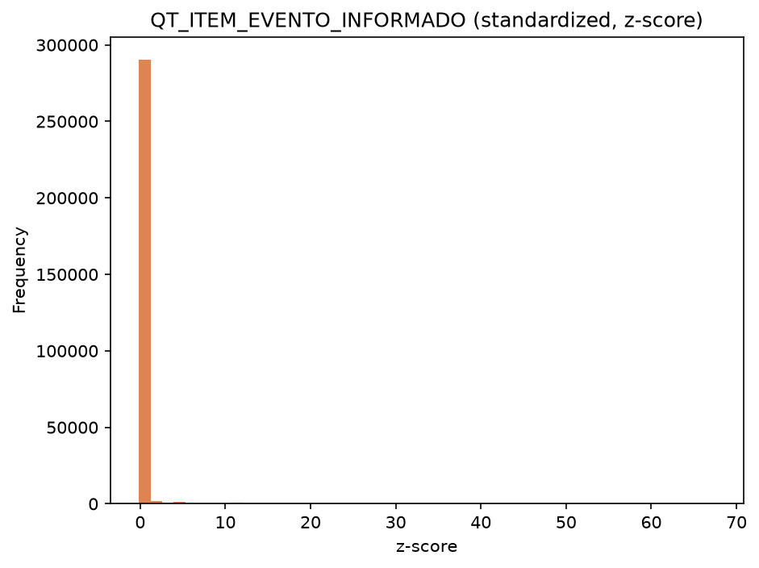

Source: Authors (2026).
</div>

The monthly mean of `QT_ITEM_EVENTO_INFORMADO` spreads its 12 points across 11.2–13.8 with no tail and no dominant peak — consistent with 8.2(c)'s normality result. Min-Max compresses that same shape into [0, 1], mapping August (lowest volume) to 0 and December (highest) to 1.

<div align="center">
Figure 19: Original distribution of the monthly mean of `QT_ITEM_EVENTO_INFORMADO`.

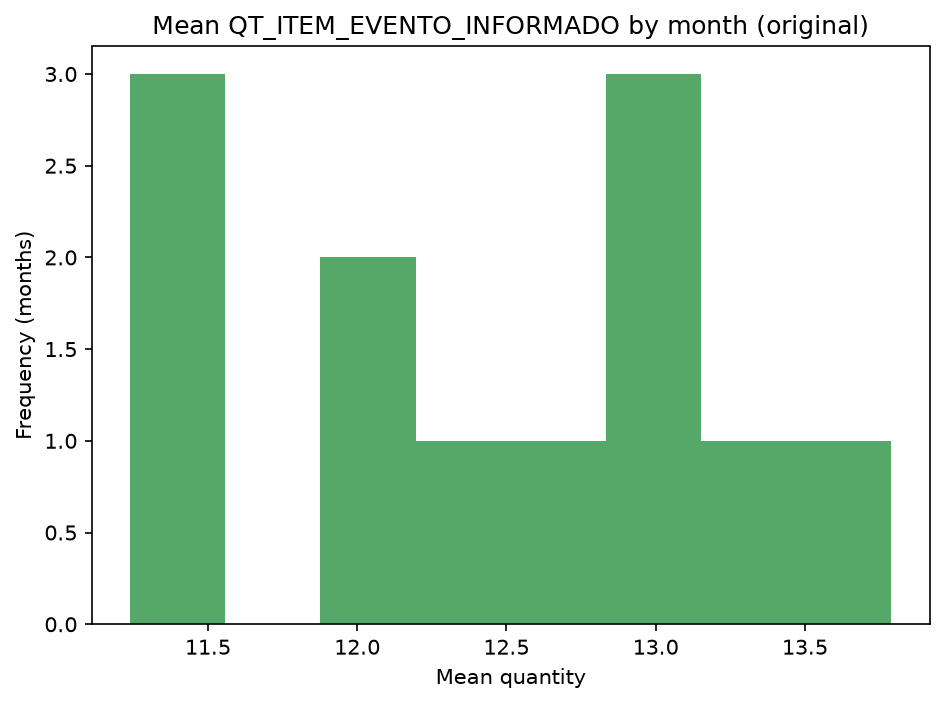

Source: Authors (2026).
</div>

<div align="center">
Figure 20: Min-Max normalized distribution of the monthly mean of `QT_ITEM_EVENTO_INFORMADO`.

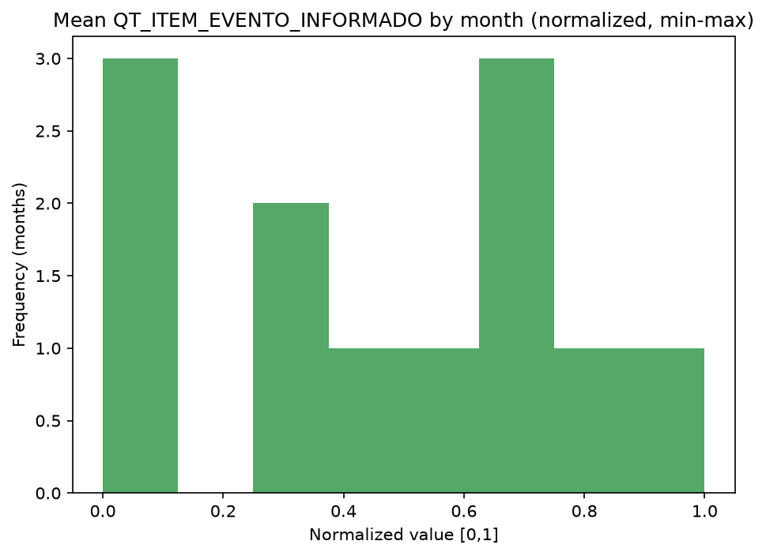

Source: Authors (2026).
</div>

#### e) Records Before vs. After Scaling

`VL_TOTAL_REMUNERACAO` and `QT_ITEM_EVENTO_INFORMADO` are measured per ambulatory event; the monthly mean of `QT_ITEM_EVENTO_INFORMADO` is a 12-row aggregate (Section 7.1). Those are two different observational grains, and a single table with one row index can't represent both without the index silently meaning two different things depending on the column — an event in some columns, a calendar month in others. That mismatch is exactly why the two per-event variables are presented separately below from the monthly aggregate: each table keeps one consistent grain, with its own row identity.

This split is also a direct consequence of the variable-selection criterion from Section 7.2(c): the exercise needs at least one variable that fails the normality test and one that doesn't. Every per-event candidate in this dataset is heavily right-skewed, so the monthly aggregate is what supplies the normally-distributed counterexample — which is exactly why it doesn't share a grain with the other two.

**Event-level variables (first 10 events):**

| Event # | `VL_TOTAL_REMUNERACAO` (original) | `VL_TOTAL_REMUNERACAO'` (Z-score) | `QT_ITEM_EVENTO_INFORMADO` (original) | `QT_ITEM_EVENTO_INFORMADO'` (Z-score) |
|---|---|---|---|---|
| 1 | 107.35 | −0.1667 | 1.0 | −0.1276 |
| 2 | 284.00 | −0.1266 | 1.0 | −0.1276 |
| 3 | 179.07 | −0.1504 | 1.0 | −0.1276 |
| 4 | 179.07 | −0.1504 | 1.0 | −0.1276 |
| 5 | 179.07 | −0.1504 | 1.0 | −0.1276 |
| 6 | 338.51 | −0.1143 | 1.0 | −0.1276 |
| 7 | 163.20 | −0.1540 | 1.0 | −0.1276 |
| 8 | 407.38 | −0.0987 | 1.0 | −0.1276 |
| 9 | 111.96 | −0.1657 | 1.0 | −0.1276 |
| 10 | 624.49 | −0.0494 | 1.0 | −0.1276 |

**Monthly-aggregate variable (all 12 months):**

| Month | Mean of `QT_ITEM_EVENTO_INFORMADO` (original) | Mean of `QT_ITEM_EVENTO_INFORMADO'` (Min-Max) |
|---|---|---|
| 1 | 12.866191 | 0.637945 |
| 2 | 11.470903 | 0.090986 |
| 3 | 11.903998 | 0.260761 |
| 4 | 12.853216 | 0.632859 |
| 5 | 12.050960 | 0.318371 |
| 6 | 12.927209 | 0.661865 |
| 7 | 12.701033 | 0.573203 |
| 8 | 11.238798 | 0.000000 |
| 9 | 11.449896 | 0.082751 |
| 10 | 12.221001 | 0.385028 |
| 11 | 13.226053 | 0.779013 |
| 12 | 13.789789 | 1.000000 |

The event-level table uses Z-score, the monthly-aggregate table uses Min-Max — the method assignment justified in 8.3(a), applying the equations from 8.3(c).

**Note on `QT_ITEM_EVENTO_INFORMADO`:** this variable is constant (= 1) across the first 10 records of the dataset, producing an identical standardized value for all 10 rows. This is expected rather than anomalous: as established in Section 7.2(e), the variable's median is 1.0, meaning that the majority of ambulatory events in the dataset report a single procedure, so any contiguous block of records taken from the start of the dataset is likely to consist entirely of single-item events. The scaled column confirms that the transformation was applied correctly — every original value of 1 maps to (1 − 12.3315) / 88.8002 = −0.1276 — while the behavior of the transformation across the variable's full range is visible in the before-and-after histograms of Section 7.3(d).
